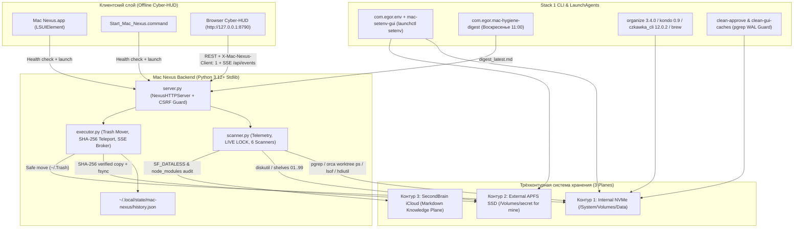

# Mac Nexus

**Mac Nexus** — локальный командный центр (Cyber-HUD) для телеметрии хранилища macOS и безопасной оркестрации очистки в трёхконтурной рабочей станции на Apple Silicon (`Internal NVMe` + `External APFS SSD` + `SecondBrain iCloud`).

Бэкенд работает строго на `http://127.0.0.1:8790` на чистой стандартной библиотеке **Python 3.12+** (без внешних `pip`-зависимостей), а интерфейс реализован на автономном **vanilla `HTML` / `CSS` / `JS`** без единого внешнего CDN-запроса. В пару к веб-кокпиту идёт портативный комплект хост-автоматизации Stack 1 (`~/.zshenv`, `LaunchAgents`, `organize`, `kondo`, `czkawka_cli`, `clean-approve`, `mac-hygiene-digest`).

---

## Архитектура экосистемы



### Трёхконтурная модель хранения (Three-Plane Architecture)

1. **Контур 1 — Internal NVMe (`Hot Active Workspace`, `/System/Volumes/Data`)**
   - Хранит macOS, `/Applications`, плоские неподвижные репозитории `~/Projects/<slug>` (чтобы не ломать `Orca` и `git worktree`), краткосрочный inbox `~/Downloads` и `UV_CACHE_DIR` (на одном APFS-томе для мгновенного `clonefile(2)`).
   - Сканер отслеживает пакетные кэши (`brew`, `pip`, `uv`, `npm`, `nuget`, `conda`), безопасные кэши GUI/Electron-приложений, протухшие установщики и скриншоты в `~/Downloads`, устаревшие артефакты сборки в `~/Projects/*` (`node_modules`, `.venv`, `venv`, `.pytest_cache`, `__pycache__`, `target`) и примонтированные «призрачные» `.dmg` (`disk >= 6`).
2. **Контур 2 — External APFS SSD (`/Volumes/secret for mine` — `Heavy Vault & Cold Archive`)**
   - Мониторит свободный объём, тип файловой системы (`APFS`) и 6 канонических полок (`01_AI_Models_and_Caches`, `02_Project_Heavy`, `03_Software_and_Installers`, `04_Media_Archive`, `90_Cold_Archive`, `99_Backups`), сохраняя активные корневые каталоги (`SSD_LIVE_HEAVY_DIRS`).
   - Принимает тяжёлые медиафайлы (`.mov`, `.mp4`, `.mkv` > 10 MiB) в `04_Media_Archive/Screen_Recordings/<YYYY-MM>/` строго после побайтового и SHA-256 подтверждения.
3. **Контур 3 — SecondBrain iCloud (`Pure Knowledge & Control Plane`)**
   - Подсчитывает `.md`-заметки и физический объём хранилища (корректно игнорируя облачные заглушки `SF_DATALESS` `0x40000000`), а также проверяет отсутствие опасного `node_modules`-мусора внутри iCloud Drive.

### Модули Cyber-HUD (`http://127.0.0.1:8790`)

| Вкладка / Панель | Основные возможности | Защита и поведение по умолчанию |
|---|---|---|
| **Orbital Telemetry Deck** | 3 реактора контуров (NVMe, SSD, SecondBrain), 5 чипов (RAM, Swap, DMG, Orca, одометр) | Учитывает macOS Purgeable и `SF_DATALESS` |
| **01 · РАДАР ОЧИСТКИ** | Фильтры категорий, пороги проектов `14д`/`30д`/`60д`, выбор безопасных целей | `DRY-RUN` включён; цели `LIVE LOCK` невыбираемы |
| **02 · ТЕЛЕПОРТ НА SSD** | Кандидаты `.mov`/`.mp4`/`.mkv` > 10 MiB с предпросмотром пути на SSD | Блокировка при отключённом SSD (`409`); SHA-256 + `fsync` |
| **03 · ДУБЛИКАТЫ** | Поиск через `czkawka_cli` (`downloads`, `desktop`, `ssd_media`) | 1-й файл (`ОРИГИНАЛ / СОХРАНИТЬ`) заблокирован; копии в `~/.Trash` |
| **04 · ПУЛЬТ КОНТУРОВ** | Статус полок `01..99`, быстрый запуск утилит и чтение `digest_latest.md` | Строгий allowlist инструментов + модальное окно Holo |
| **SSE Кибер-Терминал** | Потоковый лог `/api/events` (`[SCAN]`, `[LOCK-GUARD]`, `[SHA-256]`, `[DRY-RUN]`, `[DONE]`) | Буфер 350 строк, автоскролл, автопереподключение |

---

## Быстрый старт

### Вариант A — Desktop App Launcher (рекомендуется)
Дважды кликните **`/Users/egorlabutin/Desktop/Mac Nexus.app`** (фоновый бандл с `LSUIElement=true`):
- Если `http://127.0.0.1:8790/api/health` уже отвечает, сразу открывает Cyber-HUD в браузере по умолчанию.
- Если сервер не запущен, поднимает `mac_nexus.server` в фоне, пишет логи в `~/.local/state/mac-nexus/server.log`, ждёт до 5 секунд готовности `/api/health` и открывает `http://127.0.0.1:8790`.

### Вариант B — Скрипт запуска `.command`
Запустите [`Start_Mac_Nexus.command`](Start_Mac_Nexus.command) двойным кликом в Finder или из терминала:
```zsh
/Users/egorlabutin/Projects/mac-nexus/Start_Mac_Nexus.command
```

### Вариант C — Ручной запуск через CLI
```zsh
cd /Users/egorlabutin/Projects/mac-nexus
PYTHONPATH=/Users/egorlabutin/Projects/mac-nexus/src \
  /opt/anaconda3/bin/python3 -m mac_nexus.server --host 127.0.0.1 --port 8790
```

### Вариант D — Установка хост-автоматизации (Stack 1)
Если требуется развернуть или восстановить на Mac CLI-правила `organize`, скрипты `~/.local/bin/*`, `~/.zshenv` и `LaunchAgents` (`com.egor.env`, `com.egor.mac-hygiene-digest`), следуйте пошаговой инструкции в [`automation/README.md`](automation/README.md).

---

## Структура репозитория

```text
mac-nexus/
├── README.md                                        # Главный обзор, архитектура, инварианты и карта проекта
├── CLAUDE.md                                        # Контракты и правила для Claude Code / AI-агентов
├── AGENTS.md                                        # Системные ограничения для автономных агентов (Orca / Codex)
├── Start_Mac_Nexus.command                          # Переносимый одношаговый CLI/Finder-лаунчер
├── docs/                                            # Полная инженерная документация системы
│   ├── 00_master_index_and_system_map.md            # Мастер-индекс, роли, сквозная схема и Traceability Matrix
│   ├── 01_three_plane_filesystem_architecture.md    # 3-контурная архитектура ФС, теги и методологии
│   ├── 02_macos_apfs_xdg_and_env_internals.md       # Внутренности APFS, SF_DATALESS, XDG и LaunchAgents
│   ├── 03_cleanup_stack_and_safety_bible.md         # Стек 1, сравнение утилит и Красная книга безопасности macOS
│   ├── 04_backend_scanner_executor_and_security.md  # Устройство backend (scanner, executor, security, LIVE LOCK)
│   ├── 05_http_rest_and_sse_api_reference.md        # Полный контракт HTTP REST и SSE-потока /api/events
│   ├── 06_cyber_hud_frontend_and_app_bundle.md      # Cyber-HUD (Canvas/SVG/SSE), Mac Nexus.app и .icns иконка
│   ├── 07_automation_runbooks_and_troubleshooting.md# Ритм обслуживания, runbooks, QA и устранение сбоев
│   └── 08_agent_onboarding_and_baseline_audit.md    # Onboarding для ИИ-агентов и Baseline-аудит Фаз 1–3
├── automation/                                      # Портативный комплект хост-автоматизации (без хардкода $HOME)
│   ├── README.md                                    # Инструкция развёртывания, dry-run и отката
│   ├── organize/
│   │   └── config.yaml                              # 5 правил organize v3 для Downloads / Desktop / SSD
│   ├── bin/
│   │   ├── mac-setenv-gui                           # Экспорт XDG и условных SSD AI-переменных в launchd
│   │   ├── mac-hygiene-digest                       # 100% read-only генератор воскресного отчёта
│   │   ├── clean-approve                            # Интерактивная очистка с pgrep-защитой SQLite WAL
│   │   └── clean-gui-caches                         # Безопасная очистка кэшей закрытых GUI-приложений
│   ├── launchd/
│   │   ├── com.egor.env.plist.tmpl                  # Шаблон LaunchAgent окружения GUI (__HOME__)
│   │   └── com.egor.mac-hygiene-digest.plist.tmpl   # Шаблон LaunchAgent воскресного дайджеста (Вс 11:00)
│   └── zsh/
│       └── zshenv.snippet.zsh                       # Блок ~/.zshenv для XDG и условного экспорта AI-кэшей
├── src/mac_nexus/                                   # Бэкенд (Python 3.12+ stdlib ONLY) и статика
│   ├── __init__.py                                  # Метаданные APP_NAME и APP_VERSION (1.0.0)
│   ├── server.py                                    # NexusHTTPServer, CSRF/Origin, REST + SSE маршрутизация
│   ├── scanner.py                                   # ScanEnvironment DI, телеметрия, LIVE LOCK и 6 сканеров
│   ├── executor.py                                  # DRY-RUN/боевые задачи, Trash, SHA-256 телепорт, EventBroker
│   └── static/                                      # Автономный Cyber-HUD (0 внешних CDN)
│       ├── index.html                               # 4 командные вкладки, реакторы, терминал и голо-окно
│       ├── styles.css                               # Неоновая палитра, сетка, [hidden]-инвариант
│       └── app.js                                   # Canvas/SVG-анимации, fetch + CSRF, EventSource, escapeHtml
├── scripts/
│   └── generate_icon.py                             # Генератор 1024px Retina .icns через Pillow + iconutil
└── tests/
    └── test_mac_nexus.py                            # 13 pytest-тестов безопасности, LIVE LOCK, SHA-256 и SSE
```

Состояние выполнения и журнал логов сохраняются строго вне репозитория в `~/.local/state/mac-nexus/` (`history.json`, `server.log`).

---

## Карта документации

| Документ | Назначение и ключевое содержание | Целевая аудитория |
|---|---|---|
| [00 · Мастер-индекс и карта системы](docs/00_master_index_and_system_map.md) | Сквозная архитектура, маршруты чтения по ролям и полная Traceability Matrix | Все участники и агенты |
| [01 · Архитектура 3 контуров](docs/01_three_plane_filesystem_architecture.md) | 3-Plane модель, почему `PARA`/`Johnny.Decimal` ломают `Orca`, именование, теги, 3-2-1 бэкапы | Архитекторы и пользователи |
| [02 · APFS, XDG и macOS-внутренности](docs/02_macos_apfs_xdg_and_env_internals.md) | Контейнер APFS, `clonefile(2)`, `SF_DATALESS`, Purgeable, `~/.zshenv` + `launchctl setenv`, `tmutil` | Системные инженеры |
| [03 · Стек 1 и Красная книга безопасности](docs/03_cleanup_stack_and_safety_bible.md) | Сравнение утилит, спецификации `organize`/`kondo`/`czkawka_cli`, защита от `lipo` и WAL-порчи | Инженеры автоматизации |
| [04 · Backend, Scanner, Executor и Безопасность](docs/04_backend_scanner_executor_and_security.md) | `ScanEnvironment`, `ScanSnapshot`, `LIVE LOCK`, `is_protected_path`, SHA-256 телепорт, `EventBroker` | Backend-разработчики |
| [05 · Справочник HTTP REST и SSE API](docs/05_http_rest_and_sse_api_reference.md) | Все 10 маршрутов `server.py`, заголовки CSRF, JSON-форматы, коды `200..500`, примеры `curl` | Разработчики и интеграторы |
| [06 · Cyber-HUD Frontend и Mac Nexus.app](docs/06_cyber_hud_frontend_and_app_bundle.md) | `index.html`, `styles.css`, `app.js`, SSE-терминал, бандл `.app`, `generate_icon.py` | Frontend и UI-инженеры |
| [07 · Регламенты, Runbooks и Troubleshooting](docs/07_automation_runbooks_and_troubleshooting.md) | Ритм обслуживания (день/неделя/месяц/квартал), диагностика сбоев, QA-чеклист и Roadmap | Операторы и сопровождение |
| [08 · Гайд для агентов и Baseline-аудит](docs/08_agent_onboarding_and_baseline_audit.md) | Onboarding по `ScanEnvironment` DI, безопасное расширение категорий и аудит Фаз 1–3 (`94% -> 87%`) | ИИ-агенты и аудиторы |
| [Портативный комплект `automation/`](automation/README.md) | Развёртывание `organize`, `LaunchAgents`, скриптов `~/.local/bin/` и инструкция отката | Операторы хоста |
| [Инструкции `CLAUDE.md`](CLAUDE.md) · [`AGENTS.md`](AGENTS.md) | Машиночитаемые инварианты безопасности и команды верификации | ИИ-агенты (`Orca`, Claude, Codex, Gemini) |

---

## 5 обязательных инвариантов безопасности

1. **Loopback Binding (`127.0.0.1`) & CSRF-защита**
   - `NexusHTTPServer` в [`src/mac_nexus/server.py`](src/mac_nexus/server.py) привязывается **исключительно** к `127.0.0.1` (попытка передать `0.0.0.0` или внешний интерфейс вызывает `ValueError`).
   - Каждый `POST /api/*` запрос обязан передавать заголовок `X-Mac-Nexus-Client: 1`; если присутствует `Origin`, он должен начинаться с `http://127.0.0.1:` или `http://localhost:` (иначе `HTTP 403`).
   - Раздача `/static/*` блокирует path traversal (`..`, `/`, `\`, выход за пределы `static_dir`) и пропускает только `ALLOWED_STATIC_MIME`.

2. **Server-Side Snapshot Allowlisting (никаких сырых путей и shell-строк)**
   - Мутирующие маршруты (`/api/execute`, `/api/offload`, `/api/trash-duplicates`) принимают **только** непрозрачные серверные идентификаторы (`item_ids`, `media_ids`, `file_ids`), сгенерированные через `_stable_id()` (14 hex-символов SHA-256) и проверенные по активному `ScanSnapshot`.
   - Произвольные пути файловой системы или команды из тела JSON отклоняются со статусом `HTTP 400`.

3. **Динамическая защита `LIVE LOCK`**
   - До выдачи кандидатов и повторно перед выполнением (`detect_live_locks` и `_recheck_target_lock` в [`scanner.py`](src/mac_nexus/scanner.py) / [`executor.py`](src/mac_nexus/executor.py)) проверяются:
     - **11 GUI-приложений** (`MONITORED_APPS` через `pgrep -x`: `Google Chrome`, `Yandex`, `Telegram`, `Obsidian`, `Orca`, `Code`, `Discord`, `Notion`, `Figma`, `draw.io`, `Yandex Music` / `Яндекс Музыка`), плюс JetBrains Rider (`pgrep -fi rider`) для NuGet.
     - **Живые worktree `Orca`** через `/Applications/Orca.app/Contents/Resources/bin/orca worktree ps --limit 30 --json` (с текстовым fallback `parse_orca_worktrees_text`).
     - **Активные локальные сервисы** на портах `:3000` и `:8768` (`lsof -nP -iTCP:3000,8768 -sTCP:LISTEN` + определение рабочего каталога).
     - **Открытые файлы на DMG** (`lsof <mount_point>`) и запрет отмонтирования системных дисков `disk0..disk5` (разрешены только `disk >= 6`).
   - Заблокированные цели получают `locked: true`, `lock_reason`, недоступны для выбора в HUD и отклоняются бэкендом с `HTTP 409`.

4. **Защищённые зоны & Zero-Loss перемещение в `~/.Trash`**
   - Функция `is_protected_path()` исключает любые `.app` и `.photoslibrary`, содержимое `~/.Trash`, защищённые каталоги Desktop-ботов (`PROTECTED_DESKTOP_DIRS`), iCloud `SecondBrain`, активные каталоги внешнего SSD (`SSD_LIVE_HEAVY_DIRS`) и живые worktree `Orca`.
   - Файлы из `~/Downloads` и дубликаты `czkawka_cli` **никогда** не удаляются через `rm -rf` — `move_to_trash()` переносит их в `~/.Trash` с защитой от коллизий имён (`_unique_dest_path`).
   - Сканирование `~/Projects/*` оценивает давность проектов в Python по `older_days` без запуска `kondo` вслепую (у `kondo` отсутствует флаг `--dry-run`).

5. **SHA-256 верифицированный телепорт на External SSD**
   - Вынос тяжёлых медиафайлов (`.mov`, `.mp4`, `.mkv` > 10 MiB) в `/Volumes/secret for mine/04_Media_Archive/Screen_Recordings/<YYYY-MM>/` выполняется функцией `teleport_file_sha256()` строго по протоколу:
     1. Проверка активного монтирования внешнего SSD (`ssd_is_mounted` / `os.path.ismount`, иначе `HTTP 409`).
     2. Подсчёт размера и SHA-256 хэша исходного файла (буфер 1 MiB).
     3. Запись во временный staging-файл `.nexus.tmp` с `flush()` и `os.fsync()`.
     4. Проверка **100% совпадения размера и SHA-256** между источником и staging-файлом на SSD, затем атомарный `os.replace()` и только после этого `src.unlink()`.

---

## Проверка, тестирование и линтинг

```zsh
# 1. Полный набор unit и интеграционных тестов (13/13)
cd /Users/egorlabutin/Projects/mac-nexus
PYTHONPATH=src /opt/anaconda3/bin/python3 -m pytest -v

# 2. Проверка синтаксиса фронтенда (JavaScript)
node --check src/mac_nexus/static/app.js

# 3. Валидация скриптов запуска и Info.plist Desktop-приложения
zsh -n Start_Mac_Nexus.command
zsh -n "/Users/egorlabutin/Desktop/Mac Nexus.app/Contents/MacOS/MacNexus"
plutil -lint "/Users/egorlabutin/Desktop/Mac Nexus.app/Contents/Info.plist"

# 4. Проверка скриптов и шаблонов портативной автоматизации
zsh -n automation/zsh/zshenv.snippet.zsh
for f in automation/bin/*; do zsh -n "$f"; done

# 5. Проверка статуса работающего сервера (не останавливать при эксплуатации)
curl -fsS http://127.0.0.1:8790/api/health

# 6. Пересборка Retina .icns иконки (при изменении scripts/generate_icon.py)
/opt/anaconda3/bin/python3 scripts/generate_icon.py
file "/Users/egorlabutin/Desktop/Mac Nexus.app/Contents/Resources/AppIcon.icns"
```
