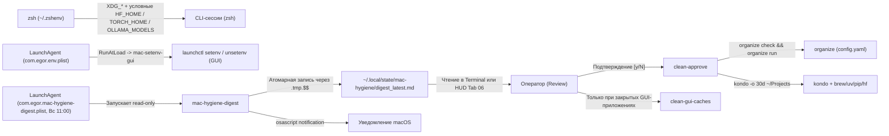

# Portable Automation Kit (Stack 1 · CLI + LaunchAgents + XDG)

> **Навигация:** [README репозитория](../README.md) | [00 · Мастер-индекс](../docs/00_master_index_and_system_map.md) | [02 · APFS, XDG и env](../docs/02_macos_apfs_xdg_and_env_internals.md) | [03 · Стек очистки и безопасность](../docs/03_cleanup_stack_and_safety_bible.md) | [07 · Регламенты и Runbooks](../docs/07_automation_runbooks_and_troubleshooting.md)

**Portable Automation Kit** — переносимый комплект хост-автоматизации **Stack 1** для macOS (Apple Silicon): единая схема переменных `XDG` и условного выноса AI-кэшей на внешний SSD, правила триажа `organize`, воскресный read-only дайджест по расписанию `launchd` и интерактивные безопасные скрипты обслуживания без жёстко зашитых путей пользователя (`$HOME` и плейсхолдер `__HOME__`).

---

## 1. Архитектура комплекта и схема работы

Вся автоматизация строго разделена на **read-only телеметрию по расписанию** и **операции с явным подтверждением человека (`[y/N]`)** и защитой активных GUI-процессов (`pgrep -x`).



---

## 2. Состав комплекта (`automation/`)

| Компонент в репозитории | Целевой путь в `$HOME` | Назначение и модель безопасности |
| :--- | :--- | :--- |
| [`organize/config.yaml`](organize/config.yaml) | `~/.config/organize/config.yaml` | 5 правил триажа: устаревшие инсталляторы (`>7d`), скриншоты (`>14d`), тег `inbox (orange)` (`<7d`), перенос тяжёлых медиа (`>100 MB`, `>14d`) на `/Volumes/secret for mine/04_Media_Archive/`, пометка старых файлов (`>30d`). |
| [`bin/mac-setenv-gui`](bin/mac-setenv-gui) | `~/.local/bin/mac-setenv-gui` | Инжектирует `XDG_*` и `UV_CACHE_DIR` в GUI-домен через `/bin/launchctl setenv`; устанавливает `HF_HOME`, `TORCH_HOME`, `OLLAMA_MODELS` **только при наличии каталогов на SSD** (иначе `unsetenv`). |
| [`bin/mac-hygiene-digest`](bin/mac-hygiene-digest) | `~/.local/bin/mac-hygiene-digest` | 100% read-only сборщик еженедельного отчёта (`df -h`, `hdiutil info`, `organize sim`, `du -sh` артефактов, `brew cleanup -n`, `hf cache prune --dry-run`, размеры GUI-кэшей) + уведомление. |
| [`bin/clean-approve`](bin/clean-approve) | `~/.local/bin/clean-approve` | Интерактивный оркестратор уборки с воротами `[y/N]`: `organize run`, `kondo -o 30d`, `brew/uv/pip/hf`, и очистка Electron-кэшей **только при `ELECTRON_SAFE=1`** (проверка `pgrep -x`). |
| [`bin/clean-gui-caches`](bin/clean-gui-caches) | `~/.local/bin/clean-gui-caches` | Выделенная очистка кэшей браузеров, Telegram и Electron. Завершается с `exit 1` (**fail-closed**), если запущено хотя бы одно из 9 GUI-приложений (защита SQLite WAL). |
| [`launchd/com.egor.env.plist.tmpl`](launchd/com.egor.env.plist.tmpl) | `~/Library/LaunchAgents/com.egor.env.plist` | Шаблон агента `RunAtLoad`, запускающего `mac-setenv-gui` при входе в сессию macOS. Использует токен `__HOME__`. |
| [`launchd/com.egor.mac-hygiene-digest.plist.tmpl`](launchd/com.egor.mac-hygiene-digest.plist.tmpl) | `~/Library/LaunchAgents/com.egor.mac-hygiene-digest.plist` | Шаблон календарного агента (воскресенье, `11:00`, `Weekday=0`), запускающего `mac-hygiene-digest`. Использует токен `__HOME__`. |
| [`zsh/zshenv.snippet.zsh`](zsh/zshenv.snippet.zsh) | `~/.zshenv` (блок `# >>> token-hygiene xdg >>>`) | Экспортирует `XDG_*`, `UV_CACHE_DIR`, добавляет `$HOME/.local/bin` в `PATH` и условно включает `HF_HOME` / `TORCH_HOME` / `OLLAMA_MODELS` для всех shell-процессов. |

> **Принцип переносимости:** ни один скрипт, шаблон `.plist.tmpl`, YAML-конфиг или `.zsh`-сниппет в `automation/` не содержит жёстко вписанного имени пользователя. Скрипты опираются на `$HOME`, а шаблоны LaunchAgent — на плейсхолдер `__HOME__`, подставляемый при установке.

---

## 3. Предварительные требования

1. **macOS 13+** (Zsh `/bin/zsh`, `launchctl`, `plutil`, `osascript`, `hdiutil`, `pgrep`).
2. **Homebrew-инструменты Stack 1:**
   ```zsh
   brew install organize-tool kondo czkawka tag fd zoxide eza yazi dust
   brew install --cask pearcleaner
   ```
3. **Опционально:**
   - `uv` (кэш остаётся на внутреннем APFS в `$HOME/.cache/uv` для работы `clonefile` CoW с `~/Projects/*/.venv`);
   - `hf` (`huggingface_hub` CLI) и/или `ollama` при использовании внешнего APFS-тома `/Volumes/secret for mine` с полками `01_AI_Models_and_Caches` и `ollama_models`.

---

## 4. Пошаговая установка

Все команды выполняются из корня репозитория `mac-nexus`.

### Шаг 1. Подготовка целевых каталогов

```zsh
mkdir -p \
  "$HOME/.local/bin" \
  "$HOME/.local/state/mac-hygiene" \
  "$HOME/.config/organize" \
  "$HOME/Library/LaunchAgents"
```

### Шаг 2. Установка исполняемых скриптов и `chmod +x`

```zsh
cp automation/bin/mac-setenv-gui \
   automation/bin/mac-hygiene-digest \
   automation/bin/clean-approve \
   automation/bin/clean-gui-caches \
   "$HOME/.local/bin/"

chmod +x \
  "$HOME/.local/bin/mac-setenv-gui" \
  "$HOME/.local/bin/mac-hygiene-digest" \
  "$HOME/.local/bin/clean-approve" \
  "$HOME/.local/bin/clean-gui-caches"
```

### Шаг 3. Установка конфигурации `organize`

Если `~/.config/organize/config.yaml` уже существует, сделайте резервную копию перед заменой:

```zsh
[[ -f "$HOME/.config/organize/config.yaml" ]] && \
  cp "$HOME/.config/organize/config.yaml" "$HOME/.config/organize/config.yaml.bak.$(date +%Y%m%d%H%M%S)"

cp automation/organize/config.yaml "$HOME/.config/organize/config.yaml"
```

### Шаг 4. Интеграция `zshenv.snippet.zsh` в `~/.zshenv`

Скрипт проверяет наличие маркера `# >>> token-hygiene xdg >>>`, чтобы не дублировать блок при повторном запуске:

```zsh
touch "$HOME/.zshenv"
if ! grep -qF "# >>> token-hygiene xdg >>>" "$HOME/.zshenv"; then
  printf "\n" >> "$HOME/.zshenv"
  cat automation/zsh/zshenv.snippet.zsh >> "$HOME/.zshenv"
fi
```

Примените переменные в текущей shell-сессии:

```zsh
source "$HOME/.zshenv"
```

### Шаг 5. Рендер шаблонов `LaunchAgent`, `plutil -lint` и `launchctl bootstrap`

Замените плейсхолдер `__HOME__` на фактический `$HOME`, проверьте синтаксис XML через `plutil -lint` и зарегистрируйте агентов в пользовательском GUI-домене `gui/$(id -u)`:

```zsh
sed "s|__HOME__|$HOME|g" automation/launchd/com.egor.env.plist.tmpl \
  > "$HOME/Library/LaunchAgents/com.egor.env.plist"

sed "s|__HOME__|$HOME|g" automation/launchd/com.egor.mac-hygiene-digest.plist.tmpl \
  > "$HOME/Library/LaunchAgents/com.egor.mac-hygiene-digest.plist"

plutil -lint \
  "$HOME/Library/LaunchAgents/com.egor.env.plist" \
  "$HOME/Library/LaunchAgents/com.egor.mac-hygiene-digest.plist"

# Идемпотентная перезагрузка агентов (bootout игнорирует отсутствие старой регистрации)
launchctl bootout "gui/$(id -u)/com.egor.env" 2>/dev/null || true
launchctl bootout "gui/$(id -u)/com.egor.mac-hygiene-digest" 2>/dev/null || true

launchctl bootstrap "gui/$(id -u)" "$HOME/Library/LaunchAgents/com.egor.env.plist"
launchctl bootstrap "gui/$(id -u)" "$HOME/Library/LaunchAgents/com.egor.mac-hygiene-digest.plist"
```

### Шаг 6. Опциональные исключения Time Machine (без `sudo`)

Чтобы тяжёлые воспроизводимые кэши не раздували бэкапы Time Machine, добавьте sticky-исключения для существующих каталогов:

```zsh
for target in \
  "$HOME/Downloads" \
  "$HOME/.cache" \
  "$HOME/.npm" \
  "$HOME/.local/share/uv" \
  "/Volumes/secret for mine/01_AI_Models_and_Caches" \
  "/Volumes/secret for mine/ollama_models"; do
  [[ -e "$target" ]] && tmutil addexclusion "$target"
done
```

---

## 5. Проверка и Dry-Run тестирование

### 5.1. Синтаксис скриптов и валидация конфигов

```zsh
zsh -n \
  automation/zsh/zshenv.snippet.zsh \
  automation/bin/mac-setenv-gui \
  automation/bin/mac-hygiene-digest \
  automation/bin/clean-approve \
  automation/bin/clean-gui-caches
```

### 5.2. Проверка XDG и GUI-переменных окружения

```zsh
# Shell-сессия
print -rl -- "XDG_CONFIG_HOME=$XDG_CONFIG_HOME" "UV_CACHE_DIR=$UV_CACHE_DIR" "HF_HOME=${HF_HOME:-unset}"

# GUI-контекст launchd
launchctl getenv XDG_CONFIG_HOME
launchctl getenv XDG_CACHE_HOME
launchctl getenv UV_CACHE_DIR
launchctl getenv OLLAMA_MODELS
```

Если `com.egor.env` только что установлен и GUI-переменные ещё не подхватились до перелогина, можно запустить скрипт напрямую (это безопасно и идемпотентно):

```zsh
"$HOME/.local/bin/mac-setenv-gui"
```

### 5.3. Dry-Run проверка `organize` и генерация первого дайджеста

```zsh
# Проверка схемы и полный сухой прогон (0 изменений на диске)
organize check && organize sim

# Генерация первого отчёта (100% read-only)
"$HOME/.local/bin/mac-hygiene-digest"

# Просмотр результата
ls -lh "$HOME/.local/state/mac-hygiene/digest_latest.md"
head -n 40 "$HOME/.local/state/mac-hygiene/digest_latest.md"
```

После запуска дайджест также доступен прямо в графическом окне **Mac Nexus Cyber-HUD** во вкладке `06 · ПУЛЬТ КОНТУРОВ` по кнопке **«Открыть Воскресный дайджест»** (`POST /api/open-tool` с `{"tool": "digest"}`).

---

## 6. Регламент ручного обслуживания и защита SQLite WAL

1. **`clean-approve`** — основной интерактивный сценарий после изучения `digest_latest.md`:
   - Запрашивает подтверждение `[y/N]` перед любым изменением.
   - Проверяет запущенные процессы через `pgrep -x` для списка из 9 приложений: `"Google Chrome"`, `"Yandex"`, `"Obsidian"`, `"Orca"`, `"Telegram"`, `"Code"`, `"Discord"`, `"Notion"`, `"Figma"`.
   - Если хотя бы одно из этих приложений активно, выставляет `ELECTRON_SAFE=0` и **пропускает** Step 4 (очистку Electron-кэшей), чтобы не повредить активные SQLite WAL-журналы.
   - Последовательно запускает `organize check && organize run`, интерактивный `kondo -o 30d "$HOME/Projects"`, `brew cleanup --prune=all`, `uv cache prune --ci`, `pip cache purge` (для Anaconda и Homebrew Python при наличии) и `hf cache prune`.
2. **`clean-gui-caches`** — точечная очистка кэшей GUI-приложений:
   - Работает по принципу **fail-closed**: при обнаружении любого запущенного процесса из 9 целевых приложений выводит список и завершается с кодом `1`.
   - Показывает размер каждого найденного каталога кэша через `du -sh` и требует `[y/N]`.
   - **Никогда не затрагивает** `User/`, `IndexedDB/` и `*.db*` (сохраняются профили, сессии, история и локальные базы).

---

## 7. Откат и полное удаление (Uninstall)

Чтобы полностью откатить установку Stack 1 Automation Kit, не затрагивая данные пользователя:

```zsh
# 1. Выгрузить LaunchAgents из GUI-домена
launchctl bootout "gui/$(id -u)/com.egor.env" 2>/dev/null || true
launchctl bootout "gui/$(id -u)/com.egor.mac-hygiene-digest" 2>/dev/null || true

# 2. Очистить GUI-переменные из launchd
for var in XDG_CONFIG_HOME XDG_CACHE_HOME XDG_DATA_HOME XDG_STATE_HOME UV_CACHE_DIR HF_HOME TORCH_HOME OLLAMA_MODELS; do
  /bin/launchctl unsetenv "$var" 2>/dev/null || true
done

# 3. Удалить установленные plist-файлы, скрипты и конфиг organize
rm -f \
  "$HOME/Library/LaunchAgents/com.egor.env.plist" \
  "$HOME/Library/LaunchAgents/com.egor.mac-hygiene-digest.plist" \
  "$HOME/.local/bin/mac-setenv-gui" \
  "$HOME/.local/bin/mac-hygiene-digest" \
  "$HOME/.local/bin/clean-approve" \
  "$HOME/.local/bin/clean-gui-caches" \
  "$HOME/.config/organize/config.yaml"

# 4. (Опционально) удалить логи состояния дайджеста
rm -rf "$HOME/.local/state/mac-hygiene"
```

После этого вручную удалите секцию между маркерами `# >>> token-hygiene xdg >>>` и `# <<< token-hygiene xdg <<<` из `~/.zshenv` и откройте новую сессию терминала (или выполните `unset HF_HOME TORCH_HOME OLLAMA_MODELS`).

---

## 8. Связанные документы

- [README репозитория](../README.md) — общий обзор экосистемы Mac Nexus и быстрый старт.
- [00 · Мастер-индекс и карта системы](../docs/00_master_index_and_system_map.md) — полная карта модулей и маршруты чтения.
- [02 · Внутреннее устройство APFS, XDG и переменных окружения](../docs/02_macos_apfs_xdg_and_env_internals.md) — почему `UV_CACHE_DIR` остаётся на внутреннем APFS, а AI-модели уходят на внешний SSD.
- [03 · Библия стека очистки и безопасности](../docs/03_cleanup_stack_and_safety_bible.md) — подробный разбор правил `organize`, `kondo`, `czkawka_cli` и `LIVE LOCK`.
- [06 · Cyber-HUD фронтенд и macOS .app бандл](../docs/06_cyber_hud_frontend_and_app_bundle.md) — интеграция дайджеста в модальное окно Holo Reader.
- [07 · Регламенты автоматизации и Runbooks](../docs/07_automation_runbooks_and_troubleshooting.md) — диагностика `launchd`, сбои монтирования SSD и типовые сценарии.
