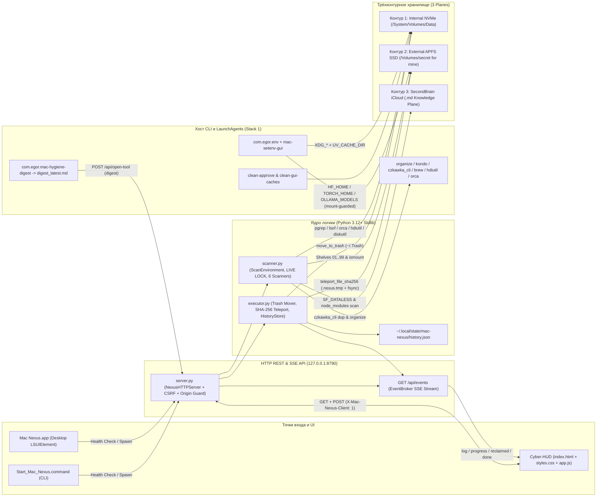
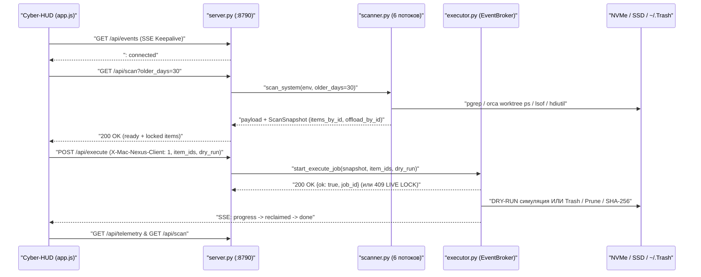

# 00 · Мастер-индекс и сквозная карта системы Mac Nexus

> **Навигация:** 00 · Мастер-индекс | [01 · Архитектура 3 контуров →](01_three_plane_filesystem_architecture.md) | [README репозитория](../README.md)

---

## 1. Назначение и архитектура верхнего уровня

**Mac Nexus** — это локальная система мониторинга хранилища macOS, безопасной очистки и оркестрации трёх контуров хранения на рабочей станции Apple Silicon (`245.11 GB` Internal NVMe + `120.02 GB` External APFS SSD `/Volumes/secret for mine` + `SecondBrain iCloud`).

Система спроектирована по принципу **«двух синхронизированных контуров управления»**:
1. **Интерактивный Web Cyber-HUD (`http://127.0.0.1:8790`)** — автономный веб-интерфейс (zero-CDN `HTML`/`CSS`/`JS`) поверх чистого stdlib-бэкенда Python 3.12+ (`server.py`, `scanner.py`, `executor.py`), запускаемый из `Mac Nexus.app` (`LSUIElement=true`) или [`Start_Mac_Nexus.command`](../Start_Mac_Nexus.command). По умолчанию работает в безопасном режиме `DRY-RUN`, проверяет `LIVE LOCK` перед показом и выполнением, переносит пользовательские файлы только в `~/.Trash` и телепортирует медиа на SSD строго после проверки **SHA-256 + byte size**.
2. **Портативный комплект хост-автоматизации Stack 1 ([`automation/`](../automation/README.md))** — слой ОС, обеспечивающий гигиену независимо от браузера: единая XDG-среда (`~/.zshenv` + `LaunchAgent com.egor.env` через `launchctl setenv`), еженедельный 100% read-only воскресный дайджест (`com.egor.mac-hygiene-digest` -> `~/.local/state/mac-hygiene/digest_latest.md`), YAML-правила `organize` v3 (`~/.config/organize/config.yaml`) и интерактивные скрипты с `pgrep`-защитой SQLite WAL (`clean-approve`, `clean-gui-caches`).

---

## 2. Сквозная диаграмма экосистемы и потоки данных

### 2.1 Архитектурная карта компонентов

### 2.2 Сквозной сценарий: Скан -> `DRY-RUN` / Боевой запуск -> SSE

### 2.3 Сводная карта контуров и локального состояния

| Контур / Слой | Точка монтирования / Путь | Роль в системе | Критические правила и границы | Документ |
|---|---|---|---|---|
| **Контур 1 · Internal NVMe** | `/System/Volumes/Data` (`disk3s5`) | Горячая рабочая среда: ОС, `~/Projects/<slug>`, `~/Downloads`, `UV_CACHE_DIR` | Целевая загрузка `< 75%`; не перемещать `~/Projects/<slug>`; `UV_CACHE_DIR` держать на внутреннем APFS для `clonefile(2)` | [01](01_three_plane_filesystem_architecture.md) · [02](02_macos_apfs_xdg_and_env_internals.md) |
| **Контур 2 · External APFS SSD** | `/Volumes/secret for mine` (`disk5s2`) | Холодный архив, AI-модели и тяжёлые медиа (`01_..99_` полки) | Формат APFS; `SSD_LIVE_HEAVY_DIRS` не трогать; перед записью обязательна проверка `ssd_is_mounted()` | [01](01_three_plane_filesystem_architecture.md) · [04](04_backend_scanner_executor_and_security.md) |
| **Контур 3 · SecondBrain iCloud** | `~/Library/Mobile Documents/iCloud~md~obsidian/Documents/SecondBrain` | База знаний (Markdown) и пульт ссылок `file:///` | Без `.git`/`node_modules`/тяжёлых `.mp4`; учёт `SF_DATALESS` (`0x40000000`) | [01](01_three_plane_filesystem_architecture.md) · [02](02_macos_apfs_xdg_and_env_internals.md) |
| **Runtime State (не в Git)** | `~/.local/state/mac-nexus/` и `~/.local/state/mac-hygiene/` | `history.json`, `server.log`, `digest_latest.md`, логи `launchd` | Запись через атомарный `os.replace()` или временные `.tmp` файлы | [04](04_backend_scanner_executor_and_security.md) · [07](07_automation_runbooks_and_troubleshooting.md) |

---

## 3. Полный каталог документации и артефактов

### 3.1 Основные руководства (`docs/00..08`)

| № | Файл | Фокус и охват | Ключевые темы |
|---|---|---|---|
| `00` | [00_master_index_and_system_map.md](00_master_index_and_system_map.md) | Навигационный центр системы | Сквозная архитектура, маршруты по ролям, Traceability Matrix |
| `01` | [01_three_plane_filesystem_architecture.md](01_three_plane_filesystem_architecture.md) | Проектирование 3 контуров хранения | NVMe vs SSD vs iCloud, отказ от `PARA`/`Johnny.Decimal` в коде, теги, NFD/NFC, бэкапы 3-2-1 |
| `02` | [02_macos_apfs_xdg_and_env_internals.md](02_macos_apfs_xdg_and_env_internals.md) | Внутренности macOS APFS и XDG | Контейнер APFS, `clonefile(2)` и `UV_CACHE_DIR`, sparse-файлы, `SF_DATALESS`, `launchctl setenv`, `tmutil` |
| `03` | [03_cleanup_stack_and_safety_bible.md](03_cleanup_stack_and_safety_bible.md) | Инструментарий Stack 1 и правила безопасности | Сравнение утилит, `organize`/`kondo`/`czkawka_cli`, запрет `lipo`, защита SQLite WAL и `disk0..disk5` |
| `04` | [04_backend_scanner_executor_and_security.md](04_backend_scanner_executor_and_security.md) | Устройство backend-модулей | `ScanEnvironment`, `ScanSnapshot`, `RadarTarget`, `TrashEntryTarget`, `LIVE LOCK`, Smart Close, Deep Radar, Trash TCC, `EventBroker`, `HistoryStore` |
| `05` | [05_http_rest_and_sse_api_reference.md](05_http_rest_and_sse_api_reference.md) | Контракт HTTP REST и SSE | Все 16 маршрутов `server.py`, CSRF/Origin, JSON-форматы, статусы `200..409..500`, `curl`-примеры |
| `06` | [06_cyber_hud_frontend_and_app_bundle.md](06_cyber_hud_frontend_and_app_bundle.md) | UI Cyber-HUD и упаковка `.app` | `index.html`, `styles.css`, `app.js` (Canvas/SVG/SSE/XSS), `Mac Nexus.app`, `generate_icon.py` |
| `07` | [07_automation_runbooks_and_troubleshooting.md](07_automation_runbooks_and_troubleshooting.md) | Эксплуатация и устранение сбоев | Ритм день/неделя/месяц/квартал, playbooks по инцидентам, QA-команды и Roadmap |
| `08` | [08_agent_onboarding_and_baseline_audit.md](08_agent_onboarding_and_baseline_audit.md) | Гайд для ИИ-агентов и Baseline-аудит | `ScanEnvironment` DI в тестах, расширение `ScanTarget`, защита `Orca` worktrees, итоги Фаз 1–3 |

### 3.2 Корневые инструкции и комплект `automation/`

| Компонент | Ссылка | Назначение |
|---|---|---|
| Главный README | [README.md](../README.md) | Обзор проекта, быстрый старт, дерево репозитория и 5 инвариантов |
| Контракт Claude Code | [CLAUDE.md](../CLAUDE.md) | Правила стека, границы безопасности и команды верификации |
| Контракт автономных агентов | [AGENTS.md](../AGENTS.md) | Правила для `Orca`, Codex, Gemini и локальных воркеров |
| Лаунчер `.command` | [Start_Mac_Nexus.command](../Start_Mac_Nexus.command) | Одношаговый запуск сервера (`127.0.0.1:8790`) и открытие HUD |
| Руководство автоматизации | [automation/README.md](../automation/README.md) | Установка, dry-run и откат хост-скриптов и `LaunchAgents` |
| Правила `organize` | [automation/organize/config.yaml](../automation/organize/config.yaml) | 5 декларативных правил разбора `~/Downloads` и `~/Desktop` |
| Шаблон `~/.zshenv` | [automation/zsh/zshenv.snippet.zsh](../automation/zsh/zshenv.snippet.zsh) | Экспорт `XDG_*`, `UV_CACHE_DIR` и условных SSD AI-переменных |
| Экспорт окружения GUI | [automation/bin/mac-setenv-gui](../automation/bin/mac-setenv-gui) | Вызов `launchctl setenv` / `unsetenv` для GUI-приложений |
| Воскресный дайджест | [automation/bin/mac-hygiene-digest](../automation/bin/mac-hygiene-digest) | Read-only сбор отчёта в `digest_latest.md` + macOS notification |
| Интерактивная очистка | [automation/bin/clean-approve](../automation/bin/clean-approve) | Человек-подтверждаемая очистка с `pgrep`-блокировкой Electron |
| Очистка GUI-кэшей | [automation/bin/clean-gui-caches](../automation/bin/clean-gui-caches) | Fail-closed очистка безопасных подпапок закрытых приложений |
| Шаблон `LaunchAgent` env | [automation/launchd/com.egor.env.plist.tmpl](../automation/launchd/com.egor.env.plist.tmpl) | Автозапуск `mac-setenv-gui` при входе в сессию (`RunAtLoad`) |
| Шаблон `LaunchAgent` digest | [automation/launchd/com.egor.mac-hygiene-digest.plist.tmpl](../automation/launchd/com.egor.mac-hygiene-digest.plist.tmpl) | Запуск `mac-hygiene-digest` каждое воскресенье в 11:00 |

---

## 4. Маршруты чтения по ролям

### Роль A · Пользователь и оператор Mac
*Цель: безопасно контролировать свободное место на NVMe, переносить тяжёлые записи на SSD и проводить воскресный обзор.*
1. [README репозитория](../README.md) — быстрый старт через `Mac Nexus.app` и понимание 5 гарантий безопасности.
2. [01 · Архитектура 3 контуров](01_three_plane_filesystem_architecture.md) — правила хранения файлов, полки `01_..99_` на SSD и 5 Finder-тегов.
3. [07 · Регламенты и Runbooks](07_automation_runbooks_and_troubleshooting.md) — что делать раз в неделю (дайджест) и раз в месяц (`clean-gui-caches` + reboot).
4. [Руководство `automation/`](../automation/README.md) — если нужно развернуть или обновить `LaunchAgents` и `organize`.

### Роль B · Разработчик Backend и Frontend
*Цель: модифицировать или расширять модули `src/mac_nexus/` и UI без нарушения stdlib-ограничений и контракта API.*
1. [CLAUDE.md](../CLAUDE.md) — жёсткие рамки стека (Python 3.12+ stdlib ONLY, 0 внешних CDN).
2. [04 · Backend, Scanner, Executor и Безопасность](04_backend_scanner_executor_and_security.md) — внутреннее устройство `ScanEnvironment`, `ScanSnapshot`, `LIVE LOCK`, `EventBroker`.
3. [05 · Справочник HTTP REST и SSE API](05_http_rest_and_sse_api_reference.md) — точные схемы запросов/ответов и коды ошибок.
4. [06 · Cyber-HUD Frontend и Mac Nexus.app](06_cyber_hud_frontend_and_app_bundle.md) — конвейер рендера HUD, CSS `[hidden]`, XSS-экранирование и генератор `.icns`.
5. [02 · APFS, XDG и macOS-внутренности](02_macos_apfs_xdg_and_env_internals.md) — низкоуровневая семантика APFS и `SF_DATALESS`, от которых зависит `scanner.py`.

### Роль C · Автономный ИИ-агент (`Orca`, Claude Code, Codex, Gemini)
*Цель: быстро войти в контекст, добавить новую фичу или исправить баг, не сломав живые процессы, `Orca` worktrees и приватность.*
1. [AGENTS.md](../AGENTS.md) и [CLAUDE.md](../CLAUDE.md) — инварианты и команды верификации.
2. [08 · Гайд для агентов и Baseline-аудит](08_agent_onboarding_and_baseline_audit.md) — работа с `ScanEnvironment` DI в `tests/test_mac_nexus.py`, чеклист добавления `ScanTarget`, правила `Orca` worktrees и baseline-сводка.
3. [04 · Backend](04_backend_scanner_executor_and_security.md) и [05 · HTTP/SSE API](05_http_rest_and_sse_api_reference.md) — точные символы и контракты.
4. [03 · Стек 1 и Красная книга безопасности](03_cleanup_stack_and_safety_bible.md) — почему нельзя вызывать `kondo --dry-run` или `lipo`.

### Роль D · Восстановление после сбоя (Incident / Troubleshooting)
*Цель: быстро диагностировать занятый порт `8790`, ошибки `403`/`409`, отключение SSD или остановку `LaunchAgent`.*
1. [07 · Регламенты и Runbooks](07_automation_runbooks_and_troubleshooting.md) — таблица «Симптом -> Причина -> Команда диагностики -> Решение».
2. [05 · Справочник HTTP REST и SSE API](05_http_rest_and_sse_api_reference.md) — расшифровка статусов `400`, `403`, `409`, `413`, `500`.
3. [Руководство `automation/`](../automation/README.md) — команды перерегистрации `launchctl bootstrap` и отката.

---

## 5. Матрица трассировки системы (Traceability Matrix)

### 5.1 Инварианты безопасности и архитектурные механизмы

| Механизм / Инвариант | Ключевые символы и файлы кода | Подробная документация | Автотест (`tests/test_mac_nexus.py`) |
|---|---|---|---|
| Строгий Loopback `127.0.0.1` | `NexusHTTPServer.__init__` в [`server.py`](../src/mac_nexus/server.py) | [04 · Backend](04_backend_scanner_executor_and_security.md) · [05 · API](05_http_rest_and_sse_api_reference.md) | `test_server_rejects_non_loopback_bind` |
| CSRF `X-Mac-Nexus-Client: 1` и `Origin` | `_check_post_csrf`, `_is_valid_origin` в [`server.py`](../src/mac_nexus/server.py) | [04 · Backend](04_backend_scanner_executor_and_security.md) · [05 · API](05_http_rest_and_sse_api_reference.md) | `test_csrf_and_origin_enforcement` |
| Path-traversal & MIME allowlist для `/static/*` | `_send_static_file`, `ALLOWED_STATIC_MIME` в [`server.py`](../src/mac_nexus/server.py) | [04 · Backend](04_backend_scanner_executor_and_security.md) · [06 · Frontend](06_cyber_hud_frontend_and_app_bundle.md) | `test_static_serving_and_traversal_blocked` |
| Непрозрачные ID снимка (Snapshot Allowlist) | `ScanSnapshot`, `_stable_id` в [`scanner.py`](../src/mac_nexus/scanner.py); `UnknownTargetError` в [`executor.py`](../src/mac_nexus/executor.py) | [04 · Backend](04_backend_scanner_executor_and_security.md) · [05 · API](05_http_rest_and_sse_api_reference.md) | `test_unknown_ids_and_command_injection_rejected` |
| Защищённые зоны (`.app`, боты, `.Trash`, `SecondBrain`) | `is_protected_path`, `PROTECTED_DESKTOP_DIRS`, `PROTECTED_BUNDLE_SUFFIXES`, `SSD_LIVE_HEAVY_DIRS` в [`scanner.py`](../src/mac_nexus/scanner.py) | [03 · Красная книга](03_cleanup_stack_and_safety_bible.md) · [04 · Backend](04_backend_scanner_executor_and_security.md) · [08 · Onboarding](08_agent_onboarding_and_baseline_audit.md) | `test_protected_paths_never_scanned_or_trashed` |
| `LIVE LOCK` для 11 GUI-приложений и Rider | `MONITORED_APPS`, `detect_live_locks` в [`scanner.py`](../src/mac_nexus/scanner.py); `_recheck_target_lock` в [`executor.py`](../src/mac_nexus/executor.py) | [03 · Красная книга](03_cleanup_stack_and_safety_bible.md) · [04 · Backend](04_backend_scanner_executor_and_security.md) | `test_live_lock_gui_apps_and_backend_rejection` |
| `LIVE LOCK` для `Orca` worktree и портов `:3000`/`:8768` | `parse_orca_worktrees_json`, `parse_orca_worktrees_text`, `_find_project_lock` в [`scanner.py`](../src/mac_nexus/scanner.py) | [01 · 3 контура](01_three_plane_filesystem_architecture.md) · [04 · Backend](04_backend_scanner_executor_and_security.md) · [08 · Onboarding](08_agent_onboarding_and_baseline_audit.md) | `test_live_lock_orca_worktrees_and_live_port_3000` |
| Возрастной фильтр `~/Projects/*` (`older_days`) | `_scan_dev_projects`, `PROJECT_ARTIFACT_NAMES` в [`scanner.py`](../src/mac_nexus/scanner.py) | [03 · Красная книга](03_cleanup_stack_and_safety_bible.md) · [04 · Backend](04_backend_scanner_executor_and_security.md) | `test_dev_projects_respects_older_days_query` |
| Защита системных дисков `disk0..disk5` при отмонтировании DMG | `_parse_hdiutil_images`, `_scan_ghost_dmgs` в [`scanner.py`](../src/mac_nexus/scanner.py) | [03 · Красная книга](03_cleanup_stack_and_safety_bible.md) · [04 · Backend](04_backend_scanner_executor_and_security.md) | `test_ghost_dmg_safety_disk6_vs_disk0` |
| SHA-256 верифицированный телепорт на SSD | `teleport_file_sha256`, `sha256_file`, `start_offload_job` в [`executor.py`](../src/mac_nexus/executor.py); `MIN_OFFLOAD_BYTES` в [`scanner.py`](../src/mac_nexus/scanner.py) | [04 · Backend](04_backend_scanner_executor_and_security.md) · [05 · API](05_http_rest_and_sse_api_reference.md) | `test_offload_sha256_parity_and_unmounted_guard` |
| Поиск дубликатов `czkawka_cli` и перенос в `~/.Trash` | `scan_duplicates`, `parse_czkawka_compact_json` в [`scanner.py`](../src/mac_nexus/scanner.py); `move_to_trash`, `trash_duplicate_files` в [`executor.py`](../src/mac_nexus/executor.py) | [03 · Красная книга](03_cleanup_stack_and_safety_bible.md) · [04 · Backend](04_backend_scanner_executor_and_security.md) | `test_duplicates_czkawka_parsing_and_trash_move` |
| Игнорирование iCloud-заглушек `SF_DATALESS` и Purgeable APFS | `SF_DATALESS_FLAG`, `_dir_size_and_latest_mtime`, `_secondbrain_stats`, `_nvme_purgeable_bytes` в [`scanner.py`](../src/mac_nexus/scanner.py) | [02 · APFS и XDG](02_macos_apfs_xdg_and_env_internals.md) · [04 · Backend](04_backend_scanner_executor_and_security.md) | `test_telemetry_and_open_tool_allowlist` |
| Allowlist утилит, телеметрия 3 контуров и `history.json` | `get_telemetry`, `load_history` в [`scanner.py`](../src/mac_nexus/scanner.py); `open_tool`, `HistoryStore` в [`executor.py`](../src/mac_nexus/executor.py) | [04 · Backend](04_backend_scanner_executor_and_security.md) · [05 · API](05_http_rest_and_sse_api_reference.md) | `test_telemetry_and_open_tool_allowlist` |
| Поток событий реального времени SSE (`/api/events`) | `_handle_sse` в [`server.py`](../src/mac_nexus/server.py); `EventBroker` в [`executor.py`](../src/mac_nexus/executor.py) | [04 · Backend](04_backend_scanner_executor_and_security.md) · [05 · API](05_http_rest_and_sse_api_reference.md) | `test_sse_events_endpoint_streams_json` |
| `RadarTarget` / `TrashEntryTarget` / расширенный `ScanTarget` | `RadarTarget`, `TrashEntryTarget`, `ScanTarget` (`quittable`, `quit_app_name`, `browser_warning`) в [`scanner.py`](../src/mac_nexus/scanner.py) | [04 · Backend](04_backend_scanner_executor_and_security.md) | `test_v2_deep_radar_scan`, `test_v2_trash_scan_tcc` |
| Smart Close HARD-запрет для `Orca` / `VS Code` | `start_smart_close_clean_job` (`app_key in {"orca","vscode"}`) в [`executor.py`](../src/mac_nexus/executor.py) | [04 · Backend](04_backend_scanner_executor_and_security.md) · [05 · API](05_http_rest_and_sse_api_reference.md) | `test_v2_smart_close_orca_vscode_forbidden` |
| Sparse-aware физический размер (`_physical_file_size`) | `_physical_file_size(st)` в [`scanner.py`](../src/mac_nexus/scanner.py) | [04 · Backend](04_backend_scanner_executor_and_security.md) | `test_v2_deep_radar_scan` |
| TCC-fallback для `~/.Trash` | `scan_trash` возвращает `tcc_restricted: True` при `PermissionError` в [`scanner.py`](../src/mac_nexus/scanner.py) | [04 · Backend](04_backend_scanner_executor_and_security.md) · [05 · API](05_http_rest_and_sse_api_reference.md) | `test_v2_trash_scan_tcc` |
| Новые категории: `system_cache`, `app_orphans`, `ai_dev_deep` | `_scan_system_caches`, `_scan_app_orphans`, `_scan_ai_dev_deep` в [`scanner.py`](../src/mac_nexus/scanner.py) | [04 · Backend](04_backend_scanner_executor_and_security.md) | `test_v2_system_cache_and_app_orphans` |
| Новые `pkg_cache`: `go`, `cargo` (≥10 MiB) | `_scan_pkg_caches` (ветки `go`, `cargo`) в [`scanner.py`](../src/mac_nexus/scanner.py); `executor.py` | [04 · Backend](04_backend_scanner_executor_and_security.md) | `test_v2_pkg_cache_go_and_cargo` |
| `ScanEnvironment` DI: `applications_dirs`, `temp_dir`, `users_dir`, `docker_bin`, `go_bin` | Новые поля `ScanEnvironment` в [`scanner.py`](../src/mac_nexus/scanner.py) | [04 · Backend](04_backend_scanner_executor_and_security.md) · [08 · Onboarding](08_agent_onboarding_and_baseline_audit.md) | `isolated_env` фикстура в [`test_mac_nexus.py`](../tests/test_mac_nexus.py) |

### 5.2 Трассировка всех 16 HTTP/SSE маршрутов (`server.py` <-> `app.js` <-> `test_mac_nexus.py`)

| Метод и маршрут | Обработчик в [`server.py`](../src/mac_nexus/server.py) | Логика в [`scanner.py`](../src/mac_nexus/scanner.py) / [`executor.py`](../src/mac_nexus/executor.py) | Клиент в [`app.js`](../src/mac_nexus/static/app.js) | Документация |
|---|---|---|---|---|
| `GET /` | `do_GET` -> `_send_static_file("index.html")` | Статическая отдача без кэша (`no-store`) | Загрузка оболочки Cyber-HUD | [05](05_http_rest_and_sse_api_reference.md) · [06](06_cyber_hud_frontend_and_app_bundle.md) |
| `GET /static/<filename>` | `do_GET` -> `_send_static_file` | MIME check (`ALLOWED_STATIC_MIME`) + anti-traversal | Подключение `styles.css`, `app.js` | [05](05_http_rest_and_sse_api_reference.md) · [04](04_backend_scanner_executor_and_security.md) |
| `GET /api/health` | `do_GET` -> `{ok, app, version, pid}` | `APP_NAME`, `APP_VERSION` (`__init__.py`) | `checkHealth()` | [05](05_http_rest_and_sse_api_reference.md) · [06](06_cyber_hud_frontend_and_app_bundle.md) |
| `GET /api/telemetry` | `do_GET` -> `get_telemetry(env)` | Diskutil/statvfs, `SF_DATALESS`, `sysctl`, `vm_stat`, `hdiutil`, `history`, `scan_trash` (badge) | `refreshTelemetry()` -> `renderTelemetry()` | [05](05_http_rest_and_sse_api_reference.md) · [02](02_macos_apfs_xdg_and_env_internals.md) |
| `GET /api/scan?older_days=30` | `do_GET` -> `scan_system(env, older_days)` | 9 потоков сканирования + обновление `ScanSnapshot` | `runScan()` -> `renderRadarItems()`, `renderTeleportCandidates()` | [05](05_http_rest_and_sse_api_reference.md) · [04](04_backend_scanner_executor_and_security.md) |
| `GET /api/deep-radar?min_mb=50` | `do_GET` -> `scan_deep_radar(env, min_mb)` | `scan_deep_radar()`, `_physical_file_size(st)`, обновление `radar_by_id` | `loadDeepRadar()` -> `renderDeepRadar()` | [05](05_http_rest_and_sse_api_reference.md) · [04](04_backend_scanner_executor_and_security.md) |
| `GET /api/trash` | `do_GET` -> `scan_trash(env)` | `scan_trash()`, TCC-fallback `tcc_restricted`, обновление `trash_by_id` | `loadTrash()` -> `renderTrash()` | [05](05_http_rest_and_sse_api_reference.md) · [04](04_backend_scanner_executor_and_security.md) |
| `GET /api/events` | `do_GET` -> `_handle_sse()` | `EventBroker.subscribe()` + 15s keepalive | `initSSE()` (`EventSource`) -> `#terminal-log` | [05](05_http_rest_and_sse_api_reference.md) · [06](06_cyber_hud_frontend_and_app_bundle.md) |
| `POST /api/execute` | `do_POST` (`_check_post_csrf`) | `start_execute_job()` -> `_execute_single_target()` | `executeSelectedCleanup()` via `apiPost()` | [05](05_http_rest_and_sse_api_reference.md) · [04](04_backend_scanner_executor_and_security.md) |
| `POST /api/offload` | `do_POST` (`_check_post_csrf`) | `start_offload_job()` -> `teleport_file_sha256()` | `executeSelectedOffload()` via `apiPost()` | [05](05_http_rest_and_sse_api_reference.md) · [04](04_backend_scanner_executor_and_security.md) |
| `POST /api/smart-close-clean` | `do_POST` (`_check_post_csrf`) | `start_smart_close_clean_job()` — HARD-FORBIDDEN для `orca`/`vscode` | `.js-smart-close-btn` -> `apiPost()` | [05](05_http_rest_and_sse_api_reference.md) · [04](04_backend_scanner_executor_and_security.md) |
| `POST /api/radar-action` | `do_POST` (`_check_post_csrf`) | `start_radar_action_job()` (`action: "trash"\|"teleport_ssd"`) | `radarAction()` via `apiPost()` | [05](05_http_rest_and_sse_api_reference.md) · [04](04_backend_scanner_executor_and_security.md) |
| `POST /api/radar-reveal` | `do_POST` (`_check_post_csrf`) | `reveal_radar_target()` -> `open` Finder | `.js-radar-reveal-btn` via `apiPost()` | [05](05_http_rest_and_sse_api_reference.md) · [04](04_backend_scanner_executor_and_security.md) |
| `POST /api/empty-trash` | `do_POST` (`_check_post_csrf`) | `purge_trash_items()` (`selected\|older_than\|finder_empty`) | `emptyTrash()` via `apiPost()` | [05](05_http_rest_and_sse_api_reference.md) · [04](04_backend_scanner_executor_and_security.md) |
| `POST /api/duplicates` | `do_POST` (`_check_post_csrf`) | `scan_duplicates()` -> `czkawka_cli dup` (target: `downloads\|desktop\|ssd_media\|documents`) | `scanDuplicates()` -> `renderDuplicates()` | [05](05_http_rest_and_sse_api_reference.md) · [03](03_cleanup_stack_and_safety_bible.md) |
| `POST /api/trash-duplicates` | `do_POST` (`_check_post_csrf`) | `trash_duplicate_files()` -> `move_to_trash()` | `trashSelectedDuplicates()` via `apiPost()` | [05](05_http_rest_and_sse_api_reference.md) · [04](04_backend_scanner_executor_and_security.md) |
| `POST /api/open-tool` | `do_POST` (`_check_post_csrf`) | `open_tool()` (allowlist: `digest`, `pearcleaner`, `daisydisk`, `finder_ssd`, `finder_downloads`, `finder_trash`) | `openTool()` -> `buildSafeMarkdownDom()` | [05](05_http_rest_and_sse_api_reference.md) · [06](06_cyber_hud_frontend_and_app_bundle.md) |

### 5.3 Модули интерфейса Cyber-HUD и упаковка приложения

| Модуль UI / Упаковка | Элементы DOM и функции кода | Документация |
|---|---|---|
| Верхняя панель телеметрии (3 реактора, 5 чипов, одометр) | `#reactor-nvme`, `#reactor-ssd`, `#reactor-secondbrain`, `#odometer-value`, Trash preview badge, `renderTelemetry()` в [`index.html`](../src/mac_nexus/static/index.html) и [`app.js`](../src/mac_nexus/static/app.js) | [06 · Cyber-HUD Frontend](06_cyber_hud_frontend_and_app_bundle.md) |
| Вкладка `01 · РАДАР ОЧИСТКИ` | `#panel-radar`, 9 chip-фильтров `#radar-category-chips` (`all`, `ai_dev_deep`, `system_cache`, `app_orphans`, `app_cache`, `pkg_cache`, `downloads_inbox`, `dev_projects`, `ghost_dmgs`), `.js-smart-close-btn`, `renderRadarItems()` | [06 · Cyber-HUD Frontend](06_cyber_hud_frontend_and_app_bundle.md) · [05 · API](05_http_rest_and_sse_api_reference.md) |
| Вкладка `02 · ГЛУБОКИЙ РАДАР` | `#panel-deepradar`, `#radar-shelf-select`, `#deep-radar-list`, threshold chips `50/250/1024 MiB`, `.js-radar-reveal-btn`, sparse badge, `renderDeepRadar()` | [06 · Cyber-HUD Frontend](06_cyber_hud_frontend_and_app_bundle.md) · [05 · API](05_http_rest_and_sse_api_reference.md) |
| Вкладка `03 · ТЕЛЕПОРТ МЕДИА` | `#panel-teleport`, `#teleport-beam-panel`, `#ssd-unmounted-alert`, `#btn-execute-offload`, `renderTeleportCandidates()` | [06 · Cyber-HUD Frontend](06_cyber_hud_frontend_and_app_bundle.md) · [05 · API](05_http_rest_and_sse_api_reference.md) |
| Вкладка `04 · ДУБЛИКАТЫ` | `#panel-duplicates`, `#dup-target-group` (`downloads`, `desktop`, `ssd_media`, `documents`), `#btn-trash-duplicates`, `renderDuplicates()` | [06 · Cyber-HUD Frontend](06_cyber_hud_frontend_and_app_bundle.md) · [03 · Красная книга](03_cleanup_stack_and_safety_bible.md) |
| Вкладка `05 · КОРЗИНА` | `#panel-trash`, TCC-fallback banner, purge-mode chips (`>30д`, `>7д`, `selected`), Holo-confirm, `renderTrash()` | [06 · Cyber-HUD Frontend](06_cyber_hud_frontend_and_app_bundle.md) · [05 · API](05_http_rest_and_sse_api_reference.md) |
| Вкладка `06 · ПУЛЬТ КОНТУРОВ` | `#panel-planes`, `#shelves-grid`, `.tool-btn[data-tool]` (вкл. `finder_trash`), `#planes-detail-grid`, `renderPlanesControlTab()` | [06 · Cyber-HUD Frontend](06_cyber_hud_frontend_and_app_bundle.md) · [01 · 3 контура](01_three_plane_filesystem_architecture.md) |
| Живой SSE-терминал и Holo-модал | `#cyber-terminal`, `initSSE()`, `#holo-modal`, Smart Close modal + browser warning, `buildSafeMarkdownDom()`, `[hidden] { display: none !important; }` в [`styles.css`](../src/mac_nexus/static/styles.css) | [06 · Cyber-HUD Frontend](06_cyber_hud_frontend_and_app_bundle.md) · [05 · API](05_http_rest_and_sse_api_reference.md) |
| Фон Canvas, защита XSS и переключатель `DRY-RUN` | `initOrbitalCanvas()`, `escapeHtml()`, `#dry-run-toggle`, `apiPost()` (`X-Mac-Nexus-Client: 1`) в [`app.js`](../src/mac_nexus/static/app.js) | [06 · Cyber-HUD Frontend](06_cyber_hud_frontend_and_app_bundle.md) |
| Лаунчеры и Retina-иконка | [`Start_Mac_Nexus.command`](../Start_Mac_Nexus.command), [`scripts/generate_icon.py`](../scripts/generate_icon.py), `/Users/egorlabutin/Desktop/Mac Nexus.app` | [06 · Cyber-HUD Frontend](06_cyber_hud_frontend_and_app_bundle.md) · [README](../README.md) |

### 5.4 Слой хост-автоматизации Stack 1 (`automation/`) и внешние утилиты

| Артефакт автоматизации | Файл в репозитории | Целевой путь на хосте | Документация |
|---|---|---|---|
| Переменные XDG и SSD для shell | [`automation/zsh/zshenv.snippet.zsh`](../automation/zsh/zshenv.snippet.zsh) | `~/.zshenv` | [02 · APFS и XDG](02_macos_apfs_xdg_and_env_internals.md) · [`automation/README.md`](../automation/README.md) |
| Экспорт переменных в GUI (`launchd`) | [`automation/bin/mac-setenv-gui`](../automation/bin/mac-setenv-gui) | `~/.local/bin/mac-setenv-gui` | [02 · APFS и XDG](02_macos_apfs_xdg_and_env_internals.md) · [`automation/README.md`](../automation/README.md) |
| Шаблон LaunchAgent окружения | [`automation/launchd/com.egor.env.plist.tmpl`](../automation/launchd/com.egor.env.plist.tmpl) | `~/Library/LaunchAgents/com.egor.env.plist` | [02 · APFS и XDG](02_macos_apfs_xdg_and_env_internals.md) · [`automation/README.md`](../automation/README.md) |
| Правила разбора `Downloads`/`Desktop` | [`automation/organize/config.yaml`](../automation/organize/config.yaml) | `~/.config/organize/config.yaml` | [03 · Красная книга](03_cleanup_stack_and_safety_bible.md) · [`automation/README.md`](../automation/README.md) |
| Read-only генератор дайджеста | [`automation/bin/mac-hygiene-digest`](../automation/bin/mac-hygiene-digest) | `~/.local/bin/mac-hygiene-digest` | [07 · Runbooks](07_automation_runbooks_and_troubleshooting.md) · [`automation/README.md`](../automation/README.md) |
| Шаблон LaunchAgent дайджеста | [`automation/launchd/com.egor.mac-hygiene-digest.plist.tmpl`](../automation/launchd/com.egor.mac-hygiene-digest.plist.tmpl) | `~/Library/LaunchAgents/com.egor.mac-hygiene-digest.plist` | [07 · Runbooks](07_automation_runbooks_and_troubleshooting.md) · [`automation/README.md`](../automation/README.md) |
| Интерактивное подтверждение очистки | [`automation/bin/clean-approve`](../automation/bin/clean-approve) | `~/.local/bin/clean-approve` | [03 · Красная книга](03_cleanup_stack_and_safety_bible.md) · [07 · Runbooks](07_automation_runbooks_and_troubleshooting.md) |
| Безопасная очистка закрытых GUI-кэшей | [`automation/bin/clean-gui-caches`](../automation/bin/clean-gui-caches) | `~/.local/bin/clean-gui-caches` | [03 · Красная книга](03_cleanup_stack_and_safety_bible.md) · [07 · Runbooks](07_automation_runbooks_and_troubleshooting.md) |

### 5.5 Реестр системных утилит и бинарных зависимостей

| Бинарный файл / Утилита | Версия / Путь | Где вызывается | Ключевое ограничение безопасности |
|---|---|---|---|
| `python3` (`/opt/anaconda3/bin/python3`) | `3.12.4` | [`Start_Mac_Nexus.command`](../Start_Mac_Nexus.command), `Mac Nexus.app` | В `src/mac_nexus/` — строго stdlib (`Pillow` только в [`generate_icon.py`](../scripts/generate_icon.py)) |
| `organize` | `v3.4.0` (`/opt/homebrew/bin/organize`) | [`executor.py`](../src/mac_nexus/executor.py), [`mac-hygiene-digest`](../automation/bin/mac-hygiene-digest), [`clean-approve`](../automation/bin/clean-approve) | Дайджест запускает только `organize check && organize sim`; `run` требует подтверждения |
| `kondo` | `0.9` (`/opt/homebrew/bin/kondo`) | [`clean-approve`](../automation/bin/clean-approve) (`kondo -o 30d ~/Projects`) | Не имеет `--dry-run`; в `scanner.py` заменён безопасным Python-сканером давности |
| `czkawka_cli` | `12.0.2` (`/opt/homebrew/bin/czkawka_cli`) | `scan_duplicates()` в [`scanner.py`](../src/mac_nexus/scanner.py) | Флаги `-C <json> -N -M -W` + повторные `-e` для исключения `.app`/`.photoslibrary`/`.Trash` |
| `brew` | `/opt/homebrew/bin/brew` | `_execute_single_target()` (`brew cleanup --prune=all`), дайджест (`-n`) | Без автоматического `brew autoremove` |
| `orca` | `/Applications/Orca.app/Contents/Resources/bin/orca` | `detect_live_locks()` (`worktree ps --limit 30 --json`) | JSON + текстовый fallback `parse_orca_worktrees_text()` |
| `hdiutil` & `diskutil` | Системные macOS | `_parse_hdiutil_images()`, `_disk_stats_from_plist_or_statvfs()` | Отмонтирование только для `disk >= 6`; `disk0..disk5` строго запрещены |
| `pgrep` & `lsof` | Системные macOS | `detect_live_locks()`, `_recheck_target_lock()`, `clean-*` | Проверка 11 `MONITORED_APPS`, `rider`, портов `:3000`/`:8768` и открытых DMG |
| `sysctl`, `vm_stat`, `osascript` | Системные macOS | `_system_memory_metrics()`, `_nvme_purgeable_bytes()` | JXA `NSURL` кэшируется на 10 секунд (`_PURGEABLE_CACHE`) |
| `Pearcleaner` & `DaisyDisk` | `/Applications/` | `open_tool()` в [`executor.py`](../src/mac_nexus/executor.py) | Запуск строго по `allowlist`; в `Pearcleaner` функция `App Lipo` отключена |
| `tag`, `fd`, `zoxide`, `eza`, `yazi`, `dust` | Homebrew Stack 1 | Консольный рабочий процесс 3 контуров | Единые Finder-теги и быстрая навигация без поломки Unicode (`core.precomposeUnicode=true`) |

---

## Связанные документы и модули кода

- **Соседние руководства:**
  - [01 · Архитектура 3 контуров](01_three_plane_filesystem_architecture.md)
  - [02 · APFS, XDG и macOS-внутренности](02_macos_apfs_xdg_and_env_internals.md)
  - [03 · Стек 1 и Красная книга безопасности](03_cleanup_stack_and_safety_bible.md)
  - [04 · Backend, Scanner, Executor и Безопасность](04_backend_scanner_executor_and_security.md)
  - [05 · Справочник HTTP REST и SSE API](05_http_rest_and_sse_api_reference.md)
  - [06 · Cyber-HUD Frontend и Mac Nexus.app](06_cyber_hud_frontend_and_app_bundle.md)
  - [07 · Регламенты, Runbooks и Troubleshooting](07_automation_runbooks_and_troubleshooting.md)
  - [08 · Гайд для агентов и Baseline-аудит](08_agent_onboarding_and_baseline_audit.md)
- **Корень репозитория и автоматизация:**
  - [README репозитория](../README.md) · [CLAUDE.md](../CLAUDE.md) · [AGENTS.md](../AGENTS.md) · [Start_Mac_Nexus.command](../Start_Mac_Nexus.command)
  - [Руководство по автоматизации (`automation/README.md`)](../automation/README.md)
- **Исходный код и тесты:**
  - [`src/mac_nexus/__init__.py`](../src/mac_nexus/__init__.py) · [`src/mac_nexus/server.py`](../src/mac_nexus/server.py) · [`src/mac_nexus/scanner.py`](../src/mac_nexus/scanner.py) · [`src/mac_nexus/executor.py`](../src/mac_nexus/executor.py)
  - [`src/mac_nexus/static/index.html`](../src/mac_nexus/static/index.html) · [`src/mac_nexus/static/styles.css`](../src/mac_nexus/static/styles.css) · [`src/mac_nexus/static/app.js`](../src/mac_nexus/static/app.js)
  - [`scripts/generate_icon.py`](../scripts/generate_icon.py) · [`tests/test_mac_nexus.py`](../tests/test_mac_nexus.py)
