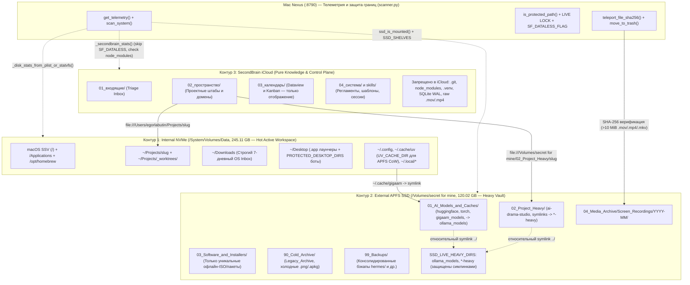

# 01 · Архитектура трёх контуров файловой системы (Three-Plane Filesystem Architecture)

> **Навигация:** [00 · Мастер-индекс](00_master_index_and_system_map.md) | ← [00 · Мастер-индекс](00_master_index_and_system_map.md) | [02 · APFS, XDG и macOS-внутренности →](02_macos_apfs_xdg_and_env_internals.md) | [README репозитория](../README.md)

---

## 1. Назначение 3-контурной архитектуры и базовый инвариант

На Apple Silicon рабочей станции (MacBook Air `arm64`, внутренний NVMe `245.11 GB` / `228.27 GiB`, macOS `26.7.1` Tahoe) смешивание исходного кода, многогигабайтных весов нейросетей, видеозаписей экрана и облачной базы знаний на одном диске неизбежно приводит к трём системным авариям:

1. **Истощение внутреннего NVMe и деградация swap (`VM`):** до внедрения трёхуровневой модели контейнер `disk3` был заполнен на `93.6–93.7%` (лишь `15.56 GB` нераспределённого свободного места при `VM = 9.66 GB`), тогда как внешний APFS SSD (`/Volumes/secret for mine`, `120.02 GB`) был свободен на `82.9%` (`99.52 GB`).
2. **Конфликты синхронизации iCloud (`fileproviderd`):** попадание `node_modules` (`56.58 MiB` в `.opencode`), `.git` (`39.43 MiB`), `.worktrees` (`28.14 MiB`) и тяжёлых бинарников внутрь `SecondBrain` провоцирует петли `100%` CPU в демоне `fileproviderd`, обрыв симлинков и риск повреждения SQLite WAL.
3. **Разрыв связей IDE и Git worktrees:** попытка применять классический перенос папок по `PARA` (`Projects/` → `Archives/`) или переименование репозиториев под `Johnny.Decimal` (`32.04_...`) мгновенно ломает реестр `Orca.app`, двусторонние указатели `git worktree`, `LaunchAgents`, `direnv` и `zoxide`.

Решение опирается на философию `SecondBrain` (**«напиши один раз, отображай везде»**), масштабированную на всю операционную систему через **жёсткое физическое разделение на 3 контура (Three-Plane Architecture)**:

- **Контур 1 (`Internal NVMe`):** горячая исполняемая среда с **неподвижными** слагами репозиториев (`~/Projects/<slug>`), строгим `7`-дневным входящим буфером `~/Downloads` и локальным `UV_CACHE_DIR` для нулевого копирования APFS `clonefile(2)`.
- **Контур 2 (`External APFS SSD`):** структурированное тяжёлое хранилище `/Volumes/secret for mine` с 6 каноническими полками (`01_..99_`) для весов ИИ, тяжёлых артефактов проектов, видеоархивов и локальных снэпшотов бэкапов.
- **Контур 3 (`SecondBrain iCloud`):** лёгкая плоскость знаний и управления (`Pure Knowledge & Control Plane`), содержащая исключительно Markdown-заметки, конфигурацию Obsidian и однонаправленные `file:///` ссылки на Контур 1 и Контур 2.

---

## 2. Топология трёх контуров



### Сводная матрица характеристик контуров

| Параметр | Контур 1 · Internal NVMe | Контур 2 · External APFS SSD | Контур 3 · SecondBrain iCloud |
| :--- | :--- | :--- | :--- |
| **Точка монтирования** | `/` (SSV) и `/System/Volumes/Data` (`disk3s5`) | `/Volumes/secret for mine` (`disk5s2`) | `~/Library/Mobile Documents/iCloud~md~obsidian/Documents/SecondBrain` |
| **Файловая система** | `APFS (Case-insensitive)`, FileVault ON | `APFS (Case-insensitive)` (нативный, НЕ ExFAT) | APFS + CloudDocs File Provider (`fileproviderd`) |
| **Роль в системе** | Исполняемая горячая среда (`Hot Active Workspace`) | Тяжёлые модели, ассеты проектов и холодный архив | Чистая база знаний и контрольная плоскость (`Control Plane`) |
| **Целевая загрузка** | **< 70–75%** (`~60–75 GB` запаса под swap/OS; факт: `94%` → `87%`) | Рабочий буфер с запасом для медиа и моделей (`~22%` занято, `88 GiB` свободно) | **< 0.6 GiB** (лёгкий Markdown, схемы WebP/PNG `< 500 KB`, `.obsidian`) |
| **SLA жизненного цикла** | `~/Downloads` — макс. `7` дней; `~/Projects` — бессрочно | `01_` сменные кэши; `90_` — неизменяемый архив | `01_входящие` — разбор раз в неделю; старые медиа → Контур 2 |
| **Spotlight (`mds_stores`)** | Включён только на пользовательских папках (`Downloads`, `Documents`); `~/Projects` и кэши исключены | Включён только по необходимости (тяжёлые полки `01_`, `02_`, `99_` в Search Privacy) | Включён для быстрого поиска заметок и тегов |
| **Резервное копирование** | Time Machine (с исключениями кэшей) + `restic` off-site | `99_Backups` не равен `3-2-1`; `01_` исключён; `90_`/`04_` в `restic`/отдельный диск | iCloud Sync + `restic` off-site (с локальной историей вне облака) |

---

## 3. Детальный регламент каждого контура и интеграция с `Mac Nexus`

### 3.1 Контур 1 · Internal NVMe (`Hot Active Workspace`)

Главная задача Контура 1 — держать операционную систему, активный код и рабочие кэши с минимальной задержкой ввода-вывода и достаточным запасом свободных блоков (целевой порог `< 70–75%`, чтобы виртуальная память `VM`, апдейты macOS и контейнеры `OrbStack` не упирались в троттлинг APFS).

#### Каноническая структура `$HOME`

```text
/Users/egorlabutin/
├── Projects/                  # ПЛОСКИЙ КОРЕНЬ КОДА — строчные ASCII-слаги, никогда не перемещаются
│   ├── ai-drama-studio/       # Активные и спящие репо (все 12 репо ~123 MiB исходников)
│   ├── analyst-trainer/
│   ├── architecture-practice/
│   ├── calisthenics-tracker/
│   ├── gigaam-studio/
│   ├── hermes-orchestration/
│   ├── hermes-pipeline-canary/
│   ├── local-jarvis/
│   ├── music-on-video/
│   ├── token-ledger/
│   ├── zombie-base-defense/
│   └── _worktrees/            # Единый каталог для локальных Git worktrees (вместо /private/tmp)
├── Downloads/                 # ЕДИНСТВЕННЫЙ 7-дневный волатильный OS Inbox (цель: 0 постоянных файлов)
├── Desktop/                   # ТОЛЬКО .app лаунчеры + защищённые живые боты (0 .mov дампов!)
├── Documents/                 # Лёгкие личные/рабочие документы (вне iCloud)
├── Movies/ & Pictures/        # Только текущие монтажи; Photos Library.photoslibrary неприкосновенна
├── Applications/              # Пользовательские утилиты
├── .config/                   # XDG_CONFIG_HOME (organize, git, yazi, zsh)
├── .cache/                    # XDG_CACHE_HOME (исключён из TM; здесь же UV_CACHE_DIR + symlink gigaam)
└── .local/
    ├── bin/                   # Исполняемые скрипты (mac-setenv-gui, mac-hygiene-digest, clean-approve)
    ├── share/                 # XDG_DATA_HOME (uv toolchains, claude, opencode)
    └── state/                 # XDG_STATE_HOME (digest_latest.md, mac-nexus/history.json, server.log)
```

#### Ключевые правила Контура 1

1. **Неизменяемость `~/Projects/<slug>`:** все `12` исходных репозиториев занимают суммарно около `123 MiB` — хранить их на NVMe практически бесплатно. Переводить проект в «архив» означает **не перемещать папку**, а закрыть вкладку в `Orca.app`, очистить мёртвые worktree (`git worktree prune`), удалить пересоздаваемые зависимости (`node_modules`, `.venv`, `.pytest_cache`, `__pycache__`, `target` — через `Mac Nexus` по порогу `older_days` или `kondo -o 30d`), вынести гигабайтные данные в `02_Project_Heavy/<slug>/` и переключить `status: archive` в `SecondBrain`.
2. **Единый 7-дневный буфер `~/Downloads`:** все браузеры, AirDrop, скриншоты и выгрузки мессенджеров сохраняются сюда. В [`scanner.py`](../src/mac_nexus/scanner.py) метод `_scan_downloads_inbox()` отслеживает три класса:
   - Установщики `INSTALLER_EXTENSIONS` (`{".dmg", ".pkg", ".exe", ".iso"}`) старше `7` дней → безопасное перемещение в `~/.Trash` (`action_kind: "trash"`).
   - Скриншоты с префиксами `SCREENSHOT_PREFIXES` (`("Screenshot", "Screen Shot", "Снимок экрана")`, расширения `{".png", ".jpg", ".jpeg"}`) старше `14` дней в `~/Downloads` (`max_depth: 2`) и `~/Desktop` (`max_depth: 1`) → `~/.Trash`.
   - Нетронутые файлы старше `older_days` (по умолчанию `30` дней) → передаются в `organize` для разметки тегом `review-delete (red)` без удаления.
3. **Защищённый `~/Desktop` и живые боты:** на Рабочем столе находятся лаунчеры `.app` (включая `Mac Nexus.app`, `AI Drama Studio.app`, `GigaAM Studio.app`, `Сеньор Помидор.app` и др.) и две директории живых ботов, прописанные в `PROTECTED_DESKTOP_DIRS` в [`scanner.py`](../src/mac_nexus/scanner.py#L45-L48):
   - `Бот_автооткликов_Егор`
   - `GPT_подключение_для_бота`
   Функция `is_protected_path()` гарантирует, что ни сканер очистки, ни перенос медиа, ни `czkawka_cli` (`-e`), ни `move_to_trash()` никогда не затронут `.app`-бандлы (`PROTECTED_BUNDLE_SUFFIXES = (".app", ".photoslibrary")`) и директории активных ботов.
4. **`UV_CACHE_DIR` строго на внутреннем APFS:** кэш `uv` хранится в `~/.cache/uv` (на том же томе `disk3s5`, что и `~/Projects/*/.venv`), чтобы работал мгновенный `clonefile(2)` без кросс-томного копирования `EXDEV`. Подробнее — в [02 · APFS, XDG и macOS-внутренности](02_macos_apfs_xdg_and_env_internals.md).
5. **Операционные правила для `/Applications` и системных кэшей:** `Mac Nexus` не сносит программы сам, а контролирует примонтированные призрачные образы `.dmg` (только устройства `/dev/diskN` с `N >= 6`, никогда `disk0..disk5`), безопасные кэши пакетных менеджеров (`brew`, `pip`, `uv`, `npm`, `nuget`, `conda clean`) и allowlist-кэши закрытых GUI-приложений.

---

### 3.2 Контур 2 · External APFS SSD (`/Volumes/secret for mine`)

В ходе живого аудита была выявлена критическая архитектурная деталь: внешний SSD (`YongzhenWeiye`, USB `disk4s2` → контейнер `disk5` → том `disk5s2`, `120.02 GB` / `111.78 GiB`) **уже отформатирован в `APFS (Case-insensitive)`**, а **не** в ExFAT! Это избавляет от разрушительной миграции и сразу открывает POSIX-симлинки, права `+x`, нативные расширенные атрибуты `xattr` без `._*` AppleDouble-файлов, разреженные файлы и `clonefile(2)`.

> **Примечание об имени тома:** пробелы в `/Volumes/secret for mine` сохранены для обратной совместимости с активными сервисами (`next-server` `:3000`, `Ollama`, `*-heavy`). Во всех скриптах и Python-модулях путь строго экранируется в двойных кавычках или передаётся массивом аргументов без shell-интерполяции.

#### 6 канонических полок (`SSD_SHELVES`) и защита `SSD_LIVE_HEAVY_DIRS`

В [`scanner.py`](../src/mac_nexus/scanner.py#L29-L43) структура Контура 2 закреплена двумя константами:

```python
SSD_SHELVES = (
    "01_AI_Models_and_Caches",
    "02_Project_Heavy",
    "03_Software_and_Installers",
    "04_Media_Archive",
    "90_Cold_Archive",
    "99_Backups",
)

SSD_LIVE_HEAVY_DIRS = {
    "ollama_models",
    "local-jarvis-heavy",
    "project-perimeter-heavy",
    "calisthenics-tracker-heavy",
}
```

Назначение каждой полки:

1. **`01_AI_Models_and_Caches/`** — заменяемые веса моделей и кэши фреймворков (`huggingface` через `HF_HOME`, `torch` через `TORCH_HOME`, `gigaam_models`, на которую указывает симлинк `~/.cache/gigaam`). Для живой корневой папки `ollama_models` (`8.63 GiB`) создан относительный симлинк `01_AI_Models_and_Caches/ollama_models -> ../ollama_models` — пути действующих сервисов не сломаны, а иерархия остаётся единой.
2. **`02_Project_Heavy/`** — тяжёлые бинарники, датасеты, логи, БД и рендеры конкретных проектов из `~/Projects/<slug>`. Живые корневые каталоги `SSD_LIVE_HEAVY_DIRS` подключены сюда через относительные симлинки:
   - `02_Project_Heavy/calisthenics-tracker -> ../calisthenics-tracker-heavy`
   - `02_Project_Heavy/local-jarvis -> ../local-jarvis-heavy`
   - `02_Project_Heavy/zombie-base-defense -> ../project-perimeter-heavy`
   При этом `is_protected_path()` в [`scanner.py`](../src/mac_nexus/scanner.py#L243-L245) запрещает любые автоматические мутации внутри `SSD_LIVE_HEAVY_DIRS`.
3. **`03_Software_and_Installers/`** — **исключительно** редкие офлайн-дистрибутивы и образы ОС, которые невозможно перекачать из сети или Homebrew. Рядовые `.dmg`/`.pkg` после установки подлежат удалению в Корзину.
4. **`04_Media_Archive/`** — целевая полка для тяжёлых записей экрана, видеомонтажа и экспортов:
   - Подкаталог `Screen_Recordings/<YYYY-MM>/` используется движком **SHA-256 телепорта** (`teleport_file_sha256()` в [`executor.py`](../src/mac_nexus/executor.py#L171-L233)) для безопасного выноса `.mov`, `.mp4`, `.mkv` размером `> 10 MiB` (`MIN_OFFLOAD_BYTES`) с `~/Desktop` и `~/Downloads`.
   - Правило #4 в [`automation/organize/config.yaml`](../automation/organize/config.yaml) также переносит сюда медиа/архивы `> 100 MB` и старше `14` дней (`on_conflict: "rename_new"`) при условии явной проверки монтирования `os.path.ismount("/Volumes/secret for mine")`.
5. **`90_Cold_Archive/`** — холодные неизменяемые архивы прошлых лет (`Legacy_Archive`), архивный снэпшот старого локального заглушечного каталога `home_SecondBrain_stub_20261118`, тяжёлые вынесенные `.png`/`.apkg`.
6. **`99_Backups/`** — структурированные локальные бэкапы (в частности, объединённый `hermes/`, куда собраны `Hermes_Backups_Root`, `Archive_Hermes_Backups`, `internal_state_snapshots_*` и `internal_backups_*`). **Важно:** хранение бэкапа на том же рабочем внешнем SSD не является стратегией `3-2-1` — отказ или потеря диска уничтожит и архив, и рабочий том.

---

### 3.3 Контур 3 · `SecondBrain` iCloud (`Pure Knowledge & Control Plane`)

Путь хранилища: `~/Library/Mobile Documents/iCloud~md~obsidian/Documents/SecondBrain`.

Его внутренняя логическая структура неизменна:
- `01_входящие/` — единый буфер неструктурированных входящих (встречи, заметки, сырые выгрузки; еженедельный разбор с выносом тяжёлых файлов старше 30 дней в `90_Cold_Archive/`).
- `02_пространство/` — рабочие домены и проектные папки с `CLAUDE.md` и карточками проектов.
- `03_календарь/` — чистые Dataview-сводки и Kanban-экраны (задачи здесь только отображаются, не хранятся).
- `04_система/` и `skills/` — индексы, шаблоны, логи сессий и локальные навыки агентов.

#### Почему бинарный и dev-мусор запрещён в iCloud Drive

Начиная с macOS Sonoma, iCloud Drive работает через **File Provider (`fileproviderd`)** с локальной базой метаданных SQLite:
- **`node_modules` / `.venv`:** десятки тысяч мелких файлов забивают очереди `fileproviderd` (`100%` загрузка CPU), а функция «Оптимизировать хранилище Mac» выгружает `.js`/`.py` в 0-блочные заглушки `SF_DATALESS`, ломая сборку и рантаймы. (В ходе миграции Контура 3 `56.58 MiB` `.opencode/node_modules` уже были безопасно удалены из iCloud.)
- **`.git` и `.worktrees`:** `git status` и `git gc` атомарно пересоздают сотни объектов и `.git/index.lock`. Пофайловая асинхронная синхронизация iCloud порождает конфликтные копии (`index 2`, `HEAD 2`) и разрушает индекс репозитория. Активные worktree должны жить в `~/Projects/_worktrees/` (Контур 1); оставшийся живой worktree в `SecondBrain` защищён `LIVE LOCK` через `orca worktree ps`, пока открыт в Orca, и подлежит плановому переводу в Контур 1 после завершения ветки.
- **Живые SQLite WAL (`*.db`, `*-wal`, `*-shm`):** iCloud синхронизирует три файла WAL по отдельности и в разное время, что приводит к необратимому `SQLITE_CORRUPT`.
- **Диета ассетов:** скриншоты внутри заметок сжимаются до WebP/PNG `< 500 KB`, а сырые рендеры и экспорты `.apkg` переносятся в `90_Cold_Archive/`.

#### Как `SecondBrain` управляет остальными контурами

В проектной карточке Obsidian фиксируются детерминированные `file:///` ссылки:

```yaml
---
type: index
space: Работа
status: active
date: 2026-11-18
repo_path: "file:///Users/egorlabutin/Projects/ai-drama-studio"
heavy_vault: "file:///Volumes/secret for mine/02_Project_Heavy/ai-drama-studio"
---
```

А `Mac Nexus` в `_secondbrain_stats()` ([`scanner.py`](../src/mac_nexus/scanner.py#L579-L627)) непрерывно контролирует здоровье Контура 3: считает число `.md`-заметок (`md_notes_count`), суммирует только локально присутствующие файлы (игнорируя `SF_DATALESS_FLAG` и `.git`) и мгновенно сигнализирует в Cyber-HUD флагом `has_node_modules_risk`, если кто-то случайно установил пакеты внутрь iCloud.

---

## 4. Сравнительный обзор методологий (`PARA`, `Johnny.Decimal`, `ACE`, `kepano`, `Karl Voit`)

Все популярные методологии создавались для человеческих документов, медиа и заметок — и **ломают инфраструктуру разработчика**, если применять их к директориям исходного кода без разделения на контуры.

### 4.1 Сравнительная матрица методологий

| Методология | Главная ось организации | Где хранится структура | Сильные стороны | Где ломается в одиночку |
| :--- | :--- | :--- | :--- | :--- |
| **PARA** *(Tiago Forte)* | **Actionability** (срочность применения): `Projects`, `Areas`, `Resources`, `Archives` | Перемещение папок между корзинами жизненного цикла | Быстрая операционная сортировка; универсальна для Finder, Drive, Notion | Постоянная ручная переброска папок; размытая граница *Area vs Resource*; **разрушает пути кода** |
| **Johnny.Decimal (`AC.ID`)** | **Ограниченная адресуемость (`10/10/100`)**: `Area` → `Category` → `.ID` + нули `.00–.09` | Строго `3` уровня папок + мастер-индекс **JDex** | Устраняет паралич выбора и бесконечную вложенность; координата `14.32` ищется мгновенно | Потолок 10 категорий/100 ID тесен для потока кода и медиа; **префиксы с точками/пробелами ломают скрипты и Git** |
| **ACE** *(Nick Milo / LYT)* | **Intention (STIR):** `Atlas` (знания), `Calendar` (время), `Efforts` (действия) | 3 корневые папки + ссылки/карты содержания (MOC) | Устраняет стресс *Project vs Area* через гибкие *Efforts*; нативная ось времени | Требует дисциплины ведения MOC; не решает раскладку системных бинарников и SSD |
| **`kepano`** *(Steph Ango)* | **Долговечность (*File over App*)** и граф связей | Плоский корень vault + **YAML-свойства** + динамические запросы (Dataview / Bases) | Нулевое трение при создании заметки; чистый Markdown переживёт любые программы | Плохо подходит для нетекстовых бинарников ОС (`.pdf`, `.mov`, `.dmg`) без файловой иерархии |
| **Karl Voit** *(`date2name`, `filetags`)* | **Независимость от БД через имя файла** | Префикс даты `ISO-8601` + семантические теги прямо в имени (`-- tag1 tag2`) | Сортировка и фильтрация работают в любой ОС/ФС без сторонних баз и `xattr` | В исходниках длинные имена с пробелами и кириллицей ломают URL, импорты и кросс-платформенный CI |

### 4.2 Почему наивные `PARA` и `Johnny.Decimal` ломают `Orca.app`, Git worktrees и скрипты

Перенос репозитория из `1_Projects/my-app` в `4_Archives/my-app` (`PARA`) или переименование в `32.04 my-app` (`Johnny.Decimal`) вызывает 5 детерминированных сбоев:

1. **Двусторонний контракт `git worktree`:**
   Связь между основным репозиторием и рабочим деревом закреплена **двумя абсолютными путями**:
   - внутри worktree файл `.git` (не папка!) содержит строку `gitdir: /Users/egorlabutin/Projects/main-repo/.git/worktrees/<wt>`;
   - в основном репозитории файл `.git/worktrees/<wt>/gitdir` указывает обратно на `/Users/egorlabutin/.../<wt>/.git`.
   Обычный `mv` разрывает оба указателя (`fatal: not a git repository`, worktree становится `prunable`) и требует ручного восстановления через `git worktree repair`.
2. **Абсолютные пути в реестре `Orca.app`:**
   Оркестратор агентов `Orca.app` хранит зарегистрированные репозитории, `worktreeMeta` и открытые PTY/терминалы по абсолютным путям в `~/Library/Application Support/orca/profiles/<profile>/orca-data.json`. Переименование или перемещение каталога порождает `DaemonProtocolError`, зависшие блокировки `"initializing"` (неудаляемые из UI до ручного `git worktree unlock && git worktree prune`) и сиротские записи `"Unknown"` в сайдбаре. Использование симлинков поверх репозитория также приводит к ошибкам вида `Worktree created but not found in listing` из-за несовпадения `realpath` с путём, сохранённым в Git.
3. **Относительные пути, импорты и Docker bind-mounts:**
   `git clone` по умолчанию создаёт `<repo-slug>` без цифр. Префиксы с точками и пробелами (`32.04 auth-service`) ломают неэкранированные shell-вызовы, `PYTHONPATH`, монорепозиторные скрипты и даже именование томов **Docker Compose**, которое по умолчанию строится от имени родительской директории проекта (смена имени папки порождает пустую БД вместо существующего volume!).
4. **`LaunchAgents`, сервисы на портах и shell-инструменты:**
   Файлы `~/Library/LaunchAgents/*.plist` содержат жёсткие `ProgramArguments` и `WorkingDirectory` (перенос каталога вызывает тихие падения `EX_NOINPUT` / код `78` или `127`). Вместе с этим теряются доверия `direnv` (`.envrc`), записи `zoxide` и открытые сопоставления `lsof` cwd, на которые опирается `Mac Nexus` (`_find_project_lock()` для портов `3000`/`8768`).
5. **Опасность вложения кода в синхронизируемое дерево:**
   Если код с `AC.ID`-номерами положить в синхронизируемый через iCloud каталог `Documents/JD`, `fileproviderd` начнёт непрерывно переиндексировать `.git` и `node_modules`.

**Итоговый синтез в `Mac Nexus`:**
- **Контур 1 (`~/Projects/<slug>`):** строгие плоские ASCII-слаги, **нулевые перемещения**. Жизненный цикл отражается состоянием Git, закрытием табов `Orca`, очисткой `.venv`/`node_modules` и полем `status: archive` в `SecondBrain`.
- **Контур 2 (`/Volumes/secret for mine`):** числовая полковая структура в духе `Johnny.Decimal` (`01_..99_`).
- **Контур 3 (`SecondBrain`):** гибрид `ACE`/`PARA`-слоёв (`01_входящие` .. `04_система`) + `kepano` YAML frontmatter (`type`, `space`, `status`, `date`, `tags`).

---

## 5. Стандарт именования, защита от `NFD`/`NFC`, 5-теговая система, Smart Folders и Spotlight

### 5.1 Стандарт именования (Karl Voit ISO-8601 + ASCII-слаги)

| Область применения | Шаблон имени | Корректный пример (обезличенный) | Обоснование |
| :--- | :--- | :--- | :--- |
| **Код, скрипты, конфиги, полки проекта** (`~/Projects`, `~/.config`, `02_Project_Heavy/<slug>`) | Строчный ASCII-слаг (`a-z`, `0-9`, `-`, `_`) или `<YYYY-MM-DD>__<slug>.<ext>` | `ai-drama-studio/`, `2026-11-18__sync-vault.sh` | Нулевые проблемы с кавычками в shell, URL, Docker, CI и несовпадением Unicode. |
| **Документы, PDF, счета, медиаархивы** (`~/Downloads`, `~/Documents`, `04_Media_Archive`, `90_Cold_Archive`) | **Стандарт Карла Войта:** `<YYYY-MM-DD>__<slug>.<ext>` или `<YYYY-MM-DD>[THH.MM.SS]__<slug> -- <tag1> <tag2>.<ext>` | `2026-11-18__screen-demo.mov`, `2026-11-18__dogovor-arendy -- docs legal final.pdf` | Железная хронологическая сортировка в Finder, `eza`, `ls` и облаках; замена хаотичных суффиксов `_final_v2_REAL` взаимоисключающими тегами статуса (`draft` → `final`). |
| **Заметки `SecondBrain`** | Правила `SecondBrain/CLAUDE.md` + YAML frontmatter + префикс `YYYY-MM-DD` там, где важна хронология | `2026-11-18_Архитектура_системы.md` | Совместимость с `[[wikilinks]]` и Dataview-дашбордами без раздувания имён. |

> **Правило разделителя времени:** при необходимости точного времени используйте **точки** (`2026-11-18T15.30.00`), но никогда двоеточия `:` — двоеточие запрещено в Windows/exFAT и вызывает POSIX/HFS+-подмену на `/`. Пробел-дефис-дефис-пробел (` -- `) отделяет базовое имя от портативных строчных тегов (`docs`, `finance`, `draft`, `final`).

---

### 5.2 Ловушка кириллицы `NFD` vs `NFC` (`й`, `ё`) в macOS

Визуально одинаковые кириллические буквы **`й`** и **`ё`** (а также умляуты/акценты в латинице) в macOS и в остальном мире кодируются **разными байтами UTF-8**:

| Символ | **NFC (Linux, Windows, Git, Web, Python стандарт)** | **NFD (macOS Finder, диалоги сохранения Cocoa, legacy HFS+)** | Внешний вид |
| :--- | :--- | :--- | :--- |
| **`ё`** | `U+0451` (`1` кодовая точка: `d1 91`) | `U+0435` (`е`) + `U+0308` (комбинируемый диерезис: `d0 b5 cc 88`) | `ё` |
| **`й`** | `U+0439` (`1` кодовая точка: `d0 b9`) | `U+0438` (`и`) + `U+0306` (комбинируемое бреве: `d0 b8 cc 86`) | `й` |

**Почему это взрывается на практике:**
- **APFS** является *normalization-preserving* и *normalization-insensitive*: в одном каталоге нельзя создать два файла с `й` в NFC и NFD, но ФС отдаёт ровно те байты, которыми файл был записан (Finder почти всегда пишет NFD, а `zsh`/Python — NFC).
- **Git-призраки:** при работе с репозиториями, где есть кириллические файлы (включая `SecondBrain` или русскоязычные проекты), `git status` может бесконечно считать файл изменённым/неотслеживаемым.
- **Ловушка `openrsync` в macOS 15+/26:** Apple заменила GNU `rsync` в `/usr/bin/rsync` на OpenBSD **`openrsync`**, который **не поддерживает `--iconv`**! Обычный `rsync` на Linux/VPS гоняет все файлы с `й`/`ё` по кругу при каждом запуске.
- **ExFAT:** вообще не нормализует Unicode, поэтому перенос кириллицы между macOS и Windows/Linux через флешку ExFAT порождает визуально идентичные дубликаты в одной папке.

**Обязательные контрмеры в системе:**

```zsh
# 1. Глобальное включение нормализации NFD -> NFC в Git (уже активировано на рабочей станции)
git config --global core.precomposeUnicode true

# 2. При синхронизации Mac <-> Linux/NAS использовать ТОЛЬКО GNU rsync из Homebrew (не /usr/bin/rsync!)
#    brew install rsync
/opt/homebrew/bin/rsync -av --iconv=utf-8-mac,utf-8 /src/ user@linux:/dst/

# 3. Лечение уже «испорченного» NFD-дерева на стороне Linux/NAS через convmv
convmv -r -f utf8 -t utf8 --nfc --nosmart .           # сухая проверка (dry-run)
convmv -r -f utf8 -t utf8 --nfc --nosmart --notest .  # применить нормализацию к NFC
```

В пользовательских Python-скриптах при сравнении имён файлов из Finder и БД необходимо предварительно вызывать `unicodedata.normalize("NFC", filename)`. В путях кода `~/Projects/` кириллица **не допускается** — только ASCII-слаги.

---

### 5.3 Пятитеговая онтология Finder (`jdberry/tag` + `organize`)

CLI-утилита `tag` (`/opt/homebrew/bin/tag`, `v0.10.0`), правила [`automation/organize/config.yaml`](../automation/organize/config.yaml) и боковая панель Finder используют единый контролируемый словарь из **5 нативных тегов macOS** (`com.apple.metadata:_kMDItemUserTags`):

| Тег в `organize` / `tag` | Цвет Finder | Семантика и жизненный цикл | Кто и когда назначает |
| :--- | :--- | :--- | :--- |
| **`inbox`** | **Orange (Оранжевый)** | Новое неразобранное поступление (`date_added < 7` дней) | Автоматически Rule #3 в `organize` для `~/Downloads` |
| **`active`** | **Green (Зелёный)** | Активный документ/скриншот текущего квартала; **иммунитет** от автоочистки | Вручную пользователем (`tag -a "active (green)" <file>`) — защищает от правил #2 и #5 |
| **`heavy`** | **Purple (Фиолетовый)** | Тяжёлый медиафайл/архив (`> 100 MB`, `> 14d`), перенесённый на SSD | Автоматически Rule #4 в `organize` перед переносом в `04_Media_Archive` |
| **`archive`** | **Gray (Серый)** | Завершённый справочный материал; защищён от удаления скриншотов | Вручную при ручной архивации или переносе в `90_Cold_Archive` |
| **`review-delete`** | **Red (Красный)** | Кандидат на удаление (`> 30d` в `Downloads`) или помеченный при отправке в Корзину (`> 7d` установщики, `> 14d` скриншоты) | Автоматически Rules #1, #2, #5 в `organize` |

### 5.3.1 Правило 2 минут и SLA разбора входящего потока

Чтобы `~/Downloads` и `01_входящие/` не превращались в свалку, используется двухскоростной конвейер:
1. **Правило 2 минут (в момент появления файла):**
   - Одноразовый установщик (`.dmg`, `.pkg`, `.zip`) → установить приложение, размонтировать образ (`hdiutil detach`), удалить установщик.
   - Постоянный документ (договор, счёт, справка) → сразу переименовать по шаблону `<YYYY-MM-DD>__<slug>.<ext>` и убрать в `~/Documents` или `90_Cold_Archive/`.
   - Всё, что требует изучения дольше 2 минут, остаётся в `~/Downloads` с оранжевым тегом `inbox`.
2. **Еженедельный разбор (воскресенье, вместе с дайджестом):** просмотреть `Inbox_Stale_7d.savedSearch` / `Review_Delete.savedSearch`, выгрузить тяжёлые записи экрана в `Mac Nexus` (вкладка `ТЕЛЕПОРТ НА SSD`) и обнулить `~/Downloads`.

---

### 5.4 Смарт-папки `.savedSearch` и правила Spotlight (почему `.metadata_never_index` сломан)

#### Боковая панель Finder (только якоря контуров)

В раздел *Избранное* выносятся только входы в контуры: `Downloads` (Inbox), `Desktop`, `Projects`, `Documents`, `SecondBrain` (папка из iCloud), `Applications` и внешний том `secret for mine`. В секцию *Теги* — `inbox`, `active`, `heavy`, `review-delete`.

#### Смарт-папки (`~/Library/Saved Searches/`)

Файлы `.savedSearch` представляют собой XML-плисты с `RawQuery` для движка Spotlight (`mdfind`):

1. **`Inbox_Stale_7d.savedSearch`** — область `~/Downloads`, предикат: `kMDItemDateAdded < $time.today(-7)` (показывает всё, что нарушило 7-дневный SLA разбора).
2. **`Review_Delete.savedSearch`** — область `$HOME`, предикат: `kMDItemUserTags == 'review-delete'` (единый экран ревизии красных кандидатов перед удалением).
3. **`Heavy_Media_Over_100MB.savedSearch`** — область `~/Desktop`, `~/Downloads`, `~/Movies`, предикат: `kMDItemFSSize > 104857600` (быстрый визуальный поиск тяжёлых видео на телепорт).

#### Критическая правда о Spotlight: `.metadata_never_index` больше не работает

На современных версиях macOS (Sonoma / Sequoia / Tahoe) создание пустого файла `.metadata_never_index` внутри директории или даже в корне внешнего тома **ненадёжно и часто игнорируется демоном `mds_stores`** (подтверждено исследованиями *The Eclectic Light Company*).

Надёжные способы отключения индексирования:
1. **Для папок на внутреннем и внешнем SSD (рекомендуемый способ):** **Системные настройки → Siri и Spotlight → Конфиденциальность поиска…** — добавить:
   - `~/Projects` (исключает штормы `mds_stores` на `.git`, `node_modules`, `.venv`);
   - `~/Library/Caches`, `~/.cache`, `~/.hermes`, `~/.codex`, `~/.npm`, `~/.local`;
   - `/Volumes/secret for mine/01_AI_Models_and_Caches`, `02_Project_Heavy`, `99_Backups` (при желании оставив `04_Media_Archive` и `90_Cold_Archive` индексируемыми).
2. **Для полного отключения на внешнем томе:**
   ```zsh
   sudo mdutil -i off -d "/Volumes/secret for mine"
   ```
   > **Ловушка удаления `.Spotlight-V100`:** после `mdutil -i off` **никогда не удаляйте** скрытую папку `.Spotlight-V100` на томе! Именно внутри `/Volumes/secret for mine/.Spotlight-V100/VolumeConfiguration.plist` хранится флаг отключения; удаление каталога заставит macOS включить индексирование заново при следующем подключении кабеля.
3. **Суффикс `.noindex` на папке:** работает для изолированных поддеревьев, но ломает жёсткие пути инструментов и может создавать нюансы Gatekeeper с `.app`.
4. **Следствие для поиска:** Смарт-папки `.savedSearch` и `tag --find` работают через Spotlight и **не видят** файлы в исключённых зонах. Поэтому `.savedSearch` работают только по индексируемому периметру (`Downloads`, `Desktop`, `Documents`, `Movies`), а внутри `~/Projects` и на внешнем SSD поиск выполняется мгновенным CLI-стеком: `fd`, `ripgrep` (`rg`), `yazi`, `eza` и `zoxide`.

---

## 6. Стратегия резервного копирования `3-2-1` (`Time Machine` + `restic` / `kopia`)

По результатам аудита исходного состояния у системы имелось **`0` внешних дисков Time Machine** (`AutoBackup = 0`, в конфиге числилась лишь отключённая локальная запись `Macintosh HD`). Один внешний SSD `/Volumes/secret for mine` (`120.02 GB`) — это рабочий **Heavy Vault**, а не резервная копия.

Полноценная защита строится по правилу **`3-2-1`** (**3** копии данных, **2** разных физических носителя, **1** шифрованная удалённая копия вне дома):

1. **Копия 1 (Рабочая):** Внутренний NVMe + внешний APFS SSD (`/Volumes/secret for mine` с включённым APFS Encryption через контекстное меню Finder *Зашифровать…*).
2. **Копия 2 (Локальный быстрый откат — Time Machine):** выделенный внешний **APFS SSD/HDD объёмом `500 ГБ–1 ТБ`** (подключаемый на рабочем столе). Обеспечивает почасовой откат и полное bare-metal восстановление macOS через *Ассистент миграции*. Обязательно применяются правила `tmutil addexclusion` и `tmutil addexclusion -p` (подробная матрица в [02 · APFS, XDG и macOS-внутренности](02_macos_apfs_xdg_and_env_internals.md)), чтобы не копировать кэши, веса ИИ и 228-гигабайтный sparse-файл `OrbStack`.
3. **Копия 3 (Шифрованный дедуплицированный off-site бэкап — `restic` vs `kopia`):**

| Критерий | **`restic`** *(рекомендуется как основа)* | **`kopia`** |
| :--- | :--- | :--- |
| **Интерфейс и расписание** | Зрелый Go CLI + `resticprofile` / `backrest` под `launchd` | Быстрый CLI + десктопное приложение **KopiaUI** |
| **Сохранение macOS `xattr`** | Полная нативная поддержка + флаг `--exclude-xattr` (`0.17+`) для отсечения шума `~/Library/Containers` | Исторически требовала осторожности по полноте сохранения `xattr`/ACL (`kopia#544`) |
| **Целевое хранилище** | Backblaze B2, Cloudflare R2, S3, SFTP/VPS | Backblaze B2, S3, R2, WebDAV, SFTP |
| **Верификация** | Регулярный `restic check --read-data-subset=5%` + тестовое восстановление | `kopia snapshot verify` + тестовое восстановление |

### Что бэкапится в off-site (`restic`), а что исключается

- **Обязательно в Copy 3:** `SecondBrain` (чистый Markdown + `.obsidian`), `~/Projects` (незакоммиченные ветки и `_worktrees`), `~/Documents`, `~/.config`, криптографические ключи/конфиги, важные архивы из `04_Media_Archive`/`90_Cold_Archive`, а также базы состояний агентов (`Orca`, `Codex`, `Hermes`).
- **Исключается навсегда:** `HF_HOME`, `TORCH_HOME`, `OLLAMA_MODELS`, `UV_CACHE_DIR`, `~/Library/Caches`, `~/.cache`, `node_modules`, `.venv`, `target/` — всё, что восстанавливается за 60 секунд командой `uv sync`, `npm ci`, `brew bundle` или `hf download`.
- **Атомарный бэкап живых SQLite WAL (`Orca`, `Codex`, `Hermes`):** ни `restic`, ни `kopia` не гарантируют консистентность открытой БД из 3 файлов (`.db` + `-wal` + `-shm`). Правильный паттерн: перед `restic backup` скрипт создаёт read-only снэпшот APFS (`tmutil localsnapshot /System/Volumes/Data`), монтирует его (`mount_apfs -o rdonly -s <snapshot> ... /private/tmp/snapshot_mnt`), снимает снэпшот в `restic` и в блоке `trap ... EXIT` отмонтирует и удаляет локальный снэпшот.

---

## Связанные документы и модули кода

- [00 · Мастер-индекс и карта системы](00_master_index_and_system_map.md)
- [02 · APFS, XDG и macOS-внутренности](02_macos_apfs_xdg_and_env_internals.md)
- [03 · Стек 1 и Красная книга безопасности](03_cleanup_stack_and_safety_bible.md)
- [04 · Backend, Scanner, Executor и Безопасность](04_backend_scanner_executor_and_security.md)
- [07 · Регламенты и Runbooks](07_automation_runbooks_and_troubleshooting.md)
- [08 · Гайд для агентов и Baseline-аудит](08_agent_onboarding_and_baseline_audit.md)
- [README репозитория](../README.md) · [CLAUDE.md](../CLAUDE.md)
- [automation/README.md](../automation/README.md) · [automation/organize/config.yaml](../automation/organize/config.yaml)
- [src/mac_nexus/scanner.py](../src/mac_nexus/scanner.py) · [src/mac_nexus/executor.py](../src/mac_nexus/executor.py) · [tests/test_mac_nexus.py](../tests/test_mac_nexus.py)
