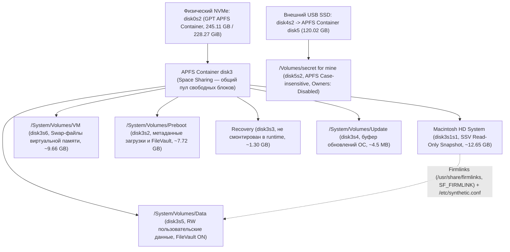
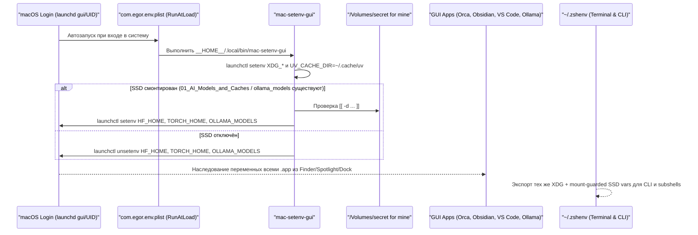

# 02 · Внутреннее устройство APFS, XDG-дисциплина и двухуровневая среда macOS

> **Навигация:** [00 · Мастер-индекс](00_master_index_and_system_map.md) | ← [01 · Архитектура 3 контуров](01_three_plane_filesystem_architecture.md) | [03 · Стек 1 и Красная книга безопасности →](03_cleanup_stack_and_safety_bible.md) | [README репозитория](../README.md)

---

## 1. Анатомия APFS-контейнера macOS и Firmlinks

На Apple Silicon (macOS Big Sur — Tahoe `26.7.1`) загрузочный диск организован не как набор жёстко нарезанных разделов фиксированного размера, а как единый **APFS-контейнер с динамическим разделением свободного пространства (Space Sharing)**. Все логические тома внутри контейнера берут блоки из общего пула по мере роста и возвращают их при удалении.



### Ключевые архитектурные механизмы контейнера

1. **Sealed System Volume (SSV, `disk3s1s1`):** корень `/` смонтирован из криптографически подписанного, доступного только на чтение снэпшота APFS (`com.apple.os.update-...`). Изменение системного тома нарушает подпись и блокирует загрузку ОС.
2. **Firmlinks (`SF_FIRMLINK`) и `/etc/synthetic.conf`:** чтобы системный том `/` и перезаписываемый том `/System/Volumes/Data` (`disk3s5`) выглядели в Finder и терминале как единое POSIX-дерево, ядро macOS сшивает их двунаправленными мостами **firmlinks** (список описан в `/usr/share/firmlinks` — например, `/Users`, `/Applications`, `/Library`). Файл `/etc/synthetic.conf` позволяет объявлять пустые синтетические каталоги или симлинки в корне `/` без нарушения печати SSV.
3. **Ловушка двойного учёта `/` vs `/System/Volumes/Data`:** если запустить `du` одновременно по `/` без ограничений границ тома, он провалится через firmlinks внутрь `/System/Volumes/Data`, либо при отдельном суммировании `/` + `Data` даст завышенный результат. В `Mac Nexus` (см. [`scanner.py`](../src/mac_nexus/scanner.py#L75)) `ScanEnvironment.nvme_mount` нацелен **строго** на `Path("/System/Volumes/Data")`, а обходы всегда используют `os.scandir()` без следования симлинкам (`follow_symlinks=False`).
4. **APFS `Case-insensitive` vs `Case-sensitive` и отказ от ExFAT:**
   - Основной внутренний том и рабочий внешний SSD должны оставаться **`APFS (Case-insensitive)`** — многие macOS-приложения (Adobe Creative Cloud, игры, ряд инсталляторов) ломаются на регистрозависимых томах. Если для сборки Linux-ядра или AOSP всё же потребуется регистрозависимость, в том же APFS-контейнере можно создать отдельный том `APFS (Case-sensitive)` — он будет делить общий пул свободного места без переразметки.
   - **Почему внешний SSD запрещено держать на ExFAT для dev/AI-задач:** ExFAT не имеет журналирования (обрыв USB-C или сон часто ломает FAT до read-only), не поддерживает POSIX-симлинки (ломаются `.venv/bin/python` и `node_modules/.bin/*`), не хранит права `+x`, плодит мусорные `._*` AppleDouble-файлы вместо нативных `xattr`/Finder-тегов, не умеет `clonefile(2)`, снэпшоты и Time Machine. Кроме того, `diskutil` **не поддерживает** конвертацию или безопасное сжатие ExFAT → APFS «на месте» (только полный слив данных → `diskutil eraseDisk APFS ... GPT /dev/diskN` → обратное копирование без `._*`).
   - Проверенный факт по нашей станции: внешний том `/Volumes/secret for mine` (`disk5s2`) **уже отформатирован в `APFS (Case-insensitive)`** (небольшой 16.8 MB раздел `disk4s1 Microsoft Reserved` в начале `disk4` безвреден и не требует переразметки диска).

---

## 2. Семантика APFS: CoW `clonefile(2)`, разреженные файлы и реальное свободное место

### 2.1 Copy-on-Write (`clonefile(2)`) и почему `UV_CACHE_DIR` обязан жить на внутреннем APFS

Внутри одного тома APFS системный вызов [`clonefile(2)`](https://developer.apple.com/documentation/system/1502476-clonefile) (также `cp -c` и дублирование `Cmd+D` в Finder) создаёт новый inode, указывающий на **те же самые физические экстенты на SSD**. Клонирование занимает `0` дополнительных блоков данных и выполняется мгновенно; физическая запись происходит только при последующей модификации конкретных блоков (**Copy-on-Write**).

#### Критическая ловушка кросс-томного `UV_CACHE_DIR`

Пакетный менеджер Python **`uv`** по умолчанию работает в режиме `--link-mode=clone` (APFS `clonefile(2)`):

- Когда `UV_CACHE_DIR="$HOME/.cache/uv"` находится на **внутреннем томе `disk3s5`**, а виртуальные окружения `~/Projects/*/.venv` лежат на том же томе `disk3s5`, создание `.venv` с десятками пакетов не копирует байты — все неизменяемые файлы `.so`/`.py` клонируются мгновенно с нулевым расходом SSD.
- Если перенести `UV_CACHE_DIR` на внешний SSD (`/Volumes/secret for mine/...`), пока проекты живут на внутреннем `~/Projects/`, `clonefile(2)` **между двумя разными томами APFS падает с ошибкой `EXDEV`** (Cross-device link). В результате `uv` молча откатывается к медленному побайтовому копированию (`UV_LINK_MODE=copy`), тратит ресурс записи SSD (TBW) и дублирует весь объём пакетов на обоих дисках!

**Инженерное правило:** в [`zshenv.snippet.zsh`](../automation/zsh/zshenv.snippet.zsh) и [`mac-setenv-gui`](../automation/bin/mac-setenv-gui) переменная `UV_CACHE_DIR` жёстко закреплена на внутреннем APFS (`"$HOME/.cache/uv"`), а объём кэша регулярно поджимается безопасной командой `uv cache prune --ci`. Переносить `UV_CACHE_DIR` на внешний SSD допустимо **только локально** для изолированных ML-окружений внутри `02_Project_Heavy/<slug>/`, чьи `.venv` физически создаются на том же внешнем APFS-томе. Аналогичное ограничение одного тома действует и для жёстких ссылок **`pnpm`** (`pnpm_config_store_dir` vs `node_modules`).

#### Ловушка учёта места у APFS-клонов (`Chrome code_sign_clone`)

Утилиты `ls -l`, *Свойства* Finder на отдельных файлах и обычный `du` суммируют **логические ссылки**, не зная об общих физических экстентах. Показательный пример из аудита нашей системы: каталог `/private/var/folders/*/X/com.google.Chrome.code_sign_clone` содержал 6 временных клонов с суммой `du = 8.61 GiB`, хотя уникальных физических блоков на диске они занимали существенно меньше, деля базовые блоки с `/Applications/Google Chrome.app`. Удаление одного клона освобождает `0` байт до тех пор, пока не удалены все ссылающиеся клоны и снэпшоты (поэтому безопасный сброс таких системных клонов — закрыть браузер и перезагрузить macOS, а не вырезать `/private/var/folders/*/X/` вручную).

---

### 2.2 Разреженные файлы (`INODE_IS_SPARSE`): `stat` vs `du`

APFS умеет хранить большие нулевые области («дыры», `INODE_IS_SPARSE`) исключительно в метаданных экстентов, не выделяя под них физические блоки на флеш-памяти.

Классический пример на нашей рабочей станции — образ виртуальной машины `OrbStack`:
`~/Library/Group Containers/HUAQ24HBR6.dev.orbstack/data/data.img.raw`

- **Логический (видимый) размер `st_size`:** `245,107,802,624 B` (**`228.27 GiB`** — равен полному потолку диска!).
- **Реально занятые физические блоки на NVMe:** `12,557,127,680 B` (**`11.695 GiB`**).

Чтобы никогда не путать логический потолок файла с реальным расходом SSD, используйте точное сравнение `st_size` и выделенных 512-байтовых блоков:

```zsh
# Сравнение логического размера (%z, байт) и выделенных 512-байтных блоков (%b)
stat -f "%z bytes logical vs %b blocks (512B) -> %N" \
  "$HOME/Library/Group Containers/HUAQ24HBR6.dev.orbstack/data/data.img.raw"

# du -h показывает реальное занятое место (по блокам), ls -lh — логический потолок
du -h "$HOME/Library/Group Containers/HUAQ24HBR6.dev.orbstack/data/data.img.raw"
```

> **Опасность при копировании:** инструменты, не поддерживающие `SEEK_HOLE`/`SEEK_DATA` или `clonefile(2)` (например, старый `cp` без `-c`, архиваторы без `-S`), разворачивают «дыры» в реальные нули, мгновенно пытаясь записать `228 GiB` на диск. Кроме того, Time Machine без фиксированного исключения `-p` может многократно обходить или разворачивать такие образы.

---

### 2.3 Finder «Доступно (Purgeable)» vs реальное свободное место (`NSURL` API)

Finder и *Системные настройки → Хранилище* показывают пользователю **оптимистичную цифру**, суммируя чистое свободное место и **Purgeable space** (очищаемые кэши обновления, локальные снэпшоты APFS, буферы стриминга/авиаобоев), которое ядро освободит только при нехватке пространства. В то же время `df -k` и `diskutil apfs list` (`Capacity Not Allocated`) считают Purgeable-блоки занятыми — что часто вызывает расхождение в `6–7 GB` между консолью и Finder.

В Apple Foundation API это различие выражается двумя разными ключами `NSURL`:

| Ключ `URLResourceValues` | Что возвращает | Когда критичен |
| :--- | :--- | :--- |
| **`NSURLVolumeAvailableCapacityKey`** | Строго свободные нераспределённые блоки на диске (без учёта Purgeable) | Определяет реальный запас до троттлинга APFS, свопа `VM` и отказа `write()` |
| **`NSURLVolumeAvailableCapacityForImportantUsageKey`** | Свободное место **плюс** Purgeable-ресурсы, которые macOS готова немедленно сбросить под важную задачу | Совпадает с тем, сколько система разрешит занять крупному приложению или установщику |

#### Реализация в `Mac Nexus` (`../src/mac_nexus/scanner.py`)

Для телеметрии Контура 1 [`scanner.py`](../src/mac_nexus/scanner.py#L514-L576) разделяет физическую ёмкость и Purgeable-резерв двумя функциями:

1. **`_disk_stats_from_plist_or_statvfs(env, mount_path)`** ([строки 514–540](../src/mac_nexus/scanner.py#L514-L540)): запускает `diskutil info -plist <mount_path>`, читает `TotalSize` / `APFSContainerSize` и `APFSContainerFree` / `FreeSpace` (при недоступности или ошибке откатывается к `os.statvfs()` через `f_blocks * f_frsize` и `f_bavail * f_frsize`). Таким образом в `planes.nvme.free_bytes` попадает строгое нераспределённое свободное место.
2. **`_nvme_purgeable_bytes(env)`** ([строки 543–576](../src/mac_nexus/scanner.py#L543-L576)): запрашивает системные `URLResourceValues` через лёгкий JXA-вызов (`osascript -l JavaScript`) с кэшированием на `10` секунд (`_PURGEABLE_CACHE`):
   ```javascript
   ObjC.import("Foundation");
   var url = $.NSURL.fileURLWithPath("/");
   var res = url.resourceValuesForKeysError($([
     "NSURLVolumeAvailableCapacityKey",
     "NSURLVolumeAvailableCapacityForImportantUsageKey"
   ]), null);
   JSON.stringify(ObjC.deepUnwrap(res));
   ```
   Вычисляет точную дельту `purgeable = important - avail` (если `important > avail > 0`) и возвращает её в поле `planes.nvme.purgeable_bytes` API `/api/telemetry`.

### 2.4 Сверка дисковых метрик: почему расходятся `df`, `diskutil`, `du` и Finder

При диагностике внутреннего NVMe без прав `root` пользовательский `du -d 1 -k -x /System/Volumes/Data` в базовом аудите показывал `161.41 GiB` (`173.31 GB`), тогда как `df -k` сообщал `184.45 GiB` (`198.07 GB`) — разница составляла **`~23.04 GiB` (`~24.75 GB`)**. Это нормальная математика APFS, складывающаяся из 4 факторов:

| Источник расхождения | Как влияет на `df` vs `du` | Как диагностируется |
| :--- | :--- | :--- |
| **TCC-защищённые и системные пути** | `du` без Full Disk Access получает `Operation not permitted` на `~/Pictures/Photos Library.photoslibrary`, `~/.Trash`, `/private/var/db`, `.Spotlight-V100` и Cryptexes | Запуск в Finder / проверка через `DaisyDisk` (*Scan as Administrator*) |
| **APFS Purgeable space (`~6.4–6.7 GB`)** | `df` включает очищаемые кэши/ресурсы в `Used`, а Finder прибавляет их к `Available` | `NSURLVolumeAvailableCapacityForImportantUsageKey` − `NSURLVolumeAvailableCapacityKey` |
| **Открытые отвязанные дескрипторы и призрачные `.dmg`** | Удалённые `.dmg`/кэши остаются занятыми на диске, пока открыт файловый дескриптор процесса или примонтирован образ (`disk >= 6`) | `hdiutil info -plist`, `lsof +L1` |
| **APFS CoW-клоны** *(обратный знак)* | `du` суммирует общие блоки повторно на каждом клоне (`com.google.Chrome.code_sign_clone`), тогда как `df` считает физические экстенты один раз | Перезагрузка macOS безопасно сбрасывает временные клоны подписи в `/private/var/folders/*/X/` |

---

## 3. Заглушки iCloud Drive `SF_DATALESS` (`0x40000000`) и защита от `fileproviderd`

В архитектуре File Provider (`fileproviderd`, macOS Sonoma/Sequoia/Tahoe) выгруженные в облако файлы остаются в локальном дереве каталогов в виде **dataless-заглушек** с установленным BSD-флагом **`SF_DATALESS` (`0x40000000`)** в поле `st_flags` структуры `stat(2)`.

Во время аудита системы в каталоге `~/Library/Mobile Documents/com~apple~CloudDocs` было зафиксировано (тогда как в самом `SecondBrain` таких заглушек было `0`):
- `3 703` из `3 714` файлов имели флаг `SF_DATALESS` (`0x40000000`);
- их суммарный логический размер `st_size` составлял **`17.91 GiB` (`18 342.86 MiB`)**;
- но реальный физический расход на внутреннем NVMe (`st_blocks * 512`) был равен всего **`84.00 KiB` (`86 016 B`)**!

### Почему это опаснейшая ловушка для скриптов

1. **Материализация «из воздуха» через `fileproviderd`:** если сканер или архиватор открывает файл на чтение (`open()`, `sha256`, `grep`), File Provider перехватывает системный вызов и начинает скачивать гигабайты из iCloud на локальный NVMe, мгновенно забивая диск.
2. **Ложная паника по размеру:** подсчёт `st_size` вместо `st_blocks` / проверки `SF_DATALESS` выдаёт фантомные `17.91 GiB` локального мусора там, где занято `84 KiB`.
3. **Удаление облачных данных командой `rm`:** вызов `rm` / `unlink()` по dataless-заглушке интерпретируется `fileproviderd` как намеренное удаление пользователем — файл стирается **и в iCloud Drive, и на всех остальных устройствах**.

### Как `Mac Nexus` защищён от `SF_DATALESS`

В [`scanner.py`](../src/mac_nexus/scanner.py#L20) объявлена константа `SF_DATALESS_FLAG = 0x40000000`. Обе функции подсчёта размеров используют только метаданные `lstat` без чтения содержимого файлов:

- **`_dir_size_and_latest_mtime(path)`** ([строки 256–289](../src/mac_nexus/scanner.py#L256-L289)): обходит дерево через `os.scandir()`, проверяет `if entry.is_symlink(): continue`, вызывает `st = entry.stat(follow_symlinks=False)` и при `getattr(st, "st_flags", 0) & SF_DATALESS_FLAG` **полностью пропускает файл**, не прибавляя его `st_size` и не вызывая `fileproviderd`.
- **`_secondbrain_stats(env)`** ([строки 579–627](../src/mac_nexus/scanner.py#L579-L627)): аналогично учитывает только реальные локальные файлы (`not (getattr(st, "st_flags", 0) & SF_DATALESS_FLAG)`), игнорируя симлинки и `.git`, но отслеживая `.md`-заметки и наличие запрещённого `node_modules`.

### Почему запрещены `.nosync` и `xattr`-костыли для кода в iCloud

В сети часто советуют прятать `node_modules` в iCloud через переименование `node_modules.nosync` + симлинк `ln -s node_modules.nosync node_modules` или через внутренний атрибут `xattr -w 'com.apple.fileprovider.ignore#P' 1 <dir>`. На практике оба приёма ненадёжны:
- iCloud синхронизирует *сам симлинк* на другой Mac, где целевой `.nosync`-папки нет (битая ссылка);
- ряд бандлеров и Python-утилит некорректно обрабатывают симлинки на дерево зависимостей;
- при `rm -rf node_modules && npm i` расширенный атрибут `xattr` уничтожается вместе с папкой, а поведение `fileprovider.ignore#P` нестабильно от релиза к релизу macOS.

Единственное надёжное правило — **строго физическое вынесение** `.git`, `node_modules`, `.venv` и живых SQLite WAL за пределы iCloud Drive (в Контур 1 или Контур 2).

---

## 4. Двухслойная XDG-среда macOS: CLI (`~/.zshenv`) + GUI (`LaunchAgent com.egor.env`)

### 4.1 Почему `~/.zshrc` не работает для GUI-приложений и агентов

До внедрения XDG-архитектуры в корне `~/` накопилось `65` скрытых точек, а все стандартные переменные окружения (`XDG_*`, `HF_HOME`, `TORCH_HOME`, `OLLAMA_MODELS`, `UV_CACHE_DIR`) были не заданы (`UNSET`). Однако прописать `export` только в `~/.zshrc` на macOS принципиально недостаточно:

| Механизм задания переменных | Виден интерактивному `zsh` | Виден неинтерактивным скриптам/агентам | Виден GUI-программам (`Orca`, `Obsidian`, `VS Code`, `Ollama`, `.app`) | Переживает перезагрузку | Архитектурный дефект |
| :--- | :--- | :--- | :--- | :--- | :--- |
| **`~/.zshrc`** | Да | **Нет** | **Нет** | Да | Читается только интерактивной оболочкой; GUI и subshell его игнорируют |
| **`~/.zshenv`** | Да | Да (для Zsh) | **Нет** | Да | GUI-приложения запускаются доменом **`launchd` (`gui/$(id -u)`)**, минуя Zsh |
| `launchctl setenv` внутри `~/.zshenv` | Да (если `export`) | Да | Только *после* запуска терминала | **Нет** (гонка при логине) | Finder, Dock и автостартующие `.app` запускаются раньше открытия терминала |
| **Двухслойный паттерн (`~/.zshenv` + `LaunchAgent com.egor.env`)** | **Да** | **Да** | **Да** | **Да** | Единственное корректное решение; открытые до перезагрузки GUI нужно перезапустить 1 раз |

*(Устаревшие глобальные механизмы `/etc/launchd.conf` и `~/.launchd.conf` давно отключены Apple и игнорируются современными версиями macOS.)*

---

### 4.2 Эталонная реализация двух слоёв в `Mac Nexus`



1. **Слой 1 — CLI и оболочки ([`automation/zsh/zshenv.snippet.zsh`](../automation/zsh/zshenv.snippet.zsh)):**
   Устанавливается в `~/.zshenv`. Экспортирует 4 базовых XDG-корня, закрепляет `UV_CACHE_DIR="$HOME/.cache/uv"`, идемпотентно добавляет `$HOME/.local/bin` в `PATH` и устанавливает переменные ИИ-кэшей строго под защитой проверки существования каталогов на смонтированном внешнем SSD:
   ```zsh
   export XDG_CONFIG_HOME="$HOME/.config"
   export XDG_CACHE_HOME="$HOME/.cache"
   export XDG_DATA_HOME="$HOME/.local/share"
   export XDG_STATE_HOME="$HOME/.local/state"
   export UV_CACHE_DIR="$HOME/.cache/uv"

   if [[ -d "/Volumes/secret for mine/01_AI_Models_and_Caches" ]]; then
     export HF_HOME="/Volumes/secret for mine/01_AI_Models_and_Caches/huggingface"
     export TORCH_HOME="/Volumes/secret for mine/01_AI_Models_and_Caches/torch"
     export OLLAMA_MODELS="/Volumes/secret for mine/ollama_models"
   elif [[ -d "/Volumes/secret for mine/ollama_models" ]]; then
     export OLLAMA_MODELS="/Volumes/secret for mine/ollama_models"
   fi
   ```
   *(Во всех живых окружениях — `zsh -ilc` и `launchctl getenv` — значения обеих систем синхронизированы для всех 8 переменных.)*

2. **Слой 2 — Домен `launchd` для GUI ([`automation/launchd/com.egor.env.plist.tmpl`](../automation/launchd/com.egor.env.plist.tmpl) + [`automation/bin/mac-setenv-gui`](../automation/bin/mac-setenv-gui)):**
   Шаблон `LaunchAgent` (где `__HOME__` при развёртывании заменяется на реальный `$HOME`) с параметром `RunAtLoad = true` и логами в `~/.local/state/mac-hygiene/com.egor.env.log` запускает скрипт `mac-setenv-gui` (`chmod +x`, `set -euo pipefail`).
   Ключевые особенности `mac-setenv-gui`:
   - Задаёт через `/bin/launchctl setenv`: `XDG_CONFIG_HOME`, `XDG_CACHE_HOME`, `XDG_DATA_HOME`, `XDG_STATE_HOME`, `UV_CACHE_DIR`.
   - Проверяет `_ssd="/Volumes/secret for mine"`: если `-d "$_ssd/01_AI_Models_and_Caches"`, прописывает `HF_HOME` и `TORCH_HOME`, иначе **принудительно сбрасывает их через `/bin/launchctl unsetenv`**, чтобы ни одно GUI-приложение не создало каталог на внутреннем диске при отключённом SSD!
   - Отдельно проверяет `-d "$_ssd/ollama_models"`, выставляя или сбрасывая `OLLAMA_MODELS`.

3. **Активация без перезагрузки и проверка:**
   ```zsh
   plutil -lint ~/Library/LaunchAgents/com.egor.env.plist
   launchctl bootstrap "gui/$(id -u)" ~/Library/LaunchAgents/com.egor.env.plist
   launchctl getenv HF_HOME
   launchctl getenv OLLAMA_MODELS
   # Уже запущенным GUI-программам (например, Ollama.app, Finder, Dock) нужен перезапуск
   ```

---

### 4.3 Защита от фантомной папки `/Volumes/secret for mine 1`

Если скрипт или запущенный от `root`/GUI процесс обращается к пути `/Volumes/<SSD_Name>/...` **в момент, когда внешний диск не подключён**, инструмент может выполнить `mkdir -p` прямо внутри локального каталога `/Volumes/` на внутреннем NVMe! Когда позже вы подключите физический USB-накопитель, macOS увидит, что точка `/Volumes/secret for mine` уже занята фантомной папкой, и смонтирует настоящий диск как **`/Volumes/secret for mine 1`**, сломав все пути.

Именно поэтому:
- в `~/.zshenv` и `mac-setenv-gui` применяется условный guard `[[ -d "/Volumes/secret for mine/..." ]]` + `unsetenv`;
- в `organize` (Правило #4 в [`config.yaml`](../automation/organize/config.yaml)) используется Python-фильтр `os.path.ismount("/Volumes/secret for mine")`;
- в `Mac Nexus` ([`scanner.py`](../src/mac_nexus/scanner.py#L195-L199), [`executor.py`](../src/mac_nexus/executor.py#L183-L184)) перед любым медиа-телепортом или показом полок вызывается `ssd_is_mounted()`, проверяющий `env.ssd_mount.exists() and os.path.ismount(str(env.ssd_mount))`.

---

### 4.4 Реестр XDG-перенаправлений и развенчанные мифы инструментов

| Переменная | Целевой путь | Критические нюансы и частые ошибки |
| :--- | :--- | :--- |
| **`XDG_CONFIG_HOME`** | `~/.config` | Хранит переносимые конфиги (`organize`, `git`, `yazi`, `zsh`), безопасные для бэкапа/Git |
| **`XDG_CACHE_HOME`** | `~/.cache` | Эфемерные кэши; корень исключён из Time Machine через `tmutil` |
| **`XDG_DATA_HOME`** | `~/.local/share` | Постоянные данные утилит (`uv`, `opencode`, `claude`, `gnupg`) |
| **`XDG_STATE_HOME`** | `~/.local/state` | Состояние рантаймов и журналы (`digest_latest.md`, `mac-nexus/history.json`, истории REPL) |
| **`XDG_RUNTIME_DIR`** | `$TMPDIR` | На macOS нет Linux `/run/user/$UID`; используется безопасный per-user `$TMPDIR` |
| **`UV_CACHE_DIR`** | **`~/.cache/uv`** *(внутренний APFS!)* | **НЕ выносить на внешний SSD** при локальных `~/Projects/*/.venv`, иначе ломается `clonefile(2)` (`EXDEV`) |
| **`HF_HOME`** | `/Volumes/secret for mine/01_AI_Models_and_Caches/huggingface` *(mount-guarded)* | Заменяет устаревший **`TRANSFORMERS_CACHE`** (`huggingface_hub >= 1.0` удалил и `huggingface-cli delete-cache` → теперь `hf cache ls/prune`) |
| **`TORCH_HOME`** | `/Volumes/secret for mine/01_AI_Models_and_Caches/torch` *(mount-guarded)* | Выносит чекпоинты и расширения PyTorch Hub на внешний SSD |
| **`OLLAMA_MODELS`** | `/Volumes/secret for mine/ollama_models` *(mount-guarded)* | `Ollama.app` читает эту переменную только через `launchctl setenv` + перезапуск |
| **`pnpm_config_store_dir`** | `~/.local/share/pnpm/store` *(или тот же APFS-том, что `node_modules`)* | **Миф:** `pnpm` игнорирует `NPM_CONFIG_CACHE` и не имеет переменной `PNPM_STORE_DIR`! Только `pnpm_config_store_dir` / `PNPM_CONFIG_STORE_DIR` |
| **`NPM_CONFIG_CACHE` / `NPM_CONFIG_USERCONFIG`** | `~/.cache/npm` / `~/.config/npm/npmrc` | Убирает `~/.npm` и `~/.npmrc` из корня `$HOME` |
| **`ZDOTDIR` / `HISTFILE` / `PYTHON_HISTORY`** | `~/.config/zsh` / `~/.local/state/zsh/history` / `~/.local/state/python/history` | Оставляет в `~/` только минимальный `~/.zshenv` (`PYTHON_HISTORY` нативно поддерживается в Python ≥ `3.13`) |
| **`CARGO_HOME` / `RUSTUP_HOME`** | `~/.local/share/{cargo,rustup}` | При изменении `CARGO_HOME` обязательно добавить `"$CARGO_HOME/bin"` в `PATH` |

Для периодического read-only аудита лишних скрытых файлов в `~/` рекомендуется [`xdg-ninja`](https://github.com/b3nj5m1n/xdg-ninja) (`brew install xdg-ninja --HEAD`), а для декларативного управления конфигами — `Brewfile` + `chezmoi` (или минималистичный `GNU Stow`).

### 4.5 Развёртывание переносимого комплекта и выбор `chezmoi` vs `GNU Stow`

В каталоге [`automation/`](../automation/README.md) лежат переносимые шаблоны без зашитых пользовательских путей (`__HOME__` вместо жёсткого `/Users/<user>`). Развёртывание и проверка двухслойного XDG-окружения выполняются тремя шагами:

```zsh
# 1. Скопировать скрипт и подставить $HOME в шаблон LaunchAgent
install -m 0755 automation/bin/mac-setenv-gui "$HOME/.local/bin/mac-setenv-gui"
sed "s|__HOME__|$HOME|g" automation/launchd/com.egor.env.plist.tmpl \
  > "$HOME/Library/LaunchAgents/com.egor.env.plist"

# 2. Валидировать синтаксис и загрузить в домен gui/$(id -u)
zsh -n "$HOME/.local/bin/mac-setenv-gui"
plutil -lint "$HOME/Library/LaunchAgents/com.egor.env.plist"
launchctl bootstrap "gui/$(id -u)" "$HOME/Library/LaunchAgents/com.egor.env.plist"

# 3. Проверить синхронность CLI и GUI доменов
zsh -ilc 'env | grep -E "^(XDG_|UV_CACHE|HF_HOME|TORCH_HOME|OLLAMA_MODELS)="'
launchctl getenv UV_CACHE_DIR
```

Для тиражирования dotfiles между Mac и Linux предпочтительнее **`chezmoi` + `Brewfile`**: в отличие от `GNU Stow`, `chezmoi` создаёт в `~/` настоящие регулярные файлы (не симлинки, которые ломают macOS-песочницы при атомарной перезаписи temp-file + `rename()`), поддерживает шаблоны `{{ .chezmoi.homeDir }}` для `LaunchAgents` и интегрируется с менеджерами секретов (`Keychain`/`age`). `GNU Stow` оправдан только для минималистичных одномашинных сборок.

---

## 5. Исключения Time Machine: `tmutil addexclusion` vs `-p` vs `-v`

Встроенный системный фильтр Time Machine (`.exclusions.plist` / `standardExclusionPaths`, сменивший старый `StdExclusions.plist`) пропускает системные служебные каталоги вроде `.Spotlight-V100` и `.Trashes`, но **не исключает** ваши `node_modules`, `.venv`, `target/`, кэши `~/.cache` и многогигабайтные веса нейросетей на внешнем SSD.

На macOS существуют **три принципиально разных режима `tmutil addexclusion`**, и выбор неправильного режима приводит либо к потере исключения после пересоздания кэша, либо к поломке при переименовании проекта:

| Режим и команда | Где хранится правило | Переживает `mv` / переименование? | Переживает `rm -rf` + повторное создание папки? | Нужен `sudo`? | Где применять |
| :--- | :--- | :--- | :--- | :--- | :--- |
| **Sticky `xattr` (по умолчанию)**<br>`tmutil addexclusion <path>` | Расширенный атрибут `com.apple.metadata:com_apple_backup_excludeItem` на самом объекте APFS | **Да** (атрибут едет вместе с каталогом) | **Нет!** Если папку удалить (`rm -rf node_modules` и снова `npm i`), атрибут пропадает | **Нет** | Конкретные `~/Projects/*/{node_modules,.venv,venv,target,dist,.next}`, `~/Downloads`, `orca/agent-runtimes`, стабильные полки SSD (`01_AI_Models_and_Caches`, `ollama_models`) |
| **Fixed-path (`-p`)**<br>`sudo tmutil addexclusion -p <path>` | Фиксированный абсолютный путь в `/Library/Preferences/com.apple.TimeMachine.plist` | **Нет** (ломается при переносе пути) | **Да!** Работает по пути, даже если кэш регулярно удаляют и создают с нуля | **Да** | Волатильные корни кэшей (`~/.cache`, `~/Library/Caches`, `~/.npm`, `~/.nuget`, `~/.local/share/uv`, `/opt/anaconda3/pkgs`, `~/.openclaw/logs`), а также **sparse-диск `OrbStack` (`~/Library/Group Containers/HUAQ24HBR6.dev.orbstack/data`)**! |
| **Volume UUID (`-v`)**<br>`sudo tmutil addexclusion -v /Volumes/<Name>` | Идентификатор **UUID** тома в `com.apple.TimeMachine.plist` | **Да** (привязан к UUID, не к имени) | **Да** (для всего тома) | **Да** | Исключение целиком временного/рабочего внешнего SSD, который не должен попадать в бэкап Time Machine |

### Верифицированные исключения на системе и команды проверки

В ходе развёртывания Stack 1 не требующие `sudo` липкие исключения (`tmutil addexclusion`) применены и проверены командой `tmutil isexcluded` (`[Excluded]`) для 10 существующих целей:
- `~/Downloads`, `~/.cache`, `~/.npm`, `~/.nuget`, `~/.local/share/uv`, `~/.openclaw/logs`
- `~/Projects/calisthenics-tracker/node_modules`, `~/Projects/gigaam-studio/.venv`
- `/Volumes/secret for mine/01_AI_Models_and_Caches`, `/Volumes/secret for mine/ollama_models`

Для корней кэшей с регулярным пересозданием папок и для 228-гигабайтного sparse-образа `OrbStack` рекомендуется дополнительно закрепить правила на уровне фиксированных путей (`-p`):

```zsh
# Проверка статуса любого пути:
tmutil isexcluded "$HOME/.cache" "$HOME/Library/Caches" \
  "$HOME/Library/Group Containers/HUAQ24HBR6.dev.orbstack/data"

# Фиксированные исключения, переживающие удаление и пересоздание каталогов (требуется sudo):
sudo tmutil addexclusion -p \
  "$HOME/.cache" \
  "$HOME/Library/Caches" \
  "$HOME/.npm" \
  "$HOME/.nuget" \
  "$HOME/.local/share/uv" \
  "$HOME/.openclaw/logs" \
  "/opt/anaconda3/pkgs" \
  "$HOME/Library/Group Containers/HUAQ24HBR6.dev.orbstack/data"

# Регулярный аудит локальных снэпшотов Time Machine на внутреннем APFS:
tmutil listlocalsnapshots /System/Volumes/Data
```

Если локальные снэпшоты Time Machine временно раздуваются и блокируют свободное место перед обновлением или тяжёлой сборкой, их не нужно удалять поштучно вслепую — используйте контролируемое прореживание ядром: `tmutil thinlocalsnapshots /System/Volumes/Data <bytes> 4`.

### 5.1 Паттерн атомарного APFS-снэпшота для off-site бэкапов SQLite WAL

Инструменты уровня `restic` и `kopia` не могут атомарно скопировать открытую базу данных SQLite в режиме Write-Ahead Logging (`*.db` + `*-wal` + `*-shm` у `Orca`, `Codex`, `Hermes`). Чтобы получить 100% консистентный off-site бэкап без остановки рабочих агентов, используется read-only локальный снэпшот APFS:

```zsh
# Концептуальный паттерн для root / Full Disk Access backup-скрипта:
SNAP_DIR="/private/tmp/apfs_snapshot_mnt"
SNAP_NAME=$(tmutil localsnapshot /System/Volumes/Data | awk -F': ' '/Created local snapshot/{print $2}')
mkdir -p "$SNAP_DIR"
trap 'umount "$SNAP_DIR" 2>/dev/null || true; tmutil deletelocalsnapshots /System/Volumes/Data "${SNAP_NAME#com.apple.TimeMachine.}" 2>/dev/null || true' EXIT

mount_apfs -o rdonly -s "$SNAP_NAME" /System/Volumes/Data "$SNAP_DIR"
restic backup --exclude-xattr \
  "$SNAP_DIR/Users/egorlabutin/Projects" \
  "$SNAP_DIR/Users/egorlabutin/.config" \
  "$SNAP_DIR/Users/egorlabutin/Library/Application Support/orca"
```

Таким образом резервная копия фиксирует замороженный во времени срез ФС на одном и том же транзакционном рубеже APFS.

---

## Связанные документы и модули кода

- [00 · Мастер-индекс и карта системы](00_master_index_and_system_map.md)
- [01 · Архитектура 3 контуров](01_three_plane_filesystem_architecture.md)
- [03 · Стек 1 и Красная книга безопасности](03_cleanup_stack_and_safety_bible.md)
- [04 · Backend, Scanner, Executor и Безопасность](04_backend_scanner_executor_and_security.md)
- [07 · Регламенты и Runbooks](07_automation_runbooks_and_troubleshooting.md)
- [08 · Гайд для агентов и Baseline-аудит](08_agent_onboarding_and_baseline_audit.md)
- [README репозитория](../README.md) · [CLAUDE.md](../CLAUDE.md)
- [automation/README.md](../automation/README.md) · [automation/zsh/zshenv.snippet.zsh](../automation/zsh/zshenv.snippet.zsh) · [automation/bin/mac-setenv-gui](../automation/bin/mac-setenv-gui) · [automation/launchd/com.egor.env.plist.tmpl](../automation/launchd/com.egor.env.plist.tmpl) · [automation/organize/config.yaml](../automation/organize/config.yaml)
- [src/mac_nexus/scanner.py](../src/mac_nexus/scanner.py) · [src/mac_nexus/executor.py](../src/mac_nexus/executor.py) · [tests/test_mac_nexus.py](../tests/test_mac_nexus.py)
