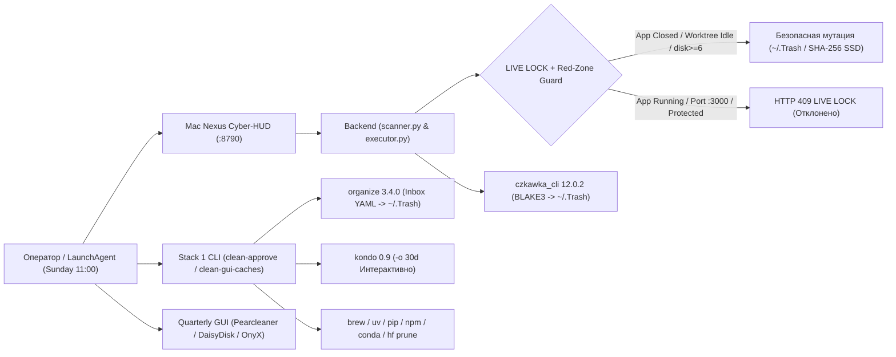

> **Навигация:** [00 · Мастер-индекс](00_master_index_and_system_map.md) | ← [02 · APFS, XDG и macOS-внутренности](02_macos_apfs_xdg_and_env_internals.md) | [04 · Backend, Scanner, Executor и Безопасность →](04_backend_scanner_executor_and_security.md) | [README репозитория](../README.md)

# 03 · Стек 1 и Красная книга безопасности Apple Silicon

Настоящий документ описывает инженерный выбор инструментального стека автоматизированной гигиены macOS (**Стек 1**) поверх уже используемого визуального анализатора **DaisyDisk**, точные CLI-спецификации и конфигурации, интегрированные в **Mac Nexus**, а также **Красную книгу безопасности Apple Silicon** — свод строгих инвариантов, нарушение которых приводит к инвалидации кодовых подписей, повреждению баз `SQLite WAL`, потере файлов в iCloud или поломке активных сред разработки.

---

## 1. Матрица оценки: коммерческие GUI-клинеры против Open-Source Стека 1

### 1.1 Где заканчивается `DaisyDisk` и зачем нужен надстроечный стек

`DaisyDisk` (на хосте установлена версия **`4.31`** в `/Applications/DaisyDisk.app`; актуальная ветка **`4.34.2`**, standalone-лицензия **$9.99** на 5 Mac предпочтительнее sandbox-редакции из Mac App Store за счёт режима *Scan as Administrator*) остаётся эталоном для реактивного визуального анализа (treemap). Он корректно учитывает APFS-клоны, cloud-only заглушки и раскрывает *Hidden Space* (`Purgeable Space`, локальные снапшоты Time Machine).

Однако `DaisyDisk` принципиально спроектирован только как ручной инспектор занятого пространства и **не решает** четыре системные задачи:
1. Деинсталляцию `.app` со сбором остатков в `~/Library` (`Application Support`, `Caches`, `Containers`, `Preferences`, `LaunchAgents`) и поиск «сирот» от давно удалённых программ.
2. Поиск бинарных и похожих дубликатов файлов в рабочих папках и медиаархивах.
3. Автоматическую разметку и триаж `~/Downloads`, скриншотов и тяжёлых экспортов по возрасту (`date_added`).
4. Безопасную возрастную очистку сборочных артефактов разработчика (`node_modules`, `.venv`, `target`) с защитой активных Git worktrees и запущенных серверов.

### 1.2 Полная сравнительная матрица инструментов (2025–2026)

| Инструмент / Стек | Версия / Статус (на хосте) | Стоимость / Лицензия | Фоновый след / Механизм | Роль в системе и вердикт для Mac Nexus |
| :--- | :--- | :--- | :--- | :--- |
| **Коммерческие и Pro GUI** | | | | |
| **CleanMyMac 5** (MacPaw) | `v5.7.2` (отклонён) | `$39.95/год` или `$119.95` (или Setapp) | `CleanMyMac Menu` + `Health Monitor` + `Moonlock` (`~30–60 МБ` RAM, `0–0.5%` CPU + пики) | **Отклонён:** дублирует `DaisyDisk` (`Space Lens`), навязывает вредный сброс RAM и тотальную очистку кэшей, не решает триаж `Downloads`, XDG и защиту `Orca` worktrees |
| **Sensei 2** (Cindori) | `v2.0.2` (отклонён) | `$29/год` или `$59` (до 3 Mac) | Единый `Sensei Monitor` `LaunchDaemon` (`~100 МБ` RAM, `~1–2%` CPU при опросе) | **Отклонён:** тяжёлый демон ради мониторинга S.M.A.R.T./термодатчиков и TRIM; функционал очистки не покрывает `kondo`/XDG/iCloud |
| **DaisyDisk** | **`4.31`** (`/Applications/DaisyDisk.app`, ветка `4.34.2`) | `$9.99` разово (уже куплен, standalone) | Нулевой фоновый след (on-demand) | **Принят (Ядро визуального аудита):** ежеквартальный *Scan as Administrator*, запуск из вкладки `ПУЛЬТ КОНТУРОВ` |
| **Noodlesoft Hazel 6** | `v6.1.2` (опция Стек 2) | `$42` разово (2 Mac; `$20` апгрейд) | `hazelhelper` + `hazelworker` по каталогам (`~15–30 МБ`), FSEvents + Finder *Revert* | **Опциональный апгрейд Стека 2:** оправдан только если понадобится GUI-конструктор правил и встроенный OCR для переименования PDF-чеков; в Стеке 1 заменён на `organize` |
| **Nektony App Cleaner & Uninstaller** | `v9.2` / `v10.x` | `$14.95/год` или `$34.95` разово | Опциональные хелперы, аудит `LaunchAgents` | **Не требуется:** аудит расширений и деинсталляция покрываются `Pearcleaner` + ручным контролем `LaunchAgents` |
| **BuhoCleaner / TrashMe 3** | `v1.16.1` / `v3.8` | `~$19–25` / `~$15–18` разово | Меню-бар виджет (Buho) / `Watchdog` (TrashMe) | **Отклонены:** `BuhoCleaner` продвигает кнопку «Free RAM»; `TrashMe 3` избыточен при наличии `Pearcleaner` |
| **AppCleaner** (FreeMacSoft) | `v3.7` (macOS 15+) | `$0` (closed-source freeware) | `SmartDelete` (перехват `.app` в Корзине) | **Резерв для Pearcleaner:** не ищет старых «сирот», но активно поддерживается и служит запасным вариантом |
| **Gemini 2** (MacPaw) | Коммерческий | `~$1.95/мес` или `$13–40` (или Setapp) | On-demand GUI; удаление платное | **Отклонён:** уступает по скорости и прозрачности Rust-движку `Czkawka` (`BLAKE3`) |
| **Open-Source Стек 1 (принят)** | | | | |
| **Pearcleaner** | **`5.4.3`** (`/Applications/Pearcleaner.app`) | `$0` (Apache-2.0 + Commons Clause) | Опциональный **Sentinel** (`~2 МБ` RAM), поиск «сирот» в `~/Library`, UI для Homebrew | **Принят с жёстким правилом:** **Sentinel ON**, **App Lipo строго OFF**; ставить только из GitHub или `brew install --cask pearcleaner` |
| **OnyX** (Titanium Software) | `v5.0.6` под macOS Tahoe 26 *(ставится при ремонте)* | `$0` (closed-source freeware) | Нулевой фоновый след; привязан строго к мажорной версии macOS (`4.8.5` Sequoia / `5.0.6` Tahoe / `5.1.2` Golden Gate) | **Принят строго по требованию:** для точечной пересборки Launch Services и Spotlight; запрещён для еженедельной очистки кэшей |
| **organize** (`organize-tool`) | **`3.4.0`** (`/opt/homebrew/bin/organize`) | `$0` (MIT, Python) | Разовый CLI по расписанию/запросу; `organize sim` (dry-run) + `date_added` + `macos_tags` | **Ядро триажа `~/Downloads`:** предпросмотр в воскресном дайджесте, применение в `clean-approve` и API |
| **kondo** | **`0.9`** (`/opt/homebrew/bin/kondo`) | `$0` (MIT, Rust) | Разовый интерактивный CLI (`-o 30d`), 20+ экосистем сборки | **Ядро ручного CLI-ревизора:** только интерактивно в `clean-approve`; в бэкенде заменён Python-сканером возраста |
| **czkawka_cli** (`czkawka`) | **`12.0.2`** (`/opt/homebrew/bin/czkawka_cli`) | `$0` (MIT, Rust) | Многопоточный CLI (`BLAKE3`), без телеметрии; есть Slint GUI `Krokiet` | **Ядро вкладки `ДУБЛИКАТЫ`:** JSON-отчёт `-C` для `Mac Nexus`, обход с исключением `.app` и `.photoslibrary` |
| **dust** | **`1.2.7`** (`/opt/homebrew/bin/dust`) | `$0` (Apache-2.0, Rust) | Read-only CLI-дерево размеров | **CLI-рентген:** быстрая диагностика папок в терминале (`dust -d 2 ~/Library`) |
| **fd** | **`10.5.2`** (`/opt/homebrew/bin/fd`) | `$0` (MIT/Apache-2.0, Rust) | Read-only CLI-поиск без Spotlight | **Поиск в контурах:** работает внутри `~/Projects` и SSD с отключённым Spotlight |
| **yazi** | **`26.9.1`** (`/opt/homebrew/bin/yazi`) | `$0` (MIT, Rust) | Асинхронный TUI-файловый менеджер | **Работа с Plane 2:** разбор `90_Cold_Archive` и `04_Media_Archive` в терминале |
| **zoxide** | **`0.10.0`** (`/opt/homebrew/bin/zoxide`) | `$0` (MIT, Rust) | Умная навигация (`z`), инициализируется в `~/.zshrc` | **Навигация по статичным путям:** мгновенные переходы без переименования `~/Projects/<slug>` |
| **eza** | **`0.23.5`** (`/opt/homebrew/bin/eza`) | `$0` (MIT, Rust) | Замена `ls` с флагами `--git` | **Аудит деревьев в CLI:** наглядное отображение прав, размеров и Git-статуса |
| **tag** (`jdberry/tag`) | **`v0.10.0`** (`tag 0.10_1`, `/opt/homebrew/bin/tag`) | `$0` (MIT) | CLI-управление Finder xattr тегами | **Синхронизация тегов:** 5-теговая система (`inbox`, `active`, `heavy`, `archive`, `review-delete`) |

**Оценка смежных OSS-комбайнов (`tw93/Mole`, `caezium/burrow`, `mac-cleanup-py`):**
- `tw93/Mole` (`mo clean --dry-run`, `mo analyze`, GPL-3.0) и его нативный SwiftUI-интерфейс `caezium/burrow` хорошо работают как обзорные утилиты, но в `Mole` встроена опасная команда `mo slim` (урезание архитектуры через `lipo`), а управление проектами не учитывает локальные живые порты и сессии `Orca`.
- `mac-cleanup/mac-cleanup-py` при конфигурации по умолчанию активирует модули `inactive_memory` (`sudo purge`), `trash` (принудительное опустошение Корзины) и `ios_backups`, что нарушает принцип обратимости (`~/.Trash`) и требует жёсткой ручной фильтрации.
- **Native Apple `Shortcuts` (macOS Tahoe 26) и `Folder Actions`:** не подходят как замена `organize`/`Hazel`, поскольку триггеры папок в Shortcuts нестабильны на внешних дисках, деградируют при ~10 000+ файлов в каталоге, страдают от гонок на недописанных загрузках и не имеют состояния/отката.

> [!WARNING]
> **Критичные предупреждения по `Pearcleaner`:**
> 1. Версии `v4.4.0`–`v4.5.1` содержали локальную уязвимость повышения привилегий до `root` (**`CVE-2025-54595`**) в XPC-демоне `PearcleanerHelper` (передача невалидированных строк в `bash -c`). Обязательно используйте **`v4.5.2+` / `v5.4.3`** (установлена `5.4.3`).
> 2. Поисковая выдача периодически выводит поддельные домены-двойники (например, `pearcleaner.com`), распространяющие стилер-скрипты (ClickFix). Устанавливайте и обновляйте программу **исключительно** через `brew install --cask pearcleaner` или официальный репозиторий `github.com/alienator88/Pearcleaner`.
> 3. Разработка `Pearcleaner v5.4.3` поставлена автором на паузу (*Maintenance Mode*). В случае несовместимости на будущих версиях macOS она штатно заменяется на `AppCleaner v3.7` (`SmartDelete`).

### 1.3 Почему отвергнуты CleanMyMac, `lipo`-утилиты и авто-очистители RAM

1. **Псевдо-оптимизация «Освободить RAM» (`purge`):** На Apple Silicon (Unified Memory) операционная система кэширует недавно прочитанные файлы в свободной оперативной памяти. Запуск `sudo purge` (в CleanMyMac, BuhoCleaner или `mac-cleanup-py`) сбрасывает этот кэш: macOS немедленно вынуждена считывать страницы заново с NVMe, увеличивая задержки и износ контроллера. Реальной метрикой нехватки памяти является **Memory Pressure** и объём **Swap** — в `Mac Nexus` их рассчитывает [`_system_memory_metrics`](../src/mac_nexus/scanner.py#L880-L943) через `sysctl vm.swapusage` и `vm_stat`.
2. **Миф о «Системных данных» (System Data) и вред тотальной очистки кэшей:** Раздел *System Data* в macOS — это не физический каталог, а бухгалтерский остаток (`Total Used − Явные категории`). Его раздувают локальные APFS-снапшоты, 4K-заставки (`com.apple.wallpaper/aerials/videos`), образы контейнеров (`OrbStack data.img.raw`) и веса нейросетей. Еженедельное удаление всех каталогов в `~/Library/Caches` заставляет IDE, браузеры и аудио/видео-плагины перекомпилировать кэши заново, сжигая CPU и TBW SSD, а чистка `/var/db/diagnostics` уничтожает системные логи расследования сбоев.
3. **Разрыв с инженерным окружением:** Коммерческие «комбайны» не понимают разницы между `User/` и `Code Cache/` в Electron, не проверяют открытые Git worktrees `Orca.app`, не защищают локальные dev-серверы на `:3000` и не проверяют `os.path.ismount` перед переносом на внешний SSD.



---

## 2. Верифицированные CLI-спецификации и конфигурации в Mac Nexus

Все приведённые ниже команды, флаги и схемы проверены непосредственно по установленным бинарникам `/opt/homebrew/bin/*` и исходному коду [`scanner.py`](../src/mac_nexus/scanner.py), [`executor.py`](../src/mac_nexus/executor.py), а также скриптам в [`automation/`](../automation/README.md).

### 2.1 `organize` (`3.4.0`) — YAML-движок триажа `~/Downloads` и `~/Desktop`

Рабочий файл конфигурации располагается по пути `~/.config/organize/config.yaml`, а его переносимый шаблон хранится в [`automation/organize/config.yaml`](../automation/organize/config.yaml).

**Ключевые возможности схемы v3 (Pydantic + Jinja):**
- **`date_added` (macOS-эксклюзив):** Фильтрует файлы по времени их **добавления в Finder** (`kMDItemDateAdded`), а не по `mtime` внутри скачанного архива или DMG. В строках пути назначения доступно форматирование `{date_added.strftime('%Y-%m')}`.
- **`macos_tags` и `not macos_tags`:** Позволяют использовать 5-теговую систему (`inbox`, `active`, `heavy`, `archive`, `review-delete`) одновременно как фильтр исключения (не трогать помеченные `active (*)`) и как действие разметки.
- **`on_conflict` (имя поля в v3):** Единственно верное имя параметра разрешения конфликтов — **`on_conflict`** (не несуществующий `conflict_mode`). Поддерживаемые режимы: `skip`, `overwrite`, `trash`, `rename_new`, `rename_existing` и `deduplicate` (добавлен в v3.3.0; пропускает побайтовые дубликаты в месте назначения и безопасно переименовывает коллизии с разными содержимым). В правиле выноса на SSD задано `on_conflict: "rename_new"`.
- **`trash` вместо удаления:** Перемещает устаревшие установщики и скриншоты строго в `~/.Trash` с возможностью отката.
- **`python` SSD-guard:** В Правиле №4 встроен Python-предикат:
  ```python
  import os
  return os.path.ismount("/Volumes/secret for mine") and os.path.isdir("/Volumes/secret for mine/04_Media_Archive")
  ```
  Если внешний SSD не смонтирован, правило возвращает `False` ещё на стадии фильтрации — это гарантирует, что `organize` не создаст на внутреннем NVMe фиктивную папку `/Volumes/secret for mine`, ломающую последующее монтирование (появление `/Volumes/secret for mine 1`).
- **Ограничение по Spotlight/xattr:** У `organize` нет встроенных ключевых слов для Spotlight-комментариев или `kMDItemWhereFroms` — при необходимости используются фильтры `shell` (`mdls`) или `python`.

**Таблица действующих правил (`config.yaml`):**

| № | Правило | Локация и глубина | Фильтры | Действие |
| :-: | :--- | :--- | :--- | :--- |
| 1 | `Downloads: trash stale installers (>7d)` | `~/Downloads` (`max_depth: 1`) | Расширения `dmg, pkg, exe, iso`; `date_added` старше 7 дней | Тег `review-delete (red)` → `trash` |
| 2 | `Downloads/Desktop: expire untagged screenshots (>14d)` | `~/Downloads` (`depth: 2`), `~/Desktop` (`depth: 1`) | Префиксы `Screenshot`, `Screen Shot`, `Снимок экрана`; `png, jpg, jpeg`; `>14d`; `not macos_tags: ["active (*)", "archive (*)"]` | Тег `review-delete (red)` → `trash` |
| 3 | `Downloads: tag new files as inbox` | `~/Downloads` (`max_depth: 1`) | `date_added` новее 7 дней; нет тегов `inbox/active/heavy/archive` | Тег `inbox (orange)` |
| 4 | `Offload heavy media (>100 MB, >14d) to External SSD if mounted` | `~/Desktop`, `~/Downloads` (`max_depth: 1`) | `mov, mp4, mkv, tar, gz, 7z`; `size: "> 100 MB"`; `>14d`; `python` SSD-guard (`ismount`) | Тег `heavy (purple)` → `move` в `/Volumes/secret for mine/04_Media_Archive/{date_added.strftime('%Y-%m')}/` (`on_conflict: "rename_new"`) |
| 5 | `Downloads: flag untouched files >30d for manual triage` | `~/Downloads` (`max_depth: 1`) | `date_added` старше 30 дней; `not macos_tags: ["review-delete (*)", "active (*)"]` | Только тег `review-delete (red)` (безопасно, без перемещения) |

**Предпросмотр (Dry-Run) vs Применение:**
- Валидация схемы и полная симуляция без изменения диска (используется в [`mac-hygiene-digest`](../automation/bin/mac-hygiene-digest)):
  ```zsh
  organize check && organize sim
  ```
- Применение правил (вызывается только после подтверждения в [`clean-approve`](../automation/bin/clean-approve) или из `POST /api/execute` в [`_execute_single_target`](../src/mac_nexus/executor.py#L477-L479)):
  ```zsh
  organize check && organize run
  ```

**Сводка режимов `on_conflict` в `organize` v3 (`move` / `copy` / `rename` / `symlink`):**

| Значение `on_conflict` | Поведение при коллизии имени в папке назначения | Применение в Mac Nexus |
| :--- | :--- | :--- |
| `rename_new` *(по умолчанию)* | Добавляет суффикс-счётчик к переносимому файлу (`file 2.mov`) | **Используется в Правиле №4** (`04_Media_Archive/{date_added.strftime('%Y-%m')}/`) |
| `skip` | Пропускает перенос, оставляя исходник на месте | Для идемпотентных архивов без дублирования |
| `deduplicate` *(v3.3.0+)* | Сравнивает содержимое: точный дубликат в источнике пропускается, разное содержимое переименовывается | Рекомендуется при ручной консолидации папок медиа |
| `trash` | Отправляет конфликтующий старый файл в Корзину перед записью нового | Только с явной проверкой тегов |
| `overwrite` | Перезаписывает целевой файл без резервной копии | **Запрещён** в автоматических правилах |

**Эталонный фрагмент правила с SSD-guard (`automation/organize/config.yaml`):**
```yaml
  - name: "Offload heavy media (>100 MB, >14d) to External SSD if mounted"
    locations:
      - path: ~/Desktop
        max_depth: 1
      - path: ~/Downloads
        max_depth: 1
    filters:
      - extension: [mov, mp4, mkv, tar, gz, 7z]
      - size: "> 100 MB"
      - date_added:
          days: 14
          mode: older
      - python: |
          import os
          return os.path.ismount("/Volumes/secret for mine") and os.path.isdir("/Volumes/secret for mine/04_Media_Archive")
    actions:
      - macos_tags: "heavy (purple)"
      - move:
          dest: "/Volumes/secret for mine/04_Media_Archive/{date_added.strftime('%Y-%m')}/"
          on_conflict: "rename_new"
```

### 2.2 `kondo` (`0.9`) — Возрастной интерактивный reaper артефактов

`kondo` рекурсивно находит пересобираемые артефакты (Node `node_modules/`, Cargo `target/`, Python `.venv/`/`__pycache__/`, Swift `.build/`, Gradle `.gradle/` и т.д.) по более чем 20 экосистемам.

**Фактическая таблица флагов установленного `/opt/homebrew/bin/kondo` (`0.9`):**

| Флаг | Описание (`kondo --help`) | Политика применения в Mac Nexus |
| :--- | :--- | :--- |
| *(без флагов)* | Интерактивный запрос по каждому проекту: `delete above artifact directories? ([y]es/[n]o/[a]ll/[q]uit)` | Интерактивность включена **по умолчанию** |
| `-o, --older <OLDER>` | Проекты, где файлы не менялись дольше `<OLDER>` (`m`, `h`, `d`, `w`, `M`, `y`; по умолчанию `0d`) | **ОБЯЗАТЕЛЬНО** `-o 30d` (защита активных репозиториев и worktrees!) |
| `-I, --ignored-dirs <DIR>` | Исключаемые директории при обходе (`.kondoignore` не используется) | Опционально для точечных исключений в CLI |
| `-s, --same-filesystem` | Ограничить обход корневой файловой системой | Использовать вместо несуществующего `-r` при ручных прогонах |
| `-L, --follow-symlinks` | Следовать по симлинкам | Не включать при автоматизации во избежание выхода на SSD |
| `-a, --all` / `-q, --quiet` / `-d, --default` | Автоудаление без подтверждения (`-a`) | **ЗАПРЕЩЕНО** без жёсткого `-o <срок>` и предварительного аудита |
| `-n, --dry-run` | В сборке `0.9` печатает плоский список папок без удаления | **Не используется** в `Mac Nexus` и дайджесте (см. ниже) |

**Почему `Mac Nexus` и дайджест НЕ используют `kondo` при сканировании (важный архитектурный инвариант):**
1. В `kondo` **отсутствуют флаги `-i` (`--interactive`) и `-r` (`--restrict-filesystem`)** (исторически также в документации upstream отсутствовал `--dry-run`, из-за чего в [`CLAUDE.md`](../CLAUDE.md) зафиксирован прямой запрет на вызов `kondo` при неинтерактивном сканировании).
2. Даже при наличии текстового `-n` в `kondo 0.9`, утилита **не умеет** выдавать структурированный JSON, не детализирует вес отдельных подкаталогов (`node_modules` vs `.venv` vs `.pytest_cache`), не проверяет открытые порты `:3000`/`:8768` (`next-server`) и не распознаёт активные worktrees в `Orca.app`.
3. По этой причине:
   - В [`mac-hygiene-digest`](../automation/bin/mac-hygiene-digest) используется чистый read-only вызов `find "$HOME/Projects" -maxdepth 3 -type d \( -name node_modules -o -name .venv -o -name venv -o -name target \) -exec du -sh {} +`.
   - В [`_scan_dev_projects`](../src/mac_nexus/scanner.py#L1692-L1799) бэкенд `Mac Nexus` сканирует `~/Projects/*` **полностью на Python**: сравнивает `mtime` корня проекта и `.git/index` с параметром `older_days`, ищет директории из `PROJECT_ARTIFACT_NAMES` (`node_modules`, `.venv`, `venv`, `.pytest_cache`, `__pycache__`, `target`), считает размер с учётом `SF_DATALESS_FLAG` и сверяет каждый путь через `_find_project_lock` (`Orca` + `lsof` на `:3000,8768`).
   - В [`clean-approve`](../automation/bin/clean-approve) `kondo` вызывается **только интерактивно с порогом 30 дней**:
     ```zsh
     kondo -o 30d "$HOME/Projects"
     ```

### 2.3 `czkawka_cli` (`12.0.2`) — Криптографическая дедупликация (BLAKE3)

Стандартный паттерн вызова для точного поиска по хэшу `BLAKE3` файлов размером от 1 МиБ (`1048576` байт):
```zsh
czkawka_cli dup -d <target> -s hash -t blake3 -m 1048576 -C <json> -e <exclusions>
```
В установленной версии `czkawka_cli 12.0.2` метод поиска по умолчанию `-s` уже установлен в `HASH`, а тип хэша `-t` — в `BLAKE3`. В модуле [`scan_duplicates`](../src/mac_nexus/scanner.py#L3169-L3234) используется точная команда:
```text
/opt/homebrew/bin/czkawka_cli dup \
  -d <scan_dir> \
  -m 1048576 \
  -E "*/*.app/*,*/*.photoslibrary/*,*/.Trash/*" \
  -C <tmp_json> \
  -N -M -W \
  -e <excluded_dir_1> -e <excluded_dir_2> ...
```
- **Разрешённые области (`target`):** `downloads` (`~/Downloads`), `desktop` (`~/Desktop`), `documents` (`~/Documents`), `ssd_media` (`/Volumes/secret for mine/04_Media_Archive` при смонтированном SSD).
- **Таблица ключевых флагов `czkawka_cli dup` (`12.0.2`):**

| Флаг | Назначение | Параметр в Mac Nexus |
| :--- | :--- | :--- |
| `-d <DIR>` | Сканируемая директория (абсолютный путь) | Один из 4 allowlist-контуров (`downloads`, `desktop`, `documents`, `ssd_media`) |
| `-s <METHOD>` | Метод сравнения (`NAME`, `SIZE`, `SIZE_NAME`, `HASH`) | По умолчанию `HASH` (эквивалент `-s hash`) |
| `-t <HASH_TYPE>` | Алгоритм хэширования (`BLAKE3`, `CRC32`, `XXH3`) | По умолчанию `BLAKE3` (криптостойкий и многопоточный) |
| `-m <BYTES>` | Минимальный размер проверяемого файла (по умолчанию `8192`) | `-m 1048576` (`MIN_DUPLICATE_BYTES = 1 MiB`) |
| `-C <FILE>` | Экспорт результата в компактный JSON без форматирования | Временный файл `mac_nexus_dup_*.json` (удаляется в `finally`) |
| `-E <PATTERNS>` | Wildcard-исключения | `*/*.app/*,*/*.photoslibrary/*,*/.Trash/*` |
| `-e <DIR>` | Исключённые директории (быстрее `-E`, передаётся **по одной на флаг**) | Повторяющийся `-e` для каждой защищённой папки из `_collect_excluded_dirs` |
| `-N -M -W` | Подавить stdout-таблицу (`-N`), лог-сообщения (`-M`) и exit code `11` при находках (`-W`) | Всегда включены; JSON читается из `-C` |

- **Защита от пробелов в исключениях:** `_collect_excluded_dirs` находит все вложенные `.app`, `.photoslibrary`, `PROTECTED_DESKTOP_DIRS`, `SSD_LIVE_HEAVY_DIRS` и активные worktrees, после чего для каждого пути добавляется **отдельная пара аргументов** `["-e", ex_dir]` (покрыто тестом `test_duplicates_czkawka_parsing_and_trash_move` в [`test_mac_nexus.py`](../tests/test_mac_nexus.py#L755-L834)).
- **Детерминированная защита оригинала и GUI-альтернатива (`Krokiet`):** `parse_czkawka_compact_json` отфильтровывает симлинки и `is_protected_path`, сортирует каждую группу по кортежу `(mtime_ts, len(str(path)), str(path))`, назначает самый ранний файл (`idx == 0`) оригиналом (**«ОРИГИНАЛ / СОХРАНИТЬ»**), а выбранные копии удаляет исключительно через `move_to_trash` в `~/.Trash`. Для ручного визуального поиска *похожих* фото/видео (perceptual matching) в поставке `czkawka` используйте Slint-интерфейс **Krokiet**, никогда не указывая ему `Photos Library.photoslibrary`.

### 2.4 Экосистемные прунеры и CLI-навигация

В [`executor.py`](../src/mac_nexus/executor.py#L422-L469) и [`clean-approve`](../automation/bin/clean-approve) используются только штатные команды очистки пакетных менеджеров:

| Инструмент | Команда очистки (Live) | Предпросмотр / Детектор | Особенности безопасности на Apple Silicon |
| :--- | :--- | :--- | :--- |
| **Homebrew** | `brew cleanup --prune=all` | `brew cleanup -n` | Удаляет старые версии формул и кэши бутылок `~/Library/Caches/Homebrew`; `brew autoremove` не запускается в автомате без просмотра списка |
| **uv** | `uv cache prune --ci` | Размер `~/.cache/uv` | Удаляет временные скачанные wheels/sdist, **сохраняя** локальные кэши для мгновенного APFS `clonefile(2)`. `UV_CACHE_DIR` обязан оставаться на внутреннем NVMe (`$HOME/.cache/uv`), чтобы не словить cross-volume `EXDEV` |
| **pip** | `pip cache purge` | `~/Library/Caches/pip`, `~/.cache/pip` | Вызывается для `/opt/anaconda3/bin/python3` и `/opt/homebrew/bin/python3` при наличии `pip` |
| **npm** | `npm cache clean --force` | `~/.npm/_cacache` | Чистит только глобальный кэш загрузок `npm`, не затрагивая локальные `node_modules` |
| **Conda** | `conda clean -y --all` | `conda clean --all --dry-run --json` | Очищает `.conda`/`.tar.bz2` архивы в `/opt/anaconda3/pkgs`, **сохраняя** `base Python 3.12.4` (критично для `AI Drama Studio.app`) |
| **Hugging Face** | `hf cache prune` | `hf cache prune --dry-run` | В `huggingface_hub v1.0+` старая команда `huggingface-cli delete-cache` **удалена**! Используйте только `hf cache ls/prune/rm`, никогда не удаляя подпапки `blobs/` вручную через `rm` |
| **NuGet (.NET)** | Очистка `~/.nuget/packages` и `NuGet/v3-cache` | Размер кэшей + `pgrep -fi rider` | Блокируется флагом `LIVE LOCK`, если запущена IDE `JetBrains Rider` |
| **Go (`go`)** | `go clean -modcache` *(или `_clear_cache_dir_contents`)* | Размер `~/go/pkg/mod/cache/download` (`>= 10 MiB`) | Пересобираемый кэш скачанных Go-модулей (если `env.go_bin` не найден, очищается только каталог `download/`) |
| **Cargo (Rust)** | `_clear_cache_dir_contents` для `~/.cargo/registry/cache` | Размер `~/.cargo/registry/cache` (`>= 10 MiB`) | Удаляет сжатые `.crate`-архивы, не затрагивая `bin/` и конфигурации Cargo |

**Навигационные CLI-утилиты Стека 1 (работают в зонах без индексации Spotlight):**
- `dust 1.2.7` (`dust -d 2 ~/Library`) — быстрая оценка тяжеловесных директорий в терминале;
- `fd 10.5.2` — мгновенный поиск по `~/Projects` и SSD, игнорирующий `.git`/`node_modules`;
- `yazi 26.9.1` — TUI-файл-менеджер с предпросмотром для сортировки Plane 2;
- `zoxide 0.10.0` (`z <repo>`) — переход в репозитории без их перемещения (сохранение worktree);
- `eza 0.23.5` (`eza -la --git`) — читаемый листинг с Git-флагами;
- `tag v0.10.0` — просмотр и простановка 5 нативных Finder-тегов (`tag --find`, `tag --add`).

---

## 3. Красная книга безопасности Apple Silicon (Red-Zone Safety Bible)

Пять правил ниже представляют собой **абсолютные инженерные барьеры**. Они зашиты как в архитектуру процессов, так и в код проверок `Mac Nexus`.

### Правило 1 · Запрет `lipo` / `App Lipo` / `mo slim` (подписи и нотаризация)

Попытка «облегчить» `.app`-бандлы путём вырезания `x86_64`-слайсов из Universal Mach-O бинарников (`lipo -remove x86_64`) на Apple Silicon разрушает модель безопасности macOS:
1. **Инвалидация `CodeResources` и Notarization:** Изменение любого Mach-O-файла внутри бандла немедленно ломает криптографический хэш директории `Contents/_CodeSignature/CodeResources`, подпись **Apple Developer ID** и тикет нотаризации.
2. **Обязательная проверка подписей ядром `arm64`:** На Apple Silicon подсистема AMFI (Apple Mobile File Integrity) запрещает исполнение неподписанного кода (`SIGKILL` при старте). Из-за этого утилиты вроде `Pearcleaner App Lipo` или `mo slim` вынуждены накладывать локальную ad-hoc подпись (`codesign -fs -`).
3. **Крах из-за смешанных `Team ID` в Electron/Swift/Sparkle:** После ad-hoc переподписи главного бинарника все вложенные `.framework`, `dylib`, helper/renderer процессы Electron и фреймворк автообновлений `Sparkle` сохраняют оригинальный вендорский `Team ID`. При загрузке `dyld` фиксирует несоответствие `Team ID` между хост-бинарником и библиотеками и роняет приложение при старте; также ломаются Hardened Runtime entitlements, доступ к Keychain, iCloud и чеки Mac App Store, а следующее обновление приложения всё равно скачает Universal-сборку.
4. **Диагностика и политика:** Проверить целостность любого приложения можно без мутаций:
   ```zsh
   codesign --verify --deep --strict --verbose=2 "/Applications/Pearcleaner.app"
   ```
   Опция **App Lipo в `Pearcleaner.app` всегда должна оставаться выключенной**, а `mo slim` полностью исключён из стека.

### Правило 2 · Защита SQLite WAL, `LevelDB` и `IndexedDB` (`LIVE LOCK`)

Браузеры (Chrome, Yandex) и Electron-приложения (VS Code, Obsidian, Orca, Discord, Notion, Figma, Telegram, draw.io, Яндекс Музыка) активно используют SQLite в режиме **Write-Ahead Logging** (`*.db` + `*-wal` + `*-shm`), а также движки `LevelDB` и `IndexedDB`. Удаление кэшей или воркеров на работающем приложении приводит к рассинхронизации WAL-фреймов (`SQLITE_CORRUPT`) и повреждению открытых профилей.

В `Mac Nexus` проверка работает в два эшелона: при сборе кандидатов (`_scan_app_caches`) и **непосредственно перед исполнением** в [`_recheck_target_lock`](../src/mac_nexus/executor.py#L248-L295) (при нарушении возвращается `HTTP 409 LIVE LOCK`). Тот же список проверяется через `pgrep -x` в [`clean-approve`](../automation/bin/clean-approve) и [`clean-gui-caches`](../automation/bin/clean-gui-caches).

**Полный перечень отслеживаемых процессов [`MONITORED_APPS`](../src/mac_nexus/scanner.py#L170-L182):**
`Google Chrome`, `Yandex`, `Telegram`, `Obsidian`, `Orca`, `Code`, `Discord`, `Notion`, `Figma`, `draw.io`, `Yandex Music` / `Яндекс Музыка` (дополнительно `pgrep -fi rider` блокирует очистку кэшей `NuGet`).

**Точная граница допустимого ([`_expand_app_cache_dirs`](../src/mac_nexus/scanner.py#L1027-L1233)):**

| Приложение | Безопасный Allowlist (строго после `Cmd+Q`!) | Запрещённая Красная зона (НИКОГДА не удалять!) |
| :--- | :--- | :--- |
| **Google Chrome / Chrome for Testing / Yandex** | `~/Library/Caches/{Google/Chrome,Google/Chrome for Testing,Yandex/YandexBrowser}/*/{Cache,Code Cache}`; `Application Support/.../*/{GPUCache,DawnGraphiteCache,DawnWebGPUCache}`; `YandexBrowser/ShaderCache` | `Default/` корень профиля, `User Data`, `History*`, `Cookies*`, `Login Data`, `Bookmarks`, `Local Storage/`, `IndexedDB/`, `Session Storage/` |
| **VS Code** (`Code`) | `Application Support/Code/{Cache,Code Cache,GPUCache,CachedData,CachedExtensionVSIXs,DawnGraphiteCache,DawnWebGPUCache}` | `Code/User/`, `workspaceStorage/`, `globalStorage/`, `Cookies`, `Local Storage/` |
| **Obsidian** | `Application Support/obsidian/{Cache,Code Cache,GPUCache,Dawn*}` и `Partitions/*/{Cache,Code Cache,GPUCache,Dawn*}` | `obsidian.json`, `IndexedDB/`, `Local Storage/`, хранилище заметок |
| **Orca** | `Caches/orca-updater`, `Application Support/orca/{Cache,Code Cache,GPUCache,Dawn*}` и `Partitions/*/{Cache,Code Cache,GPUCache}` | `profiles/*/orca-data.json`, сессии терминалов, `agent-runtimes/`, SQLite БД состояния |
| **Notion / Figma / Discord / draw.io / Яндекс Музыка** | `{Cache,Code Cache,GPUCache,Dawn*}`, `Notion/Partitions/*/Service Worker/CacheStorage`, `Figma/DesktopProfile/*/{Cache,...,Service Worker/CacheStorage}`, `discord/logs`, `*-updater` | `notion.db*`, `FigmaAgent.app`, `Cookies`, `IndexedDB/`, `Local Storage/`, `config.json`, `*.db*`, `*-wal`, `*-shm` |
| **Telegram** | `Group Containers/6N38VWS5BX.ru.keepcoder.Telegram/*/temp`, `Containers/ru.keepcoder.Telegram/Data/tmp` | `account-*/postbox/` (база сообщений и медиа-кэш аккаунта вне `temp`), ключи шифрования |

> [!CAUTION]
> Перед запуском `clean-gui-caches` или снятием `LIVE LOCK` всегда закрывайте приложения штатно через **`Cmd+Q`** (не простым закрытием окна крестиком). В терминале `clean-gui-caches` действует по принципу fail-closed: если любой процесс из списка всё ещё жив в `pgrep -x`, скрипт завершается с ошибкой `exit 1` без единой мутации.

### Правило 3 · Ловушки iCloud `fileproviderd` (`SF_DATALESS`) и внутренняя защита `~/.Trash`

1. **Флаг `SF_DATALESS_FLAG` (`0x40000000`):** Облачные заглушки iCloud Drive в APFS выглядят как обычные файлы при вызове `stat().st_size` (на базовом аудите `com~apple~CloudDocs` показывал `17.91 GiB` логического объёма при реальных `84 KiB` на диске). В [`scanner.py`](../src/mac_nexus/scanner.py#L21) все подсчёты в `_dir_size_and_latest_mtime` и `_secondbrain_stats` проверяют `flags & SF_DATALESS_FLAG` и обходят дерево с `follow_symlinks=False`, чтобы исключить фантомные гигабайты и не провоцировать `fileproviderd` на массовую загрузку из облака.
2. **Катастрофа `rm` по `SF_DATALESS`:** Удаление заглушки через `rm` / `unlink` интерпретируется `fileproviderd` как **удаление файла в iCloud и на всех ваших устройствах**. Для освобождения локального места надлежит использовать только *Удалить загрузку (Remove Download)* в Finder.
3. **Запрет `.git`, `node_modules`, `.venv`, `.worktrees` и SQLite WAL внутри iCloud `SecondBrain`:** Десятки тысяч мелких файлов забивают SQLite-очередь `fileproviderd`, вызывая бесконечную загрузку CPU и конфликты версий (`index 2`, `HEAD 2`). В `Mac Nexus` путь `env.secondbrain_dir` полностью защищён в `is_protected_path`, а на Карточке 3 HUD контролируется индикатор `has_node_modules_risk`.
4. **Дисциплина `~/.Trash` вместо `rm -rf`:** Путь `env.trash_dir` защищён от сканирования и повторного удаления (`_is_within(cand, env.trash_dir)` в [`scanner.py`](../src/mac_nexus/scanner.py#L413-L414)). Все пользовательские файлы (`downloads_inbox`, `app_orphans`, тяжёлые файлы Deep Radar и дубликаты `czkawka_cli`) никогда не удаляются вслепую мимо Корзины — они переносятся через [`move_to_trash`](../src/mac_nexus/executor.py#L141-L168), где `_unique_dest_path` подбирает уникальное имя без перезаписи уже лежащих в Корзине файлов (а необратимая очистка самого `~/.Trash` вынесена на отдельную вкладку `05 · КОРЗИНА` с containment guard `_verify_inside_trash`).

### Правило 4 · Аппаратный барьер `hdiutil` (`disk0..disk5` неприкосновенны)

На хосте нижние номера дисковых устройств ядра заняты постоянными томами: `/dev/disk0` (физический NVMe), `/dev/disk3` (системный APFS-контейнер с `/`, `Data`, `VM`, `Preboot`, `Recovery`), `/dev/disk4`/`/dev/disk5` (внешний APFS SSD `/Volumes/secret for mine`). Примонтированные образы `.dmg` («призрачные» инсталляторы) получают номера `/dev/disk6` и выше.

**Двойной аппаратный барьер в коде:**
1. В [`_parse_hdiutil_images`](../src/mac_nexus/scanner.py#L711-L761) разбор `hdiutil info -plist` применяет маску `^(/dev/disk(\d+))(?:s\d+)?$`: любой образ с `disk_num < 6` **отбрасывается немедленно** (`whole_disk = None; break`).
2. Для `disk >= 6` запускается проверка `lsof <mount_point>`: если образ используется открытым окном Finder или установщиком, он помечается `locked: true`.
3. В [`_execute_single_target`](../src/mac_nexus/executor.py#L514-L522) перед вызовом `hdiutil detach` заново проверяется `re.fullmatch(r"/dev/disk(\d+)", dev)` и условие `int(m.group(1)) >= 6`.

### Правило 5 · Защищённые бандлы Desktop, живые боты, `OrbStack` и `Orca` worktrees

В [`scanner.py`](../src/mac_nexus/scanner.py#L155-L167) и [`is_protected_path`](../src/mac_nexus/scanner.py#L399-L433) заложены абсолютные исключения, гарантирующие неприкосновенность рабочих сред:
- **`PROTECTED_BUNDLE_SUFFIXES = (".app", ".photoslibrary")`:** Защищает все `.app`-лаунчеры на `~/Desktop` и медиатеку `Photos Library.photoslibrary` от любых операций сканирования, телепорта и дедупликации (прямое вмешательство в `.photoslibrary` разрушает SQLite-каталог и хардлинки Apple Photos).
- **`PROTECTED_DESKTOP_DIRS = ("Бот_автооткликов_Егор", "GPT_подключение_для_бота")`:** Каталоги живых ботов на Рабочем столе исключены на всех этапах (`_scan_downloads_inbox`, `_scan_offload_media`, `_collect_excluded_dirs`, `move_to_trash`).
- **Активные `Orca` worktrees и живые серверы:** [`detect_live_locks`](../src/mac_nexus/scanner.py#L608-L691) опрашивает `/Applications/Orca.app/Contents/Resources/bin/orca worktree ps --limit 30 --json` (с текстовым фоллбэком `parse_orca_worktrees_text`) и `lsof -nP -iTCP:3000,8768 -sTCP:LISTEN` (привязка по `cwd` запущенных процессов вроде `next-server`). Любой активный worktree или проект с живым процессом защищён от очистки артефактов.
- **Корневые живые директории SSD (`SSD_LIVE_HEAVY_DIRS`):** `ollama_models`, `local-jarvis-heavy`, `project-perimeter-heavy`, `calisthenics-tracker-heavy` на `/Volumes/secret for mine` полностью защищены `is_protected_path`.
- **Контроль `OrbStack` и `Aerials`:** `OrbStack` хранит диск VM как APFS sparse-файл (`data.img.raw` с логическим размером `~228 GiB` при реальном расходе ~`11.7 GiB`) — его нельзя копировать без sparse-поддержки или сжимать вслепую; в Deep Radar он отображается как неразрушаемый `hotspot`, а неиспользуемые образы и build cache безопасно сбрасываются штатно через `docker image/builder prune -f`. Заставки `~/Library/Application Support/com.apple.wallpaper/aerials/videos` удаляются в Корзину только при явном выборе цели в `system_cache` (если оставить динамические обои активными, `idleassetsd` скачает их повторно).
- **Атомарность телепорта `SHA-256`:** Функция [`teleport_file_sha256`](../src/mac_nexus/executor.py#L183-L245) перед удалением оригинала на NVMe проверяет `ssd_is_mounted(env)`, копирует во временный `.nexus.tmp`, вызывает `os.fsync()`, сверяет **байтовый размер И криптографический хэш `SHA-256`** источника и приёмника, и лишь после `os.replace()` удаляет исходный файл.

### 3.1 Сводная матрица барьеров безопасности

| Красная зона | Потенциальная угроза | Механизм защиты | Реализация в коде / скриптах |
| :--- | :--- | :--- | :--- |
| Universal `.app` на `arm64` | Поломка Developer ID / Notarization / `Team ID` через `lipo` | Запрет `App Lipo` и `mo slim` | Регламент Стека 1 (`Pearcleaner` Lipo OFF) |
| Работающие Electron / Browser | Повреждение `SQLite WAL` (`*-wal`/`*-shm`), `LevelDB`, `IndexedDB` | `pgrep -x` + `LIVE LOCK` (`HTTP 409`) + allowlist кэшей | [`MONITORED_APPS`](../src/mac_nexus/scanner.py#L170-L182), [`_recheck_target_lock`](../src/mac_nexus/executor.py#L248-L295), [`clean-gui-caches`](../automation/bin/clean-gui-caches) |
| iCloud Drive & `SecondBrain` | Облачное удаление через `rm` на `SF_DATALESS`; крах `fileproviderd` | Проверка `SF_DATALESS_FLAG`, исключение `secondbrain_dir` | [`SF_DATALESS_FLAG`](../src/mac_nexus/scanner.py#L21), [`is_protected_path`](../src/mac_nexus/scanner.py#L399-L433) |
| Системные и внешние диски | Отмонтирование NVMe / SSD вместо DMG | Жёсткий фильтр `disk_num >= 6` + `lsof` проверка | [`_parse_hdiutil_images`](../src/mac_nexus/scanner.py#L711-L761), [`_execute_single_target`](../src/mac_nexus/executor.py#L514-L522) |
| Рабочие проекты и Desktop-боты | Снос `.venv`/`node_modules` активных worktrees или ботов | Возраст в Python (`older_days`), `orca worktree ps`, `PROTECTED_DESKTOP_DIRS` | [`_scan_dev_projects`](../src/mac_nexus/scanner.py#L1692-L1799), [`detect_live_locks`](../src/mac_nexus/scanner.py#L608-L691) |
| Медиа-телепорт и дубликаты | Потеря файла при обрыве USB или коллизии имён | `ismount` + `fsync` + `SHA-256` паритет; `move_to_trash` | [`teleport_file_sha256`](../src/mac_nexus/executor.py#L183-L245), [`move_to_trash`](../src/mac_nexus/executor.py#L141-L168) |

### 3.2 Команды форензик-проверки Красной зоны (Read-Only)

Перед добавлением новых целей очистки в [`scanner.py`](../src/mac_nexus/scanner.py) или ручной ревизией в терминале используйте следующие безопасные команды диагностики:

```zsh
# 1. Проверка подписи и нотаризации .app-бандла (убедиться, что lipo не ломал Team ID)
codesign --verify --deep --strict --verbose=2 "/Applications/Pearcleaner.app"
spctl --assess --type execute --verbose=4 "/Applications/Pearcleaner.app"

# 2. Проверка отсутствия запущенных GUI-процессов и открытых файлов (SQLite WAL Guard)
pgrep -x "Google Chrome" "Yandex" "Telegram" "Obsidian" "Orca" "Code" "Discord" "Notion" "Figma" "draw.io" "Яндекс Музыка" || echo "ALL TARGET APPS STOPPED"

# 3. Целостность локальной SQLite БД (строго при закрытом приложении!)
sqlite3 "$HOME/Library/Application Support/Notion/notion.db" "PRAGMA integrity_check;"

# 4. Отличие реальных физических блоков от логического st_size (SF_DATALESS / sparse)
stat -f "flags=%#Xf logical=%z blocks_512=%b name=%N" "$HOME/Library/Group Containers/HUAQ24HBR6.dev.orbstack/data/data.img.raw"

# 5. Инспекция активных Orca worktrees и примонтированных DMG (только disk >= 6)
/Applications/Orca.app/Contents/Resources/bin/orca worktree ps --limit 30
hdiutil info | grep -E "image-path|/dev/disk"
```

---

## Связанные документы и модули кода

- Мастер-карта системы: [00 · Мастер-индекс](00_master_index_and_system_map.md)
- Контур хранения и APFS/XDG-основа: [01 · Архитектура 3 контуров](01_three_plane_filesystem_architecture.md), [02 · APFS, XDG и macOS-внутренности](02_macos_apfs_xdg_and_env_internals.md)
- Реализация защиты и сканеров: [04 · Backend, Scanner, Executor и Безопасность](04_backend_scanner_executor_and_security.md), [scanner.py](../src/mac_nexus/scanner.py), [executor.py](../src/mac_nexus/executor.py)
- Автотесты инвариантов безопасности: [test_mac_nexus.py](../tests/test_mac_nexus.py)
- Регламенты запуска и устранение сбоев: [07 · Регламенты и Runbooks](07_automation_runbooks_and_troubleshooting.md), [automation/README.md](../automation/README.md)
- Портативные конфигурации и скрипты Стека 1: [config.yaml](../automation/organize/config.yaml), [mac-hygiene-digest](../automation/bin/mac-hygiene-digest), [clean-approve](../automation/bin/clean-approve), [clean-gui-caches](../automation/bin/clean-gui-caches)
- Паспорт репозитория и правила разработки: [README.md](../README.md), [CLAUDE.md](../CLAUDE.md)
