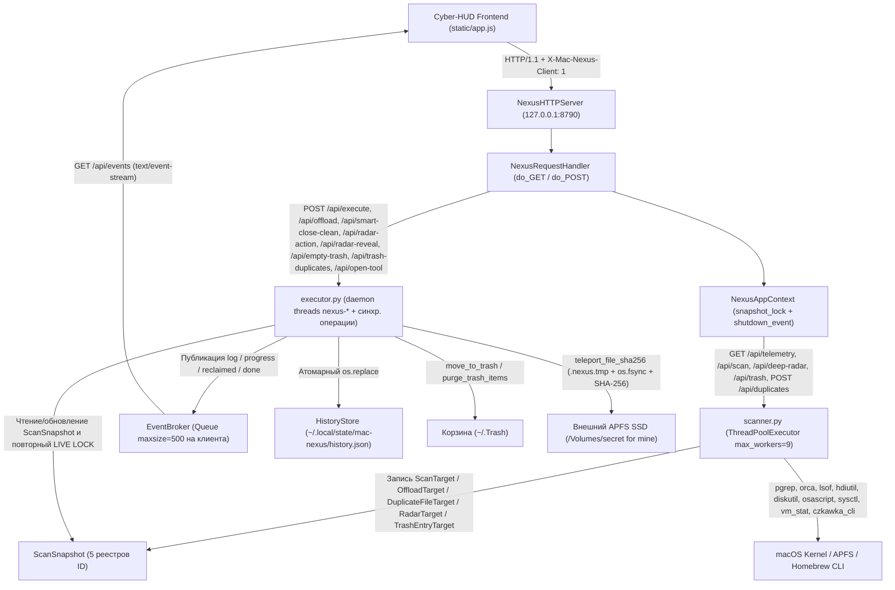
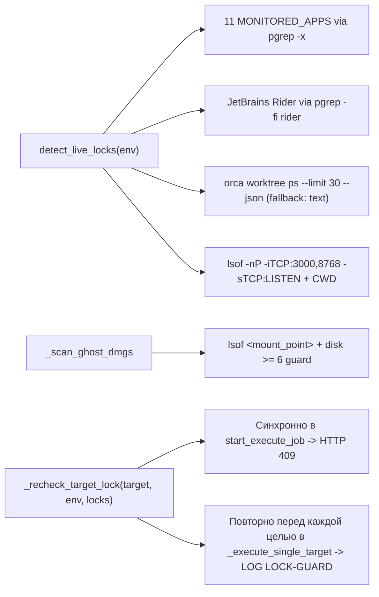

> **Навигация:** [00 · Мастер-индекс](00_master_index_and_system_map.md) | ← [03 · Стек 1 и Красная книга безопасности](03_cleanup_stack_and_safety_bible.md) | [05 · Справочник HTTP REST и SSE API →](05_http_rest_and_sse_api_reference.md) | [README репозитория](../README.md)

# 04 · Backend, Scanner, Executor и Модель Безопасности

Данный документ описывает внутреннюю архитектуру Python-бэкенда **Mac Nexus** (`mac_nexus` `v2.0.0`): структуру модулей, состояние сервера, механизмы сканирования трёх контуров хранения, многоуровневую модель безопасности, движок `LIVE LOCK` и транзакционный исполнитель операций очистки, телепорта на SSD и перемещения в Корзину.

Все факты, имена символов, пороги и инварианты в этом справочнике сверены с исходным кодом [`__init__.py`](../src/mac_nexus/__init__.py), [`server.py`](../src/mac_nexus/server.py), [`scanner.py`](../src/mac_nexus/scanner.py), [`executor.py`](../src/mac_nexus/executor.py) и набором тестов [`test_mac_nexus.py`](../tests/test_mac_nexus.py).

---

## 1. Обзор архитектуры и принцип Zero-Dependency Backend

Бэкенд Mac Nexus построен **исключительно на стандартной библиотеке Python 3.12+** (`http.server`, `concurrent.futures`, `dataclasses`, `hashlib`, `json`, `os`, `pathlib`, `plistlib`, `queue`, `re`, `shutil`, `subprocess`, `tempfile`, `threading`, `time`, `urllib.parse`, `uuid`). В `src/mac_nexus/` нет ни одной внешней PyPI-зависимости; все системные метрики и действия с инструментами выполняются либо прямыми вызовами ОС (`os.scandir`, `os.statvfs`, `os.lstat`, `shutil`), либо через контролируемые подпроцессы штатных бинарников macOS и Homebrew (`pgrep`, `orca`, `lsof`, `hdiutil`, `diskutil`, `osascript`, `sysctl`, `vm_stat`, `czkawka_cli`, `brew`, `conda`, `uv`, `npm`, `organize`, `open`).

### Ответственность модулей

| Модуль | Версия / Метаданные | Назначение | Ключевые классы и функции |
| :--- | :--- | :--- | :--- |
| [`__init__.py`](../src/mac_nexus/__init__.py) | `APP_NAME = "Mac Nexus"`, `APP_VERSION = "2.0.0"` | Метаданные пакета | `__all__ = ["APP_NAME", "APP_VERSION"]` |
| [`server.py`](../src/mac_nexus/server.py) | `HTTP/1.1` + SSE | Loopback HTTP-сервер, CSRF/Origin-фильтр, раздача `/static/*`, REST и SSE маршруты | `NexusAppContext`, `NexusRequestHandler`, `NexusHTTPServer`, `create_server`, `main` |
| [`scanner.py`](../src/mac_nexus/scanner.py) | 3660 строк | Среда выполнения, снимок ID, телеметрия 3 контуров, 9 параллельных сканеров, `LIVE LOCK`, парсер `czkawka_cli`, Deep Radar, Trash TCC | `ScanEnvironment`, `ScanSnapshot`, `RadarTarget`, `TrashEntryTarget`, `is_protected_path`, `detect_live_locks`, `get_telemetry`, `scan_system`, `scan_deep_radar`, `scan_trash`, `scan_duplicates` |
| [`executor.py`](../src/mac_nexus/executor.py) | 1132 строк | Валидация целей, фоновые задания очистки, SHA-256 телепорта, Smart Close, Radar Action, Trash Purge, SSE-брокер, аудит-история | `EventBroker`, `HistoryStore`, `move_to_trash`, `teleport_file_sha256`, `start_execute_job`, `start_offload_job`, `start_smart_close_clean_job`, `start_radar_action_job`, `reveal_radar_target`, `purge_trash_items`, `trash_duplicate_files`, `open_tool` |

### Компонентная архитектура и потоки данных



### Синхронизация состояния в `NexusAppContext`

`NexusAppContext` ([`server.py:54-64`](../src/mac_nexus/server.py#L54-L64)) связывает воедино конфигурацию и живое состояние процесса:
- `env: ScanEnvironment` — конфигурация путей, бинарников и тестовых хуков.
- `static_dir: Path` — канонический resolved-путь к директории статики (по умолчанию `src/mac_nexus/static`).
- `snapshot: ScanSnapshot` — реестр выданных сервером непрозрачных идентификаторов.
- `snapshot_lock: threading.Lock` — защищает чтение и обновление `ScanSnapshot` между потоками.
- `broker: EventBroker` — потокобезопасный брокер SSE-событий.
- `history: HistoryStore` — потокобезопасное хранилище статистики освобождённого места.
- `shutdown_event: threading.Event` — выставляется в `NexusHTTPServer.server_close()` для мгновенного завершения активных SSE-потоков.

При `GET /api/scan` обновляются `items_by_id` и `offload_by_id`, при `GET /api/deep-radar` — `radar_by_id` (все через `.update(...)` под `snapshot_lock`), при `GET /api/trash` — целиком перезаписывается `snapshot.trash_by_id`, а при `POST /api/duplicates` обновляется `snapshot.dup_files_by_id`. Перед запуском фоновых воркеров `POST /api/execute`, `/api/offload`, `/api/smart-close-clean` и `/api/radar-action` создают **изолированную копию словарей** `ScanSnapshot` (`_copy_snapshot`, поверхностное копирование `dict(...)`) под блокировкой, поэтому повторный скан не ломает уже запущенную фоновую задачу. Операции `POST /api/empty-trash` (при `selected`/`older_than` или `finder_empty`) и `POST /api/trash-duplicates` выполняются синхронно под `snapshot_lock` и удаляют (`pop`/`clear`) обработанные ID.

---

## 2. Среда выполнения `ScanEnvironment` и снимок `ScanSnapshot`

### Конфигурация `ScanEnvironment`

Датакласс `ScanEnvironment` ([`scanner.py:188-233`](../src/mac_nexus/scanner.py#L188-L233)) централизует все пути файловой системы, расположение внешних CLI-утилит и три инъекционные точки для изолированного тестирования без монтирования реального SSD или запуска деструктивных команд:

| Поле | Значение по умолчанию | Назначение |
| :--- | :--- | :--- |
| `home` | `Path.home()` | Домашняя директория пользователя (`~`) |
| `nvme_mount` | `Path("/System/Volumes/Data")` | Точка монтирования Контура 1 (Internal NVMe) |
| `ssd_mount` | `Path("/Volumes/secret for mine")` | Точка монтирования Контура 2 (External APFS SSD) |
| `secondbrain_dir` | `~/Library/Mobile Documents/iCloud~md~obsidian/Documents/SecondBrain` | Контур 3 (SecondBrain iCloud Vault) |
| `projects_dir` | `~/Projects` | Корневой каталог локальных репозиториев разработчика |
| `downloads_dir` | `~/Downloads` | Входящая папка загрузок |
| `desktop_dir` | `~/Desktop` | Рабочий стол (содержит защищённые `.app` и ботов) |
| `trash_dir` | `~/.Trash` | Целевая папка безопасного удаления (Корзина) |
| `state_dir` | `~/.local/state/mac-nexus` | Каталог состояния (XDG state) |
| `digest_path` | `~/.local/state/mac-hygiene/digest_latest.md` | Путь к последнему Воскресному дайджесту |
| `history_path` *(property)* | `self.state_dir / "history.json"` | JSON-журнал накопленного освобождённого объёма |
| `orca_bin` | `/Applications/Orca.app/Contents/Resources/bin/orca` | CLI для опроса активных worktree Orca |
| `czkawka_bin` | `/opt/homebrew/bin/czkawka_cli` | Движок поиска байтовых дубликатов |
| `organize_bin` | `/opt/homebrew/bin/organize` | Утилита тегирования и триажа `~/Downloads` |
| `brew_bin` | `/opt/homebrew/bin/brew` | Homebrew (`brew cleanup --prune=all`) |
| `conda_bin` | `/opt/anaconda3/bin/conda` | Anaconda (`conda clean --all`) |
| `anaconda_python` | `/opt/anaconda3/bin/python3` | Интерпретатор для `python3 -m pip cache purge` |
| `uv_bin` | `~/.local/bin/uv` | Менеджер `uv` (`uv cache prune --ci`) |
| `npm_bin` | `/opt/homebrew/bin/npm` | Node Package Manager (`npm cache clean --force`) |
| `applications_dirs` | `(Path("/Applications"), Path("/System/Applications"), Path.home() / "Applications")` | Каталоги `.app` для `_scan_app_orphans` (`Info.plist` Bundle ID matching); подменяется в `pytest` |
| `temp_dir` | `None` *(хэлпер `_temp_dir(env)` → `Path(tempfile.gettempdir())`)* | Каталог temp-папок старше 3 дней для `_scan_system_caches`; подменяется в `pytest` |
| `users_dir` | `None` *(хэлпер `_users_dir(env)` → `/Users` или `home.parent`)* | Корень профилей для поиска `Deleted Users` / соседних профилей в `scan_deep_radar`; подменяется в `pytest` |
| `docker_bin` | `Path.home() / ".local/bin/docker"` | CLI Docker (`system df`, `image/builder prune`) для `_scan_ai_dev_deep`; подменяется в `pytest` |
| `go_bin` | `Path("/opt/homebrew/bin/go")` | CLI Go (`go clean -modcache`) для `_scan_pkg_caches`; подменяется в `pytest` |
| `ssd_mount_checker` | `None` (используется `ssd_mount.exists() and os.path.ismount(...)`) | Хук проверки монтирования SSD для `pytest` |
| `cmd_runner` | `None` (используется `subprocess.run`) | Хук перехвата всех внешних команд для `pytest` |
| `now_fn` | `time.time` | Источник текущего Unix-времени (для детерминированных проверок возраста) |

Все вызовы CLI проходят через обёртку `_run_cmd(env, args, timeout=5.0)` ([`scanner.py:344-359`](../src/mac_nexus/scanner.py#L344-L359)), которая при `OSError` или `subprocess.TimeoutExpired` возвращает синтетический `CompletedProcess(..., returncode=1, stdout="", stderr=str(exc))` и никогда не роняет процесс сканирования.

### Модели целей и детерминированная генерация ID (`_stable_id`)

Функция `_stable_id(prefix, key)` ([`scanner.py:362-364`](../src/mac_nexus/scanner.py#L362-L364)) формирует непрозрачный идентификатор длиной `len(prefix) + 1 + 14` символов:

```python
digest = hashlib.sha256(f"{prefix}:{key}".encode("utf-8")).hexdigest()[:14]
return f"{prefix}_{digest}"
```

Используемые префиксы:
- `pkg_<14hex>` — пакетные кэши (`brew`, `pip`, `uv`, `npm`, `nuget`, `go`, `cargo`, `conda`);
- `app_<14hex>` — кэши GUI-приложений (`chrome`, `yandex`, `telegram`, `obsidian`, `orca`, `vscode`, `discord`, `notion`, `figma`, `drawio`, `yandex_music`);
- `syscache_<14hex>` — динамические кэши `~/Library/Caches/*`, `*-updater`, `GoogleUpdater crx_cache`, `~/Library/Logs/*`, `Aerials`, устаревшие каталоги temp;
- `orphan_<14hex>` — осиротевшие директории удалённых приложений (`Application Support`, `Containers`, `Saved Application State`, `>= 20 MiB`, `> 14 дн.`);
- `aidev_<14hex>` — безопасные артефакты AI-контуров (`Hermes`, `Codex`, `OpenClaw`, `Antigravity/Gemini`, `Argos Translate`) и `OrbStack / Docker Prune`;
- `dl_<14hex>` — пакеты триажа загрузок (`stale_installers`, `stale_screenshots`, `organize_triage_<older_days>`);
- `proj_<14hex>` — артефакты сборки в `~/Projects`;
- `dmg_<14hex>` — призрачные образы `.dmg` (`<dev_entry>:<image_path>`);
- `media_<14hex>` — медиа-кандидаты на телепорт в `offload_by_id` (ключ — `_safe_resolve(fp)`);
- `dupf_<14hex>` — конкретные файлы в группах дубликатов `dup_files_by_id` (ключ — `_safe_resolve(path)`);
- `dup_<12hex>` — идентификатор группы дубликатов (`hash_or_id`);
- `radar_<14hex>` — перемещаемые тяжёлые файлы (≥ `min_mb` MiB) в `ScanSnapshot.radar_by_id` (`RadarTarget`);
- `hotspot_<14hex>` — read-only X-Ray узлы (`OrbStack`, `Telegram`, `~/.hermes`, `~/.codex`, `~/.gemini`, `Steam`, `Conda`, `Adobe`, `Deleted Users`) в `ScanSnapshot.radar_by_id` (`kind="hotspot"`);
- `trash_<14hex>` — элементы `~/.Trash` в `ScanSnapshot.trash_by_id` (`TrashEntryTarget`).

`ScanSnapshot` ([`scanner.py:334-341`](../src/mac_nexus/scanner.py#L334-L341)) объединяет пять словарей с внутренними серверными дескрипторами:

| Словарь в `ScanSnapshot` | Тип значения | Поля дескриптора | Назначение |
| :--- | :--- | :--- | :--- |
| `items_by_id` | `ScanTarget` | `item_id`, `category`, `title`, `action_kind`, `paths`, `tool_name`, `app_key`, `app_label`, `project_path`, `dmg_device`, `dmg_mount_points`, `estimated_bytes`, `locked`, `lock_reason`, `quittable`, `quit_app_name`, `quit_bundle_id`, `browser_warning` | Цели очистки Контура 1 (`/api/execute`, `/api/smart-close-clean`) |
| `offload_by_id` | `OffloadTarget` | `media_id`, `name`, `source_path`, `rel_path`, `ext`, `size_bytes`, `mtime_ts`, `dest_dir` | Кандидаты SHA-256 телепорта (`/api/offload`) |
| `dup_files_by_id` | `DuplicateFileTarget` | `file_id`, `name`, `path`, `size_bytes`, `mtime_ts`, `group_id`, `is_primary` | Файлы в группах дубликатов (`/api/trash-duplicates`) |
| `radar_by_id` | `RadarTarget` | `radar_id`, `title`, `path`, `rel_path`, `kind`, `size_bytes`, `logical_bytes`, `mtime_ts`, `age_days`, `can_trash`, `can_teleport`, `default_shelf`, `note` | Тяжёлые файлы и X-Ray узлы Deep Radar (`/api/radar-action`, `/api/radar-reveal`) |
| `trash_by_id` | `TrashEntryTarget` | `trash_id`, `name`, `path`, `is_dir`, `size_bytes`, `mtime_ts`, `age_days` | Записи `~/.Trash` (`/api/empty-trash`) |

---

## 3. Многоуровневая модель безопасности (5 эшелонов защиты)

Безопасность Mac Nexus строится как эшелонированная оборона: нарушение любого из уровней немедленно останавливает запрос или операцию до касания файловой системы.

### Уровень 1 · Строгая привязка к Loopback (`NexusHTTPServer`)

В конструкторе `NexusHTTPServer.__init__` ([`server.py:496-505`](../src/mac_nexus/server.py#L496-L505)) выполняется жёсткая проверка:

```python
if host != "127.0.0.1":
    raise ValueError(f"Mac Nexus MUST bind strictly to 127.0.0.1 (got {host!r})")
```

Даже при передаче `--host 0.0.0.0` или локального LAN IP через CLI сервер откажется запускаться. На уровне класса выставлены `allow_reuse_address = True` и `daemon_threads = True`, порт по умолчанию — `8790`.

### Уровень 2 · Защита от CSRF, подмены `Origin` и Path Traversal

1. **CSRF-токен и проверка `Origin` (`_check_post_csrf`):**
   Каждый `POST /api/*` запрос проходит проверку [`server.py:141-158`](../src/mac_nexus/server.py#L141-L158):
   - Заголовок `X-Mac-Nexus-Client` (после `.strip()`) должен строго равняться `"1"`. Отсутствие или иное значение даёт `HTTP 403`. Браузерные HTML-формы и простые кросс-доменные `fetch`/`XHR` без CORS-preflight не могут добавить кастомный заголовок.
   - Если заголовок `Origin` присутствует в запросе, `_is_valid_origin(origin)` разбирает его через `urllib.parse.urlsplit` и требует `parsed.scheme == "http"` и `parsed.hostname in {"127.0.0.1", "localhost"}`. Это надёжно блокирует поддельные поддомены вида `http://127.0.0.1.evil.com:8790`, HTTPS-origins и `http://0.0.0.0:8790` (`HTTP 403`).
2. **Ограничение тела запроса (`_read_json_body`):**
   Константа `MAX_JSON_BODY_BYTES = 1024 * 1024` (1 MiB) ограничивает размер JSON-тела; отрицательный или превышающий лимит `Content-Length` отклоняется с `HTTP 413`. Невалидный `Content-Length`, битый UTF-8/JSON или не-словарь (например, JSON-массив) возвращают `HTTP 400`.
3. **Защита статики (`/static/*` и `/`):**
   Метод `_send_static_file` ([`server.py:110-139`](../src/mac_nexus/server.py#L110-L139)):
   - Декодирует URL (`unquote(rel_name).lstrip("/")`) и отклоняет пустое имя, сегмент `..` в `Path(clean_name).parts`, а также любые `/` или `\` (`HTTP 403`).
   - Канонизирует путь `(self.ctx.static_dir / clean_name).resolve()` и проверяет `candidate.relative_to(self.ctx.static_dir)` (`HTTP 403`).
   - Проверяет существование обычного файла (`HTTP 404`) и расширение по белому списку `ALLOWED_STATIC_MIME` (`.html`, `.css`, `.js`, `.svg`, `.png`, `.ico` — иначе `HTTP 403`).
   - Все ответы снабжаются заголовками `Cache-Control: no-store` и `X-Content-Type-Options: nosniff`.

### Уровень 3 · Allowlist серверных Snapshot ID

Маршруты, которым нужна конкретная цель, принимают выданные сервером строковые ID (`item_ids`, `item_id`, `media_ids`, `radar_ids`, `radar_id`, `trash_ids`, `file_ids`). Если ID отсутствует в соответствующем реестре, сервер возвращает `HTTP 400`. ID привязаны к процессу сервера, а повторное сканирование может сохранять ранее выданные ID, поскольку большинство реестров дополняются. Для поиска дубликатов `target` ограничен четырьмя значениями (`downloads`, `desktop`, `documents`, `ssd_media`), а для `/api/open-tool` `tool` ограничен шестью значениями (`digest`, `pearcleaner`, `daisydisk`, `finder_ssd`, `finder_downloads`, `finder_trash`).

### Уровень 4 · Инварианты `is_protected_path` и отказ от симлинков

Функция `is_protected_path(path, env, live_worktree_paths)` ([`scanner.py:399-433`](../src/mac_nexus/scanner.py#L399-L433)) проверяет **одновременно** исходный `path` и канонизированный `_safe_resolve(path)` (через `_is_within`, который также проверяет и исходный, и resolved базовый каталог — это исключает обход через твёрдые/промежуточные симлинки или `/var` vs `/private/var`):

| Защищённая зона | Константа / Источник в коде | Правило блокировки |
| :--- | :--- | :--- |
| Бандлы приложений и медиатек | `PROTECTED_BUNDLE_SUFFIXES = (".app", ".photoslibrary")` | Любой компонент пути (`cand.parts`), оканчивающийся на `.app` или `.photoslibrary` (регистронезависимо) |
| Содержимое Корзины | `env.trash_dir` (`~/.Trash`) | Путь равен `~/.Trash` или находится внутри него |
| Боты автоматизации на Рабочем столе | `PROTECTED_DESKTOP_DIRS = ("Бот_автооткликов_Егор", "GPT_подключение_для_бота")` | Любой путь внутри `env.desktop_dir / name` |
| Хранилище знаний SecondBrain | `env.secondbrain_dir` | Всё дерево `SecondBrain` (защита от случайного удаления `node_modules` в `.opencode` или медиа) |
| Живые тяжёлые каталоги на SSD | `SSD_LIVE_HEAVY_DIRS = {"ollama_models", "local-jarvis-heavy", "project-perimeter-heavy", "calisthenics-tracker-heavy"}` | Любой путь внутри `env.ssd_mount / heavy_name` |
| Активные Orca worktrees | `live_worktree_paths` | Динамическое множество путей из `orca worktree ps` |

Дополнительно, символические ссылки (`is_symlink()`) принудительно пропускаются во всех обходах (`_dir_size_and_latest_mtime`, `_secondbrain_stats`, `_scan_*`, `parse_czkawka_compact_json`) и отклоняются в `move_to_trash`, `teleport_file_sha256` и `_clear_cache_dir_contents`.

### Уровень 5 · Движок `LIVE LOCK` (сканирование + повторная проверка перед исполнением)

Механизм `LIVE LOCK` предотвращает повреждение SQLite WAL-журналов, кэшей активных GUI-программ, открытых `.dmg`-образов и проектов, с которыми прямо сейчас работают агенты или локальные серверы.



#### Источники блокировок в `detect_live_locks(env)`

1. **11 отслеживаемых GUI-приложений (`MONITORED_APPS`, `pgrep -x`):**
   - `chrome` — процесс `Google Chrome` (`Google Chrome`)
   - `yandex` — процесс `Yandex` (`Yandex Browser`)
   - `telegram` — процесс `Telegram` (`Telegram`)
   - `obsidian` — процесс `Obsidian` (`Obsidian`)
   - `orca` — процесс `Orca` (`Orca`)
   - `vscode` — процесс `Code` (`VS Code`)
   - `discord` — процесс `Discord` (`Discord`)
   - `notion` — процесс `Notion` (`Notion`)
   - `figma` — процесс `Figma` (`Figma`)
   - `drawio` — процесс `draw.io` (`draw.io`)
   - `yandex_music` — процессы `Yandex Music` или `Яндекс Музыка` (`Яндекс Музыка`)
   Пока процесс запущен, соответствующий `app_cache` помечается `locked: true`.
2. **JetBrains Rider (`pgrep -fi rider`):**
   При обнаружении процесса `rider_running = True`, что блокирует очистку пакетного кэша `nuget` (`~/.nuget/packages` и `~/.local/share/NuGet/v3-cache`).
3. **Активные worktree Orca (`orca worktree ps`):**
   Сначала выполняется `[orca_bin, "worktree", "ps", "--limit", "30", "--json"]` ([`scanner.py:542-577`](../src/mac_nexus/scanner.py#L542-L577)). Запись считается активной (`is_live`), если выполняется хотя бы одно условие: `liveTerminalCount > 0`, `hasAttachedPty == True`, `status.lower() in {"working", "active"}` или `len(agents) > 0`. Домашний каталог `~` / `resolved_home` принудительно исключается. Если JSON недоступен или некорректен, срабатывает текстовый фоллбэк `parse_orca_worktrees_text` (`orca worktree ps --limit 30`, разбор строк с `live:(\d+)` и следующей строкой-путём).
4. **Живые dev-серверы и боты на портах `3000` и `8768` (`lsof` + корреляция CWD):**
   Выполняется `lsof -nP -iTCP:3000,8768 -sTCP:LISTEN`; для каждого найденного `PID` запрашивается рабочий каталог `lsof -p <pid> -a -d cwd -Fn` (парсится строка `n/...`). В `_find_project_lock(proj_dir, artifact_dir, locks)` ([`scanner.py:1665-1689`](../src/mac_nexus/scanner.py#L1665-L1689)) проект блокируется, если:
   - проект или артефакт пересекается с `live_worktree_repos` (`_is_within(proj_dir, wt_path)`, `_is_within(wt_path, proj_dir)` или `_is_within(artifact_dir, wt_path)`);
   - рабочий каталог активного сервиса на `:3000` или `:8768` (`next-server` и др.) находится внутри/над `proj_dir` либо имеет совпадающее имя каталога (`cwd_path.name == proj_dir.name`, например `calisthenics-tracker` на внешнем SSD или локальном пути).
5. **Открытые файлы на DMG и запрет `disk0..disk5`:**
   В `_parse_hdiutil_images` ([`scanner.py:711-761`](../src/mac_nexus/scanner.py#L711-L761)) разбирается `hdiutil info -plist`. Если среди `system-entities` встречается `/dev/disk(\d+)` с номером `< 6`, **весь образ отбрасывается** (`whole_disk = None; break`), чтобы никогда не задеть системные разделы и физические диски (`disk0..disk5`). Для образов с `disk >= 6` в `_scan_ghost_dmgs` и `_recheck_target_lock` выполняется `lsof <mount_point>`: если возвращается больше 1 строки (заголовок + открытые дескрипторы), образ маркируется как `locked: true`.

#### Двойная проверка (`_recheck_target_lock`)

Даже если клиент получил старый скан до запуска браузера или ворктри, при получении `POST /api/execute` функция `start_execute_job` **синхронно** вызывает `detect_live_locks(env)` и `_recheck_target_lock` для всех выбранных `item_ids` — при наличии блокировки возвращается `HTTP 409 Conflict` без старта фонового потока. Более того, внутри воркера функция `_execute_single_target` повторно вызывает `detect_live_locks(env)` и `_recheck_target_lock` перед каждой отдельной целью; если пользователь запустил приложение уже во время выполнения очереди, цель пропускается с записью `[LOCK-GUARD] Пропуск ...` в SSE.

---

## 4. Подсистемы сканера (`scanner.py`)

### Телеметрия трёх контуров (`get_telemetry`)

Функция `get_telemetry(env)` ([`scanner.py:946-1008`](../src/mac_nexus/scanner.py#L946-L1008)) формирует снимок состояния всех трёх плоскостей, системных ресурсов и сводки `~/.Trash`:

1. **Plane 1 — Internal NVMe (`planes.nvme`):**
   - `_disk_stats_from_plist_or_statvfs` сначала вызывает `diskutil info -plist <mount>` (ключи `TotalSize`/`APFSContainerSize`, `APFSContainerFree`/`FreeSpace`, `FilesystemType`), а при сбое падает на `os.statvfs`.
   - `_nvme_purgeable_bytes` запускает JXA (`osascript -l JavaScript`) с импортом `Foundation`, сравнивая `NSURLVolumeAvailableCapacityForImportantUsageKey` и `NSURLVolumeAvailableCapacityKey` для `/`. Разница (`important - avail`) и есть очищаемый APFS purgeable-резерв; при `cmd_runner is None` результат кэшируется в `_PURGEABLE_CACHE` на `10.0` секунд.
2. **Plane 2 — External APFS SSD (`planes.ssd`):**
   - `ssd_is_mounted(env)` проверяет монтирование `/Volumes/secret for mine` (`os.path.ismount` или тестовый `ssd_mount_checker`).
   - Возвращает список всех 6 канонических полок `SSD_SHELVES` с флагом `exists`:
     `01_AI_Models_and_Caches`, `02_Project_Heavy`, `03_Software_and_Installers`, `04_Media_Archive`, `90_Cold_Archive`, `99_Backups`.
3. **Plane 3 — SecondBrain iCloud (`planes.secondbrain`):**
   - `_secondbrain_stats` обходит дерево `secondbrain_dir` (игнорируя `.git` и симлинки), подсчитывает количество `.md`-заметок (`md_notes_count`), суммирует размер реальных локальных файлов (пропуская выгруженные в iCloud заглушки с флагом `SF_DATALESS_FLAG = 0x40000000`) и выставляет `has_node_modules_risk = True`, если внутри хранилища обнаружена папка `node_modules`.
4. **Системные метрики (`_system_memory_metrics`):**
   - `cpu_load_1m` (`os.getloadavg()[0]`), `cpu_cores` (`os.cpu_count() or 1`).
   - `ram_total_bytes` (`sysctl -n hw.memsize`, fallback через `SC_PAGE_SIZE * SC_PHYS_PAGES`).
   - `swap_used_bytes` (регулярное выражение по `sysctl -n vm.swapusage`).
   - `ram_used_bytes` из `vm_stat`: `(Pages active + Pages wired down + Pages occupied by compressor) * page_size` (по умолчанию `page_size = 16384`).
   - Вычисление `ram_pressure`:
     - `"critical"` — если `ram_used / ram_total >= 0.88` или `swap_used >= 10 GiB`;
     - `"warning"` — если `ram_used / ram_total >= 0.72` или `swap_used >= 4 GiB`;
     - `"normal"` — во всех остальных случаях.
   - `ghost_dmgs_count`, `orca_live_worktrees` и `history` (`load_history`).

### Полное сканирование системы (`scan_system`)

Функция `scan_system(env, older_days=30)` ограничивает `older_days` диапазоном `[0, 3650]`, снимает `locks = detect_live_locks(env)` и запускает **9 воркеров параллельно** в `ThreadPoolExecutor(max_workers=9)` ([`scanner.py:2985-3045`](../src/mac_nexus/scanner.py#L2985-L3045)):

1. **`pkg_cache` (`_scan_pkg_caches`, [`scanner.py:1236-1420`](../src/mac_nexus/scanner.py#L1236-L1420)):**

   | `tool` | Сканируемые пути | Условие / Защита | Команда в `executor.py` |
   | :--- | :--- | :--- | :--- |
   | `brew` | `~/Library/Caches/Homebrew` | `env.brew_bin.exists()` при исполнении | `brew cleanup --prune=all` |
   | `pip` | `~/Library/Caches/pip`, `~/.cache/pip` | `env.anaconda_python.exists()` | `<anaconda_python> -m pip cache purge` |
   | `uv` | `~/.cache/uv` | `env.uv_bin.exists()` | `uv cache prune --ci` |
   | `npm` | `~/.npm/_cacache` | `env.npm_bin.exists()` | `npm cache clean --force` |
   | `nuget` | `~/.nuget/packages`, `~/.local/share/NuGet/v3-cache` | Блокируется при `rider_running` | `_clear_cache_dir_contents` |
   | `go` | `~/go/pkg/mod/cache/download` | Размер `>= 10 MiB` (`MIN_PKG_EXTRA_BYTES`) | `go clean -modcache` *(или `_clear_cache_dir_contents`, если `go_bin` не найден)* |
   | `cargo` | `~/.cargo/registry/cache` | Размер `>= 10 MiB` (`MIN_PKG_EXTRA_BYTES`) | `_clear_cache_dir_contents` |
   | `conda` | `/opt/anaconda3/pkgs` | Pre-check `.conda`/`.tar.bz2` или `pkgs/cache`, затем `conda clean --all --dry-run --json` | `conda clean -y --all` |

2. **`app_cache` (`_scan_app_caches`, [`scanner.py:1423-1493`](../src/mac_nexus/scanner.py#L1423-L1493) + `_expand_app_cache_dirs`, [`scanner.py:1027-1233`](../src/mac_nexus/scanner.py#L1027-L1233)):**
   Формирует строго ограниченный белый список подкаталогов кэша; каталоги `User/`, `IndexedDB/`, `Cookies`, базы сообщений и терминальные сессии никогда не включаются в `paths`. Дополнительно `APP_QUIT_METADATA` ([`scanner.py:1011-1024`](../src/mac_nexus/scanner.py#L1011-L1024)) задаёт флаги `quittable`, `quit_app_name`, `quit_bundle_id`, `browser_warning`: для `orca` и `vscode` установлено `quittable = False` (абсолютный запрет `Smart Close`), для браузеров `chrome` и `yandex` — `browser_warning = True`.

   | `app_key` | Процесс `pgrep -x` | Разрешённые каталоги (`~/Library/...`) |
   | :--- | :--- | :--- |
   | `chrome` | `Google Chrome` | `Caches/Google/Chrome/*/Cache`, `Code Cache`, `Chrome for Testing/*/Cache`, `Application Support/Google/Chrome/*/GPUCache`, `DawnGraphiteCache`, `DawnWebGPUCache` |
   | `yandex` | `Yandex` | `Caches/Yandex/YandexBrowser/*/Cache`, `Code Cache`, `Application Support/Yandex/YandexBrowser/ShaderCache`, `*/GPUCache`, `DawnGraphiteCache`, `DawnWebGPUCache` |
   | `telegram` | `Telegram` | `Group Containers/6N38VWS5BX.ru.keepcoder.Telegram/*/temp`, `Containers/ru.keepcoder.Telegram/Data/tmp` |
   | `obsidian` | `Obsidian` | `Application Support/obsidian/{Cache,Code Cache,GPUCache,DawnGraphiteCache,DawnWebGPUCache}` и `Partitions/*/{Cache,Code Cache,GPUCache,Dawn*}` |
   | `orca` | `Orca` | `Caches/orca-updater`, `Application Support/orca/{Cache,Code Cache,GPUCache,Dawn*}` и `Partitions/*/{Cache,Code Cache,GPUCache}` |
   | `vscode` | `Code` | `Application Support/Code/{Cache,Code Cache,GPUCache,CachedData,CachedExtensionVSIXs,DawnGraphiteCache,DawnWebGPUCache}` |
   | `discord` | `Discord` | `Application Support/discord/{Cache,Code Cache,GPUCache,DawnGraphiteCache,DawnWebGPUCache,logs}` |
   | `notion` | `Notion` | `Application Support/Caches/notion-updater`, `Notion/{Cache,Code Cache,GPUCache,Dawn*}`, `Partitions/*/Service Worker/CacheStorage` |
   | `figma` | `Figma` | `Application Support/Figma/DesktopProfile/*/{Cache,Code Cache,GPUCache,Dawn*,Service Worker/CacheStorage}` |
   | `drawio` | `draw.io` | `Caches/draw.io-updater`, `Application Support/draw.io/{Cache,Code Cache,GPUCache}` |
   | `yandex_music` | `Yandex Music` / `Яндекс Музыка` | `Caches/yandexmusic-updater`, `Application Support/YandexMusic/{Cache,Code Cache,GPUCache}` |

3. **`system_cache` (`_scan_system_caches`, [`scanner.py:1960-2281`](../src/mac_nexus/scanner.py#L1960-L2281)):**
   Динамический сканер пользовательских кэшей без пересечений с `pkg_cache`/`app_cache` (проверка `covered_paths` и `SYSTEM_CACHE_APPLE_SKIP_*`):
   - оставшиеся `~/Library/Caches/*` `>= 15 MiB` (`MIN_SYSTEM_CACHE_BYTES`) с привязкой к запущенным процессам (`_is_system_cache_locked`);
   - `~/Library/Application Support/Caches/*-updater`;
   - `GoogleUpdater/crx_cache`, `~/Library/Logs/*`, `com.apple.wallpaper/aerials/videos` (`>= 10 MiB`, `MIN_SYSTEM_SUB_BYTES`; `aerials` с `action_kind: "trash"`);
   - устаревшие подпапки в `_temp_dir(env)` старше `3` дней и `>= 10 MiB` (пропуская свежие `pytest-*`).

4. **`app_orphans` (`_scan_app_orphans`, [`scanner.py:2353-2478`](../src/mac_nexus/scanner.py#L2353-L2478)):**
   Собирает Bundle ID и имена установленных `.app` из `env.applications_dirs` (`Info.plist`), исключает `com.apple.*`, системные имена и активные процессы, и находит «сирот» в `Application Support`, `Containers` и `Saved Application State` (`*.savedState`), не обновлявшихся дольше `14` дней и занимающих `>= 20 MiB` (`action_kind: "trash"`, `risk: "medium"`).

5. **`ai_dev_deep` (`_scan_ai_dev_deep`, [`scanner.py:2481-2895`](../src/mac_nexus/scanner.py#L2481-L2895)):**
   Точечная безопасная очистка AI-агентов и контейнеров без касания SQLite БД истории, auth и конфигов:
   - `Hermes`: неактивные `.worktrees` (>7 дн., мимо `live_worktree_paths`), `.hermes/cache/{uv,bluebubbles-install}`, `.hermes/logs` (>7 дн.), архивы `state-snapshots` и `backups`; при живом процессе `hermes` маркируется `locked`;
   - `Codex`: устаревшие `~/.cache/codex-runtimes/codex-runtime-install-*` (>1 дн., строго сохраняя `codex-primary-runtime`), `.codex/{.tmp,cache}` (>3 дн.), архивы `.codex/sessions/*` (`> max(older_days, 30)` дн., `>= 20 MiB`);
   - `OpenClaw` logs (`>= 5 MiB`), `Gemini/Antigravity` `scratch` (>14 дн.) и `antigravity-cli/log` (>7 дн.), `~/.local/cache/argos-translate` (`>= 15 MiB`);
   - `OrbStack / Docker Prune`: вызывает `docker system df --format "{{json .}}"` (пропуская `Local Volumes`) и при наличии освобождаемого объёма предлагает `action_kind: "docker_prune"`.

6. **`downloads_inbox` (`_scan_downloads_inbox`, [`scanner.py:1496-1662`](../src/mac_nexus/scanner.py#L1496-L1662)):**
   Ограниченный обход `~/Downloads` (`max_depth=2`) и `~/Desktop` (`max_depth=1`), пропускающий скрытые файлы/папки (кроме `$RECYCLE.BIN`), симлинки и `is_protected_path`:
   - `stale_installers` (`dl_<14hex>`): файлы `INSTALLER_EXTENSIONS = {".dmg", ".pkg", ".exe", ".iso"}` в `Downloads` старше `7.0` дней → `action_kind: "trash"`.
   - `stale_screenshots` (`dl_<14hex>`): файлы `IMAGE_EXTENSIONS = {".png", ".jpg", ".jpeg"}` в `Downloads` или `Desktop`, чьё имя начинается с `SCREENSHOT_PREFIXES = ("Screenshot", "Screen Shot", "Снимок экрана")`, старше `14.0` дней → `action_kind: "trash"`.
   - `organize_triage_{older_days}` (`dl_<14hex>`): неклассифицированные файлы в `Downloads` старше `older_days` → `action_kind: "organize"`, `size_bytes: 0`, `matched_count = untouched_count`.

7. **`dev_projects` (`_scan_dev_projects`, [`scanner.py:1692-1799`](../src/mac_nexus/scanner.py#L1692-L1799)):**
   Сканирует поддиректории верхнего уровня в `~/Projects` (исключая скрытые, симлинки и `secondbrain_dir`). Возраст проекта вычисляется по максимуму из `proj_dir.stat().st_mtime` и `.git/index` mtime без глубокого обхода гигантских `node_modules`. На глубине до 2 уровней (пропуская `.git`) ищутся папки из `PROJECT_ARTIFACT_NAMES = {"node_modules", ".venv", "venv", ".pytest_cache", "__pycache__", "target"}`.
   - **Возрастной барьер:** артефакт включается в выдачу только если проект не изменялся дольше `older_days` (при `older_days > 0` активно изменяемые проекты игнорируются полностью).
   - **Почему не используется `kondo` при скане:** у `kondo` нет флага `--dry-run`, поэтому возраст и размер артефактов вычисляются безопасно средствами Python с проверкой `_find_project_lock`.
   - **Уровень риска (`risk`):** `"low"` для `__pycache__` и `.pytest_cache`, `"medium"` для остальных.

8. **`ghost_dmgs` (`_scan_ghost_dmgs`, [`scanner.py:1802-1855`](../src/mac_nexus/scanner.py#L1802-L1855)):**
   Примонтированные `.dmg`-образы с номером устройства `>= 6` и проверкой открытых файлов через `lsof`.

9. **Кандидаты на SSD-телепорт (`_scan_offload_media`, [`scanner.py:2898-2982`](../src/mac_nexus/scanner.py#L2898-L2982)):**
   Обходит `~/Desktop` и `~/Downloads` (`os.walk(root, followlinks=False)`), отсекая скрытые каталоги, симлинки, `.app`/`.photoslibrary` и `is_protected_path` (включая ботов и активные worktrees). Отбираются только файлы с расширением `MEDIA_OFFLOAD_EXTENSIONS = {".mov", ".mp4", ".mkv"}` размером строго больше `MIN_OFFLOAD_BYTES = 10 * 1024 * 1024` (10 MiB). Дедупликация по `_safe_resolve`, расчёт пути назначения `<ssd_mount>/04_Media_Archive/Screen_Recordings/<YYYY-MM>/<name>` по месяцу `mtime`, сортировка по убыванию `size_bytes`.

Во всех вычислениях размера каталогов (`_dir_size_and_latest_mtime`) файлы с флагом `SF_DATALESS_FLAG = 0x40000000` пропускаются, чтобы облачные заглушки iCloud не учитывались как локально занимаемые гигабайты на NVMe. Итоговый список `items` сортируется по кортежу `(item["locked"], -item["size_bytes"], item["title"])` — разблокированные и самые крупные цели идут первыми.

### Deep Radar X-Ray (`scan_deep_radar`) и инспектор Корзины (`scan_trash`)

- **`scan_deep_radar(env, min_mb=50)`** ([`scanner.py:3248-3541`](../src/mac_nexus/scanner.py#L3248-L3541)): ограничивает `min_mb` диапазоном `[1, 102400]` и сканирует в двух режимах:
  1. **Перемещаемые тяжёлые файлы (`kind="file"`, `radar_<14hex>`):** обход `Downloads`, `Desktop`, `Documents`, `Movies` на глубину до `3` уровней, исключая симлинки, `SF_DATALESS_FLAG`, `.app`/`.photoslibrary`, `.git`/`node_modules`/`.venv` и `is_protected_path`. Реальный расход на диске считается функцией `_physical_file_size(st)` (`st_blocks * 512`, чтобы не путать sparse-потолок `st_size` с физическими блоками). Выставляются `can_trash=True`, `can_teleport=True` и рекомендуемая полка `_default_radar_shelf(p)` (`04_Media_Archive`, `03_Software_and_Installers` или `90_Cold_Archive`).
  2. **Read-only X-Ray горячие точки (`kind="hotspot"`, `hotspot_<14hex>`):** sparse-диск `OrbStack` (`data.img.raw`), каталоги `Telegram`, `.hermes`, `.codex`, `.gemini`, `Steam`, `/opt/anaconda3/pkgs`, `/Library/Application Support/Adobe` и соседние профили / `Deleted Users` в `_users_dir(env)`. Всегда имеют `can_trash=False`, `can_teleport=False` (защищены от случайного сноса; разрешён только Finder Reveal). Результат ограничен топ-80 записями по убыванию `size_bytes`.
- **`scan_trash(env)`** ([`scanner.py:3544-3660`](../src/mac_nexus/scanner.py#L3544-L3660)): инспектирует `env.trash_dir`, рассчитывает `total_bytes`, `older_7d_bytes` (`>7` дн.) и `older_30d_bytes` (`>30` дн.), игнорируя `.DS_Store` и `.localized`. При `PermissionError` (ограничение macOS TCC) переходит в режим `tcc_restricted: True`, опрашивает Finder (`tell application "Finder" to get count of items of trash`) и заполняет `item_count` / `finder_item_count` при пустом `items: []`.

### Поиск дубликатов через `czkawka_cli` (`scan_duplicates`)

Функция `scan_duplicates(env, target)` ([`scanner.py:3169-3234`](../src/mac_nexus/scanner.py#L3169-L3234)):
1. Разрешает четыре целевых контура: `"downloads"` (`env.downloads_dir`), `"desktop"` (`env.desktop_dir`), `"documents"` (`env.home / "Documents"`), `"ssd_media"` (`env.ssd_mount / "04_Media_Archive"`). Иное значение вызывает `ValueError` (`HTTP 400`). При `target == "ssd_media"` и отмонтированном SSD выбрасывает `RuntimeError` (`HTTP 409`).
2. Вызывает `_collect_excluded_dirs(scan_dir, env, live_wt)` для сбора точных путей защищённых директорий (`.app`, `.photoslibrary`, `PROTECTED_DESKTOP_DIRS`, `SSD_LIVE_HEAVY_DIRS`, активные worktrees) и передаёт каждый отдельным флагом `-e <dir>`.
3. Запускает `czkawka_cli dup` (по умолчанию метод сравнения `HASH` и алгоритм `BLAKE3`):
   - `-d <scan_dir>` — корневая директория поиска;
   - `-m 1048576` (`MIN_DUPLICATE_BYTES = 1 MiB`) — игнорирование мелких файлов;
   - `-E "*/*.app/*,*/*.photoslibrary/*,*/.Trash/*"` — дополнительные маски исключения;
   - `-C <tmp_json>` — вывод компактного JSON во временный файл `mac_nexus_dup_*.json`;
   - `-N -M -W` — подавление вывода в консоль (`--do-not-print-results`, `--do-not-print-messages`, `--ignore-error-code-on-found`).
   Коды возврата `0` и `11` считаются штатными; временный файл гарантированно удаляется в `finally`.
4. `parse_czkawka_compact_json` ([`scanner.py:3072-3166`](../src/mac_nexus/scanner.py#L3072-L3166)) повторно фильтрует симлинки и `is_protected_path`, отбрасывает группы с менее чем 2 оставшимися файлами, сортирует каждую группу по `(mtime_ts, len(str(path)), str(path))` и **всегда помечает первый (самый старый) файл флагом `is_primary = True`** («ОРИГИНАЛ / СОХРАНИТЬ»). Избыточный объём считается как `group_size * (len(clean_entries) - 1)`, группы сортируются по убыванию `wasted_bytes`.

---

## 5. Исполнительный движок (`executor.py`)

### Жизненный цикл заданий (`start_execute_job` и `start_offload_job`)

Оба фоновых оркестратора разделены на **синхронную фазу валидации** (в потоке HTTP-запроса) и **асинхронную фоновую фазу** (в daemon-потоке `nexus-<job_id>`):

- `start_execute_job` ([`executor.py:527-591`](../src/mac_nexus/executor.py#L527-L591)):
  1. Проверяет непустоту `item_ids` и наличие каждого ID в `snapshot.items_by_id` (иначе `UnknownTargetError` → `400`).
  2. Вызывает `detect_live_locks(env)` и `_recheck_target_lock` для всех целей (при срабатывании → `LiveLockError` → `409`).
  3. Генерирует `job_id = f"exec_{uuid.uuid4().hex[:10]}"`, запускает поток `nexus-exec_...` и немедленно возвращает `job_id`.
  4. Внутри `_execute_single_target` ([`executor.py:397-524`](../src/mac_nexus/executor.py#L397-L524)) при `dry_run=True` публикует только событие `[DRY-RUN] Симуляция (...)` без изменений на диске. При `dry_run=False`:
     - `pkg_cache`: `brew cleanup --prune=all`, `anaconda_python -m pip cache purge`, `uv cache prune --ci`, `npm cache clean --force`, `conda clean -y --all`, `go clean -modcache` (с fallback на `_clean_cache_target_paths`), либо `_clean_cache_target_paths` для `nuget` и `cargo`. Для `brew`/`pip`/`uv`/`npm`/`go` освобождённый объём замеряется как `max(0, before - after)`.
     - `app_cache`: очищает **содержимое** внутри allowlisted папок через `_clear_cache_dir_contents` (без удаления родительских каталогов и без касания `User/`, `IndexedDB/`, `.db`), проверяя `is_protected_path` и игнорируя симлинки.
     - `system_cache`, `app_orphans`, `ai_dev_deep`: по `action_kind` выполняет `_clean_cache_target_paths` (`clean_cache`), `_trash_target_paths` (`trash` через `move_to_trash`), `_remove_codex_runtime_artifacts` (`rm_artifact`, только внутри `codex-runtimes/codex-runtime-install-*`), или `docker image prune -f` + `docker builder prune -f` (`docker_prune`).
     - `downloads_inbox`: `action_kind == "trash"` вызывает `move_to_trash` для каждого файла; `action_kind == "organize"` запускает `organize run`.
     - `dev_projects`: повторно проверяет несимлинковость, точное вхождение имени в `PROJECT_ARTIFACT_NAMES`, префикс `_safe_resolve(env.projects_dir) + os.sep` и `not is_protected_path` перед `shutil.rmtree(art_dir, ignore_errors=False)`.
     - `ghost_dmgs`: проверяет `re.fullmatch(r"/dev/disk(\d+)", dev)` и `int(m.group(1)) >= 6` перед `hdiutil detach <dev>`.

### Атомарный SHA-256 телепорт на SSD (`teleport_file_sha256`)

Функция `teleport_file_sha256` удаляет исходник только после записи staging-файла, проверки размера и SHA-256, переименования и проверки итогового файла на SSD. [Порядок операций в `executor.py`](../src/mac_nexus/executor.py#L183-L245)

```mermaid
sequenceDiagram
    participant W as "Worker (start_offload_job)"
    participant NVMe as "Internal NVMe (Source)"
    participant SSD as "External APFS SSD (/Volumes/secret for mine)"

    W->>SSD: "1. Проверка ssd_is_mounted(env) и is_protected_path"
    W->>NVMe: "2. Замер src_size и потоковый sha256_file(src) (блоки 1 MiB)"
    W->>SSD: "3. Запись во временный .&lt;name&gt;.&lt;uuid8&gt;.nexus.tmp"
    W->>SSD: "4. wfh.flush() + os.fsync(wfh.fileno()) + shutil.copystat"
    W->>SSD: "5. Замер dst_size и sha256_file(staging_dest)"
    alt "dst_size != src_size ИЛИ dst_hash != src_hash"
        W->>SSD: "Удаление staging_dest (.nexus.tmp)"
        W-->>NVMe: "Исходник СОХРАНЁН (возврат ошибки целостности)"
    else "Байты и SHA-256 совпали"
        W->>SSD: "6. os.replace(staging_dest, final_dest) (collision-safe имя)"
        W->>SSD: "7. Проверка final_dest.exists() и размера == src_size"
        W->>NVMe: "8. Только теперь src.unlink()"
    end
```

Если `dry_run=True`, телепорт не требует смонтированного SSD на уровне `start_offload_job` (`if not dry_run and not ssd_is_mounted(env): raise LiveLockError(...)`) и лишь возвращает ожидаемый путь `dest_dir / src.name`.

### Безопасное перемещение в Корзину (`move_to_trash` и `trash_duplicate_files`)

- `_unique_dest_path(dest_dir, filename)` ([`executor.py:125-138`](../src/mac_nexus/executor.py#L125-L138)) предотвращает перезапись одноимённых файлов в `~/.Trash` или на SSD: если `dest_dir / filename` уже существует, подбирается имя `{stem}_{unix_ts}_{idx}{suffix}` (`idx` от `1` до `9999`), с резервным суффиксом `uuid4().hex[:8]`.
- `move_to_trash(src, env, live_worktree_paths)` ([`executor.py:141-168`](../src/mac_nexus/executor.py#L141-L168)) отказывает, если объект не существует, является симлинком (`src.is_symlink()`) или подпадает под `is_protected_path`. После подсчёта размера выполняется `shutil.move(str(src), str(dest))`.
- `trash_duplicate_files` ([`executor.py:667-705`](../src/mac_nexus/executor.py#L667-L705)) проверяет все `file_ids` в `snapshot.dup_files_by_id` и на `is_protected_path`, переносит файлы в `~/.Trash`, удаляет обработанные `file_id` из снапшота и инкрементирует `history`.

### v2.0.0: Новые функции исполнителя (`executor.py`)

**`start_smart_close_clean_job(env, snapshot, item_id, reopen, dry_run, broker, history)` ([`executor.py:716-838`](../src/mac_nexus/executor.py#L716-L838)):**
Автоматически закрывает разрешённое GUI-приложение (`osascript -e 'tell application "<name>" to quit'`), ждёт исчезновения процесса по `pgrep -x` (таймаут `_SMART_CLOSE_TIMEOUT_SEC = 10.0` с опросом `_SMART_CLOSE_POLL_SEC = 0.25`), перепроверяет `detect_live_locks(env)`, очищает безопасные каталоги кэша (`_clear_cache_dir_contents`) и при `reopen=True` перезапускает приложение (`open -a`). Присваивает `job_id = "smart_<10hex>"`.
- **HARD prohibition:** если `tgt.app_key in {"orca", "vscode"}` (или `category != "app_cache"` / `not tgt.quittable`), синхронно выбрасывает `LiveLockError` (`HTTP 409 Conflict`) без запуска потока. Запрет неустраним (`dry_run=True` НЕ обходит его).

**`start_radar_action_job(env, snapshot, radar_ids, action, shelf, dry_run, broker, history)` ([`executor.py:846-966`](../src/mac_nexus/executor.py#L846-L966)):**
Присваивает `job_id = "radar_<10hex>"`. Hotspot-цели (`tgt.kind == "hotspot"`, а также объекты с `can_trash=False` / `can_teleport=False` или `is_protected_path`) синхронно отклоняются с `LiveLockError` (`HTTP 409`).
- `action == "trash"`: перемещает объекты из `radar_by_id` в `~/.Trash` через `move_to_trash`.
- `action == "teleport_ssd"`: копирует файл в `{ssd_mount}/{shelf}/Manual_Offload/{YYYY-MM}/` с SHA-256 верификацией через `teleport_file_sha256` (при `dry_run=False` проверяется `ssd_is_mounted(env)`; `shelf` проверяется по allowlist `SSD_SHELVES`).

**`reveal_radar_target(env, snapshot, radar_id)` ([`executor.py:969-984`](../src/mac_nexus/executor.py#L969-L984)):**
Синхронно (не в фоновом потоке) раскрывает файл или X-Ray каталог из Deep Radar в Finder через `open -R <path>` и возвращает `{"ok": True}`.

**`purge_trash_items(env, snapshot, mode, trash_ids, older_days, dry_run, broker, history)` ([`executor.py:998-1103`](../src/mac_nexus/executor.py#L998-L1103)):**
Выполняется **синхронно** под `snapshot_lock` и возвращает `{"ok": True, "dry_run": bool, "purged_count": int, "reclaimed_bytes": int}` (для `finder_empty` в `dry_run`: `purged_count=0` + `"message"`, при боевом `finder_empty`: `purged_count=-1`, `reclaimed_bytes=0`).
- `mode == "selected"`: удаляет конкретные `trash_ids` из `trash_by_id` через `shutil.rmtree`/`unlink`.
- `mode == "older_than"`: удаляет элементы `trash_by_id` с `age_days >= older_days`.
- `mode == "finder_empty"`: вызывает `osascript -e 'tell application "Finder" to empty trash'` (обходит TCC ограничение).
Все пути перед удалением строго проверяются через [`_verify_inside_trash`](../src/mac_nexus/executor.py#L987-L995) (`LiveLockError` → `HTTP 409` при попытке выйти за пределы `env.trash_dir` или удалить саму `~/.Trash`).

### Брокер событий `EventBroker` и журнал `HistoryStore`

- **`EventBroker`** ([`executor.py:54-96`](../src/mac_nexus/executor.py#L54-L96)):
  Поддерживает множество подписчиков SSE. Каждый `subscribe()` выделяет `queue.Queue(maxsize=500)`. Метод `publish(event_type, message, bytes_val=0, job_id=None)` формирует JSON-объект `{"type": event_type, "message": message, "bytes": int(bytes_val), "job_id": job_id, "ts": time.time()}` и рассылает через `put_nowait`. Если очередь конкретного клиента заполнена (500 событий), выполняется кольцевое вытеснение самого старого сообщения (`q.get_nowait()` затем `q.put_nowait(payload)`), благодаря чему медленный клиент никогда не блокирует исполнение фонового задания.
- **`HistoryStore`** ([`executor.py:99-122`](../src/mac_nexus/executor.py#L99-L122)):
  Потокобезопасная (`threading.Lock`) запись кумулятивного счётчика `total_reclaimed_bytes` и отметки `last_run_at` в `env.history_path` (`~/.local/state/mac-nexus/history.json`). Запись идёт во временный файл `.history.{pid}.{tid}.tmp` в `state_dir`, после чего выполняется атомарный `os.replace`.

### Запуск разрешённых инструментов (`open_tool`)

Функция `open_tool(env, tool)` ([`executor.py:1106-1132`](../src/mac_nexus/executor.py#L1106-L1132)) поддерживает строго 6 ключей:
- `"digest"` — читает `env.digest_path` (`~/.local/state/mac-hygiene/digest_latest.md`) и возвращает `{"ok": True, "content": ...}` (или заглушку, если дайджест ещё не сгенерирован);
- `"pearcleaner"` — `["open", "-a", "/Applications/Pearcleaner.app"]`;
- `"daisydisk"` — `["open", "-a", "/Applications/DaisyDisk.app"]`;
- `"finder_ssd"` — предварительно проверяет `ssd_is_mounted(env)` (иначе `LiveLockError` → `409`), затем `["open", str(env.ssd_mount)]`;
- `"finder_downloads"` — `["open", str(env.downloads_dir)]`;
- `"finder_trash"` — `["open", str(env.trash_dir)]` — открывает `~/.Trash` в Finder (полезно при TCC-restricted Trash).

Неизвестное значение `tool` вызывает `UnknownTargetError` (`400`), а ненулевой код возврата `open` — `RuntimeError` (`500`).

---

## Связанные документы и модули кода

- Следующий документ: [05 · Справочник HTTP REST и SSE API](05_http_rest_and_sse_api_reference.md)
- Предыдущий документ: [03 · Стек 1 и Красная книга безопасности](03_cleanup_stack_and_safety_bible.md)
- Архитектура и навигация: [00 · Мастер-индекс и карта системы](00_master_index_and_system_map.md), [01 · Трёхконтурная архитектура ФС](01_three_plane_filesystem_architecture.md), [02 · Внутреннее устройство macOS APFS и XDG](02_macos_apfs_xdg_and_env_internals.md), [06 · Cyber-HUD Frontend и Mac Nexus.app](06_cyber_hud_frontend_and_app_bundle.md), [07 · Автоматизация и Runbooks](07_automation_runbooks_and_troubleshooting.md), [08 · Онбординг агентов и аудит](08_agent_onboarding_and_baseline_audit.md)
- Исходный код бэкенда и тесты: [`__init__.py`](../src/mac_nexus/__init__.py), [`server.py`](../src/mac_nexus/server.py), [`scanner.py`](../src/mac_nexus/scanner.py), [`executor.py`](../src/mac_nexus/executor.py), [`test_mac_nexus.py`](../tests/test_mac_nexus.py)
- Инструкции репозитория: [README.md](../README.md), [CLAUDE.md](../CLAUDE.md), [AGENTS.md](../AGENTS.md)
