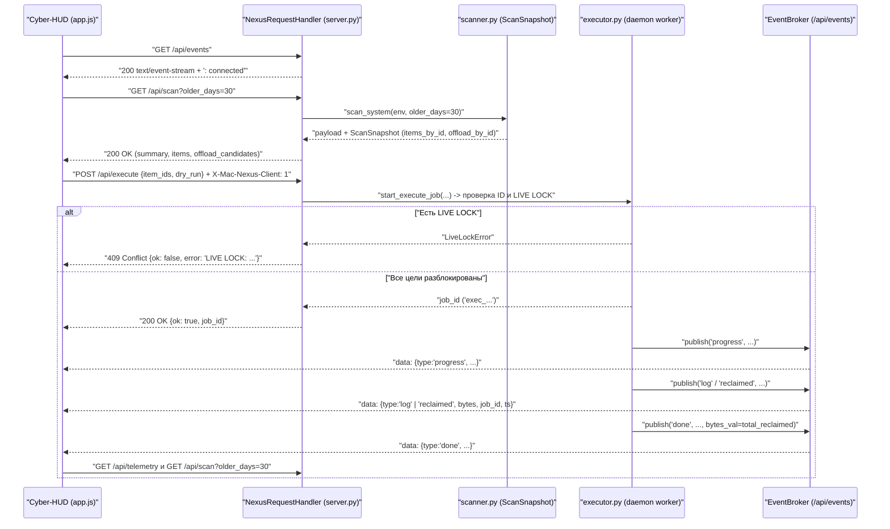

> **Навигация:** [00 · Мастер-индекс](00_master_index_and_system_map.md) | ← [04 · Backend, Scanner, Executor и Безопасность](04_backend_scanner_executor_and_security.md) | [06 · Cyber-HUD Frontend и Mac Nexus.app →](06_cyber_hud_frontend_and_app_bundle.md) | [README репозитория](../README.md)

# 05 · Справочник HTTP REST и SSE API

Этот документ представляет собой исчерпывающую спецификацию всех 17 HTTP REST/SSE маршрутов (2 статических + 15 `/api/*` эндпоинтов), реализованных в [`server.py`](../src/mac_nexus/server.py), [`scanner.py`](../src/mac_nexus/scanner.py) и [`executor.py`](../src/mac_nexus/executor.py) для Mac Nexus **v2.0.0**.

---

## 1. Транспорт, CLI-флаги, заголовки и общие ограничения

### Запуск сервера и CLI-аргументы

Точка входа `python3 -m mac_nexus.server` ([`server.py:523-540`](../src/mac_nexus/server.py#L523-L540)) запускает `NexusHTTPServer` (наследник `ThreadingHTTPServer`, `protocol_version = "HTTP/1.1"`, `allow_reuse_address = True`, `daemon_threads = True`):

| Аргумент CLI | Тип | Значение по умолчанию | Ограничения |
| :--- | :--- | :--- | :--- |
| `--host` | `str` | `"127.0.0.1"` | **Жёсткий инвариант:** любое значение кроме `"127.0.0.1"` немедленно вызывает `ValueError` |
| `--port` | `int` | `8790` | Локальный TCP-порт; в тестах может передаваться `0` (эфемеридный порт ОС) |

### Заголовки безопасности, лимиты тела и CSRF-правила

1. **Общие заголовки ответов (`_send_json`, `_send_static_file`):**
   - `Cache-Control: no-store`
   - `X-Content-Type-Options: nosniff`
   - Для всех JSON-ответов: `Content-Type: application/json; charset=utf-8` и точный `Content-Length`.
   - Формат ошибок JSON: `{"ok": false, "error": "<описание ошибки>"}`.
2. **Ограничение JSON-запросов (`_read_json_body`, [`server.py:160-181`](../src/mac_nexus/server.py#L160-L181)):**
   - Константа `MAX_JSON_BODY_BYTES = 1048576` (`1024 * 1024` байт = **1 MiB**).
   - Если `Content-Length` отсутствует или пуст, считается `"0"`, а тело трактуется как `b"{}"`.
   - Если `Content-Length` не целое число → `400 Bad Request` (`"Invalid Content-Length"`).
   - Если `length < 0` или `length > MAX_JSON_BODY_BYTES` → `413 Request Entity Too Large` (`"Body too large"`).
   - Если тело не декодируется в UTF-8, не является валидным JSON или верхнеуровневый тип не JSON-объект (`dict`) → `400 Bad Request`.
3. **Защита от CSRF на всех `POST /api/*` (`_check_post_csrf`, [`server.py:141-158`](../src/mac_nexus/server.py#L141-L158)):**
   - Заголовок `X-Mac-Nexus-Client` **обязателен** и после `.strip()` должен быть равен `"1"` (иначе `403 Forbidden: missing X-Mac-Nexus-Client header`).
   - Если в запросе присутствует заголовок `Origin`, функция `_is_valid_origin` разбирает его через `urlsplit` и требует `scheme == "http"` и `hostname in {"127.0.0.1", "localhost"}` (иначе `403 Forbidden: invalid Origin`).
   - Запросы `POST` на маршруты вне префикса `/api/` отклоняются с `404` до проверки CSRF.

### Жизненный цикл: Скан → DRY-RUN / Боевое выполнение → SSE-поток



---

## 2. Статика и служебные `GET`-эндпоинты

### `GET /` и `GET /static/<filename>`

Раздаёт встроенные файлы фронтенда из `NexusAppContext.static_dir` (по умолчанию `src/mac_nexus/static`). Маршрут `/` внутренне делегируется в `_send_static_file("index.html")` ([`server.py:187-193`](../src/mac_nexus/server.py#L187-L193)).

- **Защита пути:** URL-декодирование (`unquote`), удаление ведущего `/`; запрещены пустые имена, `..` в частях пути, любые `/` и `\` (вложенные поддиректории в `/static/` не поддерживаются — файлы лежат плоским списком), а также выход за пределы `static_dir.resolve()`. Нарушение → `403 Forbidden`.
- **Белый список MIME-типов (`ALLOWED_STATIC_MIME`, [`server.py:44-51`](../src/mac_nexus/server.py#L44-L51)):**

| Расширение | Заголовок `Content-Type` | Примечание |
| :--- | :--- | :--- |
| `.html` | `text/html; charset=utf-8` | `index.html` |
| `.css` | `text/css; charset=utf-8` | `styles.css` |
| `.js` | `application/javascript; charset=utf-8` | `app.js` |
| `.svg` | `image/svg+xml` | Векторные иконки |
| `.png` | `image/png` | Растровые ассеты |
| `.ico` | `image/x-icon` | Favicon |

Любое иное расширение (например, `.py` или `.json`) → `403 Forbidden` (`"Unsupported asset type"`). Отсутствующий файл → `404 Not Found` (`"Asset not found"`).

---

### `GET /api/health`

Быстрая проверка доступности сервера (используется в `Start_Mac_Nexus.command`, `Mac Nexus.app` и в `app.js` при запуске).

- **Запрос:** параметры не требуются.
- **Ответ `200 OK`:**
  ```json
  {
    "ok": true,
    "app": "Mac Nexus",
    "version": "2.0.0",
    "pid": 73099
  }
  ```

---

### `GET /api/telemetry`

Возвращает телеметрию трёх контуров хранения, состояние CPU/RAM/Swap, счётчики призрачных `.dmg` и активных Orca worktrees, краткую сводку `~/.Trash` и накопленную статистику из `history.json`. Опрашивается фронтендом при старте, после завершения задач и в фоновом цикле каждые `15` секунд ([`app.js:2751-2756`](../src/mac_nexus/static/app.js#L2751-L2756)).

- **Ответ `200 OK`:**
  ```json
  {
    "timestamp": "2026-11-18T03:45:00+03:00",
    "planes": {
      "nvme": {
        "name": "Internal NVMe",
        "mount": "/System/Volumes/Data",
        "mounted": true,
        "total_bytes": 245000000000,
        "used_bytes": 215000000000,
        "free_bytes": 30000000000,
        "purgeable_bytes": 6500000000,
        "used_percent": 87.8
      },
      "ssd": {
        "name": "External APFS SSD",
        "mount": "/Volumes/secret for mine",
        "mounted": true,
        "fs_type": "apfs",
        "total_bytes": 120000000000,
        "used_bytes": 30000000000,
        "free_bytes": 90000000000,
        "used_percent": 25.0,
        "shelves": [
          { "name": "01_AI_Models_and_Caches", "exists": true },
          { "name": "02_Project_Heavy", "exists": true },
          { "name": "03_Software_and_Installers", "exists": true },
          { "name": "04_Media_Archive", "exists": true },
          { "name": "90_Cold_Archive", "exists": true },
          { "name": "99_Backups", "exists": true }
        ]
      },
      "secondbrain": {
        "name": "SecondBrain iCloud",
        "path": "/Users/demo/Library/Mobile Documents/iCloud~md~obsidian/Documents/SecondBrain",
        "mounted": true,
        "size_bytes": 184320000,
        "md_notes_count": 2113,
        "has_node_modules_risk": false
      }
    },
    "system": {
      "cpu_load_1m": 2.41,
      "cpu_cores": 10,
      "ram_total_bytes": 17179869184,
      "ram_used_bytes": 11468800000,
      "ram_pressure": "normal",
      "swap_used_bytes": 1073741824,
      "ghost_dmgs_count": 0,
      "orca_live_worktrees": 2
    },
    "history": {
      "total_reclaimed_bytes": 5368709120,
      "last_run_at": "2026-11-18T03:30:12+03:00"
    },
    "trash": {
      "tcc_restricted": false,
      "total_bytes": 524288000,
      "item_count": 12
    }
  }
  ```

- **Примечания к полям:**
  - Если SSD отмонтирован (`mounted: false`), все числовые метрики `planes.ssd` равны `0`, `fs_type` равен `"unmounted"`, а в `shelves` все 6 полок имеют `"exists": false`.
  - Допустимые значения `system.ram_pressure`: `"normal"`, `"warning"`, `"critical"`.
  - `trash.tcc_restricted: true` — macOS TCC запретил прямой `os.scandir` по `~/.Trash`; в этом случае `total_bytes` равен `0`, а `item_count` заполняется количеством элементов из AppleScript-запроса к Finder (без детализации элементов до вызова `mode: "finder_empty"`).

---

### `GET /api/scan?older_days=30`

Выполняет read-only сканирование всех 8 категорий очистки (пакетные кэши incl. `go`/`cargo`, кэши GUI-программ со `Smart Close`-метаданными, динамические `system_cache`, `app_orphans`, `ai_dev_deep` & Docker Prune, Downloads Inbox, артефакты `~/Projects`, смонтированные DMG) и тяжёлых медиафайлов для SSD (всего 9 параллельных потоков), обновляя серверный `ScanSnapshot` (`items_by_id` и `offload_by_id`) под `snapshot_lock`.

- **Query-параметр:**
  - `older_days` (`int`, по умолчанию `30`): возрастной порог в днях для `dev_projects`, `organize_triage` и архивов сессий Codex. Значения принудительно ограничиваются диапазоном `[0, 3650]`. Некорректное нечисловое значение автоматически откатывается к `30`.
- **Ответ `200 OK`:**
  ```json
  {
    "scanned_at": "2026-11-18T03:45:10+03:00",
    "older_days": 30,
    "summary": {
      "reclaimable_ready_bytes": 1245678901,
      "reclaimable_locked_bytes": 412000000,
      "offloadable_media_bytes": 2684354560,
      "organize_candidates_count": 14
    },
    "items": [
      {
        "id": "proj_a1b2c3d4e5f601",
        "category": "dev_projects",
        "title": "sample-app / node_modules",
        "subtitle": "Артефакт сборки sample-app/node_modules (не изменялся 45 дн.)",
        "path": "/Users/demo/Projects/sample-app/node_modules",
        "size_bytes": 320111222,
        "locked": false,
        "lock_reason": null,
        "action_kind": "rm_artifact",
        "risk": "medium",
        "age_days": 45.0,
        "matched_count": 1,
        "quittable": false,
        "browser_warning": false
      },
      {
        "id": "app_9f8e7d6c5b4a32",
        "category": "app_cache",
        "title": "Кэш Google Chrome (Cache / GPU / Dawn)",
        "subtitle": "Безопасные кэши без вкладок, профилей, IndexedDB и Cookies",
        "path": "/Users/demo/Library/Caches/Google/Chrome/Default/Cache (+2 папок)",
        "size_bytes": 412000000,
        "locked": true,
        "lock_reason": "Приложение Google Chrome запущено — закройте его для защиты SQLite WAL и кэша",
        "action_kind": "clean_cache",
        "risk": "low",
        "age_days": 0.1,
        "matched_count": 3,
        "quittable": true,
        "quit_app_name": "Google Chrome",
        "browser_warning": true
      }
    ],
    "offload_candidates": [
      {
        "id": "media_0123456789abcd",
        "name": "demo_clip.mov",
        "rel_path": "Desktop/Screencasts/demo_clip.mov",
        "display_label": "demo_clip.mov",
        "ext": "mov",
        "size_bytes": 524288000,
        "mtime": "2026-10-15T14:20:00+03:00",
        "age_days": 34.0,
        "dest_preview": "/Volumes/secret for mine/04_Media_Archive/Screen_Recordings/2026-10/demo_clip.mov"
      }
    ]
  }
  ```

- **Словарь перечислений (`items[]`):**
  - `category`: `"pkg_cache"` | `"app_cache"` | `"system_cache"` | `"app_orphans"` | `"ai_dev_deep"` | `"downloads_inbox"` | `"dev_projects"` | `"ghost_dmgs"`
  - `action_kind`: `"prune"` | `"clean_cache"` | `"trash"` | `"organize"` | `"rm_artifact"` | `"detach_dmg"` | `"docker_prune"`
  - `risk`: `"low"` | `"medium"` (`"low"` для кэшей, загрузок, DMG и `__pycache__`/`.pytest_cache`; `"medium"` для `node_modules`/`.venv`/`venv`/`target`, `app_orphans`, `docker_prune` и архивных сессий/бэкапов в `ai_dev_deep`)
  - `quittable` / `quit_app_name` / `browser_warning`: метаданные `Smart Close` для `app_cache` (для `orca` и `vscode` `quittable: false` — кнопка Smart Close не выдаётся; `quit_app_name` присутствует при `quittable: true`)
  - `summary.organize_candidates_count`: сумма `matched_count` всех элементов с `category == "downloads_inbox"`.

---

## 3. Поток событий Server-Sent Events (`GET /api/events`)

Открывает постоянное однонаправленное соединение `text/event-stream` для трансляции логов, прогресса и счётчиков освобождённых байтов из фоновых заданий [`executor.py`](../src/mac_nexus/executor.py) в реальном времени.

- **Заголовки ответа `200 OK` (`_handle_sse`, [`server.py:250-274`](../src/mac_nexus/server.py#L250-L274)):**
  - `Content-Type: text/event-stream; charset=utf-8`
  - `Cache-Control: no-cache`
  - `Connection: keep-alive`
  - `X-Accel-Buffering: no`
- **Протокол фреймов:**
  1. Сразу после установки соединения сервер отправляет SSE-комментарий приветствия:
     ```text
     : connected

     ```
  2. Если в очереди подписчика (`queue.Queue(maxsize=500)`) нет событий в течение `15.0` секунд (`queue.Empty`), отправляется heartbeat-комментарий:
     ```text
     : keepalive

     ```
  3. Каждое событие из `EventBroker.publish` сериализуется в одну строку:
     ```text
     data: {"type": "reclaimed", "message": "[DONE] Освобождено 4096 Б (Figma Cache)", "bytes": 4096, "job_id": "exec_a1b2c3d4e5", "ts": 1800000012.345}

     ```
- **Поля JSON-события:**
  - `type` (`str`):
    - `"progress"` — старт задачи и счётчик `Выполнено i/N` / `Обработано i/N`;
    - `"log"` — информационные сообщения, события `[DRY-RUN]`, предупреждения `[LOCK-GUARD]`, ошибки задачи;
    - `"reclaimed"` — успешное освобождение `bytes` байт на NVMe (вызывает анимацию одометра в Cyber-HUD);
    - `"done"` — финальное событие завершения задания (и при `dry_run: true`, и при живом запуске), несёт итоговый `bytes` (при `dry_run: true` равен `0`).
  - `message` (`str`): текст для Cyber-Terminal.
  - `bytes` (`int`): количество освобождённых байт (`0` для `progress` и `log`).
  - `job_id` (`str | null`): идентификатор задания (`exec_...`, `offload_...`, `smart_...`, `radar_...`).
  - `ts` (`float`): Unix timestamp публикации события.
- **Корректное завершение:** при переполнении очереди (более 500 непрочитанных событий) вытесняется самое старое событие; при обрыве сокета или остановке сервера (`shutdown_event`) подписчик автоматически отписывается в `finally`.

---

## 4. Мутирующие `POST`-эндпоинты

> [!IMPORTANT]
> Каждый `POST /api/*` маршрут требует заголовок `X-Mac-Nexus-Client: 1` (и корректный loopback `Origin`, если он передан). Все пути передаются **только** через серверные непрозрачные ID, полученные в предыдущих ответах `/api/scan`, `/api/deep-radar`, `/api/trash` или `/api/duplicates`.

### `POST /api/execute`

Запускает фоновую задачу очистки (или симуляции `DRY-RUN`) выбранных целей из `items[]`.

- **Тело запроса (`application/json`):**
  ```json
  {
    "item_ids": ["proj_a1b2c3d4e5f601", "dl_99887766554433"],
    "dry_run": true
  }
  ```
  Поле `dry_run` опционально и по умолчанию равно `true` (`bool(body.get("dry_run", True))`).
- **Валидация до старта потока:**
  1. `item_ids` должен быть непустым списком строк (`list[str]`).
  2. Каждый ID должен существовать в `ScanSnapshot.items_by_id` (иначе `400`).
  3. Выполняется свежий вызов `detect_live_locks(env)` и `_recheck_target_lock` для каждой цели (иначе `409`).
- **Ответы:**
  - `200 OK`: `{"ok": true, "job_id": "exec_1a2b3c4d5e"}`
  - `400 Bad Request`: некорректный JSON, `item_ids` не `list[str]`, пустой список `item_ids`, неизвестный/устаревший ID.
  - `403 Forbidden`: отсутствует `X-Mac-Nexus-Client: 1` или невалидный `Origin`.
  - `409 Conflict`: `{"ok": false, "error": "LIVE LOCK: <причина блокировки>"}` (обратите внимание: префикс `"LIVE LOCK: "` добавляется именно обработчиком `/api/execute` в [`server.py:305`](../src/mac_nexus/server.py#L305)).
  - `413 Request Entity Too Large`: тело больше 1 MiB.

---

### `POST /api/offload`

Запускает фоновую задачу SHA-256 телепорта выбранных медиафайлов (`.mov`, `.mp4`, `.mkv` > 10 MiB) с Internal NVMe на External APFS SSD (`/Volumes/secret for mine/04_Media_Archive/Screen_Recordings/<YYYY-MM>/`).

- **Тело запроса (`application/json`):**
  ```json
  {
    "media_ids": ["media_0123456789abcd"],
    "dry_run": true
  }
  ```
  Поле `dry_run` по умолчанию равно `true`.
- **Валидация до старта потока:**
  1. `media_ids` должен быть непустым `list[str]`.
  2. Каждый ID должен присутствовать в `ScanSnapshot.offload_by_id` (иначе `400`).
  3. Исходный путь не должен попадать под `is_protected_path` (иначе `409`).
  4. Если `dry_run == false`, проверяется `ssd_is_mounted(env)`; если внешний SSD отключён → `409` (`"Внешний SSD /Volumes/secret for mine не смонтирован"`).
- **Ответы:**
  - `200 OK`: `{"ok": true, "job_id": "offload_9a8b7c6d5e"}`
  - `400 Bad Request`: невалидное тело, пустой список или неизвестный `media_id`.
  - `403 Forbidden`: сбой CSRF / `Origin`.
  - `409 Conflict`: `{"ok": false, "error": "<причина блокировки или отмонтированный SSD>"}`.
  - `413 Request Entity Too Large`: тело больше 1 MiB.

---

### `POST /api/duplicates`

Выполняет синхронный поиск побайтовых дубликатов (файлы размером `>= 1 MiB`) с помощью `czkawka_cli dup` (хэш BLAKE3), фильтрует защищённые пути и сохраняет выданные `file_id` в `ScanSnapshot.dup_files_by_id`.

- **Тело запроса (`application/json`):**
  ```json
  {
    "target": "downloads"
  }
  ```
  Допустимые значения `target`:
  - `"downloads"` → `~/Downloads`
  - `"desktop"` → `~/Desktop`
  - `"ssd_media"` → `/Volumes/secret for mine/04_Media_Archive`
  - `"documents"` → `~/Documents` (**v2.0.0**)
- **Ответ `200 OK`:**
  ```json
  {
    "ok": true,
    "groups": [
      {
        "hash_or_id": "dup_4f5e6d7c8b9a",
        "size_bytes": 2097152,
        "wasted_bytes": 4194304,
        "files": [
          {
            "id": "dupf_11112222333344",
            "name": "report_sample.pdf",
            "path": "/Users/demo/Downloads/report_sample.pdf",
            "mtime": "2026-11-10T12:00:00+03:00"
          },
          {
            "id": "dupf_55556666777788",
            "name": "report_sample.pdf",
            "path": "/Users/demo/Downloads/archive/report_sample.pdf",
            "mtime": "2026-11-12T15:30:00+03:00"
          },
          {
            "id": "dupf_9999aaaabbbbcc",
            "name": "report_sample.pdf",
            "path": "/Users/demo/Downloads/temp/report_sample.pdf",
            "mtime": "2026-11-14T09:15:00+03:00"
          }
        ]
      }
    ],
    "total_wasted_bytes": 4194304
  }
  ```
- **Инвариант сортировки:** внутри каждой группы `files[0]` — самый старый файл (`is_primary = true`, «ОРИГИНАЛ / СОХРАНИТЬ»), а `files[1..]` — более новые копии. Если целевая папка не существует (для `downloads` или `desktop`), возвращается `200 OK` с `"groups": []` и `"total_wasted_bytes": 0`.
- **Ошибки:** `400` (недопустимый `target` или не строка), `403` (CSRF), `409` (`RuntimeError`: отмонтированный SSD для `ssd_media` или ошибка `czkawka_cli`), `413`.

---

### `POST /api/trash-duplicates`

Синхронно перемещает выбранные файлы дубликатов в Корзину (`~/.Trash`) с защитой от коллизий имён и обновляет `history.json`.

- **Тело запроса (`application/json`):**
  ```json
  {
    "file_ids": ["dupf_55556666777788", "dupf_9999aaaabbbbcc"]
  }
  ```
- **Поведение:** выполняется под `snapshot_lock`; для каждого ID проверяется наличие в `dup_files_by_id` (`UnknownTargetError` → `400`) и отсутствие в `is_protected_path` (`LiveLockError` → `409`). Успешно перемещённые ID удаляются из `dup_files_by_id`.
- **Ответ `200 OK`:**
  ```json
  {
    "ok": true,
    "trashed_count": 2,
    "reclaimed_bytes": 4194304
  }
  ```
- **Ошибки:** `400` (`file_ids` не `list[str]`, пустой или содержит неизвестный ID), `403` (CSRF), `409` (`LiveLockError`), `413`.

---

### `POST /api/open-tool`

Открывает одну из разрешённых локальных утилит/папок через macOS `open` либо возвращает содержимое Воскресного дайджеста гигиены.

- **Тело запроса (`application/json`):**
  ```json
  {
    "tool": "digest"
  }
  ```
- **Allowlist допустимых значений `tool` ([`executor.py:1106-1132`](../src/mac_nexus/executor.py#L1106-L1132)):**

| Значение `tool` | Выполняемое действие | Успешный ответ `200 OK` | Возможная ошибка |
| :--- | :--- | :--- | :--- |
| `"digest"` | Читает `~/.local/state/mac-hygiene/digest_latest.md` (или возвращает заглушку, если файла нет) | `{"ok": true, "content": "<Markdown>"}` | — |
| `"pearcleaner"` | `open -a /Applications/Pearcleaner.app` | `{"ok": true}` | `500`, если приложение не найдено |
| `"daisydisk"` | `open -a /Applications/DaisyDisk.app` | `{"ok": true}` | `500`, если приложение не найдено |
| `"finder_ssd"` | Проверяет `ssd_is_mounted`, затем `open "/Volumes/secret for mine"` | `{"ok": true}` | `409`, если SSD не смонтирован; `500` при сбое `open` |
| `"finder_downloads"` | `open ~/Downloads` | `{"ok": true}` | `500` при сбое `open` |
| `"finder_trash"` | `open ~/.Trash` — открывает Корзину в Finder | `{"ok": true}` | `500` при сбое `open` |

- **Прочие ошибки:** `400` (`tool` не строка или отсутствует в allowlist), `403` (CSRF / `Origin`), `413`.

---

### `GET /api/deep-radar?min_mb=50`

Выполняет X-Ray сканирование файловой системы в поисках крупных перемещаемых пользовательских файлов (глубина ≤ 3 в `Downloads`, `Desktop`, `Documents`, `Movies`) и неразрушаемых системных X-Ray узлов (физический расход `>= min_mb` MiB через `_physical_file_size(st)` = `st_blocks * 512`), обновляя `ScanSnapshot.radar_by_id`. Выдаёт топ-80 записей по убыванию `size_bytes`.

- **Query-параметр:** `min_mb` (`int`, по умолчанию `50`, принудительно ограничивается диапазоном `[1, 102400]`; некорректное значение откатывается к `50`; в UI доступны пресеты `50`, `250`, `1024` MiB).
- **Ответ `200 OK`:**
  ```json
  {
    "ok": true,
    "scanned_at": "2026-11-18T04:00:00+03:00",
    "min_mb": 50,
    "summary": {
      "total_bytes": 12884901888,
      "movable_bytes": 2147483648,
      "hotspot_bytes": 10737418240,
      "count": 2
    },
    "items": [
      {
        "id": "hotspot_a1b2c3d4e5f601",
        "title": "OrbStack VM (data.img.raw)",
        "path": "/Users/demo/Library/Group Containers/HUAQ24HBR6.dev.orbstack/data/data.img.raw",
        "rel_path": "Library/Group Containers/HUAQ24HBR6.dev.orbstack/data/data.img.raw",
        "kind": "hotspot",
        "size_bytes": 10737418240,
        "logical_bytes": 245107802624,
        "mtime": "2026-11-18T02:00:00+03:00",
        "age_days": 0.1,
        "can_trash": false,
        "can_teleport": false,
        "default_shelf": "",
        "note": "Разрежённый (sparse) виртуальный диск OrbStack. Для сжатия используйте Docker Prune во вкладке Радар или настройки OrbStack."
      },
      {
        "id": "radar_0123456789abcd",
        "title": "sample_archive.iso",
        "path": "/Users/demo/Downloads/sample_archive.iso",
        "rel_path": "Downloads/sample_archive.iso",
        "kind": "file",
        "size_bytes": 2147483648,
        "logical_bytes": 2147483648,
        "mtime": "2026-10-12T10:00:00+03:00",
        "age_days": 37.0,
        "can_trash": true,
        "can_teleport": true,
        "default_shelf": "03_Software_and_Installers",
        "note": "Готов к SHA-256 переносу на полку 03_Software_and_Installers или в Корзину"
      }
    ]
  }
  ```
- **Поля `items[]`:**
  - `id`: префикс `radar_<14hex>` для перемещаемых файлов (`kind: "file"`), `hotspot_<14hex>` для X-Ray узлов (`kind: "hotspot"`).
  - `size_bytes` vs `logical_bytes`: `size_bytes` — реально занятые физические блоки на APFS (`_physical_file_size`), `logical_bytes` — логический `st_size`. В Cyber-HUD ([`app.js`](../src/mac_nexus/static/app.js)) признак разрежённого файла (`SPARSE`) вычисляется как `logical_bytes > size_bytes * 1.2`.
  - `kind: "hotspot"` (`can_trash: false`, `can_teleport: false`): защищён от удаления и телепорта (`HTTP 409` в `/api/radar-action`); для него доступен только `POST /api/radar-reveal` (показ в Finder).

---

### `GET /api/trash`

Инспектирует `~/.Trash` с вычислением объёма записей старше `7` и `30` дней, обновляет `ScanSnapshot.trash_by_id` и корректно обрабатывает TCC-ограничения macOS (`PermissionError`).

- **Ответ `200 OK` (доступ разрешён):**
  ```json
  {
    "ok": true,
    "tcc_restricted": false,
    "total_bytes": 524288000,
    "older_7d_bytes": 209715200,
    "older_30d_bytes": 0,
    "item_count": 2,
    "finder_item_count": 2,
    "items": [
      {
        "id": "trash_11223344556677",
        "name": "old_project.zip",
        "path": "/Users/demo/.Trash/old_project.zip",
        "is_dir": false,
        "size_bytes": 209715200,
        "mtime": "2026-11-05T10:00:00+03:00",
        "age_days": 13.0
      }
    ]
  }
  ```
- **Ответ `200 OK` (TCC-ограничение, `PermissionError` при `os.scandir`):**
  ```json
  {
    "ok": true,
    "tcc_restricted": true,
    "total_bytes": 0,
    "older_7d_bytes": 0,
    "older_30d_bytes": 0,
    "item_count": 5,
    "finder_item_count": 5,
    "items": []
  }
  ```
  В этом режиме количество элементов запрашивается через `osascript` (`Finder`), а очистка доступна через `POST /api/empty-trash` с `"mode": "finder_empty"` или `POST /api/open-tool` с `"tool": "finder_trash"`.

---

### `POST /api/smart-close-clean`

Запускает фоновую задачу: мягко закрывает разрешённое GUI-приложение через `osascript`, ждёт исчезновения процесса по `pgrep -x` (до `10` секунд с шагом `0.25` с), очищает его allowlisted-кэш через `_clear_cache_dir_contents` и при `reopen: true` перезапускает приложение (`open -a`).

> [!CAUTION]
> **HARD-FORBIDDEN для `Orca` и `VS Code`:** если `item.app_key in {"orca", "vscode"}` (или `category != "app_cache"` / `quittable != true`), немедленно возвращается `HTTP 409` без запуска задачи. Это правило не обходится флагом `dry_run: true`.

- **Тело запроса (`application/json`):**
  ```json
  {
    "item_id": "app_9f8e7d6c5b4a32",
    "reopen": true,
    "dry_run": true
  }
  ```
  Поля `reopen` и `dry_run` опциональны (`bool`, по умолчанию `true`).
- **Ответы:**
  - `200 OK`: `{"ok": true, "job_id": "smart_a1b2c3d4e5"}` (асинхронно транслирует прогресс в SSE; если при `dry_run: false` процесс не завершился за `10` секунд или запустился повторно, воркер прерывается с SSE-сообщением `[LOCK-GUARD] Таймаут закрытия ...` без касания кэша).
  - `400 Bad Request`: `item_id` не непустая строка, `reopen`/`dry_run` не boolean, либо неизвестный/устаревший `item_id`.
  - `403 Forbidden`: сбой CSRF / `Origin`.
  - `409 Conflict`: **HARD prohibition** для `orca`/`vscode`, не-`app_cache` категория, `not quittable` или недопустимое имя приложения.
  - `413 Request Entity Too Large`: тело больше 1 MiB.

---

### `POST /api/radar-action`

Запускает фоновую задачу перемещения в Корзину или SHA-256 телепорта файлов из Deep Radar (`ScanSnapshot.radar_by_id`).

- **Тело запроса (`application/json`):**
  ```json
  {
    "radar_ids": ["radar_0123456789abcd"],
    "action": "teleport_ssd",
    "shelf": "04_Media_Archive",
    "dry_run": true
  }
  ```
- **Поле `action`:** `"trash"` (`-> ~/.Trash` через `move_to_trash`) | `"teleport_ssd"` (`-> {ssd_mount}/{shelf}/Manual_Offload/{YYYY-MM}/` через `teleport_file_sha256`).
- **Поле `shelf`:** `str` (опционально, по умолчанию `"90_Cold_Archive"`); проверяется по allowlist `SSD_SHELVES` (`01_AI_Models_and_Caches`, `02_Project_Heavy`, `03_Software_and_Installers`, `04_Media_Archive`, `90_Cold_Archive`, `99_Backups`).
- **Поле `dry_run`:** `bool` (опционально, по умолчанию `true`).
- **Ответы:**
  - `200 OK`: `{"ok": true, "job_id": "radar_a1b2c3d4e5"}`
  - `400 Bad Request`: невалидные типы полей, пустой список `radar_ids`, неизвестный `radar_id`, недопустимые `action` или `shelf`.
  - `403 Forbidden`: сбой CSRF / `Origin`.
  - `409 Conflict`: `is_protected_path`, X-Ray `hotspot` (`kind == "hotspot"`), запрещённое действие (`not can_trash`/`not can_teleport`), или отмонтированный SSD (при `action == "teleport_ssd"` и `dry_run == false`).
  - `413 Request Entity Too Large`: тело больше 1 MiB.

---

### `POST /api/radar-reveal`

Раскрывает файл или X-Ray каталог из Deep Radar в Finder (`open -R <path>`). Выполняется синхронно.

- **Тело запроса (`application/json`):**
  ```json
  {
    "radar_id": "radar_0123456789abcd"
  }
  ```
- **Ответ `200 OK`:** `{"ok": true}`
- **Ошибки:** `400` (`radar_id` не непустая строка, отсутствует в `radar_by_id` или путь больше не существует на диске), `403` (CSRF / `Origin`), `413` (>1 MiB), `500` (ненулевой код возврата `open -R`).

---

### `POST /api/empty-trash`

Синхронно (в рамках HTTP-запроса, под `snapshot_lock`, с публикацией событий в SSE) очищает или симулирует очистку Корзины `~/.Trash` в одном из трёх режимов (`purge_trash_items`).

- **Тело запроса (`application/json`):**
  ```json
  {
    "mode": "older_than",
    "older_days": 30,
    "dry_run": true
  }
  ```
- **Поле `mode` (`str`):**
  - `"selected"` — удалить только указанные `trash_ids` (непустой `list[str]` обязателен).
  - `"older_than"` — удалить элементы `trash_by_id` с `age_days >= older_days` (`older_days >= 0`, по умолчанию `30`).
  - `"finder_empty"` — вызвать `osascript -e 'tell application "Finder" to empty trash'` (обходит TCC, работает даже при `tcc_restricted: true`).
- **Ответ `200 OK`:**
  - Режимы `"selected"` и `"older_than"`:
    ```json
    {
      "ok": true,
      "dry_run": true,
      "purged_count": 2,
      "reclaimed_bytes": 209715200
    }
    ```
  - Режим `"finder_empty"` при `dry_run: true`:
    `{"ok": true, "dry_run": true, "purged_count": 0, "reclaimed_bytes": 0, "message": "DRY-RUN: Finder empty trash preview"}`
  - Режим `"finder_empty"` при `dry_run: false`:
    `{"ok": true, "dry_run": false, "purged_count": -1, "reclaimed_bytes": 0}`
- **Ошибки:**
  - `400 Bad Request`: неверный `mode`, невалидный тип `trash_ids`/`older_days`/`dry_run`, пустой `trash_ids` при `mode == "selected"`, либо неизвестный `trash_id`.
  - `403 Forbidden`: сбой CSRF / `Origin`.
  - `409 Conflict`: нарушение containment guard `_verify_inside_trash` (объект вне `env.trash_dir` или равна сама папка `~/.Trash`).
  - `413 Request Entity Too Large`: тело больше 1 MiB.
  - `500 Internal Server Error`: сбой AppleScript при `mode == "finder_empty"` (`dry_run: false`).

---

## 5. Матрица HTTP статус-кодов

| Код | Название (`HTTPStatus`) | Источники в `server.py` | Типичная причина |
| :--- | :--- | :--- | :--- |
| `200` | `OK` | Все маршруты | Успешная отдача статики, JSON-ответа или открытие SSE-потока |
| `400` | `BAD_REQUEST` | `_read_json_body`, `POST /api/*` | Неверный `Content-Length`, битый JSON, не-объект JSON, неверный тип поля, пустой список ID, `UnknownTargetError`, `ValueError` |
| `403` | `FORBIDDEN` | `_send_static_file`, `_check_post_csrf` | Отсутствует `X-Mac-Nexus-Client: 1`, поддельный `Origin`, path traversal в `/static/*`, неподдерживаемое расширение файла |
| `404` | `NOT_FOUND` | `_send_static_file`, `do_GET`, `do_POST` | Отсутствующий статический файл, неизвестный маршрут |
| `409` | `CONFLICT` | `/api/execute`, `/api/offload`, `/api/smart-close-clean`, `/api/radar-action`, `/api/radar-reveal`, `/api/empty-trash`, `/api/duplicates`, `/api/trash-duplicates`, `/api/open-tool` | Активный `LIVE LOCK`, Smart Close HARD-запрет (`orca`/`vscode`), защищённый путь (`_verify_inside_trash`, `is_protected_path`), отмонтированный внешний SSD, X-Ray `hotspot`-узел или сбой `czkawka_cli` |
| `413` | `REQUEST_ENTITY_TOO_LARGE` | `_read_json_body` | `Content-Length < 0` или `> 1048576` байт (1 MiB) |
| `500` | `INTERNAL_SERVER_ERROR` | `/api/radar-reveal`, `/api/empty-trash`, `/api/open-tool` | Ошибка запуска `open` / `open -R` или AppleScript `Finder empty trash` (`RuntimeError`) |

---

## 6. Готовые `curl`-примеры (безопасные и неразрушающие)

Все приведённые ниже команды можно запускать на живом сервере `http://127.0.0.1:8790` без риска удалить или переместить файлы:

```zsh
# 1. Проверка работоспособности сервера
curl -fsS http://127.0.0.1:8790/api/health

# 2. Получение телеметрии 3 контуров, RAM, Swap и Orca worktrees
curl -fsS http://127.0.0.1:8790/api/telemetry | python3 -m json.tool

# 3. Read-only скан системы с порогом возраста проектов 30 дней
curl -fsS "http://127.0.0.1:8790/api/scan?older_days=30" | python3 -m json.tool

# 4. Чтение Воскресного дайджеста через POST /api/open-tool (обязателен CSRF-заголовок)
curl -fsS -X POST http://127.0.0.1:8790/api/open-tool \
  -H "Content-Type: application/json" \
  -H "X-Mac-Nexus-Client: 1" \
  -d '{"tool": "digest"}'

# 5. Подписка на живой SSE-поток событий (Ctrl+C для выхода)
curl -N http://127.0.0.1:8790/api/events

# 6. Симуляция очистки (DRY-RUN: возьмите реальный id из шага 3)
curl -fsS -X POST http://127.0.0.1:8790/api/execute \
  -H "Content-Type: application/json" \
  -H "X-Mac-Nexus-Client: 1" \
  -d '{"item_ids": ["<ITEM_ID_FROM_SCAN>"], "dry_run": true}'

# 7. Симуляция SHA-256 телепорта на SSD (DRY-RUN: возьмите media id из шага 3)
curl -fsS -X POST http://127.0.0.1:8790/api/offload \
  -H "Content-Type: application/json" \
  -H "X-Mac-Nexus-Client: 1" \
  -d '{"media_ids": ["<MEDIA_ID_FROM_SCAN>"], "dry_run": true}'

# 8. Read-only поиск дубликатов в ~/Downloads
curl -fsS -X POST http://127.0.0.1:8790/api/duplicates \
  -H "Content-Type: application/json" \
  -H "X-Mac-Nexus-Client: 1" \
  -d '{"target": "downloads"}'

# 9. Негативная проверка CSRF-защиты (ожидается HTTP 403)
curl -i -X POST http://127.0.0.1:8790/api/open-tool \
  -H "Content-Type: application/json" \
  -d '{"tool": "digest"}'

# 10. Негативная проверка подмены Origin (ожидается HTTP 403)
curl -i -X POST http://127.0.0.1:8790/api/open-tool \
  -H "Content-Type: application/json" \
  -H "X-Mac-Nexus-Client: 1" \
  -H "Origin: http://127.0.0.1.evil.com:8790" \
  -d '{"tool": "digest"}'

# 11. Read-only сканирование Deep Radar (порог 50 MiB, физические блоки + X-Ray hotspots)
curl -fsS "http://127.0.0.1:8790/api/deep-radar?min_mb=50" | python3 -m json.tool

# 12. Read-only инспекция Корзины ~/.Trash (с поддержкой TCC fallback)
curl -fsS http://127.0.0.1:8790/api/trash | python3 -m json.tool

# 13. Симуляция Smart Close + очистки кэша (DRY-RUN: возьмите quittable app_id из шага 3)
curl -fsS -X POST http://127.0.0.1:8790/api/smart-close-clean \
  -H "Content-Type: application/json" \
  -H "X-Mac-Nexus-Client: 1" \
  -d '{"item_id": "<APP_ID_FROM_SCAN>", "reopen": true, "dry_run": true}'

# 14. Симуляция действия Deep Radar (DRY-RUN: возьмите radar_id из шага 11)
curl -fsS -X POST http://127.0.0.1:8790/api/radar-action \
  -H "Content-Type: application/json" \
  -H "X-Mac-Nexus-Client: 1" \
  -d '{"radar_ids": ["<RADAR_ID_FROM_DEEP_RADAR>"], "action": "teleport_ssd", "shelf": "90_Cold_Archive", "dry_run": true}'

# 15. Открытие объекта из Deep Radar в Finder (безопасный read-only reveal)
curl -fsS -X POST http://127.0.0.1:8790/api/radar-reveal \
  -H "Content-Type: application/json" \
  -H "X-Mac-Nexus-Client: 1" \
  -d '{"radar_id": "<RADAR_ID_FROM_DEEP_RADAR>"}'

# 16. Симуляция очистки Корзины старше 30 дней (DRY-RUN)
curl -fsS -X POST http://127.0.0.1:8790/api/empty-trash \
  -H "Content-Type: application/json" \
  -H "X-Mac-Nexus-Client: 1" \
  -d '{"mode": "older_than", "older_days": 30, "dry_run": true}'
```

---

## Связанные документы и модули кода

- Следующий документ: [06 · Cyber-HUD Frontend и Mac Nexus.app](06_cyber_hud_frontend_and_app_bundle.md)
- Предыдущий документ: [04 · Backend, Scanner, Executor и Безопасность](04_backend_scanner_executor_and_security.md)
- Другие разделы документации: [00 · Мастер-индекс и карта системы](00_master_index_and_system_map.md), [01 · Трёхконтурная архитектура ФС](01_three_plane_filesystem_architecture.md), [02 · Внутреннее устройство macOS APFS и XDG](02_macos_apfs_xdg_and_env_internals.md), [03 · Стек 1 и Красная книга безопасности](03_cleanup_stack_and_safety_bible.md), [07 · Автоматизация и Runbooks](07_automation_runbooks_and_troubleshooting.md), [08 · Онбординг агентов и аудит](08_agent_onboarding_and_baseline_audit.md)
- Исходный код и тесты: [`server.py`](../src/mac_nexus/server.py), [`scanner.py`](../src/mac_nexus/scanner.py), [`executor.py`](../src/mac_nexus/executor.py), [`app.js`](../src/mac_nexus/static/app.js), [`test_mac_nexus.py`](../tests/test_mac_nexus.py)
- Инструкции проекта: [README.md](../README.md), [CLAUDE.md](../CLAUDE.md), [AGENTS.md](../AGENTS.md)
