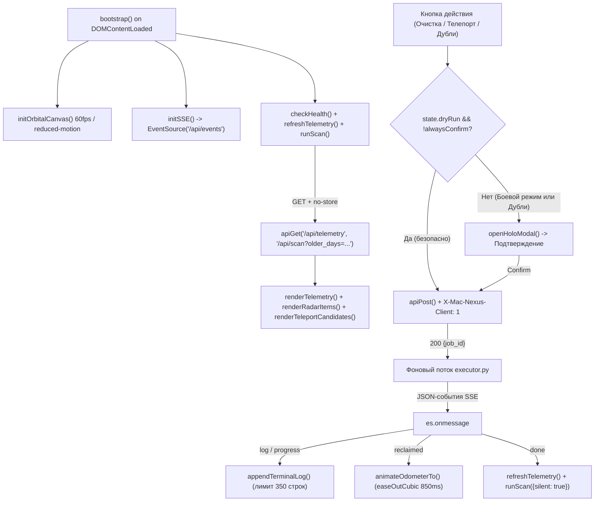
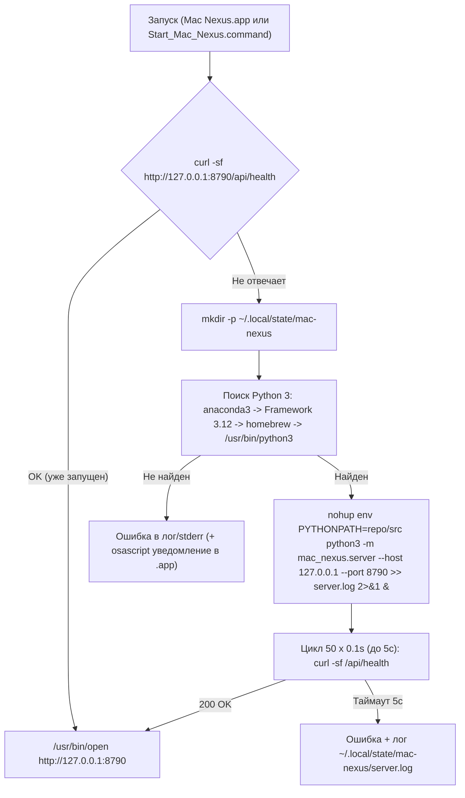

# 06 · Cyber-HUD фронтенд, macOS `.app` бандл и генерация иконок

> **Навигация:** [00 · Мастер-индекс](00_master_index_and_system_map.md) | ← [05 · Справочник HTTP REST и SSE API](05_http_rest_and_sse_api_reference.md) | [07 · Регламенты и Runbooks →](07_automation_runbooks_and_troubleshooting.md) | [README репозитория](../README.md)

Фронтенд **Mac Nexus Cyber-HUD** и нативная обёртка запуска для macOS построены по принципу полной автономности: **ноль внешних CDN-зависимостей**, чистые `HTML` / `CSS` / `JS` в [`src/mac_nexus/static/`](../src/mac_nexus/static/index.html), фоновый `LSUIElement`-бандл `/Users/egorlabutin/Desktop/Mac Nexus.app` с собственной Retina-иконкой (10 слоёв `.icns`) и идемпотентный shell-лаунчер [`Start_Mac_Nexus.command`](../Start_Mac_Nexus.command).

---

## 1. Zero-CDN дизайн и DOM-архитектура `index.html`

Файл [`index.html`](../src/mac_nexus/static/index.html) (`792` строки) не подключает ни одного внешнего ресурса (`fonts.googleapis.com`, `unpkg`, `jsdelivr` и т. п. полностью отсутствуют). Вся графика, типографика и анимации опираются на локальный `/static/styles.css`, `<script src="/static/app.js" defer></script>`, встроенный векторный SVG и фоновый `<canvas>`.

### 1.1. Иерархия DOM-слоёв

1. **Фоновые визуальные слои (`z-index: 0..1`, `pointer-events: none`):**
   - `<canvas id="orbital-canvas" aria-hidden="true">` — живой фон с орбитальными кольцами, секторными линиями и сетью частиц.
   - `.holo-scanlines` — полупрозрачные горизонтальные сканлайны.
   - `.ambient-vignette` — радиальное затемнение краёв вьюпорта.
2. **Область уведомлений и основная оболочка (`z-index: 2..60`):**
   - `#toast-container.toast-container` (`aria-live="polite"`) — всплывающие уведомления в правом верхнем углу (автоудаление через `4400` мс).
   - `.hud-shell` (`max-width: 1480px`) — главный контейнер интерфейса, состоящий из четырёх ключевых зон.
3. **Top Telemetry & Command Bar (`header.hud-header.hud-panel`):**
   - `.brand-cluster` — вращающаяся векторная эмблема (`svg.emblem-svg` с `.emblem-ring-outer`, `.emblem-ring-inner`, `.emblem-core`, 4 крестообразными `.emblem-tick`), заголовок `MAC NEXUS`, тег `ORBITAL HUD v2.0` и подзаголовок контура `Apple Silicon M4`.
   - `.header-status-cluster` — виджет радара `#radar-sweep-widget` (`#radar-state-text`: `ОЖИДАНИЕ` / `СКАН...` / `ГОТОВ`) и пилюли соединения `#pill-api-status` (`API: ONLINE (PID ...)`) и `#pill-sse-status` (`SSE: LIVE`).
   - `.header-controls-cluster` — главный переключатель безопасности `#dry-run-toggle` (`role="switch"`, `aria-checked="true"`, по умолчанию `ВКЛ · БЕЗОПАСНО`) и кнопка глобального обновления `#btn-refresh-all`.
4. **3-Plane Orbital Reactor Grid (`section.telemetry-deck`):**
   - `.reactor-grid` — трёхколоночная сетка орбитальных реакторов, где каждый реактор содержит SVG (`viewBox="0 0 180 180"`) с пунктирной сеткой (`.ring-reticle`, `r="82"`), внешним кольцом прогресса (`r="68"`, `stroke-width: 8`) и внутренним кольцом (`r="53"`, `stroke-width: 4`):
     - **Контур 1 (`#reactor-nvme`, cyan):** `/System/Volumes/Data` — `#nvme-arc-main` (занятый процент NVMe), `#nvme-arc-inner` (доля Purgeable APFS), `#nvme-percent`, `#nvme-used-total`, `#nvme-free`, `#nvme-purgeable`, `#nvme-gib-detail`.
     - **Контур 2 (`#reactor-ssd`, violet):** `/Volumes/secret for mine` — `#ssd-arc-main` (процент заполнения SSD), `#ssd-arc-inner` (доля активных полок `01..99`), `#ssd-percent`, `#ssd-center-label`, `#ssd-used-total`, `#ssd-free`, `#ssd-fs-type`, `#ssd-shelves-summary`.
     - **Контур 3 (`#reactor-secondbrain`, emerald):** `SecondBrain iCloud` — `#sb-arc-main`, `#sb-arc-inner`, `#sb-notes-big`, `#sb-size`, `#sb-notes-count`, `#sb-mounted`, `#sb-risk` (индикатор `has_node_modules_risk`).
   - `.telemetry-chips-bar` — 5 телеметрических карточек: `M4 RAM` (`#chip-ram-value`, `#chip-ram-sub`), `Swap` (`#chip-swap-value`, `#chip-swap-sub`), `Призрачные DMG` (`#chip-dmg-value`, `#chip-dmg-sub`), `Живые агенты Orca` (`#chip-orca-value`, `#chip-orca-sub`) и анимированный одометр **«ВСЕГО ОСВОБОЖДЕНО»** (`#odometer-value`, бейдж `#odometer-delta`, `#odometer-sub`).
5. **6 командных вкладок (`main.command-workspace.hud-panel`):**
   - **01 · `РАДАР ОЧИСТКИ` (`#panel-radar`):** баннер `#radar-scan-banner` (`hidden` в простое), 9 chip-фильтров категорий `#radar-category-chips` (`all`, `ai_dev_deep`, `system_cache`, `app_orphans`, `app_cache`, `pkg_cache`, `downloads_inbox`, `dev_projects`, `ghost_dmgs`), селектор давности `.age-selector` (`14д`, `30д`, `60д`), кнопки `#btn-select-all-ready`, список `#radar-items-list` с `.js-smart-close-btn` на `item.locked && item.quittable` карточках (Smart Close modal + browser_warning amber notice). Smart Close HARD-FORBIDDEN для `orca` и `vscode`.
   - **02 · `ГЛУБОКИЙ РАДАР` (`#panel-deepradar`, `hidden`):** threshold chips `50 / 250 / 1024 МБ` -> `GET /api/deep-radar?min_mb=...`, filter chips `all / movable / hotspot`, X-Ray карточки hotspot vs movable (sparse badge при `logical_bytes > size_bytes * 1.2`), `.js-radar-reveal-btn` -> `POST /api/radar-reveal`, `#radar-shelf-select` (`04_Media_Archive`, `03_Software_and_Installers`, `90_Cold_Archive`, `02_Project_Heavy`), кнопки `trash` и `teleport_ssd` -> `POST /api/radar-action`.
   - **03 · `ТЕЛЕПОРТ МЕДИА` (`#panel-teleport`, `hidden`):** баннер `#ssd-unmounted-alert` (`hidden` при смонтированном SSD), визуальный канал `#teleport-beam-panel`, список медиа `#teleport-list` и `#btn-execute-offload`.
   - **04 · `ДУБЛИКАТЫ` (`#panel-duplicates`, `hidden`):** переключатель области `#dup-target-group` (`downloads`, `desktop`, `ssd_media`, `documents`), кнопка `#btn-scan-duplicates`, список групп `#duplicates-list` и `#btn-trash-duplicates`.
   - **05 · `КОРЗИНА` (`#panel-trash`, `hidden`):** `.summary-strip`, кнопка `#btn-refresh-trash` (`GET /api/trash`), режимные chip-кнопки (`>30д`, `>7д`, `selected`) -> `POST /api/empty-trash` (всегда Holo-подтверждение при `dry_run === false`), TCC Fallback banner при `tcc_restricted === true` (показывает `finder_item_count`, кнопки «Открыть Корзину в Finder» и «Очистить Корзину через Finder»).
   - **06 · `ПУЛЬТ КОНТУРОВ` (`#panel-planes`, `hidden`):** сетка полок `01..99` (`#shelves-grid`), панель allowlist-запуска утилит `.tool-launch-grid` (`pearcleaner`, `daisydisk`, `finder_ssd`, `finder_downloads`, `finder_trash`, `digest`) и сводка трёх контуров `#planes-detail-grid`.
6. **SSE Live Terminal Drawer & Holo Modal:**
   - `#cyber-terminal` (`.is-expanded` / `.is-collapsed`) — сворачиваемый нижний журнал SSE с превью последней строки (`#terminal-preview-line`), счётчиком (`#terminal-count`), кнопками `#btn-terminal-autoscroll` и `#btn-terminal-clear` и областью вывода `#terminal-log`.
   - `#holo-modal` (`hidden`, `role="dialog"`, `aria-modal="true"`) — универсальное голографическое окно для чтения Воскресного дайджеста (`#holo-modal-copy`) и подтверждения боевых операций (`#holo-modal-footer`, `#holo-modal-cancel`, `#holo-modal-confirm`, закрытие по `Escape`, клику на `#holo-modal-backdrop` или `#holo-modal-close`).

### 1.2. Маппинг ключевых DOM-узлов на поля API

| Зона / Вкладка | DOM ID | Источник данных (`/api/*`) | Логика отображения |
| :--- | :--- | :--- | :--- |
| Header | `#pill-api-status` | `GET /api/health` → `pid` | `API: ONLINE (PID <pid>)` или `API: OFFLINE` |
| Header | `#pill-sse-status` | `EventSource('/api/events')` | `SSE: LIVE` при `onopen`, `SSE: ПЕРЕПОДКЛЮЧЕНИЕ` при `onerror` |
| Контур 1 | `#nvme-arc-main`, `#nvme-arc-inner` | `planes.nvme.{used_percent, purgeable_bytes, total_bytes}` | Пороги цвета: `<75%` cyan, `>=75%` amber, `>=88%` crimson |
| Контур 2 | `#ssd-arc-main`, `#ssd-arc-inner` | `planes.ssd.{mounted, used_percent, shelves}` | При `mounted=false` бейдж `НЕ ПОДКЛЮЧЁН` и показ `#ssd-unmounted-alert` |
| Контур 3 | `#sb-notes-big`, `#sb-risk` | `planes.secondbrain.{mounted, md_notes_count, has_node_modules_risk}` | При `has_node_modules_risk=true` предупреждение `Обнаружен node_modules!` |
| Чипы + Одометр | `#chip-ram-value`, `#chip-orca-value`, `#odometer-value` | `system.{ram_*, swap_*, ghost_dmgs_count, orca_live_worktrees}`, `history.total_reclaimed_bytes` | Анимация `animateOdometerTo()` + показ `#odometer-delta` на `4.2s` |
| Tab 01 | `#radar-items-list`, `#sum-ready-bytes`, `.js-smart-close-btn` | `GET /api/scan?older_days=<14|30|60>` → `items[]`, `summary` | Фильтрация по `state.activeCategory`; блокировка `item.locked`; Smart Close modal |
| Tab 02 | `#panel-deepradar`, `#deep-radar-list`, `#radar-shelf-select`, `.js-radar-reveal-btn` | `GET /api/deep-radar?min_mb=...` → `items[]` | Sparse badge, hotspot badge, Finder reveal, shelf selector |
| Tab 03 | `#teleport-list`, `#teleport-beam-panel` | `scan.offload_candidates[]` + SSE `job_id` | Луч `.is-transferring` при `activeJobKind === 'offload'` |
| Tab 04 | `#duplicates-list`, `#dup-wasted-bytes` | `POST /api/duplicates` → `groups[]`, `total_wasted_bytes` | Индекс `0` защищён как `ОРИГИНАЛ / СОХРАНИТЬ`, выделяются копии `>=1`; target `documents` |
| Tab 05 | `#panel-trash`, `.trash-tcc-banner`, `#btn-refresh-trash` | `GET /api/trash` → `tcc_restricted`, `items[]` | TCC banner при `tcc_restricted`, mode chips, Holo-confirm |
| Tab 06 | `#shelves-grid`, `#planes-detail-grid` | `planes.ssd.shelves[]`, `planes.{nvme, ssd, secondbrain}` | Карточки полок `01..99` (`АКТИВНА` / `ОТСУТСТВУЕТ`) + кнопки `data-tool` вкл. `finder_trash` |

### 1.3. Семантика доступности (`a11y`) и кастомные контролы

Интерфейс размечен с учётом навигации и скринридеров без сторонних UI-библиотек:

- **Вкладки (`role="tablist"` / `role="tab"` / `role="tabpanel"`):** `switchTab(tabId)` синхронизирует `aria-selected`, класс `.is-active` и атрибут `hidden` на неактивных панелях.
- **Переключатель `DRY-RUN` (`#dry-run-toggle`):** использует `role="switch"` и `aria-checked="true|false"`.
- **Динамические области (`aria-live="polite"`):** подключены к `#toast-container`, `#radar-items-list`, `#teleport-list`, `#duplicates-list` и `#terminal-log`.
- **Терминал и модальное окно:** `#btn-toggle-terminal` обновляет `aria-expanded`, `#btn-terminal-autoscroll` — `aria-pressed`, а `#holo-modal` объявлен как `role="dialog"` с `aria-modal="true"` и `aria-labelledby="holo-modal-title"`.
- **Кастомные чекбоксы `.item-checkbox`:** используют `appearance: none` (`18×18 px`), рисуют галочку через псевдоэлемент `::after` (поворот `45deg`) и переключаются в янтарный контур при `:disabled` (`aria-disabled="true"` для `LIVE LOCK` и оригинала дубликата).

---

## 2. Тема Cyber-HUD и CSS-система (`styles.css`)

Таблица стилей [`styles.css`](../src/mac_nexus/static/styles.css) (`2518` строк) реализует тёмную стеклянность (glassmorphism) без сторонних CSS-фреймворков.

### 2.1. Токены `:root` (точные значения в `styles.css`)

| CSS-переменная | Значение | Назначение в Cyber-HUD |
| :--- | :--- | :--- |
| `--bg-void` / `--bg-deep` | `#05070d` / `#070b15` | Базовый фон космоса и подложка радиальных градиентов |
| `--bg-panel` / `--bg-panel-strong` | `rgba(9, 14, 27, 0.74)` / `rgba(12, 19, 36, 0.88)` | Полупрозрачные HUD-панели с `backdrop-filter: blur(16px) saturate(135%)` |
| `--bg-card` / `--bg-card-hover` | `rgba(11, 18, 34, 0.68)` / `rgba(16, 26, 48, 0.86)` | Карточки кандидатов очистки и полок |
| `--cyan` / `--cyan-soft` | `#00f0ff` / `rgba(0, 240, 255, 0.16)` | Основной неон: Контур 1 (`NVMe`), активные вкладки, фокус |
| `--violet` / `--violet-soft` | `#8b5cf6` / `rgba(139, 92, 246, 0.18)` | Контур 2 (`External APFS SSD`), телепорт-луч, медиа-бейджи |
| `--emerald` / `--emerald-soft` | `#10b981` / `rgba(16, 185, 129, 0.16)` | Контур 3 (`SecondBrain`), `DRY-RUN` безопасный режим, одометр, `ОРИГИНАЛ` |
| `--amber` / `--amber-soft` | `#f59e0b` / `rgba(245, 158, 11, 0.16)` | Предупреждения, `LIVE LOCK`, несмонтированный SSD, нагрузка `>= 75%` |
| `--crimson` / `--crimson-soft` | `#ff3366` / `rgba(255, 51, 102, 0.16)` | Боевой режим (`DRY-RUN` выкл.), крит. загрузка `>= 88%`, дубликаты в Корзину |
| `--text-primary` / `--text-secondary` / `--text-muted` | `#eaf6ff` / `#98b2d0` / `#5e7898` | Иерархия текста; шрифты `--font-ui` (`SF Pro Display`) и `--font-mono` (`SF Mono`) |
| `--border-dim` / `--border-mid` / `--border-bright` | `rgba(0,240,255,0.16)` / `0.34` / `0.65` | Контуры панелей; скругления `--radius-sm: 8px`, `--radius-md: 12px`, `--radius-lg: 16px` |

### 2.2. Тактические рамки `.hud-panel` и правило `[hidden]`

- Каждая панель `.hud-panel` рисует 4 угловых скобы размером `11×11 px`: верхние через псевдоэлементы `.hud-panel::before` и `.hud-panel::after`, а нижние — через вложенный `<div class="hud-corners"><span></span><span></span></div>`. Для `.reactor-card--violet` и `.reactor-card--emerald` цвет уголков переопределяется на `--violet` и `--emerald`.
- В строках `46–48` [`styles.css`](../src/mac_nexus/static/styles.css#L46-L48) зафиксировано глобальное правило:

```css
[hidden] {
  display: none !important;
}
```

Это критически важный фикс (выявленный при аудите верстки): без `!important` классы с явным `display: flex` или `display: inline-flex` (`.scan-radar-banner`, `.holo-modal-footer`, `.btn-cyber` на кнопке `#holo-modal-copy`, `.odometer-delta`) перебивали нативное поведение HTML-атрибута `hidden`, оставляя баннер сканирования и футер модалки видимыми в режиме ожидания.

### 2.3. Адаптивная сетка, ключевые кадры и `prefers-reduced-motion`

| Брейкпоинт / Медиа-запрос | Изменение раскладки и поведения |
| :--- | :--- |
| По умолчанию (`> 1180px`) | `.reactor-grid`: `repeat(3, minmax(0, 1fr))`; `.telemetry-chips-bar`: `repeat(4, minmax(0, 1fr)) minmax(260px, 1.45fr)`; `.planes-detail-grid`: 3 колонки |
| `@media (max-width: 1180px)` | `.reactor-grid` → `1fr`; `.telemetry-chips-bar` → `repeat(2, minmax(0, 1fr))` (`.tele-chip--odometer` на `grid-column: 1 / -1`); `.planes-detail-grid` → `1fr` |
| `@media (max-width: 820px)` | Компактные отступы `.hud-shell` (`10px 12px 18px`); `.summary-strip` → `2x2`; `.teleport-beam-card` → 1 колонка; `.terminal-preview` скрывается (`display: none`) |
| `@media (prefers-reduced-motion: reduce)` | `animation-duration: 0.01ms !important`, `animation-iteration-count: 1 !important`, `transition-duration: 0.01ms !important` |

Используемые `@keyframes`: `spinClockwise` (эмблема `18s`, орбитальная сетка `28s`, радар `5s` в покое и `1.05s` при сканировании, баннер сканирования `0.85s`), `spinCounter` (`12s`), `pulseGlow` (`2.4s`/`2s`), `liveModePulse` (`2.2s`), `liveLockPulse` (`1.8s`), `beamStream` (`1.1s`), `plasmaSweep` (`0.9s`), `odometerFlash` (`1.2s`), `toastSlideIn` (`0.22s`).

---

## 3. Внутренняя логика контроллера `app.js`

Весь клиентский код [`app.js`](../src/mac_nexus/static/app.js) (`2760` строк) обёрнут в изолированную IIFE `(() => { 'use strict'; ... })()` с единым объектом состояния `state` (`dryRun: true`, `olderDays: 30`, `activeTab: 'radar'`, `activeCategory: 'all'`, `dupTarget: 'downloads'`, `deepMinMb: 50`, `deepView: 'all'`, данные `telemetry` / `scanData` / `deepRadarData` / `dupData` / `trashData`, наборы выбранных ID `selectedItemIds` / `selectedDeepIds` / `selectedMediaIds` / `selectedDupFileIds` / `selectedTrashIds`, счётчики одометра, состояние терминала, `eventSource`, `modalConfirmFn`).

### 3.1. Поток данных UI, CSRF и SSE



### 3.2. HTTP-клиент, фоновый `<canvas>` и SVG-реакторы

1. **HTTP-клиент (`apiGet` / `apiPost`, строки `190–232`):**
   - `apiGet(url)` выполняет `fetch` с `cache: 'no-store'` и `Accept: application/json`, парсит JSON и кидает `Error` при `!res.ok`.
   - `apiPost(url, payload)` на **каждый** запрос добавляет заголовок `'X-Mac-Nexus-Client': '1'` и `'Content-Type': 'application/json'`, что требуется CSRF-проверкой в [`server.py`](../src/mac_nexus/server.py#L141-L158). При `!res.ok || data.ok === false` ошибка передаётся в `showToast(..., 'error')` и терминал.
2. **60fps `<canvas>` орбитальный фон (`initOrbitalCanvas`, строки `249–415`):**
   - Учитывает плотность пикселей `dpr = Math.min(window.devicePixelRatio || 1, 2)` и пересчитывается при `resize`.
   - Геометрия сцены: центр `(width * 0.52, height * 0.36)`, радиус `maxR = Math.hypot(width, height) * 0.58`, `6` концентрических орбит (нечётные с анимированным пунктиром), `3` вращающиеся дуги-сканеры, `12` радиальных секторных лучей, `PARTICLE_COUNT = 64` частиц с эллиптической орбитой (`0.78` по Y) и соединяющими филаментами при дистанции `< 115 px` (`linkDist = 115`).
   - В `drawFrame` анимация ставится на паузу при `document.hidden === true`, ограничивает `dt` в диапазоне `[0.001, 0.05]`, плавно интерполирует `currentSpeed` (`1.0` в простое, `2.6` при сканировании, `3.5` при телепорте) и цветовой канал из cyan `(0, 240, 255)` в violet `(139, 92, 246)` во время `state.isTransferring`.
   - При `prefers-reduced-motion: reduce` рисует ровно один статичный кадр без постановки следующего `requestAnimationFrame`.
3. **SVG-кольца реакторов и одометр (строки `417–660`):**
   - `setArcProgress(circleEl, radius, percent)` вычисляет `circumference = 2 * Math.PI * radius`, `offset = circumference * (1 - clamped / 100)` и обновляет `strokeDasharray` / `strokeDashoffset` для внешнего (`r=68`) и внутреннего (`r=53`) колец (повёрнуты на `-90deg`).
   - Расчёт заполнения внутренних колец: для NVMe — оценка доли Purgeable `Math.max(8, Math.min(100, (purgeable / total) * 100 * 4))`; для SSD — доля существующих полок `01..99` (`existingShelves / shelves.length * 100`); для SecondBrain — индикатор наполненности `Math.min(100, Math.max(20, sbNotes / 5))` (или `60` при `has_node_modules_risk`).
   - `animateOdometerTo(targetBytes, deltaBytes)` плавно изменяет счётчик за `850` мс по кубической функции замедления (`easeOutCubic`: `1 - Math.pow(1 - progress, 3)`), мигает классом `.is-pulsing` и на `4200` мс показывает пилюлю `#odometer-delta`.
   - Двойное форматирование: `formatGiB` (основание `1024`: `Б`, `КиБ`, `МиБ`, `ГиБ`, `ТиБ`) и `formatGB` (основание `1000`: `Б`, `КБ`, `МБ`, `ГБ`, `ТБ`) для сопоставления APFS-показателей macOS и бинарных объёмов.

### 3.3. Словари UI, безопасность `DRY-RUN` / `LIVE LOCK`, SSE и XSS

1. **Словари локализации и теги (`app.js`, строки `8–54`, `1429–1455`):**
   - `CATEGORY_LABELS`: `all` («Все»), `ai_dev_deep` («AI & Dev»), `system_cache` («Система и кэши»), `app_orphans` («Сироты программ»), `app_cache` («Приложения»), `pkg_cache` («Пакеты»), `downloads_inbox` («Downloads»), `dev_projects` («Проекты»), `ghost_dmgs` («DMG»).
   - `RISK_META`: `low` (`Низкий риск`), `safe` (`Безопасно`), `medium` (`Умеренный`), `high` (`Внимание`).
   - `ACTION_LABELS`: `trash` (`В Корзину`), `prune`/`clean_cache` (`Очистка кэша`), `detach_dmg`/`detach` (`Отмонтировать DMG`), `organize` (`Organize`), `rm_artifact` (`Удаление артефакта`), `docker_prune` (`Docker Prune`).
   - Теги SSE-журнала (`classifyTagStyle`): `[SCAN]` (`.log-tag--scan`), `[LOCK*]` (`.log-tag--lock`), `[SHA*]`/`[TELEPORT*]` (`.log-tag--sha`), `[DRY*]` (`.log-tag--dry`), `[DONE*]` (`.log-tag--done`), `[ERR*]`/`[FAIL*]`/`[WARN*]` (`.log-tag--err`).
2. **Переключатель `DRY-RUN`, `LIVE LOCK` и модальное подтверждение:**
   - По умолчанию `state.dryRun = true`. `syncDryRunUI()` синхронизирует `aria-checked`, классы пилюли (`dry-run-pill--safe` / `--live`) и текст кнопок (`ОЧИСТИТЬ ВЫБРАННОЕ (DRY-RUN)` vs `ОЧИСТИТЬ ВЫБРАННОЕ`).
   - `requestConfirmIfNeeded(opts, actionFn)` пропускает подтверждение при `state.dryRun === true`, **кроме** удаления дубликатов (`alwaysConfirm: true` на `#btn-trash-duplicates`) и `#btn-trash-finder-empty`.
   - В [`renderRadarItems`](../src/mac_nexus/static/app.js#L688-L769) элементы с `item.locked === true` получают `.is-locked`, бейдж `LIVE LOCK`, пояснение `.lock-reason-box`, заблокированный чекбокс (`disabled aria-disabled="true"`) и кнопку `.js-smart-close-btn` при `item.quittable === true` (для `orca` и `vscode` кнопка недоступна). Кнопка `#btn-select-all-ready` выделяет только незаблокированные цели текущей категории.
   - В [`updateActionButtonsState`](../src/mac_nexus/static/app.js#L1351-L1427) кнопка `#btn-execute-offload` отключается при `!ssdMounted && !state.dryRun`.
   - В [`renderDuplicates`](../src/mac_nexus/static/app.js#L1013-L1088) и [`scanDuplicates`](../src/mac_nexus/static/app.js#L1890-L1935) первый файл каждой группы (`idx === 0`) помечается как `ОРИГИНАЛ / СОХРАНИТЬ` с `disabled`-чекбоксом, а автовыбор проставляется только на копии (`i >= 1`).
3. **`EventSource` SSE-терминал, авто-реконнект и фоновые таймеры:**
   - `initSSE()` открывает `new EventSource('/api/events')`. При обрыве соединения встроенный механизм `EventSource` браузера выполняет автоматический реконнект, а `es.onerror` переводит интерфейс в `SSE: ПЕРЕПОДКЛЮЧЕНИЕ` (`status-pill--pending`) и бейдж `RECONNECT`.
   - `appendTerminalLog()` хранит максимум `350` строк в `#terminal-log`; события `reclaimed` обновляют одометр в реальном времени, а `done` разблокирует UI и вызывает `refreshTelemetry()` + тихий `runScan({ silent: true })`.
   - На случай потери `done` заданы страховочные таймеры (`20000` мс для `/api/execute` и `radar-action`, `30000` мс для `/api/offload`), а при видимой вкладке и отсутствии задач раз в `15000` мс выполняется `refreshTelemetry()`.
4. **Защита от XSS (`escapeHtml`, `textContent`, `buildSafeMarkdownDom`):**
   - Динамические имена файлов, пути, причины блокировки и заголовки внутри HTML-шаблонов карточек экранируются функцией [`escapeHtml`](../src/mac_nexus/static/app.js#L102-L110) (`&`, `<`, `>`, `"`, `'`).
   - Строки терминала, тосты (`showToast`) и тексты подтверждений вставляются через `textContent`.
   - Markdown дайджеста `digest_latest.md` в Holo Modal преобразуется безопасным построчным DOM-парсером [`buildSafeMarkdownDom`](../src/mac_nexus/static/app.js#L1624-L1686) (`#`, `##`, `###`, списки, ```` ``` ````-блоки) исключительно через `document.createElement` + `textContent`.

### 3.4. Карта событий пользователя (`bindEvents`, строки `2315–2731`)

| Элемент / Событие | Действие контроллера | Сетевой запрос / Побочный эффект |
| :--- | :--- | :--- |
| `.tab-btn` (`click`) | `switchTab(btn.dataset.tab)` | Переключение активной вкладки и `aria-selected` |
| `#dry-run-toggle` (`click`) | Инверсия `state.dryRun`, `syncDryRunUI()`, `updateActionButtonsState()` | Запись предупреждения `[DRY-RUN]` / `[LOCK-GUARD]` в терминал |
| `#btn-refresh-all` (`click`) | `checkHealth()`, `refreshTelemetry()`, `runScan()`, `loadDeepRadar({silent: true})`, `loadTrash({silent: true})` | Полное обновление статуса, реакторов, целей, Deep Radar и Корзины |
| `#radar-category-chips` (`click`) | Делегирование на `.filter-chip[data-cat]` | Перерисовка `#radar-items-list` без повторного запроса к серверу |
| `.age-btn[data-days]` (`click`) | Обновление `state.olderDays` (`14` / `30` / `60`) | Повторный `GET /api/scan?older_days=<days>` |
| `#btn-select-all-ready` / `#btn-clear-radar-selection` | Массовое добавление незаблокированных `item.id` в `selectedItemIds` или очистка `Set` | Обновление счётчиков в `.action-dock` |
| `#radar-items-list` (`.js-smart-close-btn` `click`) | `openSmartCloseModal(item)` → `executeSmartCloseClean()` | `POST /api/smart-close-clean` (`quittable` приложения) |
| `#deep-min-mb-group .deep-min-btn` / `#btn-scan-deepradar` | Обновление `state.deepMinMb` (`50`/`250`/`1024`) → `loadDeepRadar()` | `GET /api/deep-radar?min_mb=<mb>` |
| `#deep-filter-chips`, `#btn-select-all-deep`, `#btn-clear-deep-selection` | Переключение вида (`all`/`movable`/`hotspot`), массовый выбор/сброс `selectedDeepIds` | Перерисовка `#deep-radar-list` |
| `#btn-radar-trash` / `#btn-radar-teleport` (`#radar-shelf-select`) | `requestConfirmIfNeeded()` → `executeRadarAction('trash' \| 'teleport_ssd')` | `POST /api/radar-action` (`X-Mac-Nexus-Client: 1`) |
| `#deep-radar-list` (`.js-radar-reveal-btn` `click`) | `revealRadarItem(id)` | `POST /api/radar-reveal` (показ в Finder) |
| `#radar-items-list`, `#deep-radar-list`, `#teleport-list`, `#duplicates-list`, `#trash-items-list` (`change`) | Делегирование чекбоксов `.js-radar-check`, `.js-deep-check`, `.js-media-check`, `.js-dup-check`, `.js-trash-check` | Синхронизация соответствующего `Set` и класса `.is-selected` |
| `#btn-execute-clean` / `#btn-execute-offload` | `requestConfirmIfNeeded()` → `executeSelectedCleanup()` / `executeSelectedOffload()` | `POST /api/execute` или `POST /api/offload` (`X-Mac-Nexus-Client: 1`) |
| `#dup-target-group`, `#btn-scan-duplicates` / `#btn-trash-duplicates` | Выбор контура (`downloads`/`desktop`/`documents`/`ssd_media`), `scanDuplicates()` / `trashSelectedDuplicates()` | `POST /api/duplicates` или `POST /api/trash-duplicates` |
| `#btn-refresh-trash`, `#btn-select-trash-7d`, `#btn-purge-trash-30d`/`7d`/`selected`, `#btn-trash-open-finder`, `#btn-trash-finder-empty` | `loadTrash()`, `executeEmptyTrash({mode})`, `openTool('finder_trash')` | `GET /api/trash`, `POST /api/empty-trash` (`selected`/`older_than`/`finder_empty`), `POST /api/open-tool` |
| `.tool-btn[data-tool]` (`click`) | `openTool(tool)` (`pearcleaner`, `daisydisk`, `finder_ssd`, `finder_downloads`, `finder_trash`, `digest`) | `POST /api/open-tool` → запуск приложения/Finder или открытие Holo Modal |
| `#btn-toggle-terminal`, `#btn-terminal-autoscroll`, `#btn-terminal-clear` | Сворачивание drawer, тумблер автопрокрутки, сброс `#terminal-log` | Обновление `aria-expanded` / `aria-pressed` и `#terminal-count` |
| `#holo-modal-copy`, `#holo-modal-close`, `Escape` | Копирование `state.modalCopyText` через `navigator.clipboard.writeText` или закрытие модалки | Тост подтверждения копирования или сброс `modalConfirmFn` |

### 3.5. Holo Modal и безопасный парсер дайджеста (`buildSafeMarkdownDom`)

Модальное окно `#holo-modal` (`openHoloModal` / `closeHoloModal`, строки `1593–1623`) работает в двух режимах:

1. **Режим чтения отчётов (`confirmMode: false`):** используется при нажатии на кнопку `Открыть Воскресный дайджест` (`POST /api/open-tool` с `{"tool": "digest"}`). Показывает кнопку `#holo-modal-copy` для копирования исходного Markdown в буфер обмена и скрывает `#holo-modal-footer`.
2. **Режим подтверждения боевых операций (`confirmMode: true`):** вызывается из `requestConfirmIfNeeded()`, когда `DRY-RUN` выключен или передан флаг `alwaysConfirm: true` (удаление дубликатов). Формирует контейнер `.confirm-box` с красной плашкой `.confirm-warning`, деталями выбранного объёма и кнопками `#holo-modal-cancel` / `#holo-modal-confirm`.

Вместо сторонних Markdown-библиотек и `innerHTML` функция `buildSafeMarkdownDom(markdownText)` построчно разбирает файл `digest_latest.md` и создаёт строго типизированные DOM-узлы через `document.createElement` + `.textContent`:
- блоки кода ```` ``` ```` преобразуются в `<pre class="digest-pre">`;
- заголовки `# `, `## `, `### ` получают классы `.digest-h1` (cyan), `.digest-h2` (violet), `.digest-h3` (emerald);
- списки `[-*] ` рендерятся как `.digest-li` с префиксом `• `;
- обычные строки и пустые интервалы — `.digest-p` и пустой разделитель высотой `6px`.

---

## 4. Упаковка, лаунчеры и пайплайн генерации иконки

### 4.1. Идемпотентный запуск (`Start_Mac_Nexus.command` и `Mac Nexus.app`)

[`Start_Mac_Nexus.command`](../Start_Mac_Nexus.command) из репозитория и скрипт внутри локального бандла `~/Desktop/Mac Nexus.app/Contents/MacOS/MacNexus` используют один сценарий запуска сервера на `127.0.0.1:8790`. Бандл устанавливается отдельно и имеет собственную версию в `Info.plist`. Версию бэкенда показывает `GET /api/health`.



Ключевые параметры бандла `/Users/egorlabutin/Desktop/Mac Nexus.app`:

- **Структура `Contents/`:**
  - `Contents/Info.plist` задаёт `CFBundleIdentifier=local.egorlabutin.mac-nexus`, `CFBundleDisplayName=Mac Nexus`, `CFBundleExecutable=MacNexus`, `CFBundleIconFile=AppIcon.icns`, `LSMinimumSystemVersion=13.0`, `LSUIElement=true` и `NSHighResolutionCapable=true`. У установленного лаунчера `CFBundleShortVersionString=1.0.0`.
  - Флаг `LSUIElement=true` переводит приложение-лаунчер в агентный режим macOS: после открытия браузера в Dock не остаётся зависшая иконка shell-скрипта и не открывается окно Terminal.
  - `Contents/MacOS/MacNexus` отличается от `Start_Mac_Nexus.command` тем, что при отсутствии Python 3 или таймауте `5s` показывает нативное системное уведомление через `/usr/bin/osascript -e 'display notification ...'` и фиксирует диагностику в `~/.local/state/mac-nexus/server.log`.

### 4.2. Генератор Retina-иконки [`scripts/generate_icon.py`](../scripts/generate_icon.py)

Скрипт [`generate_icon.py`](../scripts/generate_icon.py) (`359` строк) программно синтезирует Retina-иконку через `Pillow` (`Image`, `ImageDraw`, `ImageFilter`, `ImageChops`) и компилирует её системным `iconutil` (поддерживает аргументы `--output` и `--preview`):

| Этап пайплайна | Параметры и детали реализации |
| :--- | :--- |
| 1. Холст и 2× Supersampling | Рендер на `CANVAS_SIZE = 2048` (`2048×2048` RGBA, `CENTER = 1024`), затем Lanczos-сжатие до `FINAL_SIZE = 1024` |
| 2. Маска macOS Squircle | `superellipse_points(..., radius=824.0, exponent=4.8, steps=720)` с `2x`-суперсэмплингом (`make_squircle_mask`) и тенью (`GaussianBlur(36)`) |
| 3. Фон и HUD-сетка | Подложка `BG_OBSIDIAN = (7, 11, 20, 255)`, 3 радиальных свечения, 5 колец сетки (`210..725`), 4 диагональные оси и `72` радарные риски с шагом `5°` |
| 4. Неоновые дуги (`draw_glow_arcs`) | 3-проходное рисование (`blur_wide=32.0`, `blur_tight=10.0`, резкое ядро + внутренняя нить) на радиусах `565` (cyan), `462` (violet), `356` (cyan), `276` (`VIOLET_BRIGHT`) |
| 5. Узлы и 3-контурное ядро | 5 спутниковых узлов (включая `EMERALD = (16, 185, 129)` на радиусе `356`), два шестиугольника (`r=210` и `r=156`), три луча контуров (`-90°`, `30°`, `150°`) и двойной ромб |
| 6. Кромка и обрезка | Субтракция масок `ImageChops.subtract` для cyan→violet ободка толщиной `6 px` и вставка внутрь `squircle_mask` |
| 7. Набор `.iconset` (10 PNG) | `ICONSET_SPECS` во временном `TemporaryDirectory(prefix="mac_nexus_icon_")`: 10 масштабов от `16×16` до `1024×1024` (Lanczos) |
| 8. Сборка `.icns` | `/usr/bin/iconutil -c icns <iconset_dir> -o <output_icns>` → `AppIcon.icns` (`1 196 828` байт, `"ic12"`), поддержка `--output` и `--preview`, автоочистка `.iconset` |

#### Таблица слоёв `ICONSET_SPECS`

| Файл внутри `AppIcon.iconset` | Масштаб macOS | Физический размер (px) |
| :--- | :--- | :--- |
| `icon_16x16.png` | `16pt @1x` | `16 × 16` |
| `icon_16x16@2x.png` | `16pt @2x` (Retina) | `32 × 32` |
| `icon_32x32.png` | `32pt @1x` | `32 × 32` |
| `icon_32x32@2x.png` | `32pt @2x` (Retina) | `64 × 64` |
| `icon_128x128.png` | `128pt @1x` | `128 × 128` |
| `icon_128x128@2x.png` | `128pt @2x` (Retina) | `256 × 256` |
| `icon_256x256.png` | `256pt @1x` | `256 × 256` |
| `icon_256x256@2x.png` | `256pt @2x` (Retina) | `512 × 512` |
| `icon_512x512.png` | `512pt @1x` | `512 × 512` |
| `icon_512x512@2x.png` | `512pt @2x` (Retina) | `1024 × 1024` |

---

## 5. Команды проверки фронтенда и сборки

```zsh
cd /Users/egorlabutin/Projects/mac-nexus

# 1. Проверка синтаксиса клиентского контроллера
node --check src/mac_nexus/static/app.js

# 2. Проверка отсутствия внешних CDN-ссылок в статике
grep -En "https?://" src/mac_nexus/static/index.html src/mac_nexus/static/styles.css src/mac_nexus/static/app.js || echo "Zero CDN links OK"

# 3. Проверка лаунчеров и Info.plist
zsh -n Start_Mac_Nexus.command
zsh -n "/Users/egorlabutin/Desktop/Mac Nexus.app/Contents/MacOS/MacNexus"
plutil -lint "/Users/egorlabutin/Desktop/Mac Nexus.app/Contents/Info.plist"

# 4. Перегенерация и проверка .icns (опционально)
/opt/anaconda3/bin/python3 scripts/generate_icon.py
file "/Users/egorlabutin/Desktop/Mac Nexus.app/Contents/Resources/AppIcon.icns"

# 5. Диагностика запущенного процесса и логов лаунчера
lsof -nP -iTCP:8790 -sTCP:LISTEN
curl -fsS http://127.0.0.1:8790/api/health
tail -n 50 "$HOME/.local/state/mac-nexus/server.log"
```

### 5.1. Частые вопросы по `.app` бандлу и фронтенду

- **Почему в браузере видны старые стили или скрипт?** Сервер отдаёт `/static/*` с заголовком `Cache-Control: no-store` ([`server.py`](../src/mac_nexus/server.py#L136)), а также используйте принудительное обновление вкладки (`Cmd+Shift+R`), если меняли статику во время работы сервера.
- **Сервер не стартует по двойному клику на `Mac Nexus.app`:** проверьте права на выполнение бинарника (`chmod +x "/Users/egorlabutin/Desktop/Mac Nexus.app/Contents/MacOS/MacNexus"`), наличие одного из четырёх интерпретаторов Python 3 из списка поиска и ошибки в `~/.local/state/mac-nexus/server.log`.
- **Изменение `AppIcon.icns` не сразу отображается в Finder/Spotlight:** обновите кеш иконки самого бандла командой `touch "/Users/egorlabutin/Desktop/Mac Nexus.app"`.

---

## Связанные документы и модули кода

- **Документация:**
  - [00 · Мастер-индекс и карта системы](00_master_index_and_system_map.md)
  - [04 · Бэкенд: сканеры, исполнитель и модель безопасности](04_backend_scanner_executor_and_security.md)
  - [05 · Справочник HTTP REST и SSE API](05_http_rest_and_sse_api_reference.md)
  - [07 · Регламенты и Runbooks](07_automation_runbooks_and_troubleshooting.md)
  - [08 · Онбординг агентов и аудит базовой линии](08_agent_onboarding_and_baseline_audit.md)
  - [Portable Automation Kit](../automation/README.md)
  - [README репозитория](../README.md)
- **Код фронтенда, сборки и тестов:**
  - [`src/mac_nexus/static/index.html`](../src/mac_nexus/static/index.html)
  - [`src/mac_nexus/static/styles.css`](../src/mac_nexus/static/styles.css)
  - [`src/mac_nexus/static/app.js`](../src/mac_nexus/static/app.js)
  - [`src/mac_nexus/server.py`](../src/mac_nexus/server.py)
  - [`Start_Mac_Nexus.command`](../Start_Mac_Nexus.command)
  - [`scripts/generate_icon.py`](../scripts/generate_icon.py)
  - [`tests/test_mac_nexus.py`](../tests/test_mac_nexus.py)
