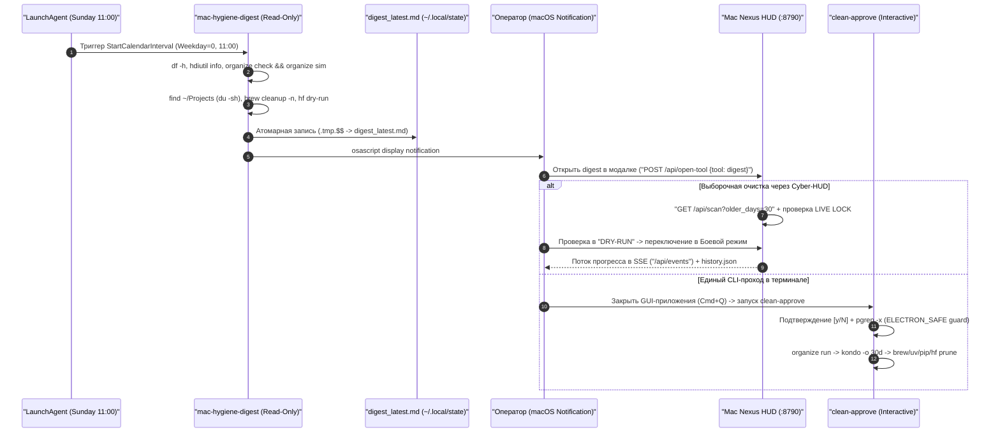

> **Навигация:** [00 · Мастер-индекс](00_master_index_and_system_map.md) | ← [06 · Cyber-HUD Frontend и Mac Nexus.app](06_cyber_hud_frontend_and_app_bundle.md) | [08 · Гайд для агентов и Baseline-аудит →](08_agent_onboarding_and_baseline_audit.md) | [README репозитория](../README.md)

# 07 · Регламенты эксплуатации, Runbooks и Устранение сбоев

Этот документ определяет полный операционный цикл поддержки чистоты macOS с помощью **Mac Nexus v2.0.0** и **Стека 1**, пошаговые сценарии диагностики сбоев (Troubleshooting Playbooks), регламент QA-верификации перед изменениями и инженерную дорожную карту развития `v2.1+`.

---

## 1. Операционный ритм обслуживания (Zero Blind Cron)

Базовый архитектурный принцип эксплуатации — **разделение наблюдения и мутации**:
1. **Фоновая автоматика (`launchd`) работает исключительно в Read-Only режиме** — она размечает статус, собирает телеметрию и формирует сводный отчёт, никогда не удаляя файлы вслепую.
2. **Все деструктивные и переносящие операции инициируются человеком** после просмотра отчёта и проверки статуса `LIVE LOCK` — либо через графический **Mac Nexus Cyber-HUD** (где по умолчанию активен режим `DRY-RUN`), либо через терминальный скрипт [`clean-approve`](../automation/bin/clean-approve) с подтверждением `[y/N]`.



### 1.1 Сводный график обслуживания

| Периодичность | Затраты времени | Исполнитель / Инструмент | Что происходит и цель цикла |
| :--- | :--- | :--- | :--- |
| **Daily** | `0 мин` | Авто-теги `inbox` + беглый взгляд в HUD | Контроль SLA `~/Downloads` (7 дней) и свободного порога NVMe (`< 75%` норма, `>= 88%` критично) |
| **Weekly** | `2 мин` (Вс 11:00) | `com.egor.mac-hygiene-digest` + **Mac Nexus HUD** / `clean-approve` | Разбор воскресного дайджеста, триаж загрузок, `brew`/`uv`/`pip` прунинг, телепорт тяжёлых `.mov`/`.mp4` на SSD |
| **Monthly** | `5 мин` | `Cmd+Q` GUI-приложений + `clean-gui-caches` + reboot + `ДУБЛИКАТЫ` | Безопасная очистка Electron/Browser кэшей, сброс OS `code_sign_clone` перезагрузкой, поиск дубликатов `czkawka_cli` |
| **Quarterly** | `15 мин` | `Pearcleaner` (`5.4.3`) + `DaisyDisk` + `OnyX` (по симптомам) + `tmutil` | Глубокий рентген скрытого пространства, зачистка хвостов удалённых программ, проверка исключений и 3-2-1 бэкапов |

---

### 1.2 Daily Runbook (`0 мин` — Пассивный мониторинг)

1. **Видимость новых загрузок:** Новые файлы в `~/Downloads` моложе 7 дней получают оранжевый тег `inbox (orange)` (Правило №3 в [`config.yaml`](../automation/organize/config.yaml)) после ближайшего прогона `organize run`, что делает очередь в Finder Smart Folder `Inbox_Stale_7d` самоочевидной.
2. **Контроль телеметрии (по желанию):** Если открыт [Mac Nexus](http://127.0.0.1:8790), верхняя панель телеметрии автоматически обновляется каждые 15 секунд (`refreshTelemetry()`):
   - **Контур 1 (`Internal NVMe`):** следите, чтобы карточка не переходила в янтарный (`>= 75%`) или малиновый (`>= 88%`, `ВЫСОКАЯ НАГРУЗКА`) статус.
   - **Чипы `M4 RAM` и `Swap`:** норма давления `Норма`; при `Повышено`/`Критично` проверьте тяжёлые локальные модели или вкладки браузера.
   - **Чип `Призрачные DMG`:** при значении `> 0` отмонтируйте зависшие образы через вкладку `РАДАР ОЧИСТКИ`.
   - **Контур 3 (`SecondBrain iCloud`):** индикатор `Риск node_modules` должен всегда показывать `0 (Чистый контур)`.

---

### 1.3 Weekly Runbook (`2 мин` — Воскресенье 11:00)

Каждое воскресенье в `11:00` системный агент [`com.egor.mac-hygiene-digest`](../automation/launchd/com.egor.mac-hygiene-digest.plist.tmpl) запускает [`mac-hygiene-digest`](../automation/bin/mac-hygiene-digest) в 100% read-only режиме, атомарно обновляет `~/.local/state/mac-hygiene/digest_latest.md` и выводит системное уведомление macOS.

**Шаг 1 · Просмотр отчёта в Mac Nexus HUD (15 сек):**
1. Запустите **Mac Nexus** (двойной клик по `Mac Nexus.app` на Рабочем столе или [`Start_Mac_Nexus.command`](../Start_Mac_Nexus.command)).
2. Перейдите на вкладку **06 `ПУЛЬТ КОНТУРОВ`** и нажмите **«Открыть Воскресный дайджест»** (выполняет `POST /api/open-tool {"tool": "digest"}` и безопасно рендерит Markdown в Holo-модальном окне).
3. Оцените 7 секций дайджеста: свободное место на NVMe/SSD, примонтированные DMG, план `organize sim`, вес спящих `node_modules`/`.venv` в `~/Projects`, кандидатов `brew cleanup -n`, `hf cache prune --dry-run` и размеры безопасных кэшей GUI.

**Шаг 2 · Выборочная очистка (выберите вариант A через HUD или вариант B через CLI):**

- **Вариант A — через Mac Nexus Cyber-HUD (рекомендуется для наглядного контроля):**
  1. На вкладке **01 `РАДАР ОЧИСТКИ`** выберите нужный порог возраста проектов (`14д` / `30д` / `60д`), убедитесь, что приложения, чьи кэши нужно почистить, закрыты через `Cmd+Q`, и нажмите **«Скан»** для обновления `LIVE LOCK`. Для активных кэшей с кнопкой «Smart Close» — не использовать для `Orca` и `VS Code`.
  2. Оставьте верхний переключатель **`DRY-RUN`** во включённом состоянии (`ВКЛ · БЕЗОПАСНО`), нажмите **«Выбрать все доступные»** и затем **«ОЧИСТИТЬ ВЫБРАННОЕ (DRY-RUN)»**.
  3. Проверьте строки `[DRY-RUN]` и `[LOCK-GUARD]` в нижнем **SSE КИБЕР-ТЕРМИНАЛЕ**.
  4. Переведите тумблер **`DRY-RUN`** в положение `ВЫКЛ · БОЕВОЙ РЕЖИМ`, нажмите **«ОЧИСТИТЬ ВЫБРАННОЕ»** и подтвердите операцию в диалоговом Holo-окне.
  5. При наличии крупных записей экрана (`.mov`, `.mp4`, `.mkv` > 10 MiB) на Рабочем столе или в Загрузках перейдите на вкладку **03 `ТЕЛЕПОРТ МЕДИА`**, подключите `/Volumes/secret for mine`, отметьте файлы и запустите **«ТЕЛЕПОРТИРОВАТЬ НА SSD (SHA-256)»** (копирование → проверка размера и SHA-256 → удаление исходника). Также откройте вкладку **02 `ГЛУБОКИЙ РАДАР`** для поиска гигантских файлов (hotspot X-Ray).

- **Вариант B — единой CLI-командой (`clean-approve`):**
  1. При необходимости закройте GUI-приложения (`Cmd+Q`) и выполните в терминале:
     ```zsh
     clean-approve
     ```
  2. Подтвердите запуск (`y`). Скрипт автоматически проверит `pgrep -x` (при открытом Chrome, Telegram, Obsidian, Orca, Code, Discord, Notion, Figma или Yandex установит `ELECTRON_SAFE=0` и пропустит их кэши), затем выполнит `organize check && organize run`, запустит интерактивный `kondo -o 30d "$HOME/Projects"` (отвечайте `[y]`/`[n]` по каждому старому проекту), прогонит `brew cleanup --prune=all`, `uv cache prune --ci`, `pip cache purge`, `hf cache prune` и выведет итоговый `df -h /System/Volumes/Data`.

---

### 1.4 Monthly Runbook (`5 мин` — Глубокая очистка кэшей, reboot и дубликаты)

Раз в месяц накопившиеся скомпилированные кэши браузеров и системные клоны кодовых подписей в `/private/var/folders/*/X/` (включая `com.google.Chrome.code_sign_clone`) требуют полного закрытия программ и перезагрузки:

1. **Полностью выйдите (`Cmd+Q`) из всех 11 отслеживаемых приложений:** `Google Chrome`, `Yandex`, `Telegram`, `Obsidian`, `Orca`, `VS Code` (`Code`), `Discord`, `Notion`, `Figma`, `draw.io`, `Яндекс Музыка`.
2. **Запустите строгий очиститель GUI-кэшей:**
   ```zsh
   clean-gui-caches
   ```
   Скрипт [`clean-gui-caches`](../automation/bin/clean-gui-caches) работает по принципу fail-closed: если хотя бы одно из 9 базовых GUI-приложений продолжает работать (`pgrep -x`), скрипт **немедленно завершится с кодом `1`** и покажет список открытых процессов. Когда все закрыты, он покажет размеры найденных безопасных кэшей (никогда не трогая `User/`, `IndexedDB/` и `*.db*`), запросит `[y/N]` и выведет освобождённые MiB.
3. **Перезагрузите Mac:** После `clean-gui-caches` выполните штатную перезагрузку macOS — ядро безопасно сбросит `/private/var/folders/*/X/*.code_sign_clone`, временные файлы XPC и файл подкачки (swap).
4. **Проверьте дубликаты после перезагрузки:** Откройте **Mac Nexus** → вкладка **04 `ДУБЛИКАТЫ`**, поочерёдно просканируйте цели `Downloads`, `Desktop`, `SSD Media` и `Documents` (`POST /api/duplicates`), убедитесь, что самый ранний экземпляр помечен `ОРИГИНАЛ / СОХРАНИТЬ`, и отправьте лишние копии в Корзину (`УБРАТЬ ДУБЛИ В КОРЗИНУ` → `~/.Trash`). Также откройте вкладку **05 `КОРЗИНА`** для контроля содержимого `~/.Trash`.

---

### 1.5 Quarterly Runbook (`15 мин` — Ревизия программ, DaisyDisk и целостность резервных копий)

1. **Ревизия софта и сирот (`Pearcleaner.app` `5.4.3`):**
   - Запустите `Pearcleaner.app` из вкладки `06 · ПУЛЬТ КОНТУРОВ`.
   - Убедитесь, что **Sentinel включён**, а **App Lipo строго ВЫКЛЮЧЕН** (Правило 1 из [Книги безопасности](03_cleanup_stack_and_safety_bible.md)).
   - Удалите неиспользуемые тяжёлые приложения и прогоните поиск *Orphaned Files* в `~/Library`.
2. **Визуальный рентген (`DaisyDisk.app`):**
   - Запустите `DaisyDisk.app` из вкладки `06 · ПУЛЬТ КОНТУРОВ` в режиме **Scan as Administrator**.
   - Проверьте *Hidden Space* на наличие локальных снапшотов Time Machine, оцените фактический размер `OrbStack` (`data.img.raw`) и тяжёлых библиотек в `/opt` или `~/Library/Group Containers`.
3. **Точечный ремонт ОС (`OnyX` — только при наличии проблем):**
   - Если появились битые ассоциации файлов или сбоит Spotlight, скачайте **строго версию под текущую macOS** (`OnyX v5.0.6` для macOS Tahoe 26) с `titanium-software.fr` и выполните пересборку *Launch Services* / индекса. Не запускайте в `OnyX` массовый сброс системных логов и кэшей без причины.
4. **Аудит исключений Time Machine и 3-2-1:**
   ```zsh
   for p in "$HOME/Downloads" "$HOME/.cache" "$HOME/.npm" "$HOME/.nuget" "$HOME/.local/share/uv" "$HOME/.openclaw/logs" "/Volumes/secret for mine/01_AI_Models_and_Caches"; do
     tmutil isexcluded "$p"
   done
   ```
   При наличии нового внешнего диска Time Machine или облачного `restic` сверьте дату последнего успешного снимка (`tmutil destinationinfo`).

---

## 2. Playbooks устранения неполадок (Troubleshooting)

Каждый сценарий ниже проверен по фактическому коду [`server.py`](../src/mac_nexus/server.py), [`scanner.py`](../src/mac_nexus/scanner.py), [`executor.py`](../src/mac_nexus/executor.py) и [`app.js`](../src/mac_nexus/static/app.js).

### 2.1 Порт `8790` занят (`Address already in use`)

- **Симптом:** Ручной запуск `python3 -m mac_nexus.server` падает с `OSError: [Errno 48] Address already in use`, либо `Start_Mac_Nexus.command` открывает браузер вместо старта нового процесса, а UI отображает старую версию кода.
- **Причина:** В фоне уже работает предыдущий экземпляр `mac_nexus.server` (например, запущенный через `Mac Nexus.app`), либо порт `8790` занял сторонний локальный сервис. Напомним, что `MacNexus` и [`Start_Mac_Nexus.command`](../Start_Mac_Nexus.command) проверяют `curl -sf http://127.0.0.1:8790/api/health` и при коде `200` не запускают дубликат.
- **Команда диагностики:**
  ```zsh
  lsof -nP -iTCP:8790 -sTCP:LISTEN
  curl -fsS http://127.0.0.1:8790/api/health && echo ""
  ```
- **Исправление:**
  - Если это старый процесс `mac_nexus.server` и вы обновили код — остановите его по `PID` из вывода `lsof` и перезапустите:
    ```zsh
    kill <PID>
    /Users/egorlabutin/Projects/mac-nexus/Start_Mac_Nexus.command
    ```
  - Если порт `8790` занят другим нужным вам сервисом — запустите `Mac Nexus` на свободном порту (например, `8791`):
    ```zsh
    PYTHONPATH=/Users/egorlabutin/Projects/mac-nexus/src \
      /opt/anaconda3/bin/python3 -m mac_nexus.server --host 127.0.0.1 --port 8791
    ```

---

### 2.2 `HTTP 403 Forbidden` (ошибка CSRF-заголовка, `Origin` или статического пути)

- **Симптом:** `POST /api/*` возвращает статус `403` с телом `{"ok": false, "error": "Forbidden: missing X-Mac-Nexus-Client header"}` или `{"ok": false, "error": "Forbidden: invalid Origin"}`, либо запрос `/static/...` получает `403`.
- **Причина:** В [`_check_post_csrf`](../src/mac_nexus/server.py#L141-L158) и [`_is_valid_origin`](../src/mac_nexus/server.py#L67-L73) сработала защита от CSRF / подделки домена:
  1. Отсутствует или не равен `"1"` заголовок `X-Mac-Nexus-Client`.
  2. Передан заголовок `Origin`, чей `scheme != "http"` или `hostname` не входит строго в `{"127.0.0.1", "localhost"}` (включая спуфинг вида `http://127.0.0.1.evil.com:8790` или `http://0.0.0.0:8790`).
  3. Для `GET /static/*` передана попытка выхода из каталога (`..`, `/`, `\`) или расширение не входит в `ALLOWED_STATIC_MIME`.
- **Команда диагностики:**
  ```zsh
  curl -i -sS -X POST http://127.0.0.1:8790/api/open-tool \
    -H "Content-Type: application/json" \
    -H "X-Mac-Nexus-Client: 1" \
    -d '{"tool":"digest"}' | head -n 15
  ```
- **Исправление:**
  - Для интеграционных `curl`/скриптов всегда передавайте `-H "X-Mac-Nexus-Client: 1"` и используйте URL `http://127.0.0.1:8790` или `http://localhost:8790` (без `https://` и без `0.0.0.0`).
  - Если ошибка появилась в браузере, проверьте адресную строку (должен быть `http://127.0.0.1:8790` или `http://localhost:8790`, не IP LAN и не сторонний прокси) и обновите вкладку без кэша (`Cmd+Shift+R`).

---

### 2.3 `HTTP 409 Conflict: LIVE LOCK` (блокировка приложения, worktree или порта)

- **Симптом:** В Cyber-HUD карточка помечена оранжевым бейджем `LIVE LOCK` (чекбокс заблокирован), либо прямой `POST /api/execute` возвращает `HTTP 409` с ошибкой `LIVE LOCK: ...`.
- **Причина:** [`detect_live_locks`](../src/mac_nexus/scanner.py#L608-L691) или предвыполнимая перепроверка [`_recheck_target_lock`](../src/mac_nexus/executor.py#L248-L295) обнаружила:
  - запущенное приложение из `MONITORED_APPS` (`pgrep -x`) или `rider` (`pgrep -fi rider` для NuGet);
  - активный worktree в `orca worktree ps --limit 30 --json` (или текстовом фоллбэке);
  - слушающий сервис на портах `3000` или `8768` с `cwd` внутри проекта (`lsof -nP -iTCP:3000,8768 -sTCP:LISTEN`);
  - открытые файлы на примонтированном `.dmg` (`lsof <mount_point>`).
- **Команда диагностики:**
  ```zsh
  for app in "Google Chrome" "Yandex" "Telegram" "Obsidian" "Orca" "Code" "Discord" "Notion" "Figma" "draw.io" "Yandex Music" "Яндекс Музыка"; do
    pgrep -x "$app" >/dev/null && echo "RUNNING: $app"
  done
  /Applications/Orca.app/Contents/Resources/bin/orca worktree ps --limit 30
  lsof -nP -iTCP:3000,8768 -sTCP:LISTEN
  ```
- **Исправление:**
  1. Для кэшей программ: полностью закройте нужное приложение (`Cmd+Q`), затем проверьте, что `pgrep -x` больше не возвращает PID (иногда фоновые helper-процессы закрываются 2–3 секунды).
  2. Для проектов: остановите локальный dev-сервер на `:3000`/`:8768` или закройте активную сессию worktree в `Orca.app`.
  3. Для призрачных DMG: закройте окна Finder / процессы, читающие `/Volumes/<образ>`, проверьте `lsof "/Volumes/<образ>"`.
  4. Нажмите кнопку **«Скан»** в HUD (`GET /api/scan`), чтобы снять устаревший флаг `locked`.

---

### 2.4 Внешний SSD `/Volumes/secret for mine` не смонтирован

- **Симптом:** На орбитальном реакторе Контура 2 отображается `OFF` / `НЕ ПОДКЛЮЧЁН`, во вкладке `03 · ТЕЛЕПОРТ МЕДИА` горит янтарный баннер `#ssd-unmounted-alert`, кнопка **«ТЕЛЕПОРТИРОВАТЬ НА SSD (SHA-256)»** неактивна в боевом режиме, а вызов `POST /api/offload` (`dry_run: false`), `POST /api/radar-action` (`action: "teleport_ssd"`, `dry_run: false`), `POST /api/duplicates` (`target: "ssd_media"`) или `POST /api/open-tool` (`tool: "finder_ssd"`) возвращает **`HTTP 409`** (`"Внешний SSD /Volumes/secret for mine не смонтирован"`).
- **Причина:** Физический накопитель отключён, не размонтировался корректно после сна, либо сторонняя утилита успела создать пустую фантомную папку `/Volumes/secret for mine` на внутреннем диске, из-за чего macOS смонтировала реальный SSD по пути `/Volumes/secret for mine 1`.
- **Команда диагностики:**
  ```zsh
  ls -la /Volumes/
  mount | grep -i "secret" || echo "Not mounted"
  diskutil list external
  launchctl getenv HF_HOME OLLAMA_MODELS
  ```
- **Исправление:**
  1. Если диск не отображается — физически переподключите USB-кабель SSD и дождитесь появления тома в `diskutil list external`.
  2. **Если в `/Volumes/` одновременно существуют `secret for mine` (пустая папка на NVMe) и `secret for mine 1` (реальный диск):** безопасно извлеките `secret for mine 1` через Finder / `diskutil unmount`, убедитесь, что оставшаяся `/Volumes/secret for mine` — пустая фиктивная директория (0 файлов, не точка монтирования), удалите пустую заглушку (`rmdir "/Volumes/secret for mine"`) и подключите SSD заново.
  3. После монтирования тома обновите GUI-переменные среды (`HF_HOME`, `TORCH_HOME`, `OLLAMA_MODELS`) и нажмите **«ОБНОВИТЬ»** в `Mac Nexus`:
     ```zsh
     ~/.local/bin/mac-setenv-gui
     launchctl getenv HF_HOME TORCH_HOME OLLAMA_MODELS
     ```

---

### 2.5 Устаревшие идентификаторы `ScanSnapshot` (`HTTP 400 UnknownTargetError`)

- **Симптом:** Запрос к `POST /api/execute`, `POST /api/offload` или `POST /api/trash-duplicates` возвращает `HTTP 400` с ошибкой вида `"Неизвестный или устаревший идентификатор: ..."`, `"Неизвестный media_id: ..."` или `"Неизвестный file_id дубликата: ..."`.
- **Причина:** Реестр разрешённых целей [`ScanSnapshot`](../src/mac_nexus/scanner.py#L334-L341) (`items_by_id`, `offload_by_id`, `dup_files_by_id`, `radar_by_id`, `trash_by_id`) хранится **в оперативной памяти** запущенного процесса сервера ([`NexusAppContext`](../src/mac_nexus/server.py#L54-L64)) и никогда не принимает произвольные пути от клиента. При перезапуске сервера или при отправке ID дубликата/корзины, уже удалённого ранее (`pop` в `trash_duplicate_files` или `purge_trash_items`), ID отсутствует в активном snapshot.
- **Команда диагностики:**
  ```zsh
  curl -fsS http://127.0.0.1:8790/api/health
  # Проверить, когда стартовал текущий PID сервера:
  ps -o pid,lstart,command -p "$(lsof -t -nP -iTCP:8790 -sTCP:LISTEN)"
  ```
- **Исправление:**
  - В HUD нажмите **«Скан»** (`GET /api/scan?older_days=...`) или **«Сканировать дубликаты»** (`POST /api/duplicates`) — реестр `ctx.snapshot` заново заполнится серверными хэш-ID, после чего операцию можно запускать.
  - В CLI-скриптах всегда получайте свежие `id` из `GET /api/scan` (или `POST /api/duplicates`) в рамках того же живого `pid` перед вызовом `POST /api/execute` / `POST /api/offload`.

---

### 2.6 `czkawka_cli` не найден или завершился с ошибкой

- **Симптом:** Во вкладке `ДУБЛИКАТЫ` появляется ошибка (или `POST /api/duplicates` возвращает **`HTTP 409`** с сообщением `czkawka_cli завершился с ошибкой: ...` / `No such file or directory`).
- **Причина:** Бинарник [`env.czkawka_bin`](../src/mac_nexus/scanner.py#L209) (`/opt/homebrew/bin/czkawka_cli`) не установлен, повреждён, заблокирован Gatekeeper после ручного скачивания, либо передан некорректный/отмонтированный путь (`ssd_media`).
- **Команда диагностики:**
  ```zsh
  ls -la /opt/homebrew/bin/czkawka_cli
  brew list --versions czkawka
  /opt/homebrew/bin/czkawka_cli --version
  ```
- **Исправление:**
  1. Установите или переустановите пакет через Homebrew:
     ```zsh
     brew install czkawka
     ```
  2. Если вы запускаете также GUI `Krokiet` или неподписанный бинарник, проверьте права в *Системные настройки → Конфиденциальность и безопасность → Доступ к диску (Full Disk Access)* для терминала / Python-интерпретатора, запускающего `Mac Nexus`.
  3. Если ошибка возникла на цели `SSD Media`, убедитесь, что том `/Volumes/secret for mine` смонтирован и в нём существует полка `04_Media_Archive`.

---

### 2.7 `LaunchAgent` остановлен, выдаёт ошибку или GUI не видит `XDG_*` / `OLLAMA_MODELS`

- **Симптом:** В воскресенье после `11:00` файл `~/.local/state/mac-hygiene/digest_latest.md` не обновился, в `launchctl list | grep com.egor` отображается ненулевой код выхода (столбец 2 != `0`) или агент отсутствует, либо `Ollama`/`Orca` не видят `OLLAMA_MODELS` / `XDG_CONFIG_HOME`.
- **Причина:** Агент не загружен в домен `gui/$(id -u)`, plist содержит синтаксическую ошибку или нераскрытый плейсхолдер `__HOME__`, отсутствует бит `+x` у скриптов в `~/.local/bin/`, либо агент запускался при отключённом SSD (из-за чего `mac-setenv-gui` корректно выполнил `launchctl unsetenv`).
- **Команда диагностики:**
  ```zsh
  launchctl list | grep com.egor || echo "No com.egor agents loaded"
  launchctl print "gui/$(id -u)/com.egor.mac-hygiene-digest" | head -n 30
  plutil -lint ~/Library/LaunchAgents/com.egor.env.plist ~/Library/LaunchAgents/com.egor.mac-hygiene-digest.plist
  ls -la ~/.local/bin/{mac-setenv-gui,mac-hygiene-digest,clean-approve,clean-gui-caches}
  tail -n 30 ~/.local/state/mac-hygiene/com.egor.env.log ~/.local/state/mac-hygiene/digest_launchd.log 2>/dev/null || true
  ```
- **Исправление:**
  1. Проверьте, что в plist нет литерала `__HOME__`, и восстановите права на исполнение и синтаксис:
     ```zsh
     chmod +x ~/.local/bin/{mac-setenv-gui,mac-hygiene-digest,clean-approve,clean-gui-caches}
     zsh -n ~/.local/bin/{mac-setenv-gui,mac-hygiene-digest,clean-approve,clean-gui-caches}
     ```
  2. Перерегистрируйте агенты в пользовательской сессии:
     ```zsh
     UID_NUM="$(id -u)"
     launchctl bootout "gui/$UID_NUM/com.egor.env" 2>/dev/null || true
     launchctl bootout "gui/$UID_NUM/com.egor.mac-hygiene-digest" 2>/dev/null || true
     launchctl bootstrap "gui/$UID_NUM" ~/Library/LaunchAgents/com.egor.env.plist
     launchctl bootstrap "gui/$UID_NUM" ~/Library/LaunchAgents/com.egor.mac-hygiene-digest.plist
     ```
  3. Выполните принудительный тестовый прогон и проверьте результат:
     ```zsh
     launchctl kickstart -k "gui/$(id -u)/com.egor.env"
     launchctl kickstart -k "gui/$(id -u)/com.egor.mac-hygiene-digest"
     launchctl getenv XDG_CONFIG_HOME UV_CACHE_DIR HF_HOME OLLAMA_MODELS
     ```
  4. Если обновляли `HF_HOME` / `OLLAMA_MODELS` на лету, перезапустите соответствующие GUI-приложения (`Cmd+Q` → запуск заново), чтобы они унаследовали свежую среду `launchd`.

---

### 2.8 Быстрая шпаргалка по ошибкам правил `organize` и SSE-соединения

- **Ошибка в `~/.config/organize/config.yaml`:** Проверьте схему командой `organize check` (без модификации диска!). Наиболее частые опечатки: использование несуществующего параметра `conflict_mode` вместо `on_conflict` или пропуск отступа в `python:` фильтре SSD-guard.
- **Переподключение `SSE: ПЕРЕПОДКЛЮЧЕНИЕ` в HUD:** В [`server.py`](../src/mac_nexus/server.py#L250-L274) сервер шлёт keepalive-комментарий `: keepalive\n\n` каждые `15.0` секунд. Если ноутбук выходил из сна и сокет закрылся, браузерный `EventSource` переподключается автоматически; при зависании просто нажмите **«ОБНОВИТЬ»** (`btn-refresh-all`) или перезагрузите страницу (`Cmd+R`).

---

## 3. Регламент QA и верификации (Verification Runbook)

После любых правок в коде `src/mac_nexus/`, статике, лаунчерах, скриптах `automation/` или конфигах необходимо прогнать полный проверочный контур.

### 3.1 Полный набор проверок (Copy-Paste Ready)

```zsh
cd /Users/egorlabutin/Projects/mac-nexus

# 1. Unit & Integration тесты бэкенда (21 тест в tests/test_mac_nexus.py)
PYTHONPATH=src /opt/anaconda3/bin/python3 -m pytest -v

# 2. Проверка синтаксиса фронтенда (Zero-CDN Vanilla JS)
node --check src/mac_nexus/static/app.js

# 3. Проверка синтаксиса Zsh для лаунчеров и портативных скриптов automation/
zsh -n Start_Mac_Nexus.command
zsh -n "/Users/egorlabutin/Desktop/Mac Nexus.app/Contents/MacOS/MacNexus"
zsh -n automation/zsh/zshenv.snippet.zsh
zsh -n automation/bin/mac-setenv-gui \
       automation/bin/mac-hygiene-digest \
       automation/bin/clean-approve \
       automation/bin/clean-gui-caches

# 4. Проверка Info.plist приложения и рендера LaunchAgent-шаблонов
plutil -lint "/Users/egorlabutin/Desktop/Mac Nexus.app/Contents/Info.plist"
sed "s|__HOME__|$HOME|g" automation/launchd/com.egor.env.plist.tmpl | plutil -lint -
sed "s|__HOME__|$HOME|g" automation/launchd/com.egor.mac-hygiene-digest.plist.tmpl | plutil -lint -

# 5. Проверка конфигурации organize (read-only симуляция)
organize check && organize sim

# 6. Live API Health & CSRF-проверка работающего сервера (127.0.0.1:8790)
curl -fsS http://127.0.0.1:8790/api/health
echo ""
curl -s -o /dev/null -w "CSRF_NO_HEADER_HTTP=%{http_code}\n" \
  -X POST http://127.0.0.1:8790/api/open-tool \
  -H "Content-Type: application/json" \
  -d '{"tool":"digest"}'
```

### 3.2 Матрица критериев приёмки (Pass / Fail Gates)

| Проверка | Ожидаемый результат (PASS) | Что блокирует релиз (FAIL) |
| :--- | :--- | :--- |
| `pytest -v` ([test_mac_nexus.py](../tests/test_mac_nexus.py)) | `21 passed` (`0` failed, `0` skipped) | Любой провал инвариантов CSRF `403`, `LIVE LOCK` `409`, `SHA-256`, Smart Close или Trash |
| `node --check` ([app.js](../src/mac_nexus/static/app.js)) | Exit code `0` | Синтаксическая ошибка JS |
| `zsh -n` на лаунчерах и `automation/bin/*` | Exit code `0` на каждом файле; права `-x` у скриптов | Ошибка кавычек/синтаксиса или отсутствие `chmod +x` |
| `plutil -lint` | `OK` для `Info.plist` и обоих отрендеренных шаблонов `.plist.tmpl` | Невалидный XML / забытый плейсхолдер |
| `organize check` | `No problems found ...` (exit `0`) | Неверная схема правил или синтаксиса YAML |
| Live `/api/health` и CSRF check | `{"ok": true, "app": "Mac Nexus", ...}` и `CSRF_NO_HEADER_HTTP=403` | Недоступность `127.0.0.1:8790` или пропуск `POST` без `X-Mac-Nexus-Client: 1` |

---

## 4. Инженерная дорожная карта `v2.0` (DELIVERED) и `v2.1+`

Релиз **`v2.0.0`** (`NEX-004`–`NEX-006` **DELIVERED**) полностью реализует: 3-контурную телеметрию, Радар очистки с 9 категориями (`system_cache`, `app_orphans`, `ai_dev_deep`, `app_cache`, `pkg_cache`, `downloads_inbox`, `dev_projects`, `ghost_dmgs`, `go`/`cargo`), `LIVE LOCK` защиту, Smart Close (с HARD-запретом для `Orca`/`VS Code`), Глубокий Радар (sparse-aware), Корзину (TCC-fallback), 6 вкладок Cyber-HUD, 16 HTTP маршрутов и 21 pytest-тест. Дальнейшее развитие разбито на этапы `v2.1+` при сохранении **Python 3.12+ stdlib only** и нулевых внешних CDN.

| Версия / Тикет | Название и приоритет | Планируемые возможности и затрагиваемые модули | Инженерные инварианты |
| :--- | :--- | :--- | :--- |
| **`v2.0.0` · `NEX-004–006`** | **✅ DELIVERED — AI Telemetry, Deep Radar, Smart Close, Trash UI** | • 9 категорий Radar (`system_cache`, `app_orphans`, `ai_dev_deep`, `app_cache`, `pkg_cache`, `go`, `cargo`, ...). <br>• Вкладка Глубокий Радар: sparse-aware `_physical_file_size`, `scan_deep_radar`, Radar Action (Trash / SSD), Finder Reveal.<br>• Вкладка Корзина: `scan_trash`, TCC-fallback, `purge_trash_items` (selected / older_than / finder_empty).<br>• Smart Close: `start_smart_close_clean_job` (10s poll, HARD-FORBIDDEN для Orca/VS Code).<br>• 6 вкладок HUD; 21 pytest-тест; 16 HTTP маршрутов. | Все ограничения stdlib-only сохранены; никаких рисков для Orca worktrees |
| **`v2.1` · `NEX-007`** | **LaunchAgents, `tmutil` & Perceptual Media Control** | • Панель статуса `com.egor.env` и `com.egor.mac-hygiene-digest` (`launchctl list`) и проверка `tmutil isexcluded` + `tmutil listlocalsnapshots /` во вкладке `06 · ПУЛЬТ КОНТУРОВ` ([`app.js`](../src/mac_nexus/static/app.js), [`server.py`](../src/mac_nexus/server.py)).<br>• Опциональный перцептивный поиск похожих изображений/видео через `czkawka_cli image` / `video` с явным сохранением защиты `.photoslibrary`. | Только allowlist read-only запросы к `launchctl` и `tmutil`; защита `Photos Library.photoslibrary` в `is_protected_path` |
| **`v2.2` · `NEX-008`** | **3-2-1 Backup Orchestrator & Snapshot Safety** | • Телеметрия подключённого выделенного диска Time Machine (`tmutil destinationinfo -X`, контроль свежести последнего бэкапа).<br>• Мониторинг зашифрованного off-site бэкапа `restic` (Backblaze B2 / R2 / S3) с `--exclude-xattr`.<br>• Поддержка атомарных read-only APFS-снапшотов (`tmutil localsnapshot` + `mount_apfs -o rdonly`) для консистентного бэкапа живых SQLite WAL баз (`Orca`, `Codex`, `Hermes`) и SHA-256 верификация манифестов `90_Cold_Archive/`. | Никаких токенов/ключей S3/restic внутри репозитория и HTTP API; только статус и безопасные триггеры через `ScanSnapshot` |

---

## Связанные документы и модули кода

- Мастер-карта системы: [00 · Мастер-индекс](00_master_index_and_system_map.md)
- Стек 1 и Красная книга безопасности: [03 · Стек 1 и Красная книга безопасности](03_cleanup_stack_and_safety_bible.md)
- Внутреннее устройство API и фронтенда: [04 · Backend, Scanner, Executor и Безопасность](04_backend_scanner_executor_and_security.md), [05 · Справочник HTTP REST и SSE API](05_http_rest_and_sse_api_reference.md), [06 · Cyber-HUD Frontend и Mac Nexus.app](06_cyber_hud_frontend_and_app_bundle.md)
- Онбординг агентов и Baseline-аудит: [08 · Гайд для агентов и Baseline-аудит](08_agent_onboarding_and_baseline_audit.md)
- Портативный пакет автоматизации: [automation/README.md](../automation/README.md), [mac-setenv-gui](../automation/bin/mac-setenv-gui), [mac-hygiene-digest](../automation/bin/mac-hygiene-digest), [clean-approve](../automation/bin/clean-approve), [clean-gui-caches](../automation/bin/clean-gui-caches), [config.yaml](../automation/organize/config.yaml), [com.egor.env.plist.tmpl](../automation/launchd/com.egor.env.plist.tmpl), [com.egor.mac-hygiene-digest.plist.tmpl](../automation/launchd/com.egor.mac-hygiene-digest.plist.tmpl)
- Исходный код, лаунчер и тесты: [server.py](../src/mac_nexus/server.py), [scanner.py](../src/mac_nexus/scanner.py), [executor.py](../src/mac_nexus/executor.py), [app.js](../src/mac_nexus/static/app.js), [Start_Mac_Nexus.command](../Start_Mac_Nexus.command), [test_mac_nexus.py](../tests/test_mac_nexus.py)
- Общие документы репозитория: [README.md](../README.md), [CLAUDE.md](../CLAUDE.md)
