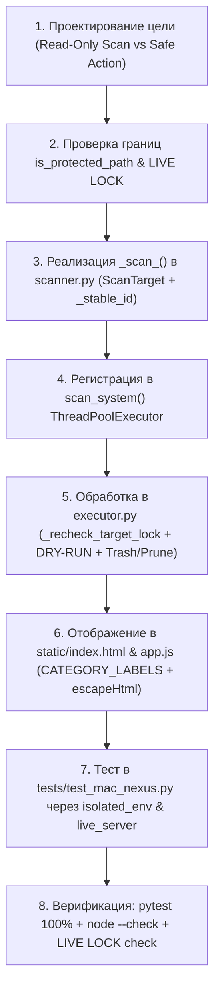

# 08 · Гайд для ИИ-агентов (Onboarding) и Baseline-аудит системы

> **Навигация:** [00 · Мастер-индекс](00_master_index_and_system_map.md) | ← [07 · Регламенты и Runbooks](07_automation_runbooks_and_troubleshooting.md) | [automation/README.md →](../automation/README.md) | [README репозитория](../README.md)

---

## Часть I · Onboarding Runbook для ИИ-агентов (`Orca`, Claude Code, Codex, Gemini)

Этот документ служит практической точкой входа для автономных и интерактивных агентов разработки, работающих с репозиторием `Mac Nexus`. Все архитектурные ограничения из [`CLAUDE.md`](../CLAUDE.md) и [`AGENTS.md`](../AGENTS.md) здесь дополнены точными контрактами структур данных, паттернами Dependency Injection и правилами изоляции тестов.

### 1.1 Жёсткие инженерные границы репозитория

Перед любым изменением кода проверьте 6 базовых инвариантов:
1. **Только stdlib Python 3.12+ в `src/mac_nexus/`:** в модулях [`__init__.py`](../src/mac_nexus/__init__.py), [`server.py`](../src/mac_nexus/server.py), [`scanner.py`](../src/mac_nexus/scanner.py) и [`executor.py`](../src/mac_nexus/executor.py) запрещены внешние `pip`-зависимости. Сторонняя библиотека `Pillow` разрешена только на этапе сборки иконки в [`scripts/generate_icon.py`](../scripts/generate_icon.py).
2. **Zero-CDN Frontend и безопасность DOM:** файлы [`index.html`](../src/mac_nexus/static/index.html), [`styles.css`](../src/mac_nexus/static/styles.css) и [`app.js`](../src/mac_nexus/static/app.js) не должны содержать внешних URL (`http://`/`https://`). Динамический текст выводится исключительно через `textContent` или `escapeHtml()`, а правило `[hidden] { display: none !important; }` (строки 46–48 в `styles.css`) должно сохраняться, чтобы flex-баннеры и модалки не ломали скрытие.
3. **Loopback & CSRF:** `NexusHTTPServer` принимает только `host == "127.0.0.1"`; любой `POST /api/*` проверяет `X-Mac-Nexus-Client: 1` и loopback `Origin` (`127.0.0.1` или `localhost`).
4. **Непрозрачные идентификаторы (`Snapshot Allowlist`):** в JSON-запросах на мутацию никогда не принимаются сырые пути или shell-команды — только серверные ID формата `<prefix>_<14-hex>` из [`ScanSnapshot`](../src/mac_nexus/scanner.py).
5. **Безусловная защита `LIVE LOCK` и `~/.Trash`:** новые цели сканирования обязаны уважать `is_protected_path()`, проверяться в `detect_live_locks()` и повторно валидироваться в `_recheck_target_lock()` перед выполнением. Пользовательские файлы переносятся только в `~/.Trash` через `move_to_trash()`, но не удаляются через `rm -rf`.
6. **Приватность:** категорически запрещено упоминать в коде, тестах, документации или логах личные имена файлов из `~/Downloads`, `~/Desktop`, `~/Documents`, `SecondBrain`, а также секреты/токены/ключи API. Для примеров используйте синтетические имена вроде `2026-11-18_screen-demo.mov`.

---

### 1.2 Dependency Injection через `ScanEnvironment` в тестах

Чтобы гарантировать 100% безопасность при прогоне тестов, ни одна проверка в [`tests/test_mac_nexus.py`](../tests/test_mac_nexus.py) не обращается к реальному `$HOME`, реальному внешнему SSD или системным процессам хоста. Вся работа с ОС изолирована через dataclass `ScanEnvironment` в [`src/mac_nexus/scanner.py`](../src/mac_nexus/scanner.py):

| Поле `ScanEnvironment` | Назначение в продакшене | Изоляция в фикстуре `isolated_env` (`pytest`) |
|---|---|---|
| `home`, `nvme_mount`, `ssd_mount`, `secondbrain_dir` | Пути к корню пользователя и 3 контурам | Перенаправляются в `tmp_path/{home,nvme_root,ssd_secret_for_mine,...}` |
| `projects_dir`, `downloads_dir`, `desktop_dir`, `trash_dir` | Сканируемые зоны и Корзина | Временные каталоги внутри `tmp_path/home/` |
| `state_dir`, `digest_path` | Хранение `history.json` и дайджеста | Временные файлы в `tmp_path/home/.local/state/` |
| `orca_bin`, `czkawka_bin`, `organize_bin`, `brew_bin`, `conda_bin`, `anaconda_python`, `uv_bin`, `npm_bin` | Пути к бинарям Stack 1 и окружениям | Фиктивные пути `tmp_path/bin/*` |
| `ssd_mount_checker: Callable[[Path], bool] \| None` | Проверка `os.path.ismount(ssd_mount)` | Лямбда `lambda _p: bool(state["ssd_mounted"])` для симуляции отключения SSD |
| `cmd_runner: Callable[..., CompletedProcess[str]] \| None` | Вызов `subprocess.run` в `_run_cmd()` | Функция `fake_cmd(args, ...)` с записью в `state["commands_called"]` |
| `now_fn: Callable[[], float]` | Текущее время (для расчёта `age_days`) | Детерминированный таймер `lambda: float(state["now"])` |
| `applications_dirs: list[Path]` | Каталоги приложений для `_scan_app_orphans` | `[tmp_path / "Applications"]` |
| `temp_dir: Path` | Системный temp для `_scan_system_caches` | `tmp_path / "tmp"` |
| `users_dir: Path` | Корень Users для `_scan_ai_dev_deep` | `tmp_path / "Users"` |
| `docker_bin: Path` | CLI Docker для ai_dev_deep | `tmp_path / "bin/docker"` (несуществующий) |
| `go_bin: Path` | CLI Go для go pkg_cache | `tmp_path / "bin/go"` (несуществующий) |

Кроме того, фикстура `live_server` поднимает реальный `NexusHTTPServer` через `create_server(host="127.0.0.1", port=0, env=env, static_dir=static_dir)` на эфемерном порту в daemon-потоке. Это позволяет проверять реальный HTTP/1.1 стек, CSRF-заголовки, `409 LIVE LOCK`, traversal в `/static/*` и поток `GET /api/events` (SSE) без какого-либо влияния на запущенный экземпляр на `:8790`.

#### Контракты целевых дескрипторов в `scanner.py`
Агенту, добавляющему логику сканирования или исполнения, важно точно соблюдать поля четырёх dataclasses:
- **`ScanTarget`:** `item_id` (`_stable_id`), `category`, `title`, `action_kind`, `paths: list[Path]`, `tool_name`, `app_key`, `app_label`, `project_path`, `dmg_device`, `dmg_mount_points`, `estimated_bytes`, `locked`, `lock_reason`, `quittable`, `quit_app_name`, `quit_bundle_id`, `browser_warning`.
- **`OffloadTarget`:** `media_id`, `name`, `source_path`, `rel_path`, `ext`, `size_bytes`, `mtime_ts`, `dest_dir`.
- **`DuplicateFileTarget`:** `file_id`, `name`, `path`, `size_bytes`, `mtime_ts`, `group_id`, `is_primary`.
- **`ScanSnapshot`:** `items_by_id`, `offload_by_id`, `dup_files_by_id`, `radar_by_id` (`RadarTarget`), `trash_by_id` (`TrashEntryTarget`) (защищены в `NexusAppContext` мьютексом `snapshot_lock`).

#### Правило вызова внешних команд и шаблон нового теста
Любую новую команду ОС вызывайте **строго через `_run_cmd(env, args, timeout=...)`** (а проверку SSD — через `ssd_is_mounted(env)`), чтобы `fake_cmd` в `isolated_env` перехватывал её без запуска реальных бинарей:

```python
def test_new_category_with_di(live_server):
    base_url, _, env, state, _ = live_server
    # 1. Создаём тестовый артефакт строго внутри tmp_path
    target_dir = env.home / "Library/Caches/example-app"
    target_dir.mkdir(parents=True, exist_ok=True)
    blob = target_dir / "cache.bin"
    blob.write_bytes(b"X" * 4096)

    # 2. Эмулируем активный процесс в state["running_pgrep"] -> ждём LIVE LOCK (409)
    state["running_pgrep"].add("ExampleApp")
    _, locked_scan = _http_json(base_url, "GET", "/api/scan?older_days=30")
    locked_item = next(it for it in locked_scan["items"] if "example-app" in it["path"])
    assert locked_item["locked"] is True

    status_409, _ = _http_json(
        base_url,
        "POST",
        "/api/execute",
        {"item_ids": [locked_item["id"]], "dry_run": False},
        headers={"X-Mac-Nexus-Client": "1"},
    )
    assert status_409 == 409
    assert blob.exists()

    # 3. Останавливаем процесс и проверяем DRY-RUN (200, файл сохраняется), затем боевой режим
    state["running_pgrep"].discard("ExampleApp")
    _, ready_scan = _http_json(base_url, "GET", "/api/scan?older_days=30")
    ready_item = next(it for it in ready_scan["items"] if "example-app" in it["path"])
    assert ready_item["locked"] is False
```

#### Пятнадцать проверенных доменов покрытия в `tests/test_mac_nexus.py`
Текущий набор из `21` теста проверяет каждый защитный слой в изоляции:
- **Транспорт и CSRF:** `test_server_rejects_non_loopback_bind`, `test_csrf_and_origin_enforcement`, `test_static_serving_and_traversal_blocked`.
- **Границы и injection:** `test_protected_paths_never_scanned_or_trashed`, `test_unknown_ids_and_command_injection_rejected`.
- **Блокировки `LIVE LOCK` и возраст:** `test_live_lock_gui_apps_and_backend_rejection`, `test_live_lock_orca_worktrees_and_live_port_3000`, `test_dev_projects_respects_older_days_query`, `test_ghost_dmg_safety_disk6_vs_disk0`.
- **Операции с данными и SSE:** `test_offload_sha256_parity_and_unmounted_guard`, `test_duplicates_czkawka_parsing_and_trash_move`, `test_telemetry_and_open_tool_allowlist`, `test_sse_events_endpoint_streams_json`.
- **v2.0.0 (новые домены):** `test_v2_pkg_cache_go_and_cargo`, `test_v2_system_cache_and_app_orphans`, `test_v2_deep_radar_scan`, `test_v2_trash_scan_tcc`, `test_v2_smart_close_orca_vscode_forbidden`, `test_v2_radar_action_and_reveal`, `test_v2_empty_trash_modes`, `test_v2_duplicates_documents_target`.

---

### 1.3 Безопасное расширение категорий `ScanTarget`



#### Пошаговый чеклист добавления новой категории `ScanTarget`
1. **Определите инварианты безопасности:**
   - Какой процесс или активный порт может удерживать файлы этой категории открытыми? Добавьте проверку в `detect_live_locks()` ([`scanner.py`](../src/mac_nexus/scanner.py)) и в `_recheck_target_lock()` ([`executor.py`](../src/mac_nexus/executor.py)).
   - Выберите безопасное действие (`action_kind`): `trash` (строго через `move_to_trash`), `prune` (встроенный безопасный CLI-прунер) или `clean_cache` (строго по allowlist-подкаталогам с запретом `User/`, `IndexedDB/`, `*.db*`).
2. **Добавьте сканер в [`src/mac_nexus/scanner.py`](../src/mac_nexus/scanner.py):**
   - Используйте `os.scandir` / `os.walk(..., followlinks=False)`, **никогда** не следуя по симлинкам и проверяя `is_protected_path(p, env, live_wt)` на каждом уровне.
   - Учитывайте флаг `SF_DATALESS_FLAG` (`0x40000000`) при подсчёте размеров.
   - Генерируйте стабильный ID через `_stable_id("<prefix>", unique_key)` (не передавайте реальные пути в качестве ID).
   - Подключите задачу в `ThreadPoolExecutor(max_workers=6)` (при необходимости увеличив пул) внутри `scan_system()`.
3. **Добавьте исполнение в [`src/mac_nexus/executor.py`](../src/mac_nexus/executor.py):**
   - Ветка в `_execute_single_target()` обязана уважать `dry_run` (в режиме симуляции не изменять ни одного байта на диске, только публиковать `[DRY-RUN]` в `broker.publish`).
   - В боевом режиме после `_recheck_target_lock()` повторно проверьте `is_protected_path()` и `not p.is_symlink()` непосредственно перед мутацией.
   - Возвращайте фактически освобождённые байты (`reclaimed`) — `start_execute_job()` автоматически запишет их в `HistoryStore` (`history.json`) и отправит событие `"reclaimed"` в SSE.
4. **Обновите Cyber-HUD (если добавлена новая категория фильтра):**
   - В [`src/mac_nexus/static/index.html`](../src/mac_nexus/static/index.html) добавьте кнопку `.filter-chip` с `data-cat="<new_cat>"` в `#radar-category-chips`.
   - В [`src/mac_nexus/static/app.js`](../src/mac_nexus/static/app.js) добавьте ключи в `CATEGORY_LABELS` и при необходимости в `ACTION_LABELS`. Убедитесь, что все строки из JSON попадают в шаблон через `escapeHtml()`.
5. **Добавьте isolated + HTTP тест в [`tests/test_mac_nexus.py`](../tests/test_mac_nexus.py):**
   - Проверьте: а) обнаружение при `GET /api/scan`; б) игнорирование защищённых путей; в) `HTTP 409 LIVE LOCK` при активном процессе; г) отсутствие изменений при `dry_run: true`; д) корректную очистку / перенос в `~/.Trash` при `dry_run: false`.
6. **Добавление инструмента в `POST /api/open-tool`:**
   - Допускается только строгое сопоставление по словарю `allowlist` в `open_tool()` ([`executor.py`](../src/mac_nexus/executor.py)) без интерполяции пользовательских аргументов.

---

### 1.4 Защищённые зоны и правила работы агентов в `Orca` worktrees

Рабочая среда на этом Mac использует **Orca.app** и параллельные git worktree. Неправильное вмешательство в файловую систему ломает активные агентские сессии.

| Защищённый контур | Как определяется в коде | Почему запрещено трогать / перемещать |
|---|---|---|
| **Активные `Orca` worktrees** | `parse_orca_worktrees_json()` (`orca worktree ps --limit 30 --json`) и fallback `parse_orca_worktrees_text()` в [`scanner.py`](../src/mac_nexus/scanner.py) | Перемещение `~/Projects/<slug>` или удаление `.venv`/`node_modules` внутри живого worktree вызывает `DaemonProtocolError` в `Orca.app`, ломает `.git/worktrees/*/gitdir` и роняет текущую задачу агента |
| **Живые сервисы `:3000` и `:8768`** | `lsof -nP -iTCP:3000,8768 -sTCP:LISTEN` + `lsof -p <pid> -a -d cwd -Fn` в `detect_live_locks()` | Порт `:3000` обслуживает активное веб-приложение (в т.ч. `next-server` с SQLite-базой на SSD), порт `:8768` — локальную консоль Desktop-бота |
| **Защищённые каталоги Desktop-ботов** | `PROTECTED_DESKTOP_DIRS` в [`scanner.py`](../src/mac_nexus/scanner.py) | Содержат автономных ботов, чьи `.venv`, Node-серверы и `LaunchAgents` привязаны к фиксированным путям |
| **Папки приложений и медиатеки** | `PROTECTED_BUNDLE_SUFFIXES = (".app", ".photoslibrary")` | Модификация содержимого `.app` разрушает цифровую подпись и нотаризацию Apple Silicon; вмешательство в `.photoslibrary` разрушает SQLite Photos |
| **Живые тяжёлые базы на SSD** | `SSD_LIVE_HEAVY_DIRS` (`ollama_models`, `local-jarvis-heavy`, `project-perimeter-heavy`, `calisthenics-tracker-heavy`) | Используются активными процессами напрямую (включая SQLite WAL и веса моделей); приведены к полкам `01_`/`02_` только через относительные симлинки |
| **Хранилище знаний iCloud** | `env.secondbrain_dir` в `is_protected_path()` | Содержит чистые Markdown-заметки и живые iCloud-потоки `fileproviderd`/`bird`; автоматике запрещено удалять файлы внутри vault |
| **Системные диски `disk0..disk5`** | Проверка `if disk_num < 6` в `_parse_hdiutil_images()` и `re.fullmatch(r"/dev/disk(\d+)", dev)` в `executor.py` | Отмонтирование разрешено только для виртуальных `.dmg`-образов начиная с `/dev/disk6` |

#### Специфика парсинга `Orca` worktrees (`JSON` + текстовый fallback)
Чтобы не пропускать активные агентские сессии при обновлении CLI `Orca.app`:
1. Первым вызывается `orca worktree ps --limit 30 --json` (`parse_orca_worktrees_json()`): worktree считается живым, если `liveTerminalCount > 0`, `hasAttachedPty == True`, `status in {"working", "active"}` или `len(agents) > 0`. Корневой путь `~` (`_safe_resolve(wt_path) == resolved_home`) целенаправленно отфильтровывается, чтобы не заблокировать весь `$HOME`.
2. Если `--json` возвращает ошибку, запускается `orca worktree ps --limit 30` (`parse_orca_worktrees_text()`), извлекающий `live:<N>` и абсолютный путь на следующей строке.
3. Поверх этого `lsof -nP -iTCP:3000,8768 -sTCP:LISTEN` определяет PID и `cwd` живых серверов (`next-server` или локальных ботов), блокируя удаление `node_modules`/`.venv` в соответствующих проектах с информативным `lock_reason`.

### 1.5 Предкоммитный чеклист ИИ-агента

Перед завершением любой задачи в репозитории агент обязан подтвердить:
1. `PYTHONPATH=src /opt/anaconda3/bin/python3 -m pytest -v` — **100% pass** (все 21 тест без пропусков).
2. `node --check src/mac_nexus/static/app.js` — **exit 0**; в `src/mac_nexus/static/` нет внешних `http://`/`https://` CDN.
3. `zsh -n` на `Start_Mac_Nexus.command`, `automation/zsh/zshenv.snippet.zsh` и всех `automation/bin/*` скриптах.
4. `plutil -lint` на `Info.plist` и отрендеренных `automation/launchd/*.plist.tmpl`.
5. В переносимых скриптах и шаблонах `automation/` отсутствуют захардкоженные домашние пути (`/Users/egorlabutin`), а во всём репозитории — личные имена файлов и секреты.
6. Если живой сервер `http://127.0.0.1:8790/api/health` запущен, не останавливать его без явной задачи.

### 1.6 Справочник констант безопасности в `scanner.py`

При модификации фильтров, порогов или списков защиты опирайтесь строго на канонические константы из [`src/mac_nexus/scanner.py`](../src/mac_nexus/scanner.py):

| Константа | Значение в коде | Назначение |
|---|---|---|
| `SF_DATALESS_FLAG` | `0x40000000` | Бит macOS `st_flags`, отличающий iCloud-заглушку от локально скачанного файла |
| `MIN_OFFLOAD_BYTES` | `10 * 1024 * 1024` (`10 MiB`) | Минимальный порог размера видео (`.mov`, `.mp4`, `.mkv`) для телепорта на SSD |
| `MIN_DUPLICATE_BYTES` | `1048576` (`1 MiB`) | Минимальный размер файла для поиска дубликатов через `czkawka_cli -m` |
| `MEDIA_OFFLOAD_EXTENSIONS` | `{".mov", ".mp4", ".mkv"}` | Разрешённые форматы медиа для SHA-256 выноса на SSD |
| `INSTALLER_EXTENSIONS` | `{".dmg", ".pkg", ".exe", ".iso"}` | Порог `> 7` дней в `~/Downloads` -> перенос в `~/.Trash` |
| `PROJECT_ARTIFACT_NAMES` | `{"node_modules", ".venv", "venv", ".pytest_cache", "__pycache__", "target"}` | Артефакты сборки в `~/Projects/*`, проверяемые по `older_days` |
| `SSD_SHELVES` | `("01_AI_Models_and_Caches", ..., "99_Backups")` (`6` полок) | Каноническая структура полок на `/Volumes/secret for mine` |
| `SSD_LIVE_HEAVY_DIRS` | `{"ollama_models", "local-jarvis-heavy", "project-perimeter-heavy", "calisthenics-tracker-heavy"}` | Живые корневые базы SSD, защищённые `is_protected_path()` |
| `PROTECTED_BUNDLE_SUFFIXES` | `(".app", ".photoslibrary")` | Неприкосновенные бандлы macOS и медиатека Photos |
| `MONITORED_APPS` | `11` GUI-приложений (вкл. кириллическое `"Яндекс Музыка"`) | Список процессов `pgrep -x` для блокировки `LIVE LOCK` (плюс `pgrep -fi rider`) |

---

## Часть II · Санитизированный Baseline-аудит и отчёт по Фазам 1–3 (`2026-11-18`)

Вторая часть документа фиксирует фактическое инженерное состояние хоста до запуска реорганизации, детализированный учёт выполнения Фаз 1–3, интеграцию веб-кокпита Mac Nexus (Фаза 4) и верифицированные дельты на диске.

### 2.1 Профиль оборудования и исходная диагностика (Read-Only Baseline)

* **Платформа:** Apple Silicon (`arm64`), `macOS 26.7.1` Tahoe (Build `25G241`), `16 GiB` Unified RAM.
* **Контур 1 — Внутренний APFS NVMe (`disk3`, `disk0s2`, `245.11 GB` / `228.27 GiB`):**
  * Тома в контейнере `disk3`: `/` (Sealed OS Snapshot `disk3s1s1`, `12.65 GB`), `/System/Volumes/Data` (`disk3s5`, FileVault ON), `/System/Volumes/VM` (`9.66 GB`), `/System/Volumes/Preboot` (`7.72 GB`), `Recovery` (`1.30 GB`) и `Update` (`4.5 MB`).
  * **Критичное состояние на старте выполнения (`02:58`):** занято **`94%`** (`df -k`: `194,267,060 KiB`), доступно без purgeable всего **`12.69 GiB` (`13.63 GB` / `13,309,896 KiB`)**; по `diskutil apfs list` нераспределённый резерв контейнера `disk3` упал до **`13.6 GB` (`5.6% free`)** *(в раннем read-only аудите — `93.6–93.7%`, `~15.5 GB` free)*.
* **Контур 2 — Внешний SSD (`/Volumes/secret for mine`, `disk5s2` в контейнере `disk5`, `120.02 GB` / `111.78 GiB`):**
  * Подтверждён формат **`APFS (Case-insensitive)`** (переформатирование из ExFAT не требовалось), занято `~17.1–18%` (`91.66–99.5 GB` свободно), структура полок `01_..99_` отсутствовала, бэкапы Hermes были разбросаны по корню тома и legacy-папкам.
* **Выявленные аномалии на старте:**
  1. **0 внешних дисков Time Machine** (`AutoBackup = 0`, последняя запись `2025-12-25`, локальных снапшотов `0`).
  2. **4 «призрачных» смонтированных `.dmg`-образа** (`disk6` `Orca 1.4.257-arm64`, `disk7` `Gemini 1.144.4.1467`, `disk8` `Adobe Acrobat v25.001.21223 UB`, `disk11`/`disk12` `CapCut`), удерживавших дескрипторы на диске.
  3. **Ловушка `SF_DATALESS` в `com~apple~CloudDocs`:** `3,703` из `3,714` облачных заглушек показывали логический размер `17.91 GiB` при физическом расходе **`84 KiB`** (`86,016 B`).
  4. **Sparse-эффект `OrbStack`:** файл `data.img.raw` имел логический размер `228.27 GiB` при фактическом расходе **`11.695 GiB`** (`12,262,820 KiB`).
  5. **Артефакты в iCloud `SecondBrain`:** внутри iCloud-хранилища обнаружены `.opencode/node_modules` (`56.58 MiB`), `.git` (`39.43 MiB`), `.worktrees` (`28.14 MiB`) и legacy-дубль `~/SecondBrain` (`2.47 MiB`).
  6. **Отсутствие 12 стандартных XDG/AI-переменных** (`XDG_*`, `HF_HOME`, `TORCH_HOME`, `OLLAMA_MODELS`, `UV_CACHE_DIR` и др.) и разрастание точечных папок в `$HOME` (`65` dot-элементов, включая `~/.cache/gigaam` `428.38 MiB` при пустой папке на внешнем SSD).

---

### 2.2 Сводка выполнения по фазам (Фазы 1–3 + Web Cockpit)

#### Фаза 1 — Tier 1 Безопасная очистка кэшей и отмонтирование DMG (`clean-tier1`)
1. **Отмонтированы 4 призрачных DMG** (`disk6`, `disk7`, `disk8`, `disk11`/`disk12`) после подтверждения `lsof = 0`. Пост-проверка `hdiutil info`: **`0` подключённых образов**, `/` и `/Volumes/secret for mine` не затронуты.
2. **Prune мёртвых git worktree:** `git -C ~/Projects/analyst-trainer worktree prune -v` удалил `2` мёртвые ссылки в `/private/tmp` (`worktrees/analyst-trainer-backlog` и `worktrees/analyst-trainer-generation`).
3. **Поблочный реестр освобождённого места (`9.634 GiB` / `10.344 GB`):**

| Цель очистки | Метод и проверка безопасности | До (KiB) | После (KiB) | Освобождено (MiB) |
|---|---|---:|---:|---:|
| Conda (`/opt/anaconda3/pkgs`) | `conda clean -y --all` (`501` tarballs, `17` pkgs; `Python 3.12.4` OK) | `4,487,324` | `3,753,800` | `716.33` |
| pip (`~/Library/Caches/pip`) | `pip cache purge` (`475` файлов) | `223,000` | `28` | `217.75` |
| npm (`~/.npm`) | `npm cache clean --force` | `1,165,976` | `467,540` | `682.07` |
| uv (`~/.cache/uv`) | `uv cache prune --ci` (`1,072` файлов) | `58,624` | `988` | `56.29` |
| NuGet (`~/.nuget` + `~/.local/share/NuGet`) | `pgrep -fi rider` пусто -> `dotnet nuget locals all --clear` | `657,712` | `4` | `642.29` |
| `~/Library/Caches/c8run` | `pgrep`/`lsof` = 0 | `1,235,776` | `0` | `1,206.81` |
| `yougile-updater` & `notion-updater` | Целевые процессы остановлены, `lsof` = 0 | `337,400` | `0` | `329.50` |
| `Google/GoogleUpdater` | `pgrep -f GoogleUpdater` пусто (`Chrome` сохранён) | `811,956` | `0` | `792.93` |
| `VS Code` (5 безопасных кэш-папок) | `User/` и `Local Storage` сохранены | `546,532` | `0` | `533.72` |
| `Discord` (`Cache`, `Code Cache`, `GPUCache`, `logs`) | `Local Storage` сохранён | `475,996` | `0` | `464.84` |
| `Notion` (Partition + root caches) | `notion.db`, `Cookies`, `IndexedDB`, `Local Storage` сохранены | `901,320` | `0` | `880.20` |
| `Figma` (`DesktopProfile/v42` кэши) | `FigmaAgent.app`, `Cookies`, `IndexedDB`, `Local Storage` сохранены | `1,246,708` | `0` | `1,217.50` |
| `Anki` (`AnkiProgramFiles/cache/*`) | Проверено отсутствие `*.db*` | `625,424` | `4` | `610.76` |
| `OpenClaw` (`~/.openclaw/logs/*`) | `pgrep`/`lsof` = 0 | `821,356` | `0` | `802.11` |
| `Codex` (`.tmp` и `codex-runtime-install-*` `-mtime +1`) | Активный lock и текущие рантаймы сохранены | `2,149,168` | `1,713,900` | `425.06` |
| `Hermes` (`~/.hermes/cache/bluebubbles-install`) | `state-snapshots` и `backups` переданы в Фазу 2 | `293,636` | `0` | `286.75` |
| **ИТОГО Блок 1 (`clean-tier1`)** | **100% проверка `pgrep`/`lsof`** | **`16,037,908`** | **`5,936,264`** | **`9,864.89 MiB` (`9.634 GiB`)** |

* **Сработавшая защита:** `~/Library/Caches/draw.io-updater` (`~290 MiB`) и `~/Library/Caches/yandexmusic-updater` (`~238 MiB`) были **пропущены**, так как `draw.io` и `Яндекс Музыка` были запущены.

#### Фаза 2 — Организация 3 контуров и вынос на External SSD (`plane-ssd-desktop`)
* **Созданы 6 канонических полок** на `/Volumes/secret for mine`: `01_AI_Models_and_Caches`, `02_Project_Heavy`, `03_Software_and_Installers`, `04_Media_Archive/Screen_Recordings`, `90_Cold_Archive`, `99_Backups/hermes`.
* **Сохранены 4 живых корневых каталога SSD** (`SSD_LIVE_HEAVY_DIRS`: `ollama_models`, `local-jarvis-heavy`, `project-perimeter-heavy`, `calisthenics-tracker-heavy`) с относительными симлинками с полок `01_` и `02_` на них.
* **Консолидация бэкапов Hermes с rsync-проверкой:** перенесены `Hermes Backups`, `~/.hermes/state-snapshots` (`96` файлов, **`465.51 MiB`**) и `~/.hermes/backups` (`1,394` файла, **`341.87 MiB`**) в `99_Backups/hermes/`.
* **Миграция AI-кэша GigaAM:** `~/.cache/gigaam` (**`428.38 MiB`**, `2` файла) скопирован с побайтной и SHA-256 проверкой в `01_AI_Models_and_Caches/gigaam_models` и заменён симлинком.
* **Вынос медиа с верхнего уровня `~/Desktop`:** `3` `.mp4` файла (**`7.39 MiB`**) перенесены в `04_Media_Archive/Screen_Recordings/` после SHA-256 верификации (`6` `.app`-ярлыков на Рабочем столе сохранены нетронутыми).
* **Очистка `SecondBrain`:** удалён `SecondBrain/.opencode/node_modules` (**`56.58 MiB`**) при сохранении `.opencode` и активного worktree `calisthenics-tracker/biomechanics-audit`; legacy-папка `~/SecondBrain` (`36` файлов, **`2.47 MiB`**) заархивирована в `90_Cold_Archive/` и перемещена в `~/.Trash`.
* **Исключения безопасности:** живой проект `calisthenics-tracker` (`next-server` на `:3000` с открытой SQLite WAL базой на SSD) и активные Desktop-боты (`:8768` и процесс `node`) не затрагивались.
* **Прямой итог Фазы 2 на NVMe:** **`~1,363.2 MiB` (`~1.33 GiB`)** вынесено/очищено (`+ 2.47 MiB` перемещено в Корзину).

##### Реестр 6 полок External APFS SSD и проверенных симлинков
| Полка / Путь на `/Volumes/secret for mine` | Содержимое и связанные симлинки | Статус проверки |
|---|---|---|
| `01_AI_Models_and_Caches/` | `gigaam_models/` (`428.38 MiB`, `2` файла; симлинк `~/.cache/gigaam`), `ollama_models -> ../ollama_models` | SHA-256 & `stat` 1:1 |
| `02_Project_Heavy/` | Симлинки `local-jarvis -> ../local-jarvis-heavy`, `zombie-base-defense -> ../project-perimeter-heavy`, `calisthenics-tracker -> ../calisthenics-tracker-heavy` | Живые корни не тронуты |
| `03_Software_and_Installers/` | Целевая полка для дистрибутивов (`.dmg`, `.pkg`, образов ОС) | Создана в структуре |
| `04_Media_Archive/Screen_Recordings/` | `3` файла `.mp4` (`7.39 MiB`), выгруженных с верхнего уровня `~/Desktop` | SHA-256 верифицирован |
| `90_Cold_Archive/` | `Legacy_Archive/`, `home_SecondBrain_stub_20261118/` (`36` файлов, `2.47 MiB`) | Полное совпадение хэшей |
| `99_Backups/hermes/` | `Hermes_Backups_Root`, `Archive_Hermes_Backups`, `internal_state_snapshots_20261118` (`96` ф., `465.51 MiB`), `internal_backups_20261118` (`1,394` ф., `341.87 MiB`) | `rsync` parity подтверждён |

#### Фаза 3 — Установка Stack 1, XDG и полуавтоматизация (`stack1-xdg-auto`)
* **Установлены через Homebrew:** `organize v3.4.0`, `kondo 0.9`, `czkawka 12.0.2` (`czkawka_cli`), `tag v0.10.0`, `fd 10.5.2`, `zoxide 0.10.0`, `eza v0.23.5`, `yazi 26.9.1`, `dust 1.2.7` + cask `Pearcleaner 5.4.3`, затем выполнен `brew cleanup --prune=all` (освобождено **`~960.7 MB`** устаревших артефактов Homebrew без `autoremove`).
* **Unicode в Git:** включён `git config --global core.precomposeUnicode true` (защита `й`/`ё` NFD vs NFC).
* **Двухслойный экспорт XDG + SSD AI-переменных (`8` переменных):** развёрнут `~/.zshenv`, обновлён `~/.zshrc` (`zoxide init`), установлены `mac-setenv-gui` и `LaunchAgent com.egor.env` (`launchctl getenv` подтверждён по всем 8 переменным: `XDG_CONFIG_HOME`, `XDG_CACHE_HOME`, `XDG_DATA_HOME`, `XDG_STATE_HOME`, `UV_CACHE_DIR`, `HF_HOME`, `TORCH_HOME`, `OLLAMA_MODELS`).
* **Сухой прогон `organize` (`organize check && organize sim`, `0` изменений на диске):**
  * Rule #0 (`Downloads >7d` установщики): `4` файла (`8` action lines).
  * Rule #1 (скриншоты `>14d`): `9` файлов (`18` action lines).
  * Rule #2 (разметка новых файлов `<7d` тегом `inbox`): `31` файл.
  * Rule #3 (тяжёлые медиа `>100 MB, >14d` при смонтированном SSD): `0` файлов.
  * Rule #4 (нетронутые файлы `>30d` -> `review-delete`): `337` файлов.
  * Итого dry-run: `381` файл-кандидат / `394` планируемых действия.
* **Воскресный дайджест, скрипты и `tmutil`:** развёрнут `com.egor.mac-hygiene-digest` (первый отчёт `digest_latest.md`: `854` строк, `44,375` байт), установлены `clean-approve` и `clean-gui-caches`, применены `10` исключений `tmutil addexclusion` (`~/Downloads`, `~/.cache`, `~/.npm`, `~/.nuget`, `~/.local/share/uv`, `~/.openclaw/logs`, `calisthenics-tracker/node_modules`, `gigaam-studio/.venv`, `/Volumes/secret for mine/01_AI_Models_and_Caches`, `/Volumes/secret for mine/ollama_models`).

#### Фаза 4 — Создание и верификация Mac Nexus Cyber-HUD
* Собраны stdlib-бэкенд ([`src/mac_nexus/`](../src/mac_nexus/server.py)), автономный Cyber-HUD ([`index.html`](../src/mac_nexus/static/index.html), [`styles.css`](../src/mac_nexus/static/styles.css), [`app.js`](../src/mac_nexus/static/app.js)), лаунчеры [`Start_Mac_Nexus.command`](../Start_Mac_Nexus.command) и `/Users/egorlabutin/Desktop/Mac Nexus.app` с Retina-иконкой [`scripts/generate_icon.py`](../scripts/generate_icon.py).
* Верификация: **`21/21 pytest` PASSED (`4.91s`)**, `node --check` exit `0`, `plutil -lint` OK, `zsh -n` OK, `AppIcon.icns` (`1,196,828` байт, формат `ic12`), `142/142` DOM ID в `app.js` совпадают с `index.html`, `0` внешних CDN URL.
* Живой сервер `http://127.0.0.1:8790` проверен по всем 16 маршрутам: `/api/telemetry` (`nvme` `89.1%`, `ssd` `21.6%` APFS с `6/6` полок, `secondbrain` `2,113` заметок с `has_node_modules_risk: false`, `orca_live_worktrees: 8`, `ghost_dmgs_count: 0`), `/api/scan?older_days=30` (`21` цель + `24` медиа-кандидата `> 10 MiB`), `403` без CSRF/при плохом `Origin`, `409 LIVE LOCK` на открытом `Telegram`, `200 dry-run` с потоком SSE `/api/events` (без изменения файлов), `digest_latest.md` (`40,167` символов через `/api/open-tool`).

---

### 2.3 Сверка объёма диска «До -> После»

| Метрика (Internal NVMe `245.11 GB` / `disk3`) | До (Старт `02:58`) | После Фаз 1–3 (`03:11`) | Итоговая дельта |
|---|---:|---:|---:|
| `df -k /System/Volumes/Data` `Available` | `13,309,896 KiB` (**`12.69 GiB`** / `13.63 GB`) | `27,312,532 KiB` (**`26.05 GiB`** / `27.97 GB`) | **`+14,002,636 KiB`** (**`+13.35 GiB` / `+14.34 GB`**) |
| `df -k /System/Volumes/Data` Занято (`Used %`) | `194,267,060 KiB` (**`94%`**) | `180,264,424 KiB` (**`87%`**) | **`-14,002,636 KiB`** (**`-7%`**) |
| `diskutil apfs list` `disk3` Нераспределено | `13,629,321,216 B` (`13.6 GB`, `5.6% free`) | `27,968,036,864 B` (`28.0 GB`, **`11.4% free`**) | **`+14,338,715,648 B`** (`+13.35 GiB` / `+14.34 GB`) |
| `diskutil apfs list` `disk3s5` (`Data`) Consumed | `198,929,481,728 B` (`198.9 GB`) | `184,590,766,080 B` (`184.6 GB`) | **`-14,338,715,648 B`** |
| Foundation `URLResourceValues` (Purgeable сверх `avail`) | `~6.43 GB` (`important - avail`) | **`~6.50 GB`** (`33.42 GB` important vs `26.92 GB` avail) | Прозрачный резерв macOS сохранён |
| Внешний SSD `/Volumes/secret for mine` (`disk5s2`, `120.02 GB`) | `91.66 GiB` свободно (`18%` занято) | `88.00 GiB` / `94.49 GB` свободно (`22%` занято) | `-3.66 GiB` (за счёт выноса моделей и архивов) |

### 2.4 Оставшиеся цели Tier 2 / Инфраструктурный бэклог (после Фаз 1–4)

Часть крупных резервов намеренно оставлена под интерактивное решение пользователя (через Cyber-HUD или ручной аудит, без слепого автоудаления):
1. **Вложенные медиафайлы (глубина > 1 под `~/Desktop`):** `24` видеофайла `.mov`/`.mp4` общим объёмом `~2.42 GiB` (`2,594,605,008 B`) автоматически индексируются вкладкой **`02 · ТЕЛЕПОРТ НА SSD`** для SHA-256 выноса в `04_Media_Archive/Screen_Recordings/<YYYY-MM>/`.
2. **Второй локальный профиль и `Deleted Users` (`~3.75 GiB`):** требуют штатного удаления через Системные настройки macOS.
3. **Раздутые образы `OrbStack` (`11.695 GiB`) и кэш аккаунта Telegram (`~4.85 GiB`):** сбрасываются при необходимости штатными средствами (`docker system prune`, настройки кэша Telegram).
4. **Кэши открытых браузеров / `code_sign_clone` (`~8.61 GiB` в `/private/var/folders/*/X/`):** сбрасываются после выхода из приложений (`Cmd+Q`) запуском [`clean-gui-caches`](../automation/bin/clean-gui-caches) с последующей перезагрузкой macOS.
5. **Физический 3-2-1 бэкап:** подключение внешнего диска Time Machine (`500 GB – 1 TB`) и шифрованного облачного `restic` (поскольку на момент аудита `AutoBackup = 0`, подробнее в [01 · Архитектура 3 контуров](01_three_plane_filesystem_architecture.md)).

### 2.5 Аудит приватности

Все этапы очистки, переноса, построения Mac Nexus и составления данной документации прошли проверку приватности:
* В репозитории, тестах [`tests/test_mac_nexus.py`](../tests/test_mac_nexus.py), документации `docs/00..08` и `automation/` отсутствуют личные имена документов/видео из `~/Downloads`, `~/Desktop`, `~/Documents` и `SecondBrain`.
* Отсутствуют какие-либо API-ключи, токены, пароли, значения `.env` и жёстко зашитые домашние пути в переносимых шаблонах `automation/`.

---

## Связанные документы и модули кода

- **Навигация по документации:**
  - [00 · Мастер-индекс и карта системы](00_master_index_and_system_map.md)
  - [03 · Стек 1 и Красная книга безопасности](03_cleanup_stack_and_safety_bible.md)
  - [04 · Backend, Scanner, Executor и Безопасность](04_backend_scanner_executor_and_security.md)
  - [05 · Справочник HTTP REST и SSE API](05_http_rest_and_sse_api_reference.md)
  - [07 · Регламенты, Runbooks и Troubleshooting](07_automation_runbooks_and_troubleshooting.md)
- **Корень и автоматизация:**
  - [README репозитория](../README.md) · [CLAUDE.md](../CLAUDE.md) · [AGENTS.md](../AGENTS.md) · [automation/README.md](../automation/README.md)
- **Модули кода и тесты:**
  - [`src/mac_nexus/__init__.py`](../src/mac_nexus/__init__.py) · [`src/mac_nexus/server.py`](../src/mac_nexus/server.py) · [`src/mac_nexus/scanner.py`](../src/mac_nexus/scanner.py) · [`src/mac_nexus/executor.py`](../src/mac_nexus/executor.py)
  - [`src/mac_nexus/static/index.html`](../src/mac_nexus/static/index.html) · [`src/mac_nexus/static/styles.css`](../src/mac_nexus/static/styles.css) · [`src/mac_nexus/static/app.js`](../src/mac_nexus/static/app.js)
  - [`tests/test_mac_nexus.py`](../tests/test_mac_nexus.py)
